# 用基础模型指导特征传播，首个泛化型图像匹配器OmniGlue搞定未见过域

> 来源：[https://agijuejin.feishu.cn/docx/UupzdBxMtotwYIxTBEecsBf9nSf](https://agijuejin.feishu.cn/docx/UupzdBxMtotwYIxTBEecsBf9nSf)

> 机器之心｜[阅读原文](https://www.jiqizhixin.com/articles/2024-05-27-5)

> 转载请联系原作者取得授权

> 第一个以「泛化」能力为核心设计原则的可学习图像匹配器来了！

对于想要获取两张图像之间的细粒度视觉对应关系而言，局部图像特征匹配技术是高不错的 xuanz，对于实现准确的相机 姿态估计 和 3D 重建至关重要。过去十年见证了从手工制作到基于学习的图像特征的演变。

最近，研究社区又提出了新颖的可学习图像匹配器，在传统 基准 上实现了性能的不断改进。尽管已经取得了长足的进步，但这些进展忽略了一个重要方面：图像匹配模型的泛化能力。

如今，大多数局部特征匹配研究都集中在具有丰富训练数据的特定视觉领域（如室外和室内场景），这就导致了模型高度专用于训练领域。遗憾的是，这些方法的性能在域外数据（如以对象为中心或空中捕获）上通常急剧下降，在某些情况下甚至可能并不比传统方法好很多。

因此，传统的域无关技术（如 SIFT）仍被广泛用于获取下游应用的姿态。并且由于收集高质量注释的成本很高，在每个图像域都有丰富的训练数据是不现实的，就像其他一些视觉任务一样。因此，社区应该专注于开发架构改进，使得可学习的匹配方法具有泛化能力。

近日，受上述观察的启发，德克萨斯大学奥斯汀分校和谷歌研究院的研究者联合提出了 OmniGlue，这是第一个以泛化为核心原则设计的可学习图像匹配器 。在与域无关的局部特征基础上，他们引入了用于提高匹配层泛化性能的新技术：基础模型指导和关键点位置注意力指导。

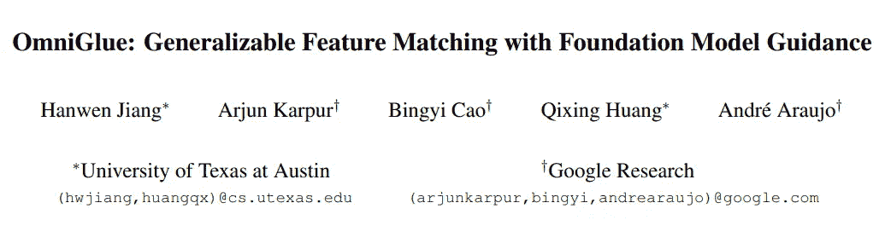

+   论文地址：https://arxiv.org/pdf/2405.12979

+   项目主页：https://hwjiang1510.github.io/OmniGlue/

如图 1 所示，通过引入的技术，OmniGlue 能够在分布外领域上实现更好泛化性能，同时保持源领域上的高质性能。

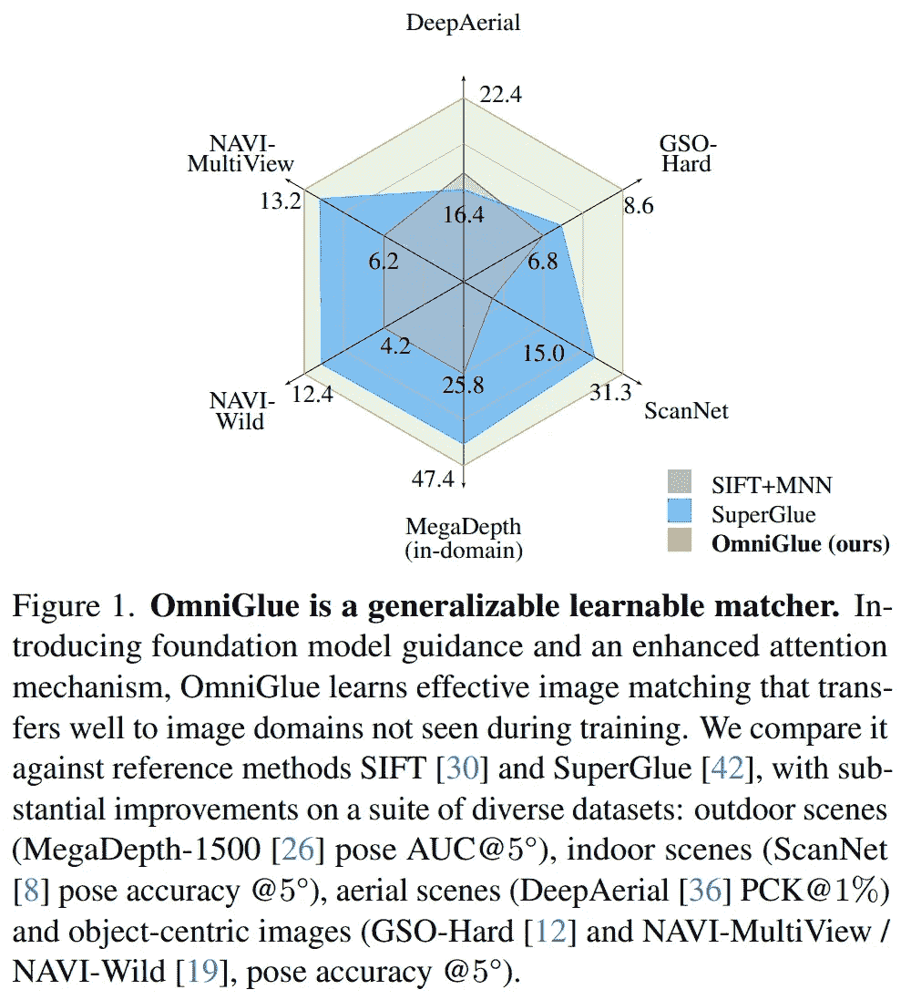

研究者首先 **整合了基础模型的广泛视觉知识 **。通过对大规模数据进行训练，基础视觉模型 DINOv2 在各种图像域中的各种任务（包括稳健的区域级匹配）中表现良好。尽管基础模型所产生匹配结果的粒度有限，但当专门的匹配器无法处理域位移时，这些模型可以为潜在的匹配区域提供可泛化的指导。因此，他们使用 DINO 来指导图像间特征传播过程，降低不相关的关键点并鼓励模型融合来自潜在可匹配区域的信息。

接着 利用关键点位置信息来指导信息传播过程 。研究者发现，当模型应用于不同领域时，以往的位置编码策略会损害性能。这促使他们与用于估计对应关系的匹配描述符区分开来。研究者提出了一种新颖的关键点位置指导 注意力机制 ，从而避免过于专注关键点的训练分布和相对姿态变换。

通过实验，研究者评估了 OmniGlue 在各种视觉领域的泛化能力，包括合成图像和真实图像，从场景级到以对象为中心和空中数据集，期间使用小基线和宽基线相机。与以往工作相比，OmniGlue 展示出显著的改进。

**方法概览**

下图 2 概述了 OmniGlue 方法，主要包括以下四个阶段。

首先，研究者使用两种互补类型的编码器提取图像特征，包括了专注于通用细粒度匹配的 SuperPoint 以及对粗略但广泛的视觉知识进行编码的视觉基础模型 DINOv2。

其次，研究者使用这些 特征构建 关键点关联图，包括图像内和图像间。

第三，研究者基于构建的图在两张图像中的关键点之间传播信息，分别使用 自注意力 层和交叉注意力层进行图像内和图像间通信。

最后，一旦获得改进后的描述符，研究者应用最佳匹配层来生成两张图像中关键点之间的 映射 。

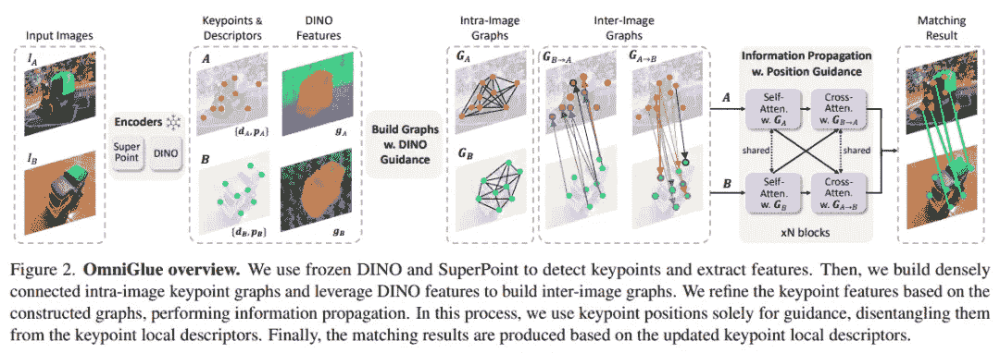

在具体细节上，OmniGlue 方法主要包含以下几步。

特征提取。输入是两张具有共享内容的图像，表示为 I_A 和 I_B。研究者将这两张图像的 SuperPoint 关键点集表示为 A := {A_1, ..., A_N } 和 B := {B_1, ..., B_M}。N 和 M 分别是 I_A 和 I_B 的已识别关键点的数量。每个关键点都与其 SuperPoint 局部描述符 d ∈ R^C 相关联。

利用 DINOv2 构建图形。研究者利用 DINOv2 特征来指导图像间图形的构建。如下图 3（左）所示，他们以 G_B→A_i 为例。对于关键点集合 A 中的每个关键点 A_i，研究者计算其与集合 B 中所有关键点的 DINOv2 特征相似度。

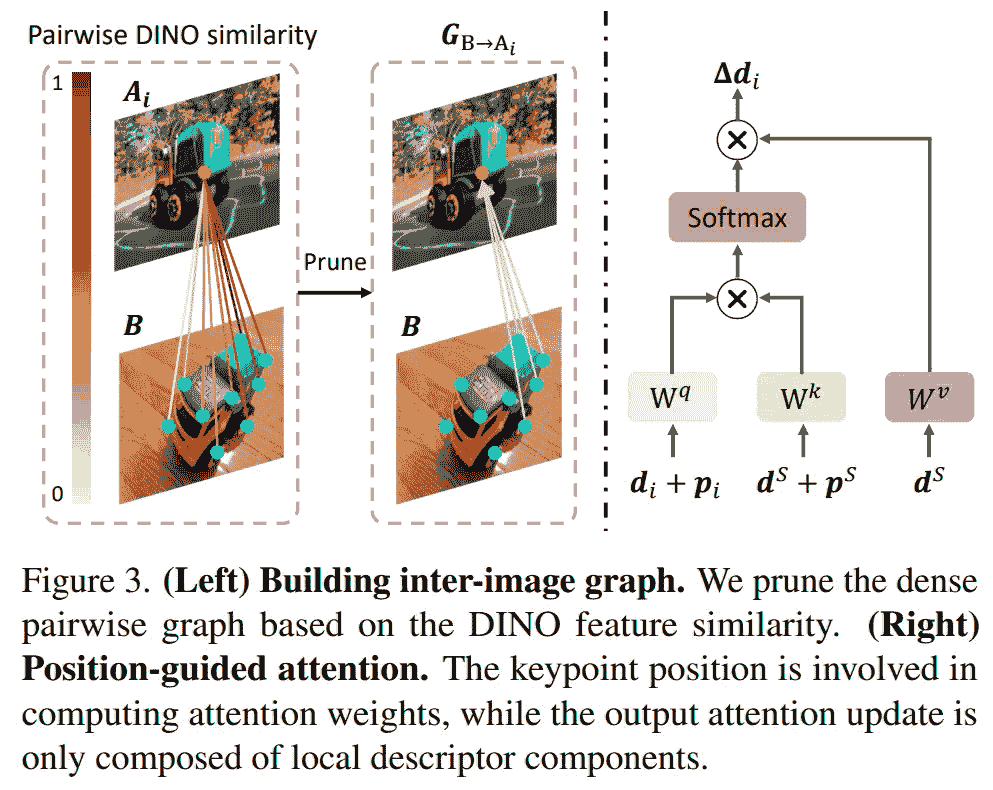

具有新颖指导的信息传播。研究者根据关键点图执行信息传播，这一模块包含了多个块，每个块都有两个注意力层。第一个基于图像内图更新关键点，执行 自注意力 ；第二个基于图像间图更新关键点，执行交叉注意力。

匹配层和 损失函数 。使用改进的关键点表示来生成成对相似度矩阵：

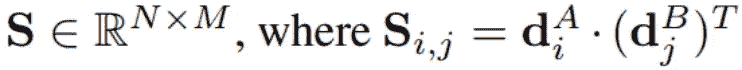

对比 SuperGlue 和 LightGlue

SuperGlue 和 LightGlue 都使用注意力层进行信息传播。不同的是，OmniGlue 利用基础模型来指导这个过程，这对迁移到训练期间未观察到的图像域有很大帮助。

在局部描述符改进方面，与 SuperGlue 不同，OmniGlue 解耦了位置和外观特征。作为参考，SuperGlue 将关键点表示为 d + p，将两个特征纠缠在一起，其中位置特征也用于产生匹配结果。

与 OmniGlue 的设计类似，LightGlue 消除了更新的描述符对位置特征的依赖，但提出了一种非常具体的位置编码公式，基于旋转编码，并且仅在 自注意力 层中。

总之，SuperGlue 是最接近 OmniGlue 的模型，可作为直接对比的参考。也因此，研究者使用 SuperGlue 作为实验验证的主要参考比较。

**实验结果**

研究者在下表 1 中列出了用于评估 OmniGlue 的数据集和任务。

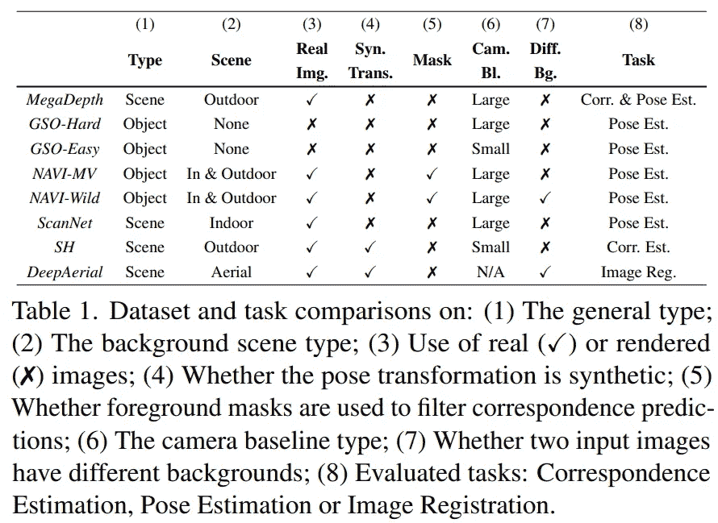

从 Synthetic Homography（SH）到 MegaDepth（MD）数据集，如下表 2 所示，与基础方法 SuperGlue 相比，OmniGlue 不仅在领域内数据上表现出优异的性能，而且还表现出强大的泛化能力。

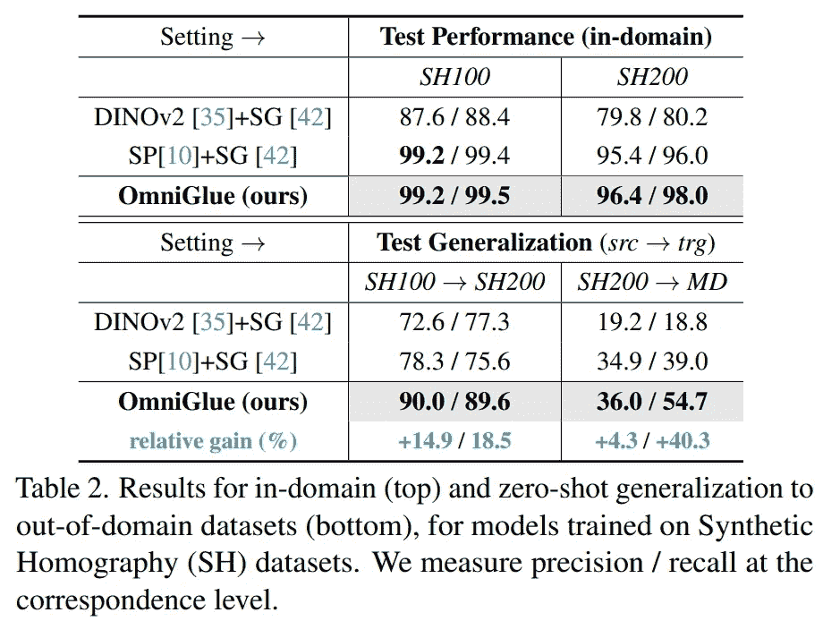

从 MegaDepth（MD）到其他领域，如下表 3 所示，OmniGlue 不仅在 MegaDepth-1500 上实现了与 SOTA 稀疏匹配器 LightGlue 相当的性能，而且与所有其他方法相比，在 6 个新领域中的 5 个领域中表现出更好的泛化能力。

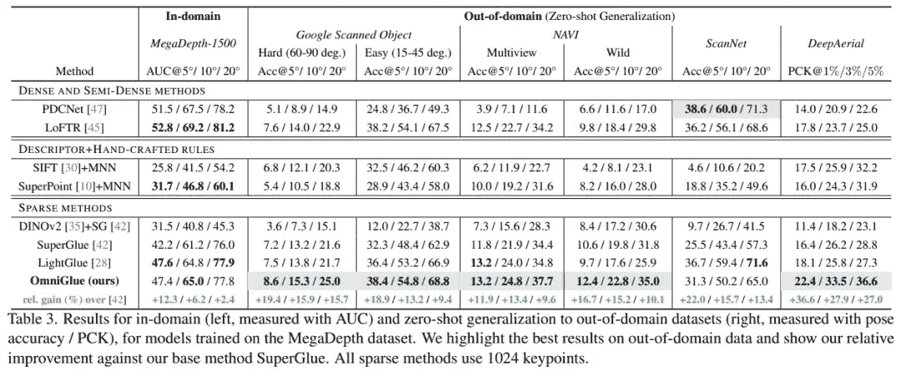

研究者在下图 5 和图 4 中分别展示了新领域上的零样本泛化性能以及在源领域上的性能。

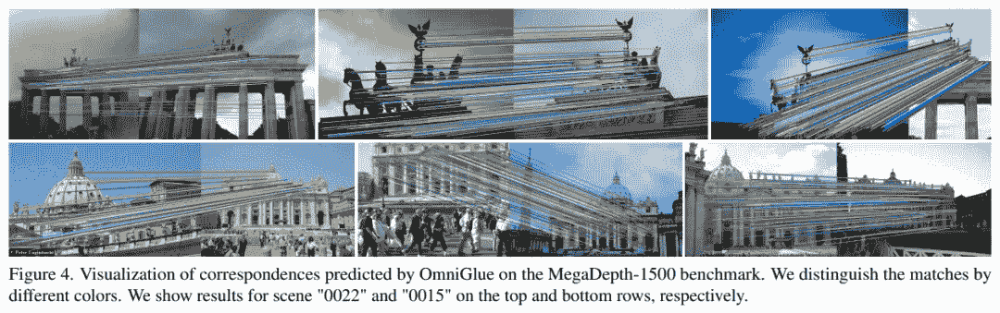

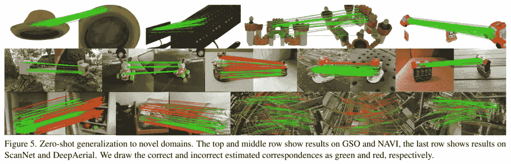

最后如下表 4 所示，OmniGlue 更容易适应目标领域。

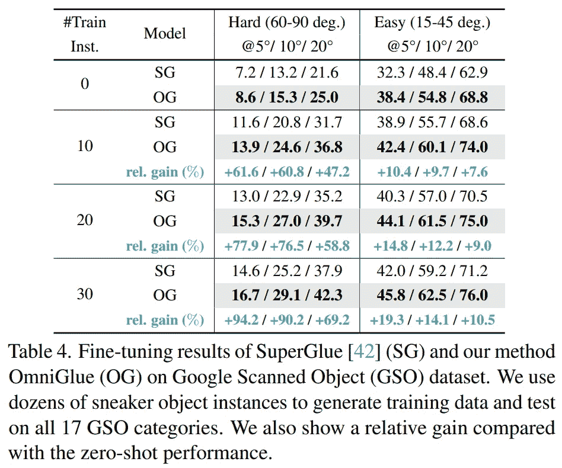

更多技术细节和实验结果请参阅原论文。