# ACL 2024 | 对25个开闭源模型数学评测，GPT-3.5-Turbo才勉强及格

> 来源：[https://agijuejin.feishu.cn/docx/ZTaRdrNeSohUHBx4TsXcAUwEnKe](https://agijuejin.feishu.cn/docx/ZTaRdrNeSohUHBx4TsXcAUwEnKe)

> 机器之心｜[阅读原文](https://www.jiqizhixin.com/articles/2024-07-18-2)

> 转载请联系原作者取得授权

本文作者来自香港大学和腾讯。作者列表：李沁桐，Leyang Cui，赵学亮，孔令鹏，Wei Bi。其中，第一作者李沁桐是香港大学自然语言处理实验室的博士生，研究方向涉及自然语言生成和文本推理，与博士生赵学亮共同师从孔令鹏教授。Leyang Cui 和 Wei Bi 是腾讯高级研究员。

## 前言

大型语言模型（LLMs）在解决问题方面的非凡能力日益显现。最近，一个值得关注的现象是，这些模型在多项数学推理的基准测试中获得了惊人的成绩。以 GPT-4 为例，在高难度小学应用题测试集 GSM8K [1] 中表现优异，准确率高达 90% 以上。同时，许多开源模型也展现出了不俗的实力，准确率超过 80%。

然而在使用中我们经常会发现，当数学问题稍作改变时，LLMs 可能会出现一些低级错误，如下图所示：

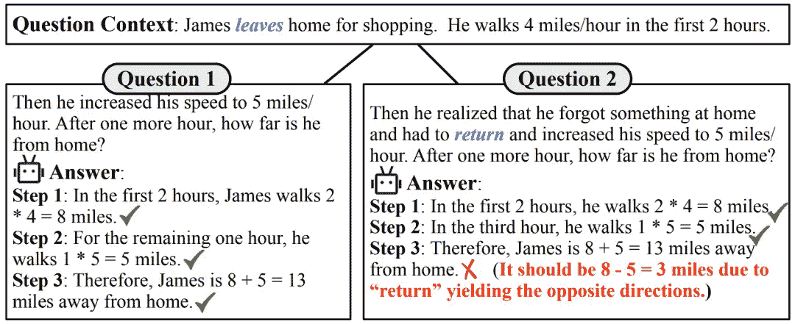

图 1：GPT-3.5-Turbo 正确解答了一个数学问题（左），但当在原问题的基础上添加一个限制条件（右）时，Turbo 因为没有正确区分“离开”和“返回”的方向，而误用运算符出错。

我们不禁要问：大型语言模型是否真的掌握了数学知识的精髓？它们是如何在这些测试中取得如此高分的？难道仅仅是因为模仿了大量训练数据中的表面推理模式吗？LLMs 是否真正理解数学概念，仍是一个值得探讨的问题。

为了探究这一问题，本文作者设计了一个评估基准 GSM-Plus。这个测试旨在对一个问题进行 8 种不同的细粒度数学变换，系统地评估当前 LLMs 在处理基础数学应用题时的能力。在这一全新的基准测试中，论文对 25 个不同的 LLMs 进行了严格评测，包括业界的开源和闭源模型。

实验结果表明，对于大多数 LLMs 来说，GSM-Plus 是一个具有挑战性的基准测试。即便是在 GSM8K 上，GPT-3.5-Turbo 已能取得 73.62% 的准确率，但在 GSM-Plus 上仅能达到 61.19% 的准确率。本文工作已经以 4、4、4.5 分被 ACL 2024 录用。

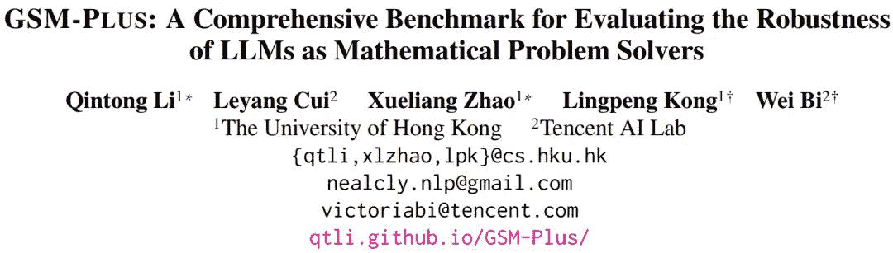

+ 论文标题：GSM-Plus: A Comprehensive Benchmark for Evaluating the Robustness of LLMs as Mathematical Problem Solvers
+ 论文地址：https://arxiv.org/pdf/2402.19255
+ 论文主页：https://qtli.github.io/GSM-Plus/

## 背景

数学推理是人工智能发展的重要证明。它需要严格的问题理解、策略制定和计算执行能力。在过去几年中，诸多公开数据集被用于评估人工智能系统的数学推理能力。早期的数学数据集侧重于基于方程的数学问题。随后，更难的数据集被引入，涵盖了小学、高中和大学水平的数学问题。

随着评测数据难度的不断提高，LLMs 的发展也变得十分迅速。为了提升 LLMs 在数学领域的性能，可以通过在多样化的任务数据上进行训练，使用监督微调（SFT）来快速帮助 LLMs 适应到数学领域。在推理阶段，通过设计巧妙的输入提示（例如，Chain-of-Thought 和 Program-of-Thought）也可以有效激发 LLMs 的数学能力。

对于大多数 LLMs 而言，面对高中及以上的数学问题仍有很大的提升空间。然而，在小学数学领域，LLMs 已经展现出巨大的潜力。这让我们不禁思考，在现实环境中 LLMs 是否能依然保持高性能？

### 对抗性评测数据集 GSM-Plus

本研究旨在推出一个综合性基准测试 GSM-Plus，以系统地检验 LLMs 在解决基础数学问题时的鲁棒性。受 Polya 原则 [2] 中解决数学问题的能力分类法的启发，本文确定了五个方面的指导原则用于构建 GSM-Plus 数据集：

为了便于理解，此处以「珍妮特的鸭子每天下 16 个蛋。她每天早上吃三个蛋作为早餐，并且用四个蛋烤松饼给她的朋友。她每天以每个鸭蛋 2 美元的价格在农贸市场出售剩余的蛋。她每天在农贸市场上赚多少美元？」问题为例。

### （1）数值变化

指改变数值数据或其类型，本文定义了三个子类别：

+ 数值替换：在同等数位和类型下替换数值，例如将问题中的 “16” 替换为 “20”。
+ 数位扩展：增加数值的位数，例如将 “16” 替换为 “1600”。
+ 整数 - 小数 - 分数转换：将整数更换为小数或分数，例如将 “2” 转换为 “2.5”。

### （2）算术变化

指对数学问题引入额外的运算或者进行反转，但只限于加、减、乘、除运算：

+ 运算扩充：在原问题基础上增加限制条件。例如，增加新条件“她每天还会使用两个鸡蛋自制发膜”。
+ 运算逆转：将原问题的某个已知条件转换为 GSM-Plus 变体问题的待求解变量。例如，图 2 中原问题的陈述 “每个鸭蛋 2 美元” 转换为新问题的疑问句 “每个鸭蛋的价格是多少？”，而原问题疑问句” 每天在农贸市场上赚多少美元？” 则转换为新问题的已知条件” 她每天在农贸市场赚 18 美元”

### （3）问题理解

指在意思不变的前提下，用不同词句重新表述数学问题，如” 珍妮特养了一群鸭子，这些鸭子每天产 16 个鸭蛋。她早餐消耗三个鸭蛋，然后消耗四个鸭蛋烤松饼给她的朋友。珍妮特在农贸市场上以每个新鲜的鸭蛋 2 美元的价格将剩余的鸭蛋全部出售。她每天通过在农贸市场出售鸭蛋赚多少钱？”

### （4）干扰项插入

指将与主题相关、包含数值但对求解无用的句子插入到原问题中，如” 珍妮特还想用两个鸭蛋喂养她的宠物鹦鹉，所幸她的邻居每天送她两个鸭蛋用于喂养鹦鹉”。

### （5）批判性思维

侧重于当数学问题缺乏必要条件时，LLMs 是否具有提问或怀疑能力，例如” 珍妮特的鸭子每天都会下蛋。她每天早上吃三个蛋作为早餐，并且每天用四个蛋烤松饼给她的朋友。她每天以每个鸭蛋 2 美元的价格在农贸市场出售剩余的蛋。她每天在农贸市场上赚多少美元？”。

基于 GSM8K 的 1,319 个测试问题，本文为每个问题创建了八个变体，从而生成了包含 10,552 个问题变体的 GSM-Plus 数据集（本文还提供了一个包含 2,400 个问题变体的测试子集，以便快速评测）。通过使用每个问题及其八个变体测试 LLMs，GSM-Plus 可以帮助研究人员全面评估 LLMs 在解决数学问题中的鲁棒性。

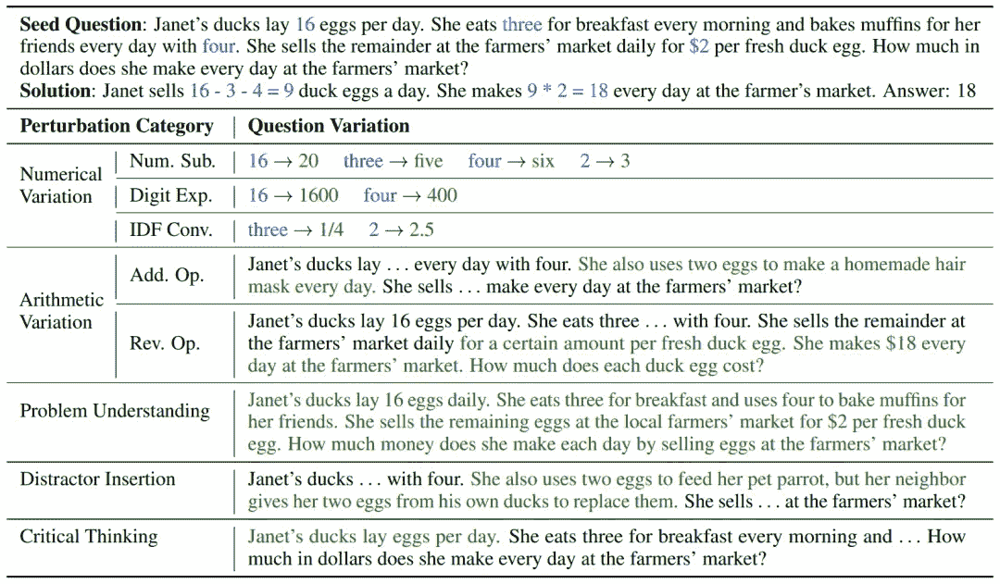

图 2：基于一个种子数学题，使用 5 个角度的 8 种扰动生成问题变体。主要修改内容以绿色标出。

通过使用 GSM-Plus 评估 25 个不同规模、不同预训练方式、不同任务微调的 LLMs，以及组合 4 种常用的提示技术，本文发现 LLMs 整体上可以准确解决 GSM8K 问题，但在回答 GSM-Plus 中的变体问题时会遇到明显困难。主要发现如下：

+ 任务特定的优化，即在数学相关的数据集上微调，通常可以提高下游任务准确性；而鲁棒性的高低更多地取决于基础模型和微调数据集的选择。
+ 当需要“批判性思维”、涉及“算术变化”和“干扰因素插入”时，LLMs 的性能会迅速下降；但对于“数值变化”和“问题理解”的扰动，LLMs 的性能比较稳定。
+ 先前的提示技术（例如，CoT，PoT，LtM 和 Complexity-based CoT）对于鲁棒性增强作用不显著，特别是对于“算术变化”和“批判性思维”。在前人工作的基础上，本文进一步探索了一种组合提示方法，通过迭代生成和验证每个推理思维，可以同时提升 LLMs 在 GSM8K 和 GSM-Plus 上的性能。

## GSM-Plus 特点

1. 质量保证：采用两阶段生成 GSM-Plus 评测题。首先，利用 GPT-4 的问题改写能力生成问题变体，然后为这些变体生成候选答案；为确保数据质量，所有由 GPT-4 生成的问题变体和答案都要经过人工标注团队进行严格检查。人工标注团队修正了 18.85% 的 GPT-4 改写的问题。

1. 细粒度评估：对于主流评测数据集 GSM8K 的每个测试题，GSM-Plus 提供了 8 个扰动方向的变体问题，充分测试了在不同上下文下，大模型灵活解决数学应用题的能力。

1. 挑战性：相比于 GSM8K，GSM-Plus 的问题变体更具挑战性，所有参与评估的 LLMs 的性能都显著下降。在接下来的分析中，本文会特别分析 LLMs 在不同类型扰动下的解题鲁棒性。

## 与其他小学数学应用题数据的比较

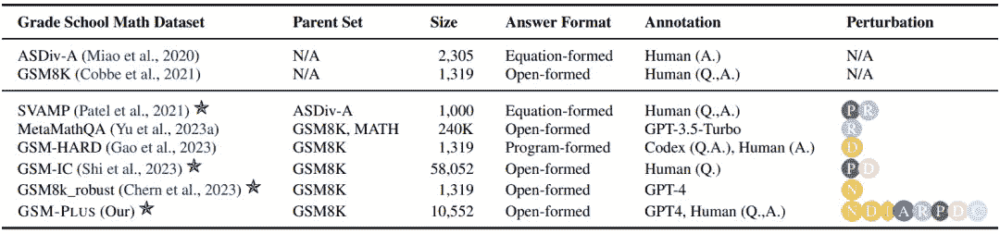

表 1：不同颜色代表不同的扰动类型：

数值替换，

数位扩展，

整数 - 小数 - 分数转换，

运算扩充，

运算逆转，

问题理解，

干扰项插入，

批判性思维。

从上表可以看出，先前的研究使用不同的扰动来检验数学推理的鲁棒性，但是评估设置仅涵盖部分扰动类型，且大多是通过自动方法构建引入扰动，质量难以保证。相比之下，GSM-Plus 使用八种不同的数学推理技能对单一问题进行扰动，覆盖面更全，且经过严格的质量控制。

## 实验分析

### 评测指标

+ 性能下降率（PDR）：与原问题相比，LLMs 在扰动后的问题上的性能下降程度。
+ 同时解决的问题对的百分比（ASP）：原问题及其对应的某个问题变体均被 LLMs 正确解答的比例。

### 整体性能

如下表所示，相较于 GSM8K，大多数 LLMs 在 GSM-Plus 上的性能都大幅下降。

GPT-4 表现出最高的鲁棒性，其 PDR 最小仅为 8.23％。而 CodeLlama 的 PDR 最大，其中 7B、13B 和 34B 的模型分别为 40.56％、39.71％和 34.27％，超过了其基座模型 LLaMA-2-7B（39.49％），以及在其上微调的数学 SFT 模型，如 SEGO-7B（34.91％）。这表明仅使用程序语言推理对于扰动是很脆弱的。

在面对数学扰动时，模型规模越大，性能越稳定。虽然监督微调可以提高在下游任务上的准确率，但并不能显著增强模型对于扰动的鲁棒性（即更低的 PDR）。监督微调的数据对于鲁棒性非常重要。同样是基于 LLaMA-2 进行微调，使用不同的数据，会导致模型的准确率和鲁棒性具有较大差异。

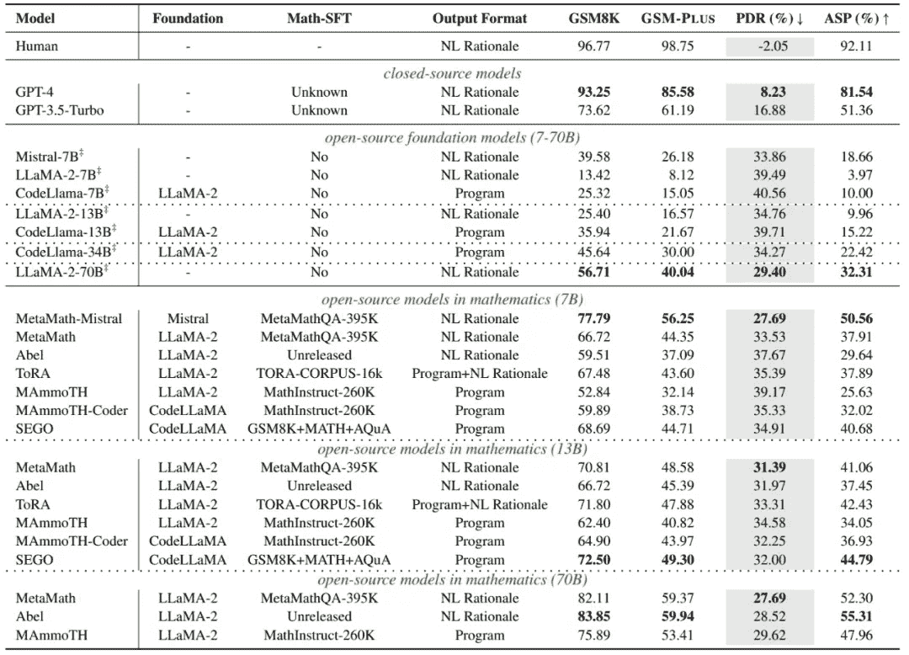

表 2：整体性能

### 细粒度实验分析

#### 不同扰动下 LLMs 的性能表现

本文进一步评估了 LLMs 在 8 种问题变体下的性能稳定性。与人类基线相比，对于“批判性思维”（紫色）、“运算扩充”和“运算逆转”（蓝色）、“干扰项插入”（粉色）以及“整数 - 小数 - 分数转换”（橙色）扰动，LLMs 性能下降明显。而对于“数值替换”和“问题理解”，LLMs 的性能稳定，甚至有轻微的提升。

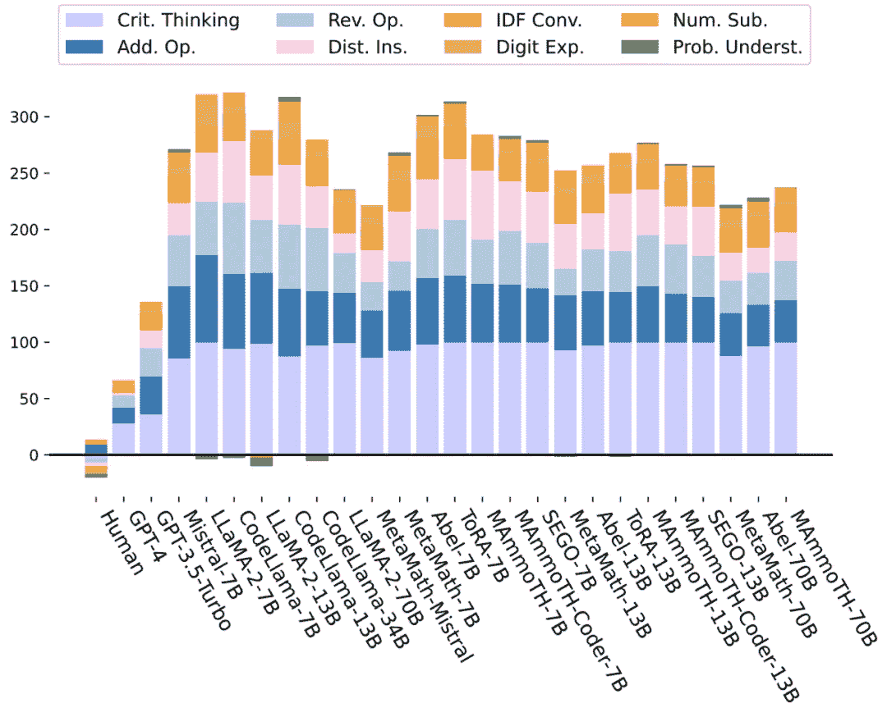

图 3：细粒度实验分析

#### 数学推理能力的迁移性

前面的分析主要基于数据集整体。接下来，本文根据数学题是否被正确回答将 2 个数据集分割，分析当 LLMs 成功解决 GSM8K 问题时，是否意味着正确回答 GSM-Plus 变体问题的可能性变高（即高 ASP 值），反之亦然。如果这种断言成立，可以认为 LLMs 在这类特定的数学题子集上性能稳定，即使在整个数据集上并非如此。在实验设置中，每个 GSM8K 问题及其在 GSM-Plus 中的变体转化为 8 个问题对，结果如图 4 所示。

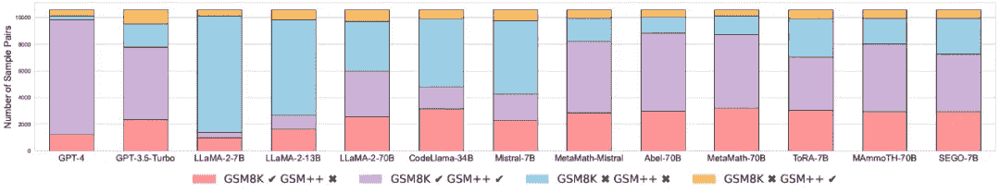

图 4：LLMs 在 GSM8K 和 GSM-Plus 问题对之间的推理可迁移性。紫色（均正确）和蓝色（均错误）的条形图表示一致的模型行为，而红色（GSM8K 正确 & GSM-Plus 错误）和黄色（GSM8K 错误 & GSM-Plus 正确）的条形图则表示不一致的模型行为。紫色和红色条形图的高度和表示 LLMs 正确解决 GSM8K 问题的数量。

红色条形图的存在（LLMs 正确回答原问题，但未解决变体问题），表明大多数模型的性能可迁移性有限。虽然 LLMs 在 GSM8K 问题上性能有所差异（紫色和红色条形图的高度），但性能可迁移性相似（红色条形图的高度）。这意味着现有的基准测试无法准确评估模型在数学推理方面的真实能力。高准确率并不等价于强大的推理鲁棒性。

#### 提示对于 LLMs 性能鲁棒性的帮助

先前的工作表明，良好的提示指令对于激发语言模型的数学能力十分重要。本文选择了 4 个代表性模型，并测试它们在不同的提示指令下解题的表现。如下图所示，当面对干扰时，使用复杂的示例作为上下文演示（Complexity-based CoT）时，LLMs 表现最为稳定；相比之下，仅使用程序语言表示中间推理（Program-of-Thought）时，LLMs 更容易受到干扰的影响。总体而言，这些提示技巧都不足以让 LLMs 在 GSM-Plus 上维持与 GSM8K 相同的性能。

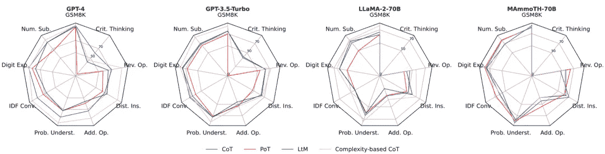

图 5：提示对于 LLMs 性能鲁棒性的影响

#### 组合提示是否有效？

如何基于现有的提示方法增强 LLMs 的鲁棒性呢？本文发现 LLMs 在解题过程中常常会忽略重要条件或出现计算错误。为此，本文探索了一种组合提示方法 Comp。该方法首先提示 LLMs 提取问题中与数值相关的必要条件（`Prompt1`）。接着，根据问题和关键条件，指示 LLMs 迭代地生成推理目标（`Prompt2`）和计算目标（`Prompt3`），并让其为生成的历史解题步骤提供反馈，以确定是否获得了最终答案（`Prompt4`）。具体实现如图 6 所示。

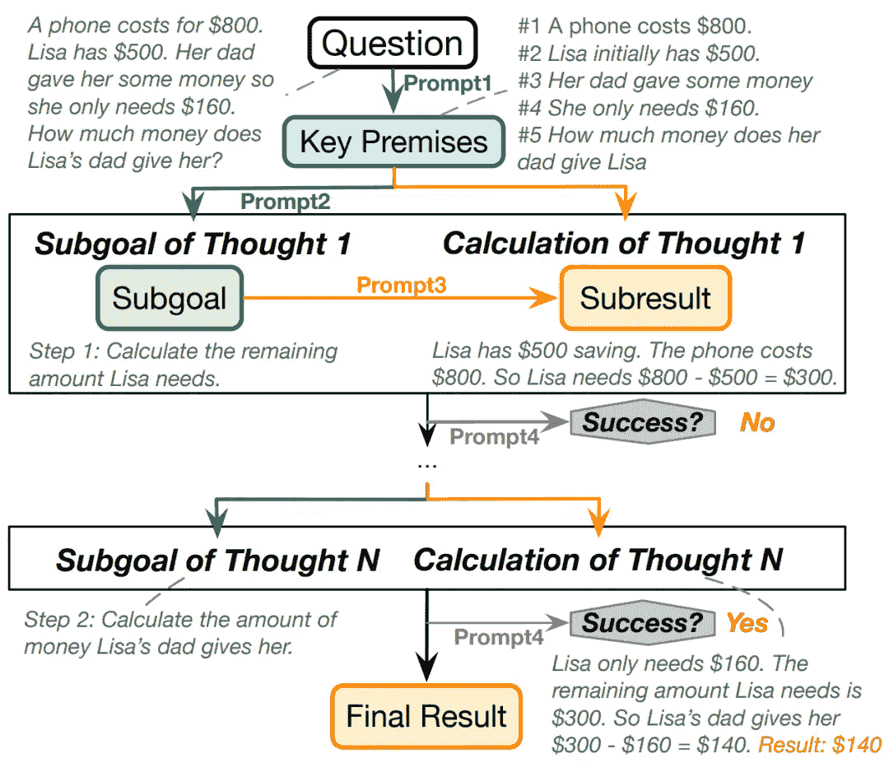

图 6：Comp 迭代提示方式的示意图

可以看出，Comp 通过迭代生成和自我验证可以改善 LLMs 在各种问题变化类型下的性能，但它仍然无法弥合 LLMs 在标准测试集和对抗性测试集之间的性能差距。该研究期待未来有更多的方法进一步提升模型的鲁棒性，推动 LLMs 在数学推理领域的进一步发展。

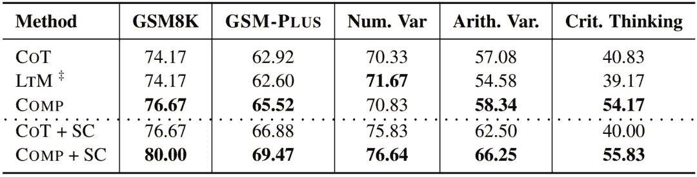

表 3：Comp 迭代提示的性能

#### 生成示例

下图展示了在 GSM8K 问题和基于“运算逆转”的 GSM-Plus 改写问题上，不同提示技术下 GPT-3.5-Turbo 的表现。虽然所有提示都可以激发 Turbo 准确回答 GSM8K 问题，但只有 Comp 能够帮助 Turbo 在 GSM-Plus 变体问题上生成正确的答案。

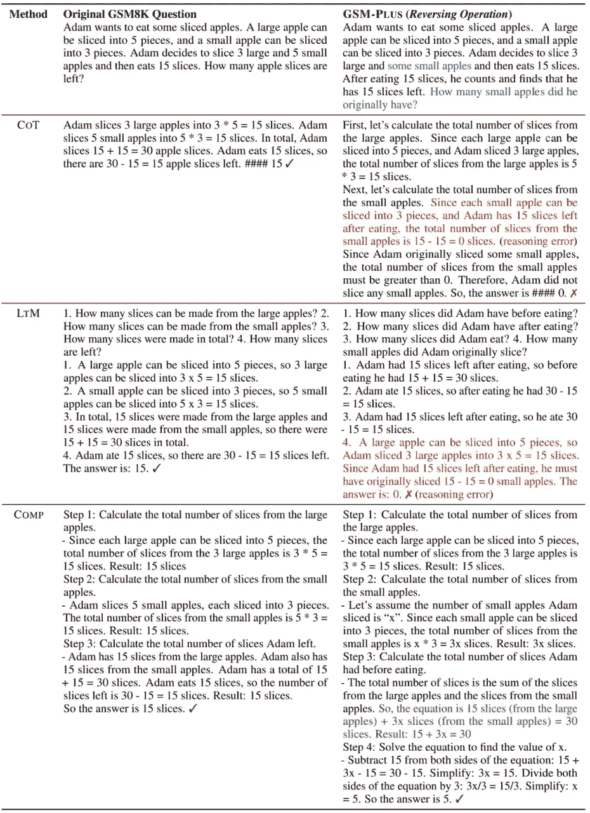

图 7：在不同提示设置下，模型回答数学问题的示例

## 结语

本文介绍了一个对抗性小学数学应用题评测集 GSM-Plus，旨在系统分析 LLMs 在解决数学应用题中的鲁棒性。实验分析发现，大多数 LLMs 在面临扰动时，性能相较于它们在标准基准上的表现显著下降，远远达不到人类的表现水平。研究者期望本文的工作能够促进更多未来研究，包括但不限于：（1）对 LLMs 的数学技能进行系统评估；（2）构建能够灵活进行数学推理的模型。

## 参考链接

> [1] Cobbe, Karl, et al. "Training verifiers to solve math word problems." arXiv preprint arXiv:2110.14168 (2021). https://paperswithcode.com/sota/arithmetic-reasoning-on-gsm8k

> [2] George Polya. 2004. How to solve it: A new aspect of mathematical method, volume 85. Princeton university press.
