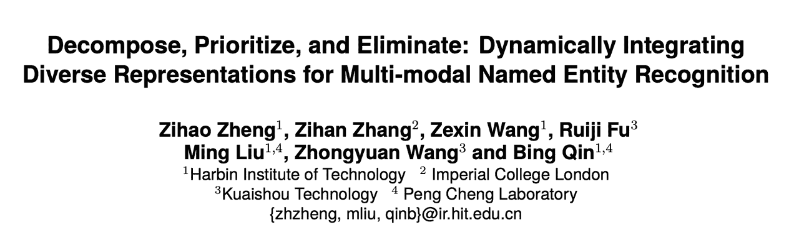
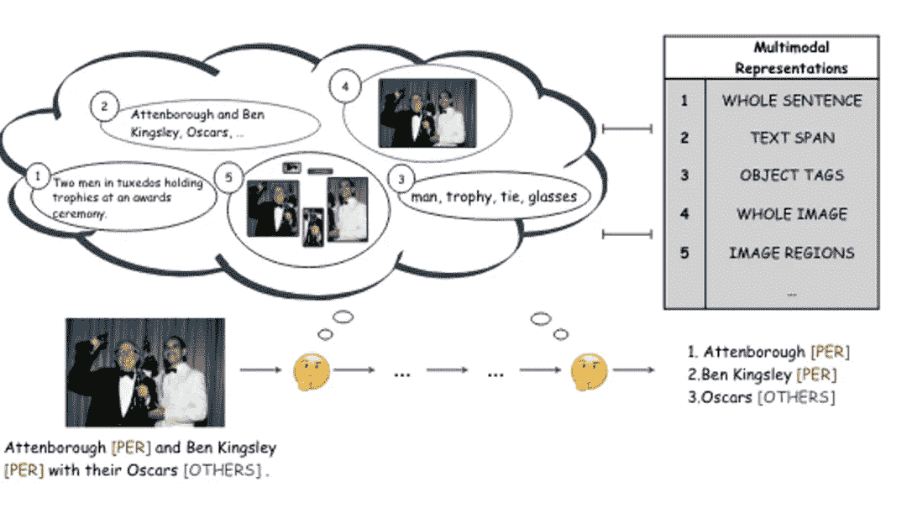
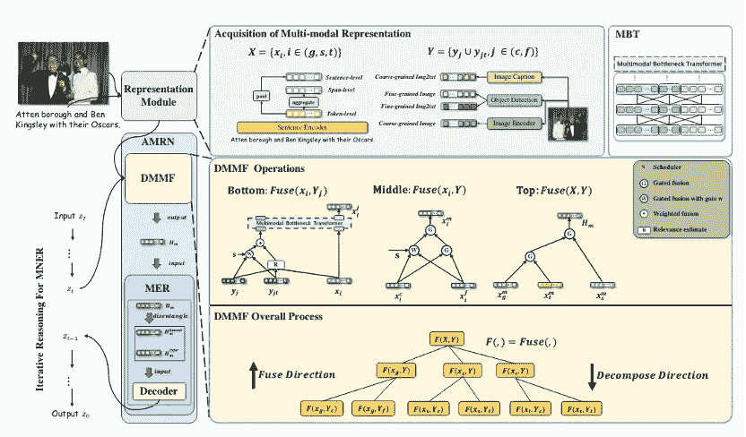
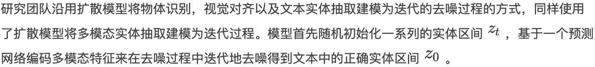
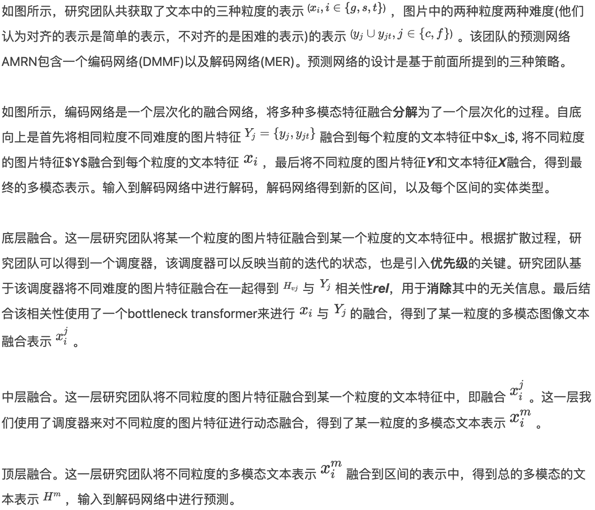
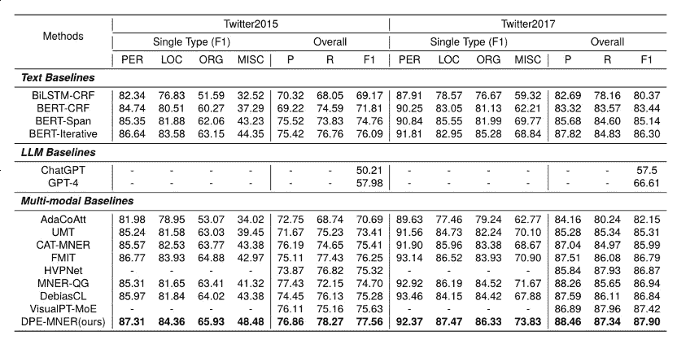
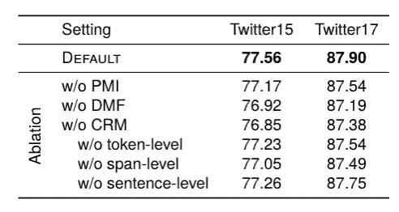
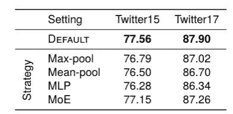
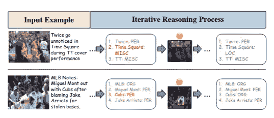

# 哈工大提出创新迭代推理框架 DPE-MNER ：充分发挥多模态表示潜力

> 来源：[https://agijuejin.feishu.cn/docx/FWs1dCjy3ou8YJxpp2ecoITcnlc](https://agijuejin.feishu.cn/docx/FWs1dCjy3ou8YJxpp2ecoITcnlc)

> 机器之心｜[阅读原文](https://www.jiqizhixin.com/articles/2024-07-02-3)

> 转载请联系原作者取得授权

> **该**文章的作者团队来自于哈工大社会计算与信息检索研究中心，作者团队构成：郑子豪、张梓涵、王泽鑫、付瑞吉、刘铭、王仲远、秦兵。

**多模态表示**

多模态命名实体识别，作为构建多模态知识图谱的一项基础而关键任务，要求研究者整合多种模态信息以精准地从文本中提取命名实体。尽管以往的研究已经在不同层次上探索了多模态表示的整合方法，但在将这些多模态表示融合以提供丰富上下文信息、进而提升多模态命名实体识别的性能方面，它们仍显不足。

本文，研究团队提出了 **DPE-MNER **，一个创新的**迭代推理框架，它遵循“分解、优先、消除**”的策略，动态地整合了多样化的多模态表示。该框架巧妙地将多模态表示的融合分解为层次化且相互连接的融合层，极大地简化了处理过程。在整合多模态信息时，该团队特别强调了从“简单到复杂”和“宏观到微观”的渐进式过渡。此外，通过显式地建模跨模态的相关性，研究团队有效地排除了那些可能对MNER预测造成误导的不相关信息。通过在两个公共数据集上进行的广泛实验，研究团队的方法已被证实在提升多模态命名实体识别的准确性和效率方面具有显著效果。本文为 LREC-COLING 2024 1558篇录用论文中的十篇最佳论文候选之一 。

+   论文链接： [https://aclanthology.org/20](https://aclanthology.org/2024.lrec-main.403.pdf)24.lrec-main.403.pdf

**

动**机

多模态命名实体识别的一个实例。研究团队展示了对于命名实体识别决策可能有用的多种多模态表示。人类通常在心中以迭代的方式处理这些信息。

为解决这一问题，研究团队从 **复杂问题解决 **（Sternberg 和 Frensch，1992）这一领域中获得灵感。该领域专注于研究人类和计算机在解决包含多个变量、不确定性和高复杂性的问题时所采用的方法和策略。首先他们认为，当面对复杂问题时，人类一般会采用迭代的处理方式，如图所示，研究团队在处理MNER时其实也是个迭代的过程。其次，人类会运用特定策略来简化这些问题，比如分解、优先排序和排除不相关因素。

该研究团队认为，将多模态命名实体识别（MNER）视为一个整合多模态信息的迭代过程，并运用这些策略，非常适合于MNER任务。与单一步骤的方法相比，多步骤的方法能够在迭代优化命名实体识别（NER）结果的过程中，更全面地利用多样化的多模态表示。

此外，这三种策略非常适合于多模态NER中多种表示的整合：

+   分解策略鼓励我们将多模态表示的融合拆分为更小、更易于处理的单元，这些单元能够在不同的粒度级别上探索多模态交互。

+   优先排序策略建议根据“由易到难”和“由粗到细”的顺序来整合多模态信息；这种渐进式的整合有助于MNER预测的逐步优化。这使得模型能够逐步将注意力从简单但粗糙的信息转移到复杂但精确的细节上。

+   不相关性消除策略启发我们显式地筛选并排除不同多模态表示中的无关信息；这可以消除那些可能影响MNER性能的无关信息。

**方法**

研究团队设计了一个迭代的动态融合多种多模态特征的多模态实体抽取框架，其包含一个迭代过程以及预测网络。

**迭代建模MNER**

**预测网络**

**实验结果**

**主实验**

作者团队对比了MNER的一些典型的方法。实验结果表明该方法在两个常用的数据集上取得了最佳的性能。

**消融实验**

研究者分别去除了我们论文中关于优先级、层次化、以及消除的设计，来观察模型性能，结果表明移除各个设计均带来了性能的下降。

**与静态特征融合方法的对比**

他们对比了一些典型的静态多模态融合方法，例如最大池化，平均池化，基于MLP以及MoE的方法，结果表明他们所提出的动态融合框架能达到最好的性能。

**典型样例分析**

研究团队选取了两个有代表性的样例来表明迭代过程。可以看到最开始的迭代步骤里，time square和cubs的类型被错误地预测了；然而根据图片中的重要特征线索，迭代地修正为了正确的实体类型。

**结论**

本文旨在多模态命名实体识别（MNER）领域内，充分地发挥各种多模态表示的潜力，以期获得卓越的识别效果。为此，作者们设计并提出了一种创新的迭代推理框架——DPE-MNER。DPE-MNER通过将MNER任务分解为多个阶段，巧妙地简化了对这些丰富多样的多模态表示的整合过程。在这一迭代过程中，多模态表示依据“分解、优先排序和消除”的策略，实现了动态的融合与整合。通过一系列严谨的实验验证，研究团队充分展示了DPE-MNER框架的显著效果和优越性能。

参考文献：

[1] Knowledge Graphs Meet Multi-Modal Learning: Comprehensive Survey, arxiv

[2] Decompose, Prioritize, and Eliminate: Dynamically Integrating Diverse Representations for Multi-modal Named Entity Recognition,2024,Joint International Conference on Computational Linguistics, Language Resources and Evaluation

[3] Complex problem solving : Principles and mechanisms,1992, American Journal of Psycholog

[4] DiffusionNER: Boundary Diffusion for Named Entity Recognition, ACL23

[5] DiffusionDet: Diffusion Model for Object Detection, ICCV23

[6] Language-Guided Diffusion Model for Visual Grounding, arxiv23