# Llama3训练每3小时崩一次？豆包大模型、港大团队为脆皮万卡训练提效

> 来源：[https://agijuejin.feishu.cn/docx/XlZydyr94ozwcKxcK8wclqiSnUb](https://agijuejin.feishu.cn/docx/XlZydyr94ozwcKxcK8wclqiSnUb)

> 机器之心｜[阅读原文](https://www.jiqizhixin.com/articles/2024-08-08-7)

> 转载请联系原作者取得授权

> 伴随大模型迭代速度越来越快，训练集群规模越来越大，高频率的软硬件故障已经成为阻碍训练效率进一步提高的痛点，检查点（`Checkpoint`）系统在训练过程中负责状态的存储和恢复，已经成为克服训练故障、保障训练进度和提高训练效率的关键。

> 近日， 字节跳动 豆包大模型团队与香港大学联合提出了 `ByteCheckpoint`。这是一个 `PyTorch` 原生，兼容多个训练框架，支持 `Checkpoint` 的高效读写和自动重新切分的大模型 `Checkpointing` 系统，相比现有方法有显著性能提升和易用性优势。本文介绍了大模型训练提效中 `Checkpoint` 方向面临的挑战，总结 `ByteCheckpoint` 的解决思路、系统设计、I/O 性能优化技术，以及在存储性能和读取性能测试的实验结果。

Meta 官方最近披露了在 16384 块 H100 80GB 训练集群上进行 Llama3 405B 训练的故障率 —— 短短 54 天，发生 419 次中断，平均每三小时崩溃一次，引来不少从业者关注。

正如业内一句常言，大型训练系统唯一确定的，便是软硬件故障。随着训练规模与模型大小的日益增长，克服软硬件故障，提高训练效率成为大模型迭代的重要影响要素。

`Checkpoint` 已成为训练提效关键。在 Llama 训练报告中，技术团队提到，为了对抗高故障率，需要在训练过程中频繁地进行 `Checkpoint` ，保存训练中的模型、 优化器 、数据读取器状态，减少训练进度损失。

字节跳动 豆包大模型团队与港大近期公开了成果 —— `ByteCheckpoint` ，一个 `PyTorch` 原生，兼容多个训练框架，支持 `Checkpoint` 的高效读写和自动重新切分的大模型 `Checkpointing` 系统。

与基线方法相比，`ByteCheckpoint` 在 `Checkpoint` 保存上性能提升高达 529.22 倍，在加载上，性能提升高达 3.51 倍。 极简的用户接口和 `Checkpoint` 自动重新切分功能，显著降低了用户上手和使用成本，提高了系统的易用性。

目前论文成果已对外公开。

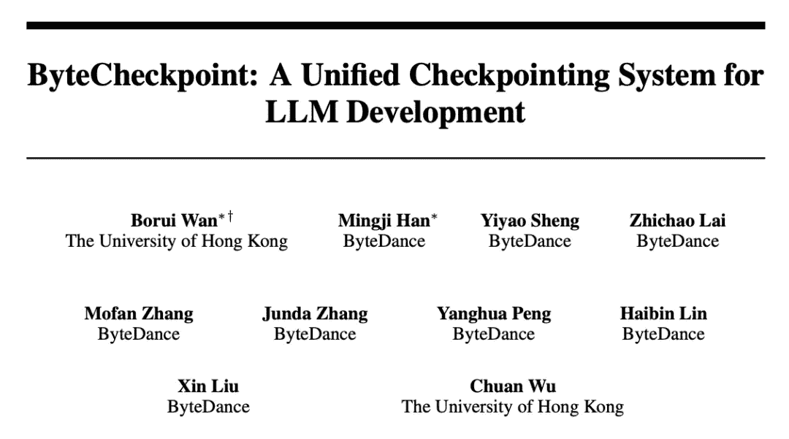

+ `ByteCheckpoint`: A Unified `Checkpointing` System for LLM Development

+ 论文链接：`https://team.doubao.com/zh/publication/bytecheckpoint-a-unified-checkpointing-system-for-llm-development?view_from=research`

## Checkpoint 技术在大模型训练中的技术挑战

当前 `Checkpoint` 相关技术在支持大模型训练提效中，共面临四个方面挑战：

+ 现有系统设计存在缺陷，显著增加训练额外 I/O 开销

在训练工业级别的大 语言模型 (LLM) 的过程中，训练状态需要通过检查点技术 ( `Checkpointing` ) 进行保存和持久化。通常情况下，一个 `Checkpoint` 包括 5 个部分 (模型， 优化器 ，数据读取器，随机数和用户自定义配置)。这一过程往往会给训练带来分钟级别的阻塞，严重影响训练效率。

在使用远程持久化存储系统的大规模训练场景下，现有的 `Checkpointing` 系统没有充分利用 `Checkpoint` 保存过程中 GPU 到 CPU 内存拷贝 ( D2H 复制)，序列化，本地存盘，上传到存储系统各个阶段的执行独立性。

此外，不同训练进程共同分担 `Checkpoint` 存取任务的并行处理潜力也没有被充分发掘。这些系统设计上的不足增加了 `Checkpoint` 训练带来的额外 I/O 开销。

+ `Checkpoint` 重新切分困难，手动切分脚本开发维护开销过高

在 LLM 的不同训练阶段 (预训练到 SFT 或者 RLHF ) 以及不同任务 (从训练任务拉取不同阶段的 `Checkpoint` 进行执行自动评估) 之间进行 `Checkpoint` 迁移时，通常需要对保存在持久化存储系统中的 `Checkpoint` 进行重新切分 ( `Checkpoint Resharding` ) ，以适应下游任务的新并行度配置以及可用 GPU 资源的配额。

现有 `Checkpointing` 系统 [1, 2, 3, 4] 都假设存储和加载时，并行度配置和 GPU 资源保持不变，无法处理 `Checkpoint` 重新切分的需求。工业界目前常见的解决办法是 —— 为不同模型定制 `Checkpoint` 合并或者重新切分脚本。这种方法带来了大量开发与维护开销，可扩展性较差。

+ 不同的训练框架 `Checkpoint` 模块割裂，为 `Checkpoint` 统一管理和性能优化带来挑战

在工业界的训练平台上，工程师与科学家往往会根据任务特性，选择合适框架 (`Megatron-LM` [5], `FSDP` [6], `DeepSpeed` [7], `veScale` [8, 9]) 进行训练，并保存 `Checkpoint` 到存储系统。然而，这些不同的训练框架都具有自己独立的 `Checkpoint` 格式以及读写模块。不同训练框架的 `Checkpoint` 模块设计不尽相同，为底层系统进行统一的 `Checkpoint` 管理以及性能优化带来了挑战。

+ 分布式训练系统的用户面临多重困扰

从训练系统的用户（ AI 研究科学家或工程师）的角度出发，用户使用分布式训练系统时，在 `Checkpoint` 方向往往会被三个问题困扰：

1）如何高效地存储 `Checkpoint` ，在不影响训练效率的情况下保存 `Checkpoint`。

2）如何重新切分 `Checkpoint` ，对于在一个并行度下存储的 `Checkpoint` ，根据新的并行度正确读入。

3）如何把训练得到的产物上传到云存储系统上（ `HDFS`，`S3` 等），手动管理多个存储系统，对用户来说学习和使用成本较高。

针对上述问题， 字节跳动 豆包大模型团队和香港大学吴川教授实验室联合推出了 `ByteCheckpoint` 。

`ByteCheckpoint` 是一个多训练框架统一，支持多存储后端，具备自动 `Checkpoint` 重新切分能力的高性能分布式 `Checkpointing` 系统。`ByteCheckpoint` 提供了简单易用的用户接口 ，实现了大量 I/O 性能优化技术提高了存储和读取 `Checkpoint` 性能，并支持 `Checkpoint` 在不同并行度配置的任务中的灵活迁移。

## 系统设计

### 存储架构

`ByteCheckpoint` 采用了元数据 / 张量 数据分离的存储架构，实现了 `Checkpoint` 管理与训练框架和并行度的解耦合。

不同训练框架中的模型以及 优化器 的 张量 切片 ( `Tensor Shard`) 存储在 `storage` 文件中，元信息 (`TensorMeta`, `ShardMeta`, `ByteMeta`) 存储到全局唯一的 `metadata` 文件中。

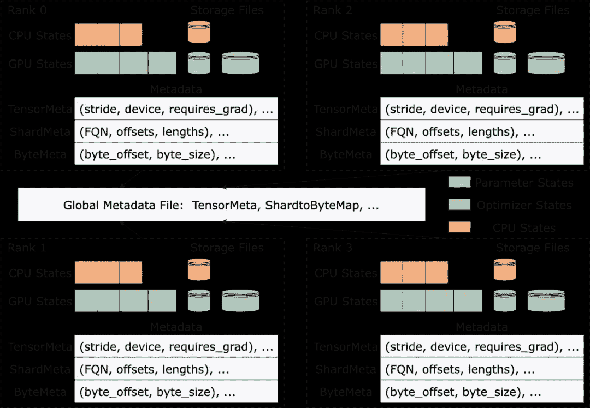

当使用不同的并行度配置读取 `Checkpoint` 时，如下图所示，每个训练进程只需要根据当前的并行度设置 查询 元信息，便能够获取进程所需要 张量 的存储位置，再根据位置直接读取，实现自动 `Checkpoint` 重新切分。

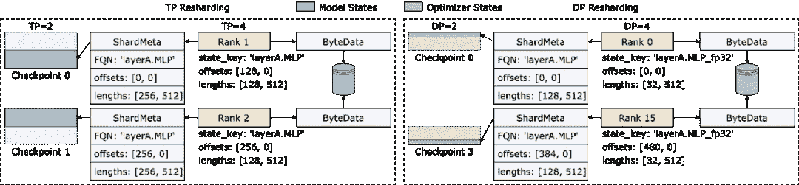

### 巧解不规则张量切分

不同训练框架在运行时，往往会把模型或者 优化器 中 张量 的形状摊平 ( `Flatten` ) 成一维，从而提高集合通信性能。这种摊平操作给 `Checkpoint` 存储带来了不规则 张量 切分 (Irregular Tensor Sharding) 的挑战。

如下图所示，在 `Megatron-LM` (由 NVIDIA 研发的分布式大模型训练框架) 和 `veScale` (由 字节跳动 研发的 `PyTorch` 原生分布式大模型训练框架) 中，模型 参数 对应的 优化器 状态会被展平为一维后合并，再根据数据并行度切分。这导致 张量 被不规则地切分到不同进程之中， 张量 切片的元信息无法使用偏移量和长度元组来表示，给存储和读取带来困难。

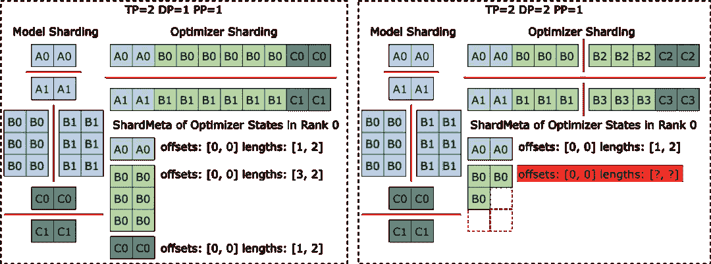

不规则 张量 切分的问题在 `FSDP` 框架中也同样存在。

为消除不规则切分的 张量 切片 ，`FSDP` 框架在存储 `Checkpoint` 之前会在所有进程上对一维 张量 切片进行 all-gather 集合通信以及 D2H 复制操作，以获取完整不规则切分的 张量 。这种方案带来了极大的通信和频繁的 GPU-CPU 同步开销，严重影响了 `Checkpoint` 存储的性能。

针对这个问题，`ByteCheckpoint` 提出了异步 张量 合并 (Asynchronous Tensor Merging) 技术。

`ByteCheckpoint` 首先找出不同进程中被不规则切分的 张量 ，之后采用异步的 P2P 通信，把这些不规则的 张量 分配到不同进程上进行合并。所有针对这些不规则 张量 的 P2P 通信等待（Wait) 以及 张量 D2H 复制操作被推迟到他们即将进入序列化阶段的时候，从而消除了频繁的同步开销，也增加了通信与其他 `Checkpoint` 存储流程的执行重叠度。

### 系统架构

下图展示了 `ByteCheckpoint` 的系统架构：

API 层为不同训练框架提供了简单，易用且统一的读取和写入 ( `Save` ）和读取（ `Load` ）接口。

Planner 层会根据存取对象为不同训练进程生成存取方案，交由 Execution 层执行实际的 I/O 任务。

Execution 层执行 I/O 任务并与 Storage 层进行交互，利用各种 I/O 优化技术进行高性能的 `Checkpoint` 存取。

Storage 层管理不同的存储后端，并在 I/O 任务过程中根据不同存储后端进行相应的优化。

分层设计增强了系统的可扩展性，以便未来支持更多的训练框架和存储后端。

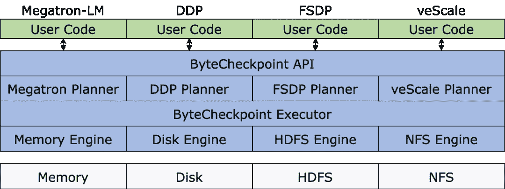

### API 用例

`ByteCheckpoint` 的 API 用例如下：

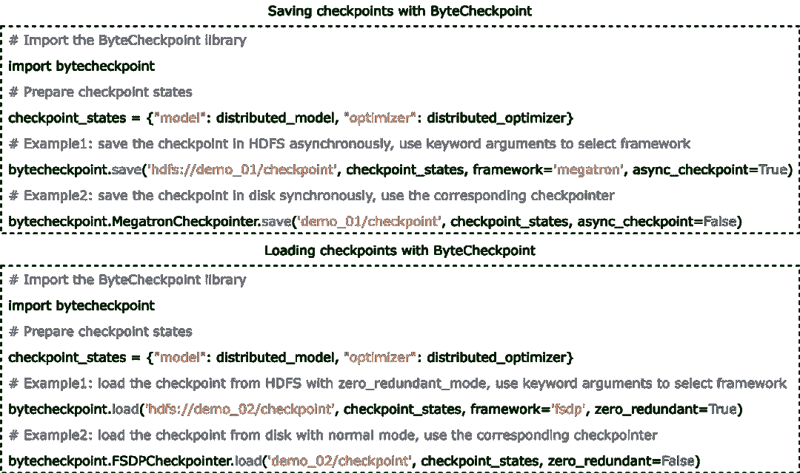

`ByteCheckpoint` 提供了极简 API ，降低了用户上手的成本。用户在存储和读取 `Checkpoint` 时，只需要调用存储和加载函数，传入需要存储和读取的内容，文件系统路径和各种性能优化选项。

## I/O 性能优化技术

### Checkpoint 存储优化

#### 流水线执行

如下图所示，`ByteCheckpoint` 设计了全异步的存储流水线（Save Pipeline），将 `Checkpoint` 存储的不同阶段（P2P 张量 传输，D2H 复制，序列化，保存本地和上传文件系统）进行拆分，实现高效的流水线执行。

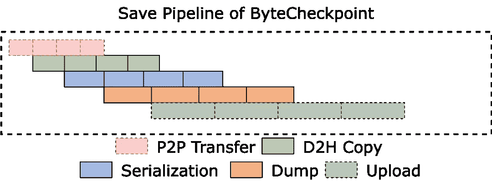

#### 避免内存重复分配

在 D2H 复制过程，`ByteCheckpoint` 采用固定内存池（ Pinned Memory Pool ），减少了内存反复分配的时间开销。

除此之外，为了降低高频存储场景中因为同步等待固定内存池回收而带来的额外时间开销，`ByteCheckpoint` 在固定内存池的基础上加入了 Ping-Pong buffering 的机制。两个独立的内存池交替扮演着读写 buffer 的角色，与 GPU 和执行后续 I/O 操作的 I/O workers 进行交互，进一步提升存储效率。

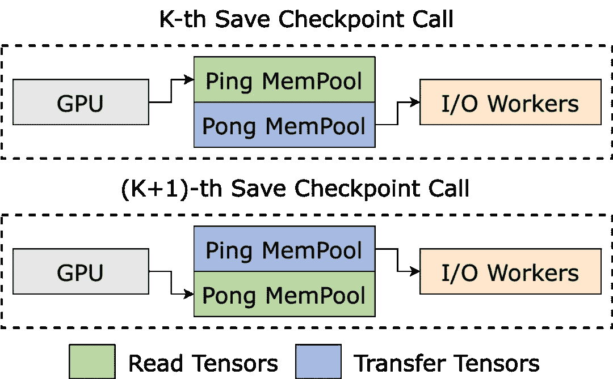

#### 负载均衡

在数据并行 ( Data-Parallel or DP ) 训练中，模型在不同的数据并行进程组（ DP Group ）之间是冗余的， `ByteCheckpoint` 采用了负载均衡算法把冗余的模型 张量 均匀分配到不同进程组中进行存储，有效地提高了 `Checkpoint` 存储效率。

### Checkpoint 读取优化

#### 零冗余加载

如图所示，在改变并行度读取 `Checkpoint` 时，新的训练进程可能只需要从原来的 张量 切片中读取其中的一部分。

`ByteCheckpoint` 采用按需部分文件读取（ Partial File Reading ） 技术，直接从远程存储中读取需要的文件片段，避免下载和读取不必要的数据。

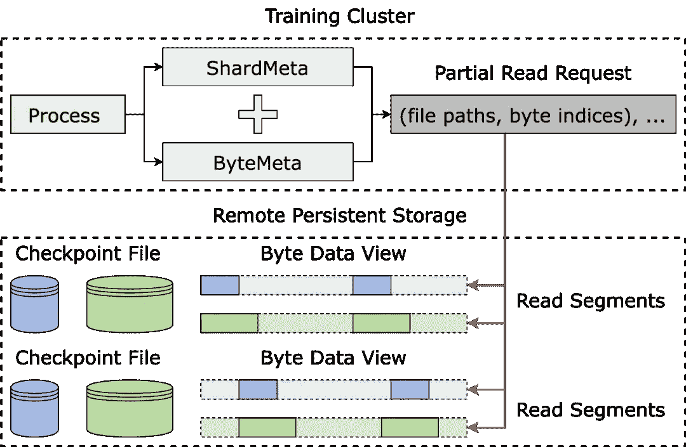

在数据并行 (Data-Parallel or DP) 训练中，模型在不同的数据并行进程组（DP Group）之间是冗余的，不同进程组会重复读取同一个 张量 切片。在大规模训练的场景下，不同进程组同时发给远程持久化存储系统 （比如 `HDFS` ）大量请求，会给存储系统带来巨大压力。

为了消除重复数据读取，减少训练进程发给 `HDFS` 的请求，优化加载的性能，`ByteCheckpoint` 把相同的 张量 切片读取任务均匀分配到不同进程上，并在对远程文件进行读取的同时，利用 GPU 之间闲置的带宽进行 张量 切片传输。

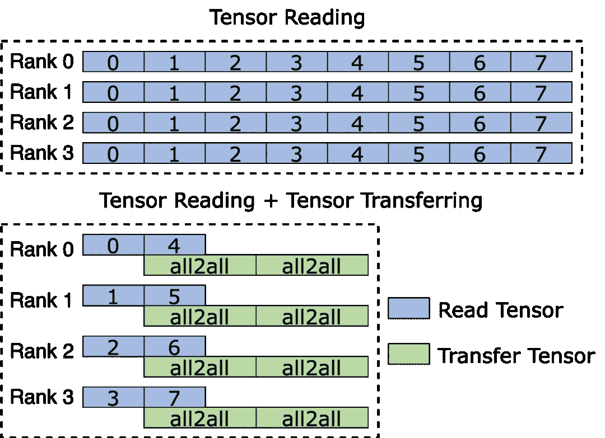

## 实验结果

### 实验配置

团队使用 DenseGPT 与 SparseGPT 模型 (基于 GPT-3 [10] 结构实现)，在不同模型 参数 量，不同训练框架和不同规模的训练任务中评估了 `ByteCheckpoint` 的 `Checkpoint` 存取正确性、存储性能和读取性能。更多实验配置和正确性测试细节请移步完整论文。

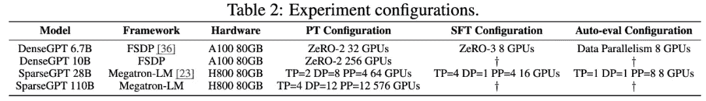

### 存储性能测试

在存储性能测试中，团队比较了不同模型规模和训练框架，在训练过程中每 50 或者 100 步存一次 `Checkpoint` ， `Bytecheckpoint` 和基线（ Baseline ）方法给训练带来的总的阻塞时间 ( Checkpoint stalls )。

得益于对写入性能的深度优化，`ByteCheckpoint` 在各类实验场景中均取得了很高的表现，在 576 卡 SparseGPT 110B - `Megatron-LM` 训练任务中相比基线存储方法取得了 66.65~74.55 倍的性能提升，在 256 卡 DenseGPT 10B - `FSDP` 训练任务中甚至能达到 529.22 倍的性能提升。

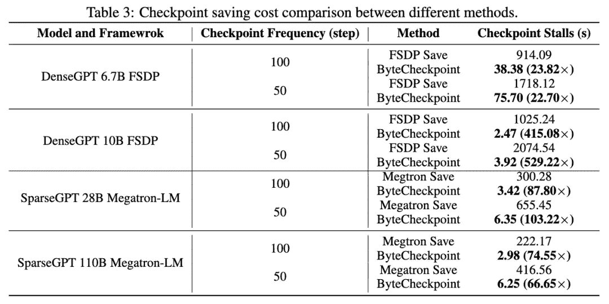

### 读取性能测试

在读取性能测试中，团队比较不同方法根据下游任务并行度读取 `Checkpoint` 的加载时间。`ByteCheckpoint` 相比基线方法取得了 1.55 ～ 3.37 倍的性能提升。

团队观察到 `ByteCheckpoint` 相对于 `Megatron-LM` 基线方法的性能提升更为显著。这是因为 `Megatron-LM` 在读取 `Checkpoint` 到新的并行度配置之前，需要运行离线的脚本对分布式 `Checkpoint` 进行重新分片。相比之下，`ByteCheckpoint` 能够直接进行自动 `Checkpoint` 重新切分，无需运行离线脚本，高效完成读取。

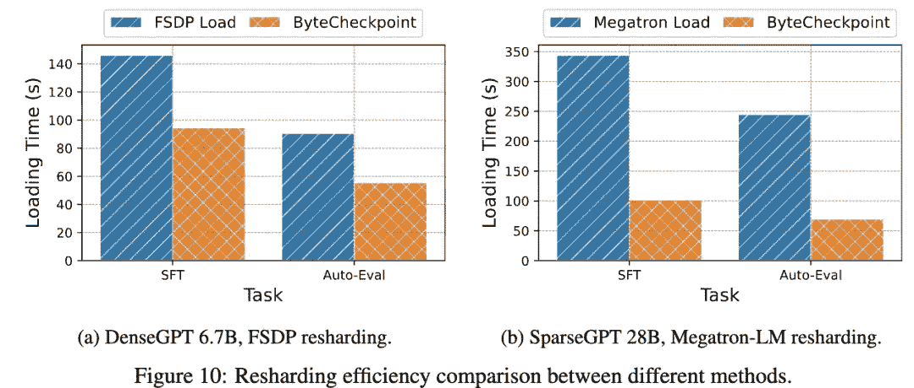

最后，关于 `ByteCheckpoint` 的未来 规划 ，团队希望从两个方面着手：

其一，实现支持超大规模 GPU 集群训练任务高效 `Checkpointing` 的长远目标。

其二，实现大模型训练全生命周期的 `Checkpoint` 管理，支持全场景的 `Checkpoint` ，从预训练（Pre-Training)，到监督微调（ SFT ），再到 强化学习 （ RLHF ）和评估 (Evaluation) 等场景。

## 团队介绍

字节跳动 豆包大模型团队成立于 2023 年，致力于开发业界最先进的 AI 大模型技术，成为世界一流的研究团队，为科技和社会发展作出贡献。

目前，团队正在持续吸引优秀人才加入，硬核、开放且充满创新精神是团队氛围关键词，团队致力于创造一个积极向上的工作环境，鼓励团队成员不断学习和成长，不畏挑战，追求卓越。

希望与具备创新精神、责任心的技术人才一起，推进大模型训练提效工作取得更多进展和成果。

## 参考文献

[1] Mohan, Jayashree, Amar Phanishayee, and Vijay Chidambaram. "`{CheckFreq}`: Frequent,{Fine-Grained}{DNN} Checkpointing." 19th USENIX Conference on File and Storage Technologies (FAST 21). 2021.

[2] Eisenman, Assaf, et al. "`{Check-N-Run}`: A Checkpointing system for training deep learning recommendation models." 19th USENIX Symposium on Networked Systems Design and Implementation (NSDI 22). 2022.

[3] Wang, Zhuang, et al. "`Gemini`: Fast failure recovery in 分布式 training with in-memory Checkpoints." Proceedings of the 29th Symposium on Operating Systems Principles. 2023.

[4] Gupta, Tanmaey, et al. "Just-In-Time Checkpointing: Low Cost Error Recovery from Deep Learning Training Failures." Proceedings of the Nineteenth European Conference on Computer Systems. 2024.

[5] Shoeybi, Mohammad, et al. "Megatron-lm: Training multi-billion parameter language models using model parallelism." arXiv preprint arXiv:1909.08053 (2019).

[6] Zhao, Yanli, et al. "Pytorch fsdp: experiences on scaling fully sharded data parallel." arXiv preprint arXiv:2304.11277 (2023).

[7] Rasley, Jeff, et al. "Deepspeed: System optimizations enable training deep learning models with over 100 billion parameters." Proceedings of the 26th ACM SIGKDD International Conference on Knowledge Discovery & Data Mining. 2020.

[8] Jiang, Ziheng, et al. "{MegaScale}: Scaling large language model training to more than 10,000 {GPUs}." 21st USENIX Symposium on Networked Systems Design and Implementation (NSDI 24). 2024.

[9] veScale: A PyTorch Native LLM Training Framework `https://github.com/volcengine/veScale`

[10] Brown, Tom, et al. "Language models are few-shot learners." Advances in neural information processing systems 33 (2020): 1877-1901.
