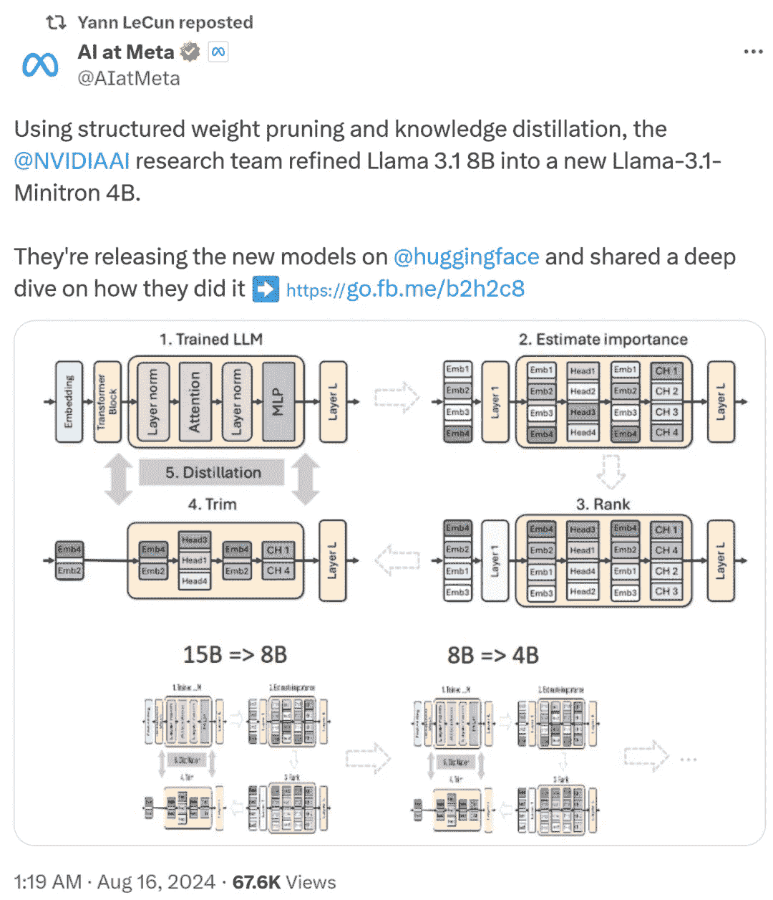
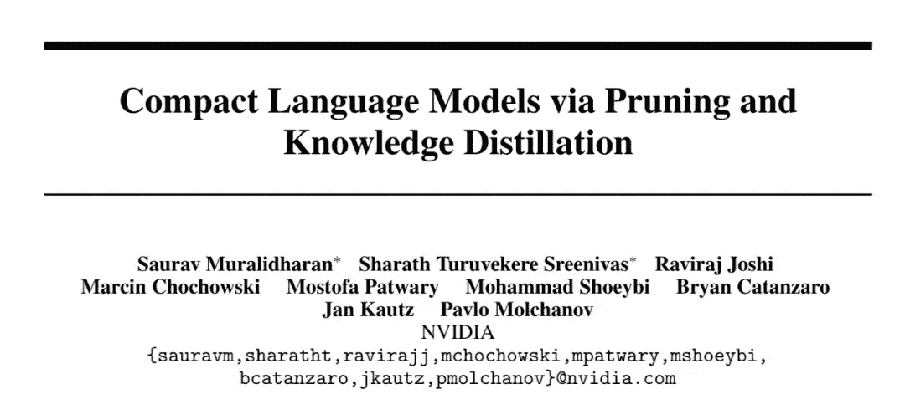
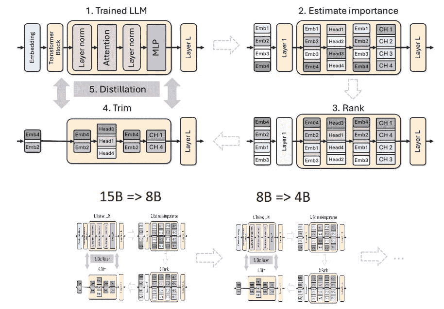
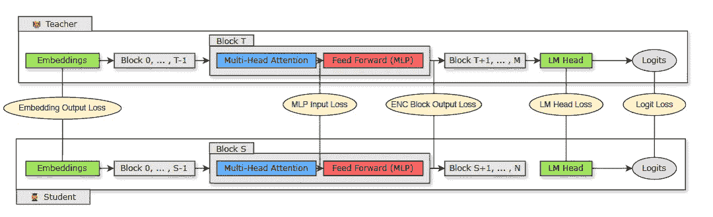
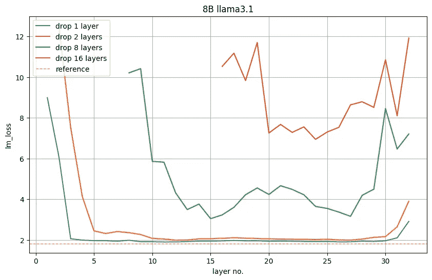
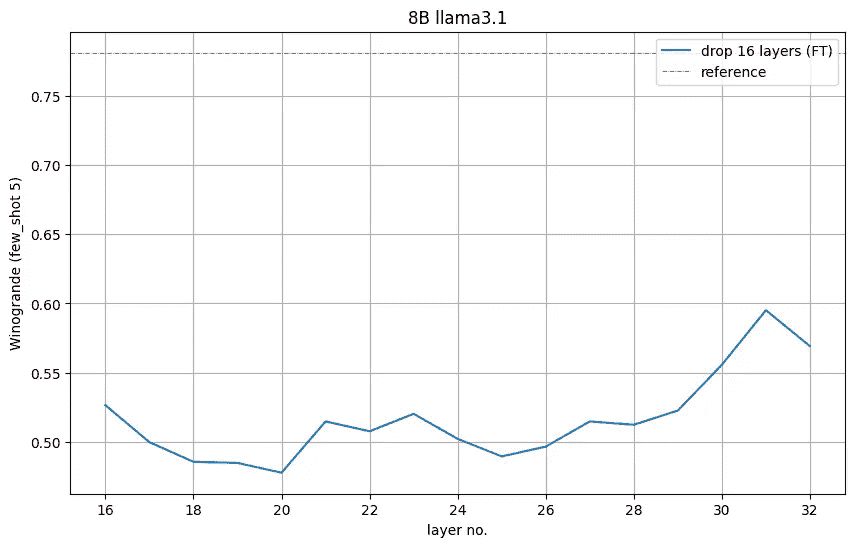
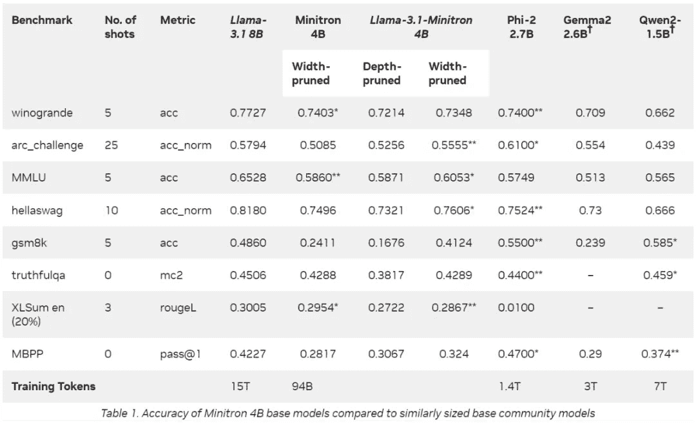
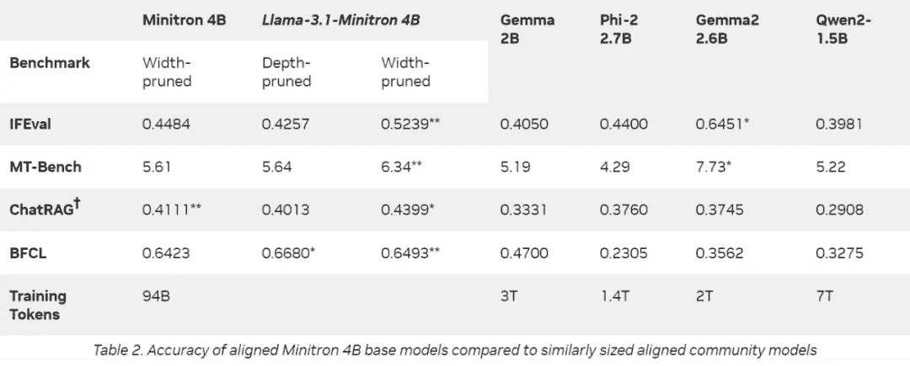
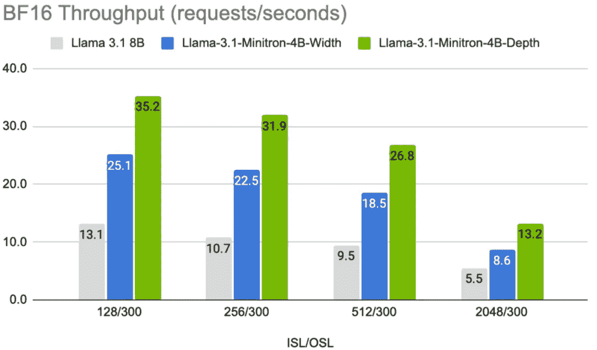
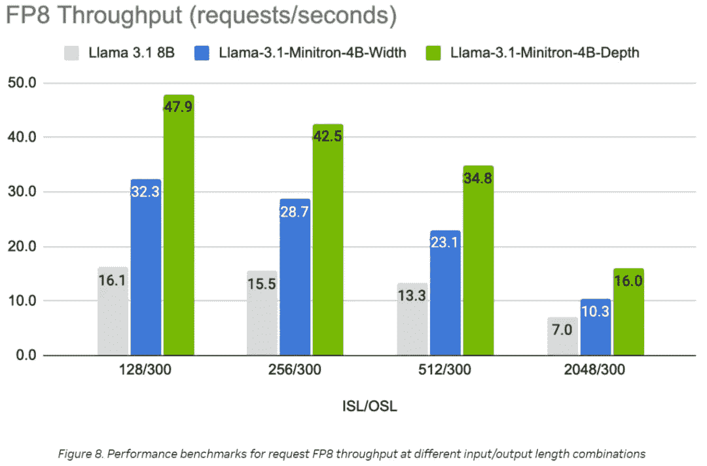

# 英伟达玩转剪枝、蒸馏：把Llama 3.1 8B参数减半，性能同尺寸更强

> 来源：[https://agijuejin.feishu.cn/docx/ESH7daTTuoDux2x50bfcvLVnnXb](https://agijuejin.feishu.cn/docx/ESH7daTTuoDux2x50bfcvLVnnXb)

> 机器之心｜[阅读原文](https://www.jiqizhixin.com/articles/2024-08-16-4)

> 转载请联系原作者取得授权

> 小模型崛起了。

上个月，Meta 发布了 Llama 3.1 系列模型，其中包括 Meta 迄今为止最大的 405B 模型，以及两个较小的模型， 参数 量分别为 700 亿和 80 亿。

Llama 3.1 被认为是引领了开源新时代。然而，新一代的模型虽然性能强大，但部署时仍需要大量计算资源。

因此，业界出现了另一种趋势，即开发小型 语言模型 (SLM)，这种模型在许多语言任务中表现足够出色，部署起来也非常便宜。

最近，英伟达研究表明，结构化 权重 剪枝 与 知识蒸馏 相结合，可以从初始较大的模型中逐步获得较小的 语言模型 。

图灵奖得主、Meta 首席 AI 科学家 Yann LeCun 也点赞转帖了该研究。

经过 剪枝 和蒸馏，英伟达研究团队将 Llama 3.1 8B 提炼为 Llama-3.1-Minitron 4B 开源了出来。这是英伟达在 Llama 3.1 开源系列中的第一个作品。

Llama-3.1-Minitron 4B 的表现优于类似大小的最先进的开源模型，包括 Minitron 4B、Phi-2 2.7B、Gemma2 2.6B 和 Qwen2-1.5B。

这项研究的相关论文早在上个月已经放出了。

+   论文链接：https://www.arxiv.org/pdf/2407.14679

+   论文标题：Compact Language Models via Pruning and Knowledge Distillation

**剪枝和蒸馏**

剪枝 使模型变得更小、更精简，可以通过删除层（深度 剪枝 ）或删除 神经元 和注意力头以及嵌入通道（宽度 剪枝 ）来实现。 剪枝 通常伴随着一定程度的再训练，以恢复 准确率 。

模型蒸馏是一种将知识从大型复杂模型（通常称为教师模型）迁移到较小、较简单的学生模型的技术。目标是创建一个更高效的模型，该模型保留了原始较大模型的大部分预测能力，同时运行速度更快且资源消耗更少。

蒸馏方式主要包括两种：SDG 微调与经典 知识蒸馏 ，这两种蒸馏方式互补。本文主要关注经典 知识蒸馏 方法。

英伟达采用将 剪枝 与经典 知识蒸馏 相结合的方式来构造大模型，下图展示了单个模型的 剪枝 和蒸馏过程（上）以及模型 剪枝 和蒸馏的链条（下）。具体过程如下：

1. 英伟达从 15B 模型开始，评估每个组件（层、 神经元 、头和嵌入通道）的重要性，然后对模型进行排序和 剪枝 ，使其达到目标大小：8B 模型。

2. 接着使用模型蒸馏进行了轻度再训练，原始模型作为老师， 剪枝 后的模型作为学生。

3. 训练结束后，以小模型（8B）为起点， 剪枝 和蒸馏为更小的 4B 模型。

从 15B 模型进行 剪枝 与蒸馏的过程。

需要注意的点是，在对模型 剪枝 之前，需要先了解模型的哪部分是重要的。英伟达提出了一种基于激活的纯重要性评估策略，该策略可以同时计算所有相关维度（深度、 神经元 、头和嵌入通道）的信息，使用一个包含 1024 个样本的小型校准数据集，并且只需要前向传播。这种方法相比依赖梯度信息并需要反向传播的策略更加简单且具有成本效益。

在 剪枝 过程中，你可以针对给定轴或轴组合在 剪枝 和重要性估计之间进行迭代交替。实证研究显示，使用单次重要性估计就足够了，迭代估计不会带来额外的好处。

利用经典 知识蒸馏 进行重新训练

下图 2 展示了蒸馏过程，其中 N 层学生模型（ 剪枝 后的模型）是从 M 层教师模型中（原始未 剪枝 模型）蒸馏而来。学生模型通过最小化嵌入输出损失、logit 损失以及 映射 到学生块 S 和教师块 T 的 Transformer 编码器特定损失组合来学习。

图 2：蒸馏训练损失。

**剪枝 和蒸馏最佳实践**

英伟达基于紧凑 语言模型 中 剪枝 和 知识蒸馏 的广泛消融研究，将自己的学习成果总结为以下几种结构化压缩最佳实践。

一是调整大小。

+   要训练一组 LLM，首先训练最大的一个，然后迭代地 剪枝 和蒸馏以获得较小的 LLM。

+   如果使用多阶段训练策略来训练最大的模型，最好 剪枝 并对训练最后阶段获得的模型进行重新训练。

+   对最接近目标大小的可用源模型进行 剪枝 。

二是 剪枝 。

+   优先考虑宽度 剪枝 而不是深度 剪枝 ，这对于 15B 参数 规模以下的模型效果很好。

+   使用单样本（single-shot）重要性估计，因为迭代重要性估计没有任何好处。

三是重新训练。

+   仅使用蒸馏损失进行重新训练，而不是常规训练。

+   当深度明显减少时，使用 logit、中间状态和嵌入蒸馏。

+   当深度没有明显减少时，使用 logit-only 蒸馏。

Llama-3.1-Minitron：将最佳实践付诸应用

Meta 最近推出了功能强大的 Llama 3.1 开源模型系列，在许多 基准 测试中可与闭源模型相媲美。Llama 3.1 的 参数 范围从巨大的 405B 到 70B、8B。

凭借 Nemotron 蒸馏的经验，英伟达着手将 Llama 3.1 8B 模型蒸馏为更小、更高效的 4B 模型，采取以下措施：

+   教师微调

+   Depth-only 剪枝

+   Width-only 剪枝

+   准确率 基准

+   性能 基准

**教师微调**

为了纠正模型训练所基于的原始数据集的分布偏差，英伟达首先在他们的数据集上（94B token）对未 剪枝 的 8B 模型进行了微调。实验表明，如果不纠正分布偏差，教师模型在蒸馏时会为数据集提供次优指导。

**Depth-only 剪枝**

为了从 8B 降到 4B，英伟达 剪枝 了 16 层（50%）。他们首先通过从模型中删除每个层或连续子层组来评估它们的重要性，并观察下游任务中 LM 损失的增加或 准确率 的降低。

下图 5 显示了删除 1、2、8 或 16 层后 验证集 上的 LM 损失值。例如，第 16 层的红色图表示如果删除前 16 层，则出现 LM 损失。第 17 层表示如果保留第一层并删除第 2 至第 17 层，也出现 LM 损失。英伟达观察到：开始和结束的层是最重要的。

图 5：depth-only 剪枝 中层的重要性。

然而，英伟达观察到，这种 LM 损失不一定与下游性能直接相关。

下图 6 显示了每个 剪枝 模型的 Winogrande 准确率 ，它表明最好删除第 16 到第 31 层，其中第 31 层是倒数第二层， 剪枝 模型的 5-shot 准确率 明显高于随机 准确率 (0.5)。英伟达采纳了这一见解，删除了第 16 到第 31 层。

图 6：当删除 16 层时，在 Winogrande 任务上的 准确率 。

**Width-only 剪枝**

英伟达沿宽度轴 剪枝 了嵌入（隐藏）和 MLP 中间维，以压缩 Llama 3.1 8B。具体来说，他们使用前面描述的基于激活的策略来计算每个注意头、嵌入通道和 MLP 隐藏维度的重要性分数。

在重要性估计之后，英伟达选择

+   将 MLP 中间维从 14336 剪枝 到 9216。

+   将隐藏大小从 4096 剪枝 到 3072。

+   重新训练注意头数量和层数。

值得一提的是，在单样本 剪枝 之后，宽度 剪枝 的 LM 损失高于深度 剪枝 。然而，经过短暂的重新训练后，趋势发生了逆转。

**准确率 基准**

英伟达使用以下 参数 对模型进行蒸馏

+   峰值 学习率 = 1e-4

+   最小 学习率 = 1e-5

+   40 步线性预热

+   余弦衰减计划

+   全局批量大小 = 1152

下表 1 显示了 Llama-3.1-Minitron 4B 模型变体（宽度 剪枝 和深度 剪枝 ）与原始 Llama 3.1 8B 模型、其他类似大小的模型在跨多个领域的 基准 测试中的性能比较。总体而言，英伟达再次证实了宽度 剪枝 策略相较于遵循最佳实践的深度 剪枝 的有效性。

表 1：Minitron 4B base 模型相较于类似规模 base 模型的 准确率 比较。

为了验证蒸馏后的模型是否可以成为强大的指令模型，英伟达使用 NeMo-Aligner 对 Llama-3.1-Minitron 4B 模型进行了微调。

他们使用了 Nemotron-4 340B 的训练数据，在 IFEval、MT-Bench、ChatRAG-Bench 和 Berkeley Function Calling Leaderboard (BFCL) 上进行了评估，以测试指令遵循、角色扮演、RAG 和函数调用功能。最后确认 Llama-3.1-Minitron 4B 模型可以成为可靠的指令模型，其表现优于其他基线 SLM。

表 2：对齐 Minitron 4B base 模型与类似规模的对齐模型的 准确率 比较。

**性能 基准**

英伟达利用 NVIDIA TensorRT-LLM（一种用于优化 LLM 推理的开源工具包）优化了 Llama 3.1 8B 和 Llama-3.1-Minitron 4B 模型。

下两张图显示了不同模型在不同用例下以 FP8 和 FP16 精度每秒的吞吐量请求，表示为 8B 模型的 batch size 为 32 的输入序列长度 / 输出序列长度 (ISL/OSL) 组合以及 4B 模型的 batch size 为 64 的输入序列长度 / 输出序列长度 (ISL/OSL) 组合，这要归功于在一块英伟达 H100 80GB GPU 上，较小的 权重 允许较大的 batch size。

Llama-3.1-Minitron-4B-Depth-Base 变体是最快的，平均吞吐量约为 Llama 3.1 8B 的 2.7 倍，而 Llama-3.1-Minitron-4B-Width-Base 变体的平均吞吐量约为 Llama 3.1 8B 的 1.8 倍。与 BF16 相比，在 FP8 中部署还可使这三种型号的性能提高约 1.3 倍。

图 8：组合：Llama 3.1 8B 为 BS=32，Llama-3.1-Minitron 4B 型号为 BS=64。1x H100 80GB GPU。

**结论**

剪枝 和经典知识提炼是一种非常经济高效的方法，可以逐步获得更小尺寸的 LLM，与在所有领域从头开始训练相比，可实现更高的准确性。与合成数据式微调或从头开始预训练相比，这是一种更有效且数据效率更高的方法。

Llama-3.1-Minitron 4B 是英伟达首次尝试使用最先进的开源 Llama 3.1 系列完成的探索。要在 NVIDIA NeMo 中使用 Llama-3.1 的 SDG 微调，可参阅 GitHub 上的 /sdg-law-title-generation 部分。

有关更多信息，请参阅以下资源：

+   https://arxiv.org/abs/2407.14679

+   https://github.com/NVlabs/Minitron

+   https://huggingface.co/nvidia/Llama-3.1-Minitron-4B-Width-Base

+   https://huggingface.co/nvidia/Llama-3.1-Minitron-4B-Depth-Base

参考链接：https://developer.nvidia.com/blog/how-to-prune-and-distill-llama-3-1-8b-to-an-nvidia-llama-3-1-minitron-4b-model/