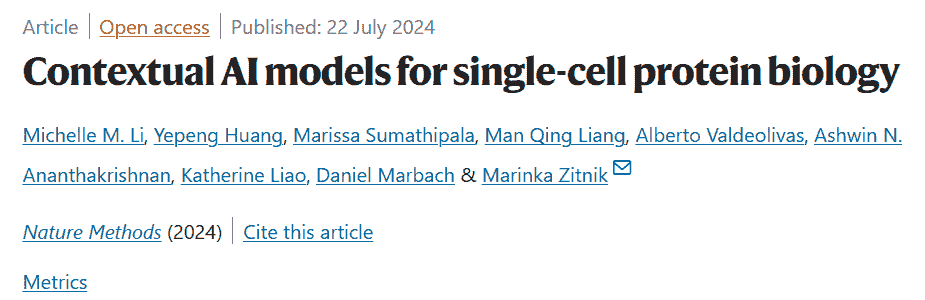
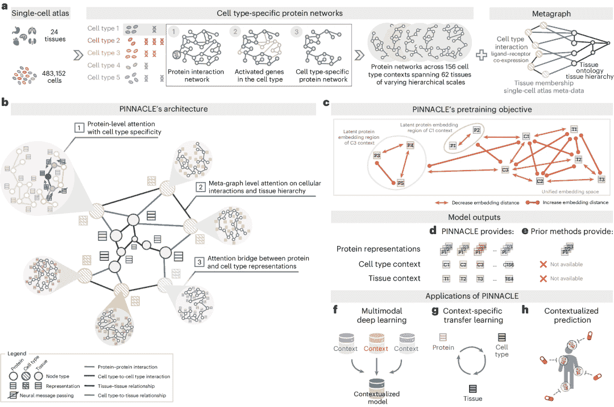
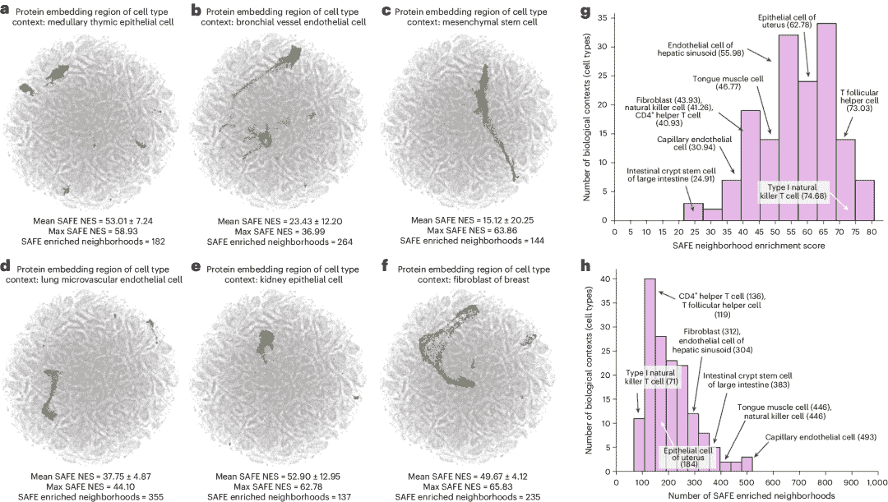

# 生成394,760种蛋白质表征，哈佛团队开发AI模型，全面理解蛋白质上下文

> 来源：[https://agijuejin.feishu.cn/docx/BN9mdIaqwoaS6Sxp4jic8AmDnYf](https://agijuejin.feishu.cn/docx/BN9mdIaqwoaS6Sxp4jic8AmDnYf)

> 机器之心 ScienceAI｜[阅读原文](https://www.jiqizhixin.com/articles/2024-07-26-10)

> 转载请联系原作者取得授权

编辑 | 萝卜皮

了解蛋白质功能和开发分子疗法，需要破译蛋白质发挥作用的细胞类型，解析蛋白质之间的相互作用。

然而，对跨生物背景蛋白质相互作用进行建模对于现有算法来说仍然具有挑战性。

在最新的研究中，哈佛医学院的研究人员开发了 PINNACLE，这是一种生成情境 感知 蛋白质表征的几何 深度学习 方法。

PINNACLE 利用多器官单细胞图谱，在情境化蛋白质相互作用网络上进行学习，从 24 种组织的 156 种细胞类型情境中生成 394,760 种蛋白质表征。

该研究以「 Contextual AI models for single-cell protein biology 」为题，于 2024 年 7 月 22 日发布在《 Nature Methods 》。

蛋白质是细胞的功能单位，通过相互作用实现不同生物功能。高通量技术使得绘制大规模蛋白质相互作用图成为可能，并通过计算方法改进对蛋白质结构的理解、功能注释的预测和治疗靶点的设计。表示学习方法通过整合分子细胞图谱，能够解析不同组织和细胞类型的蛋白质相互作用网络，扩展对蛋白质与功能关系的理解。

然而，蛋白质在不同生物背景中具有不同的作用，基因表达和蛋白质功能因健康与疾病状态不同而异。现有 深度学习 方法生成的蛋白质表示是无背景的，无法识别在不同细胞类型中的功能变化，从而影响多效性和特异性预测。

测量单细胞分辨率基因表达的测序技术为解决这一挑战铺平了道路。单细胞转录组图谱测量许多细胞背景下的活化基因。通过基于注意力的 深度学习 ，该方法可以关注大型输入并学习在每个背景中最重要的元素，单细胞图谱可以用于增强驱动疾病进展的基因调控网络的绘制，并揭示治疗靶点。

然而，将蛋白质编码基因的表达整合到蛋白质相互作用网络中仍是一个挑战。现有算法，包括蛋白质表示学习，无法将蛋白质表示与具体背景相联系。

哈佛医学院的研究人员引入了 PINNACLE（基于蛋白质网络的上下文学习算法），这是一种用于全面理解蛋白质的上下文特定模型。PINNACLE 是一种几何 深度学习 模型，擅长通过分析各种细胞环境中的蛋白质相互作用来生成蛋白质表征。

图示：PINNACLE 概览。（来源：论文）

PINNACLE 在一组集成的情境 感知 蛋白质相互作用网络（PPI）上进行训练，并辅以捕捉细胞相互作用和组织层次的网络，从而生成情境化的蛋白质表征，这些表征针对蛋白质编码基因被激活的细胞类型进行定制。

与上下文无关的模型不同，PINNACLE 为每种蛋白质生成多种表示，每种表示取决于其特定的细胞类型上下文。此外，PINNACLE 还生成细胞类型上下文的表示和组织层次的表示。这种方法确保了对蛋白质相互作用网络的多方面理解，同时考虑到蛋白质作用的无数背景。

给定多尺度模型输入，PINNACLE 通过优化统一的潜在表示空间来学习蛋白质、细胞类型和组织的拓扑结构。PINNACLE 将不同的上下文特定 数据集成 到一个上下文 感知 模型中，并在蛋白质、细胞类型和组织级数据之间传递知识，以使表示具有上下文相关性。

为了将细胞和组织组织注入这个嵌入空间，PINNACLE 采用蛋白质、细胞类型和组织水平的注意力以及各自的 目标函数 。

从概念上讲，物理上相互作用的蛋白质对（即通过输入网络中的边缘连接）是紧密嵌入的。类似地，蛋白质嵌入在它们各自的细胞类型环境附近，同时与不相关的细胞类型保持相当大的距离。

这确保了相同细胞类型环境中的相互作用蛋白质位于嵌入空间的近端，但与其他细胞类型环境中的蛋白质分开。这种方法产生的嵌入空间可以准确表示蛋白质、细胞类型和组织之间错综复杂的关系。

PINNACLE 使用一系列针对每个特定节点和边缘类型量身定制的 注意力机制 在蛋白质、细胞类型和组织之间传播 图神经网络 信息。

图示：PINNACLE 蛋白质嵌入区域的富集。（来源：论文）

蛋白质级预训练任务考虑对蛋白质相互作用进行自监督链接预测和对蛋白质节点进行细胞类型分类。这些任务使 PINNACLE 能够塑造一个嵌入空间，该空间封装了上下文 感知 蛋白质相互作用网络的拓扑结构和蛋白质的细胞类型身份。

PINNACLE 的细胞类型和组织特定预训练任务完全依赖于自监督链接预测，从而促进细胞和组织组织的学习。细胞类型和组织的拓扑结构通过注意力桥接机制传递给蛋白质表示，有效地将组织和细胞组织强化到蛋白质表示上。

PINNACLE 的情境化蛋白质表征可捕捉情境 感知 蛋白质相互作用网络的结构。这些情境化蛋白质表征在潜在空间中的区域排列反映了元图所代表的细胞和组织组织。这将导致在统一的细胞类型和组织特定框架内对蛋白质进行全面且特定于上下文的表示。

通过 PINNACLE 生成的 394,760 个情境化蛋白质表示，其中每个蛋白质表示都具有细胞类型特异性，研究人员证明了 PINNACLE 能够将蛋白质相互作用与 156 种细胞类型情境的底层蛋白质编码基因转录组相结合。

PINNACLE 的嵌入空间反映了细胞和组织结构，从而实现了组织层次结构的零样本检索。预训练的蛋白质表征可以适应下游任务：增强基于 3D 结构的表征以解决免疫肿瘤学蛋白质相互作用，并研究药物对不同细胞类型的影响。

PINNACLE 在指定类风湿性关节炎和炎症性肠病的治疗靶点方面优于最先进的模型，并且比无上下文模型具有更高的预测能力，可以精确定位细胞类型上下文。PINNACLE 能够根据其运行环境调整输出，为生物学中大规模上下文特定预测铺平了道路。

论文链接： https://www.nature.com/articles/s41592-024-02341-3