# 让GPT-4图像理解更易出错，全新策略增强VLP模型对抗迁移性

> 来源：[https://agijuejin.feishu.cn/docx/Rly9dLz9PoER4CxmvZocDRfDnQc](https://agijuejin.feishu.cn/docx/Rly9dLz9PoER4CxmvZocDRfDnQc)

> 机器之心｜[阅读原文](https://www.jiqizhixin.com/articles/2024-07-22-6)

> 转载请联系原作者取得授权

**本文作者分别来自南开大学、南洋理工大学和新加坡科技局。第一作者高森森为南开大学大四学生，此工作为其在新加坡科技局实习期间完成，实习导师为本文通讯作者郭青研究员（主**页：https://tsingqguo.github.io）。本文的共同第一作者和共同通讯作者是南洋理工大学的加小俊博后研究员（主页：https://jiaxiaojunqaq.github.io）。

针对视觉-语言预训练（Vision-Language Pretraining, VLP）模型的对抗攻击，现有的研究往往仅关注对抗轨迹中 对抗样本 周围的多样性，但这些 对抗样本 高度依赖于代理模型生成，存在代理模型 过拟合 的风险。

为了解决这一问题，我们引入了 **对抗轨迹交集区域 **的概念。这个区域由干净样本、当前 对抗样本 以及上一步 对抗样本 所构成的三角形区域。通过利用这一区域的多样性，我们不仅考虑了更加多样化的扰动方向，还关注了干净样本周围的对抗多样性，从而提升了 对抗样本 的迁移性。

本篇工作的论文和代码均已开源。

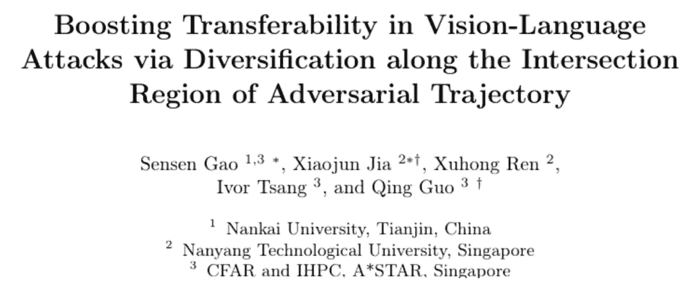

+   论文题目：Boosting Transferability in Vision-Language Attacks via Diversification along the Intersection Region of Adversarial Trajectory

+   论文链接：https://arxiv.org/pdf/2403.12445

+   代码链接：https://github.com/SensenGao/VLPTransferAttack

**研究背景**

近年来，ChatGPT-4等视觉 - 语言预训练模型（VLP）展示了强大的多模态理解和生成能力，在图像识别、 文本生成 等任务中表现出色。然而，这些模型的强大性能也伴随着一个显著的安全隐患： 对抗攻击（Adversarial Attacks） 。对抗攻击是指通过对输入数据进行微小且难以察觉的扰动，诱使模型产生错误输出。这种攻击方式不仅可以影响模型的预测准确性，甚至可能导致严重的安全问题。

由于 ChatGPT-4 等商业模型通常是闭源的，攻击者无法直接访问其内部 参数 和结构信息，这使得直接攻击这些模型变得困难。然而，攻击者可以通过对类似的开源或已知结构的 VLP 模型（如 CLIP）进行研究，生成 对抗样本 并将其应用于闭源商业模型。这种方法被称为 对抗攻击的迁移攻击（Transfer Attack） 。

对抗攻击的迁移性研究具有重要意义。一方面，了解对抗攻击在不同模型间的迁移性，可以提高对这些商业闭源模型的攻击成功率，从而帮助我们更好地评估和提升闭源模型的安全性，防止潜在的安全漏洞。另一方面，通过研究 对抗样本 在不同模型上的表现，可以进一步优化 对抗训练 方法，提高模型的鲁棒性和抗攻击能力。

**动机**

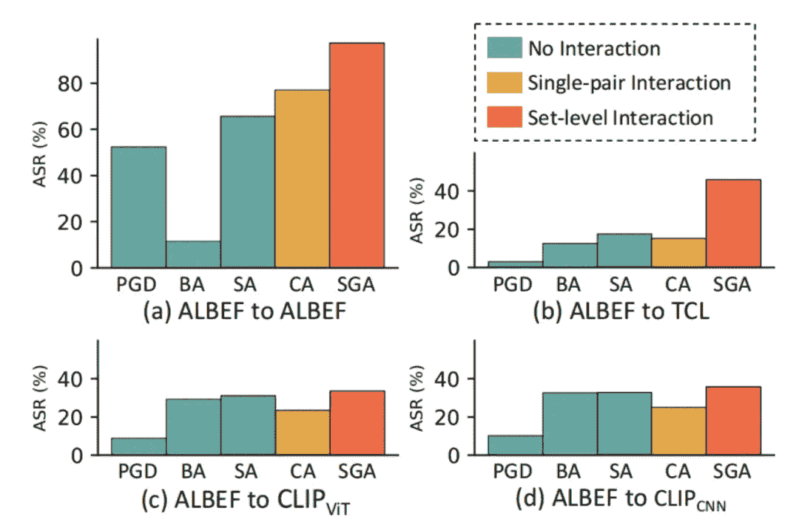

图 1：现有方法对于 VLP 模型在代理模型和目标模型上的攻击成功率 (图片来源：SGA (arXiv:2307.14061))。

SGA (ICCV2023 Oral) 是第一篇探索对 VLP 模型进行迁移攻**击的工作，但实验结果显示在目标模型上的攻击成功率远低**于代理模型。本研究的目标是 探索 SGA 方法在目标模型上迁移性较差的因素，进一步提高对 VLP 模型迁移攻击的成功率 。

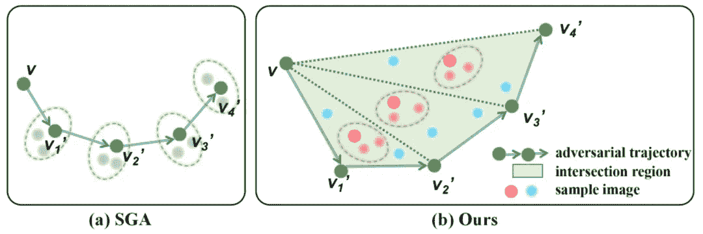

图 2：SGA 和我们方法的对比。

如图 2 所示，SGA 采用迭代攻击，并在迭代优化路径上通过 图像增强 （Resize）来增加 对抗样本 的多样性。然而，这种多样性仅考虑了对抗图像的周围区域，而对抗图像由代理模型生成，容易导致 过拟合 ，从而降低了迁移性。

干净样本完全独立于代理模型，因此我们认为干净样本周围的对抗多样性同样重要。为此，我们利用对抗轨迹的交集区域构建更广泛的多样性，它由干净图像、当前对抗图像和上一步对抗图像构成。

**方法**

**图像模态**

首先，我们在所提出的对抗轨迹交集区域中采样多个图像，并得到多样化的对抗扰动方向：

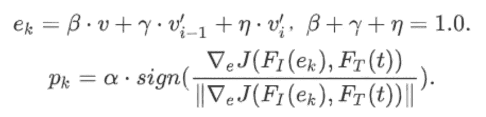

随后，我们使用文本引导进行采样图像的选择：

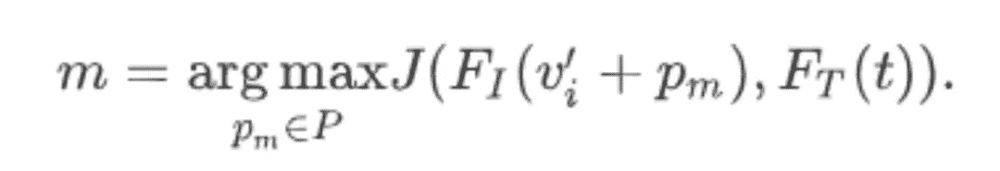

此时即表示最佳的采样图像，我们同时采用了 SGA 的思想，通过 图像增强 操作进一步探索最佳采样图像周围的对抗扰动多样性，最终的迭代表示为：

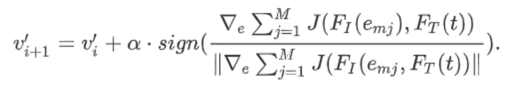

**文本模态**

过去的研究在 生成对抗 文本时，先通过迭代优化 生成对抗 图像，随后使对抗文本偏离最终生成的对抗图像。然而，正如我们前面所述，对抗图像高度依赖于代理模型，这样生成的对抗文本也存在 过拟合 的风险。

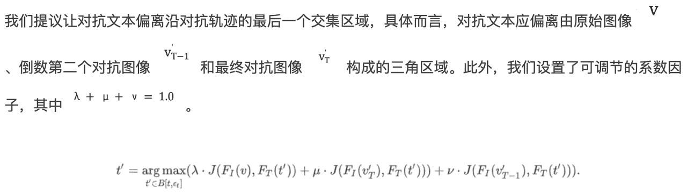

**实验效果**

**跨模型迁移性**

下表 1 显示了在图像 - 文本检索 （Image-Text Retrieval, ITR）任务中跨模型攻击的迁移性。相比于 SGA，我们的方法在多个跨模型迁移性上提升了 10% 以上。

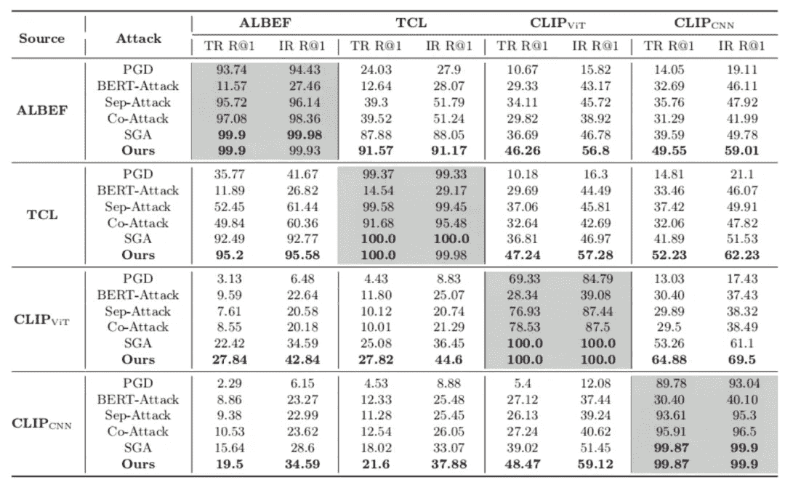

**跨任务迁移性**

下表 2 显示了利用在图像 - 文本检索 （ITR）任务上预训练的 ALBEF 模型，生成多模态 对抗样本 ，以攻击 RefCOCO + 数据集上的视觉定位（VG）任务和 MSCOCO 数据集上的图像描述（IC）任务。基线表示每个任务在没有任何攻击时的性能，较低的值表示对这两个任务的对抗攻击效果更好。

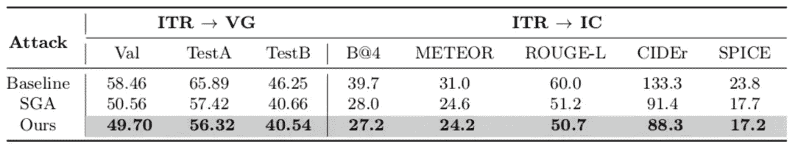

**攻击可视化**

下图 3 显示了对视觉定位任务攻击的可视化。

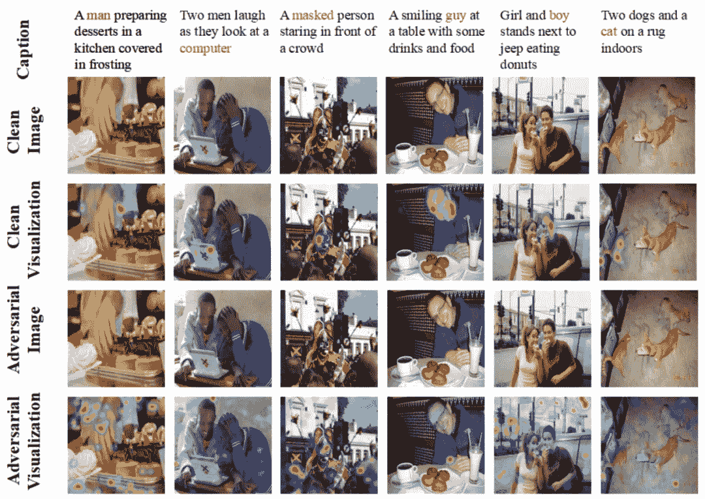

下图 4 显示了对图像描述任务攻击的可视化。

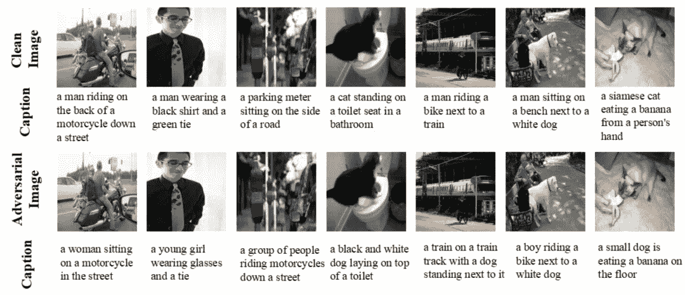

从图 3 和图 4 可以看出，通过对抗攻击，使 VLP 模型在视觉定位和图像描述任务上均出现了严重错误。

下图 5 显示了对 ChatGPT-4 迁移攻击的可视化。

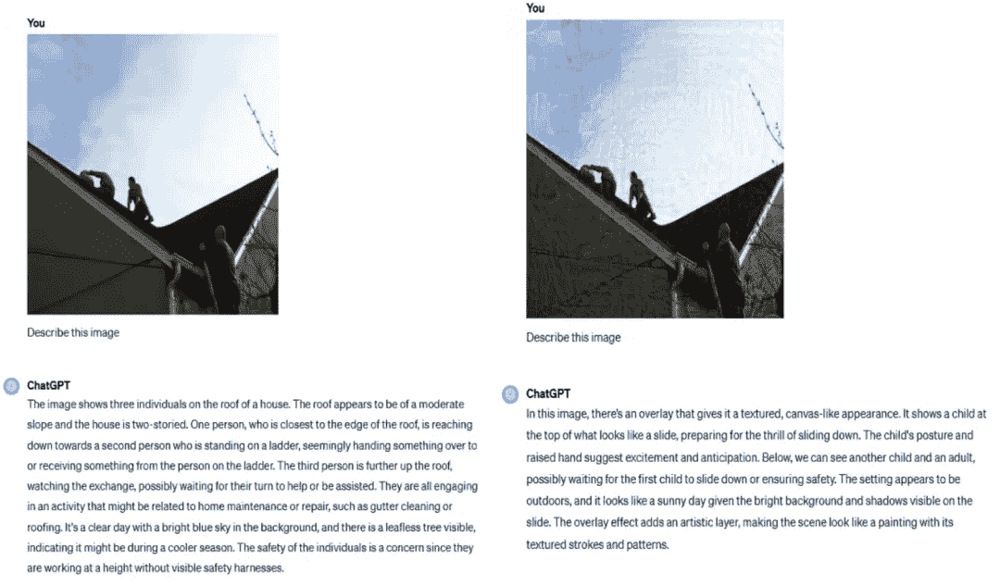

下图 6 显示了对 Claude-3 迁移攻击的可视化。

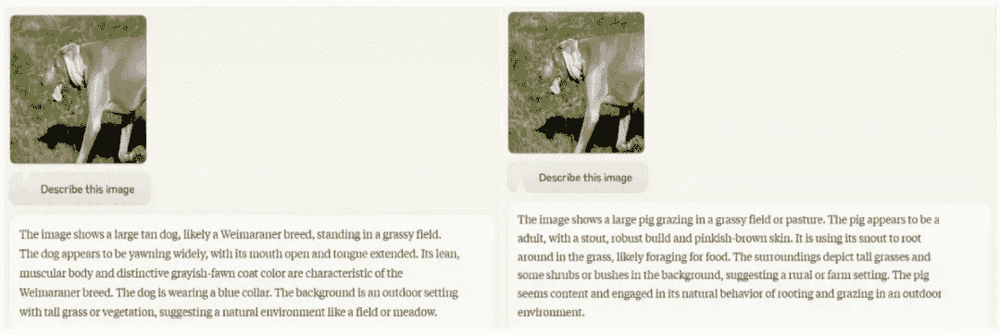

我们分别将干净图像和对抗图像输入 ChatGPT-4，Claude-3 等大模型，并使用 查询 「Describe this image.」得到输出结果，我们从图 5 和图 6 可以看到，两个大模型对对抗图像的理解已经出现很大的错误。

**结语**

尽管该工作在提升多模态对抗攻击迁移性方面取得了显著效果，但如何更充分地利用对抗攻击的交集区域，以及提供更深入的理论解释，仍然是未来值得深入研究的方向。我们对对抗轨迹交集区域及其对 VLP 对抗攻击迁移性的研究还在持续探索中，欢迎大家持续关注。如果有任何问题或进一步的想法，随时欢迎讨论。