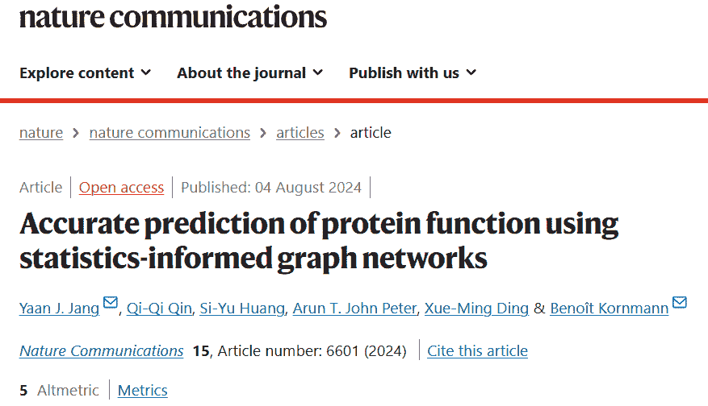
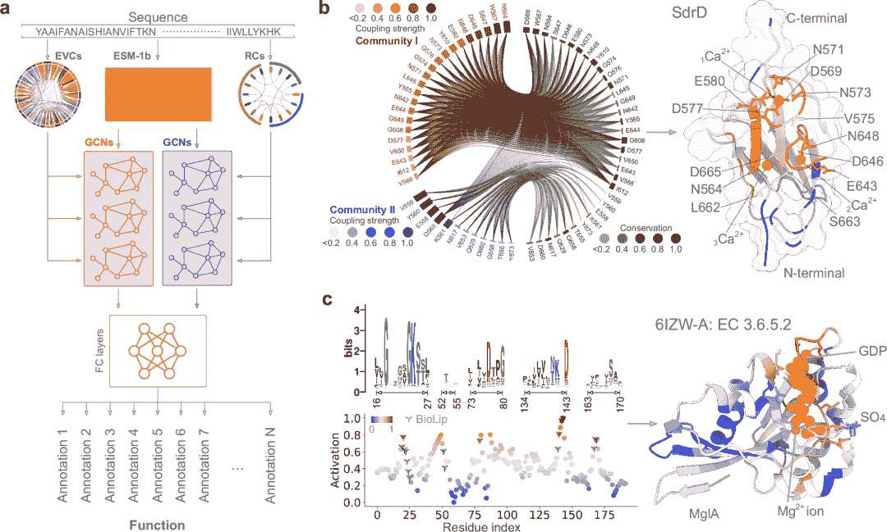
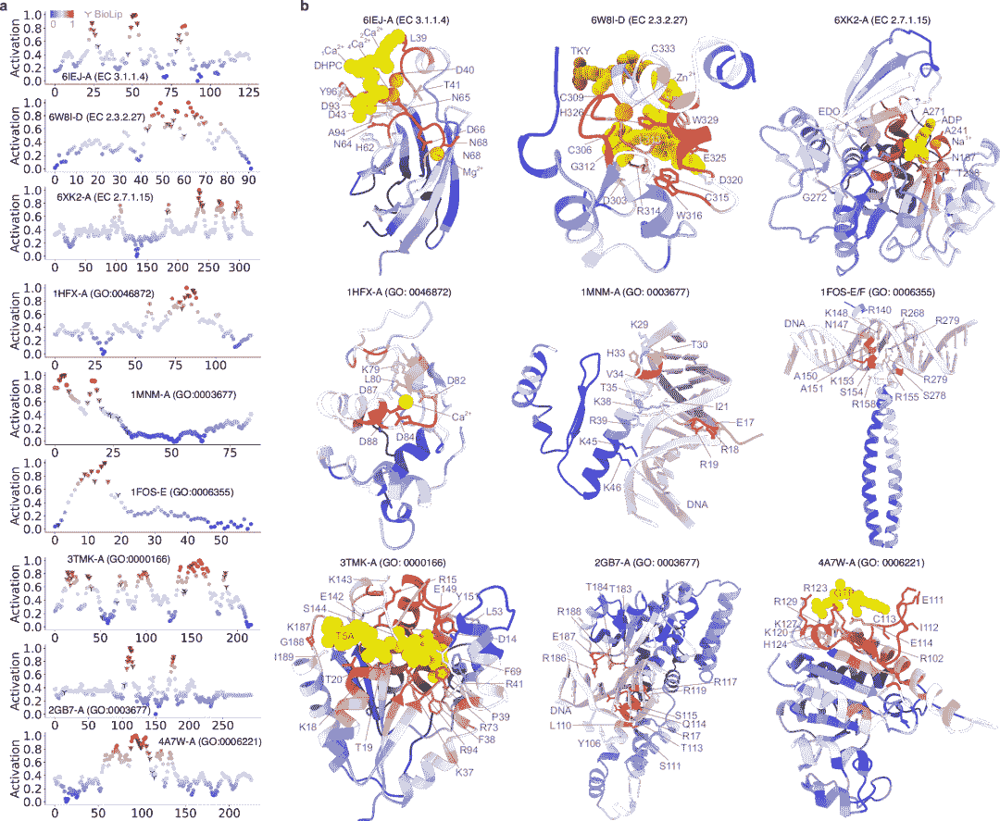
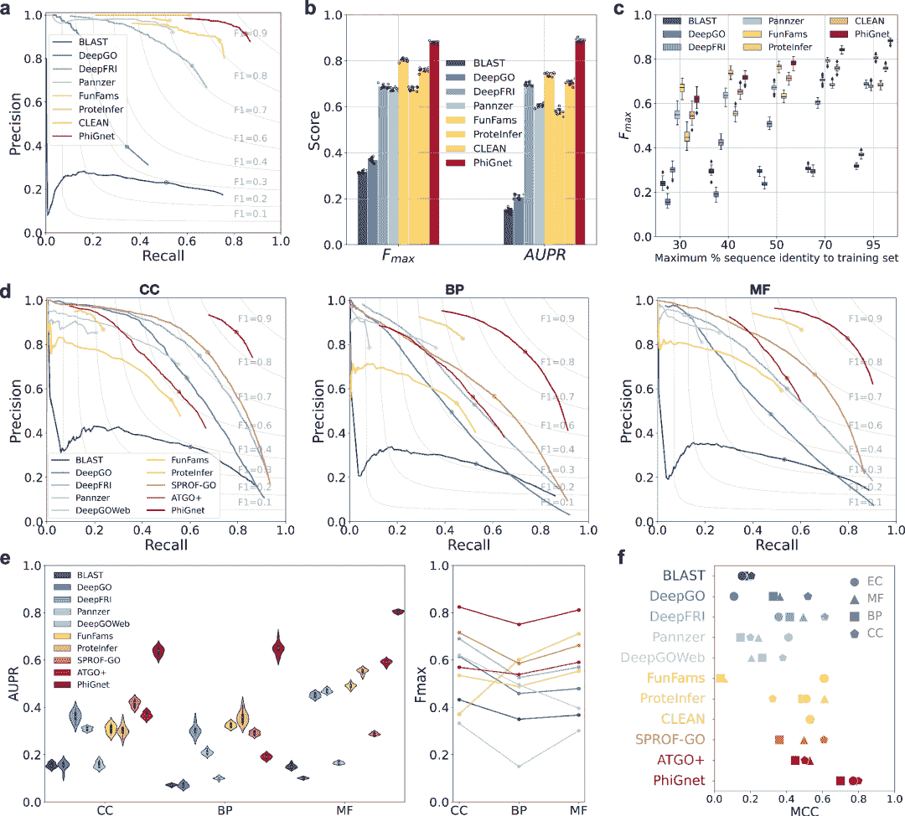
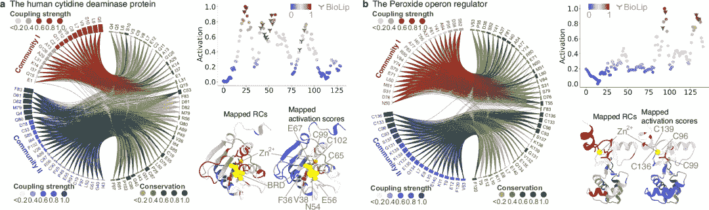

# 蛋白质功能预测新SOTA，上海理工、牛津等基于统计的AI方法，登Nature子刊

> 来源：[https://agijuejin.feishu.cn/docx/HPQKd6eWiolIT9xbH4scta4Bnx2](https://agijuejin.feishu.cn/docx/HPQKd6eWiolIT9xbH4scta4Bnx2)

> 机器之心 ScienceAI｜[阅读原文](https://www.jiqizhixin.com/articles/2024-08-22-3)

> 转载请联系原作者取得授权

编辑 | KX

蛋白质与其他分子相结合，促进几乎所有的基础生物活动。因此，了解蛋白质功能对于理解健康、疾病、进化和分子水平上的生物体功能至关重要。

然而，超过 2 亿种蛋白质仍未得到表征，计算方法在很大程度上依赖于蛋白质的结构信息来预测不同质量的注释。

近日，来自牛津大学、苏黎世联邦理工学院、上海理工大学和北京师范大学组成的研究团队，设计了一种基于统计的 图网 络方法，称为 PhiGnet，从而促进蛋白质的功能注释和功能位点的识别。

PhiGnet 不仅在性能上优于其它方法，而且即使在没有结构信息的情况下也缩小了序列-功能差距。研究结果表明，将 深度学习 应用于进化数据可以突出残基级别的功能位点，为解释和研究生物医学中蛋白质的现有特性和新功能提供宝贵支持。

相关研究以「 Accurate prediction of protein function using statistics-informed graph networks 」为题，于 8 月 4 日发布在《 Nature Communications 》上。

论文链接： https://www.nature.com/articles/s41467-024-50955-0

了解蛋白质功能对于理解许多关键生物活动的复杂机制至关重要，对医学、生物技术和药物开发领域具有深远的影响。

迄今为止，UniProt 数据库 （6/2023）中已有超过 3.56 亿种蛋白质被测序，其中绝大多数（~80%）没有已知的功能注释。

深度学习 方法在预测蛋白质 3D 结构方面取得了显著的准确性，超越了从头算方法和同源性建模等经典方法的能力。然而，准确地将功能注释分配给蛋白质仍然具有挑战性，尤其是与实验测定相比。

为了应对这些挑战，研究人员假设可以利用共同进化残基中所包含的信息来注释残基级别的功能。

牛津大学团队提出利用基于统计的 图网 络仅从蛋白质序列预测其功能。该方法固有地表征了进化特征，可以对执行特定功能的残基的重要性进行定量评估。

该方法利用从进化数据中获得的知识来驱动两个 堆叠 图卷积网络 。借助所获得的知识和设计的网络架构，可以准确地为蛋白质分配功能注释，并且重要的是，可以 量化 每个残基相对于特定功能的重要性。

# 用于蛋白质功能注释的 PhiGnet

PhiGnet 方法使用基于统计的 图网 络来注释蛋白质功能并根据其序列识别跨物种的功能位点。

图示：PhiGnet 注释蛋白质功能。（来源：论文）

为了从进化耦合（EVC，两个共变位点的成对残基之间的关系）和残基群落（RC，残基之间的层次相互作用）中吸收知识，研究人员设计了双通道架构的方法，采用 堆叠 图卷积网络 (GCN)。该方法专门用于为蛋白质分配功能注释，包括酶委员会 (EC) 编号和基因 本体 (GO) 术语（生物过程、BP、细胞成分、CC 和分子功能、MF）。

当提供蛋白质序列时，研究使用预先训练的 ESM-1b 模型得出其嵌入。随后，将嵌入作为图节点以及 EVC 和 RC（图边）输入到双 堆叠 GCN 的六个图卷积层中。这些层与两个完全连接 (FC) 层块协同工作，精心处理来自两个 GCN 的信息，最终生成一个概率 张量 ，用于评估为蛋白质分配功能注释的可行性。

此外，使用梯度加权类激活图 (Grad-CAM) 方法得出的激活分数（activation score）用于评估每个残基在特定功能中的重要性。该分数使 PhiGnet 能够在单个残基水平上精确定位功能位点。

例如，通过计算含有丝氨酸-天冬氨酸重复序列的蛋白质 D (SdrD) 的 RC，表明功能位点的残基通过自然进化而得以保留，并且 PhiGnet 能够捕获此类信息，从而改进在残基水平上预测蛋白质功能的方法，即使在没有结构数据的情况下也是如此。

# **注释蛋白质功能位点**

计算预测是否与实验确定的功能注释一样准确？为了解决这个问题，研究使用激活分数对每种氨基酸对蛋白质功能的贡献进行了定量检查。评估了 PhiGnet 的预测性能，并评估了九种蛋白质中残基的重要性（它们对蛋白质功能的贡献）。

图示：PhiGnet 在残基水平上注释蛋白质功能。（来源：论文）

通过计算九种蛋白质中每个残基的激活分数，并将它们与通过实验或半手动注释确定的残基进行比较。PhiGnet 在预测残基水平的重要位点方面表现出了良好的准确性（平均 ⩾ 75%），与实际的配体/离子/DNA 结合位点非常一致。PhiGnet 准确地识别出具有高激活分数的蛋白质的功能重要残基。

# **优于其他最先进的方法**

为了评估 PhiGnet 的预测性能，应用该方法来推断两个 基准 测试集中蛋白质的功能注释（EC 编号和 GO 术语）。将 PhiGnet 与最先进的方法进行比较，包括基于比对的方法、基于 深度学习 的方法。比较使用了两个基本指标，包括以蛋白质为中心的 Fmax 得分和精确召回曲线下面积 (AUPR)。

图示：不同方法在不同 本体 和 EC 编号中的 GO 术语之间的比较。（来源：论文）

PhiGnet 展示了在两个测试集中为蛋白质分配功能注释的预测能力。它分别对 GO 术语和 EC 编号实现了 0.70 和 0.89 的平均 AUPR，以及 0.80 和 0.88 的 Fmax 分数。

总体而言，PhiGnet 在 基准 数据集上的表现明显优于所有监督和无监督方法。

此外，还证明了 PhiGnet 的泛化稳健性，可以测试与训练集中的蛋白质具有不同序列同一性阈值的蛋白质。在不同的最大序列同一性水平（30%、40%、50%、70% 和 95%）下，随着序列同一性的增加，PhiGnet 表现出更好的预测性能。

# **由进化特征驱动**

进化数据在 PhiGnet 中起着重要作用，可用于预测蛋白质功能注释和识别功能位点。首先，进行了消融实验，以测试 EVC/RC 对 PhiGnet 的贡献。实验表明，PhiGnet 可以准确分配蛋白质功能注释。此外，使用 EVC 或 RC 的 PhiGnet 证明了学习一般序列功能关系的强大能力，通常比其他方法更好或一样好。

其次，进一步研究了 PhiGnet 从残基群落中已识别的功能相关残基中表征有意义特征的能力。计算了残基的激活分数以强调它们对蛋白质功能的贡献。值得注意的是，预测的残基与通过实验测定确定的功能位点的残基一致，比 RC 中的残基识别得更好。

图示：PhiGnet 学习进化特征以识别蛋白质功能位点。（来源：论文）

研究表明，进化信息，特别是 RC 中包含的信息，足以指定蛋白质的功能并定量表征功能位点的残基。此外，与 EVC 中较低阶水平的信息相比，RC 包含更高阶水平的进化知识。同时，RC 中包含的信息对于增强 PhiGnet 在残留水平上识别功能相关位点的能力起着重要作用。

# **成功之处与局限**

总之，PhiGnet 的更好性能可以归因于它利用了蛋白质序列的进化数据和数据的高阶模式，从而可以更深入、更准确地理解蛋白质功能。

PhiGnet 的主要成功之处在于利用统计信息 图卷积神经网络 ，来促进对来自海量序列数据集的进化数据的分层学习。这种方 法大大 超越了现有的监督和无监督方法，可用于指导未来的生物和临床实验。

PhiGnet 方法的局限性包括序列多样性较低的蛋白质家族中出现的偏差/ 噪音 。将（共同）进化信息纳入 PhiGnet 可能会影响残基群落的准确识别，特别是如果信息来自高度保守的蛋白质家族。虽然将物理提取的知识整合到 PhiGnet 中与其他方法相比取得了显著的改进，但在解释 PhiGnet 中的学习机制方面仍然存在重大挑战。

进化数据和 机器学习 之间的协同作用将为准确确定和设计蛋白质的生物物理特性铺平道路。