# 几分钟生成四维内容，还能控制运动效果：北大、密歇根提出DG4D

> 来源：[https://agijuejin.feishu.cn/docx/OZJAdKd0CoMVyHxID7lcRUN4nRb](https://agijuejin.feishu.cn/docx/OZJAdKd0CoMVyHxID7lcRUN4nRb)

> 机器之心｜[阅读原文](https://www.jiqizhixin.com/articles/2024-07-08-16)

> 转载请联系原作者取得授权

**本文作者潘**亮博士目前是上海人工智能实验室的Research Scientist。此前，在2020年至2023年，他于新加坡南洋理工大学S-Lab担任Research Fellow，指导老师为刘子纬教授。他的研究重点是 计算机视觉 、3D点云和虚拟人类，并在顶级会议和期刊上发表了多篇论文，谷歌学术引用超过2700次。此外，他还多次担任 计算机视觉 和 机器学习 等领域顶级会议和期刊的审稿人。

近期， 商汤科技 - 南洋理工大学联合 AI 研究中心 S-Lab ，上海人工智能实验室， 北京大学 与密歇根大学联合提出 DreamGaussian4D（DG4D），通过结合空间变换的显式建模与静态 3D Gaussian Splatting（GS）技术实现高效四维内容生成。

四维内容生成近来取得了显著进展，但是现有方法存在优化时间长、运动控制能力差、细节质量低等问题。DG4D 提出了一个包含两个主要模块的整体框架：1）图像到 4D GS - 我们首先使用 DreamGaussianHD 生成静态 3D GS，接着基于 HexPlane 生成基于高斯形变的动态生成；2）视频到视频纹理细化 - 我们细化生成的 UV 空间纹理 映射 ，并通过使用预训练的图像到视频扩散模型增强其时间一致性。

值得注意的是，DG4D 将四维内容生成的优化时间从几小时缩短到几分钟（如图 1 所示），允许视觉上控制生成的三维运动，并支持生成可以在三维引擎中真实渲染的动画网格模型。

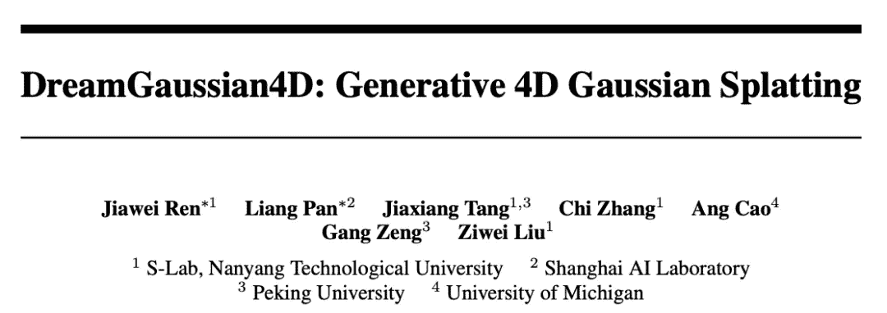

+   论文名称: DreamGaussian4D: Generative 4D Gaussian Splatting

+   主页地址: https://jiawei-ren.github.io/projects/dreamgaussian4d/

+   论文地址: https://arxiv.org/abs/2312.17142

+   Demo 地址: https://huggingface.co/spaces/jiawei011/dreamgaussian4d

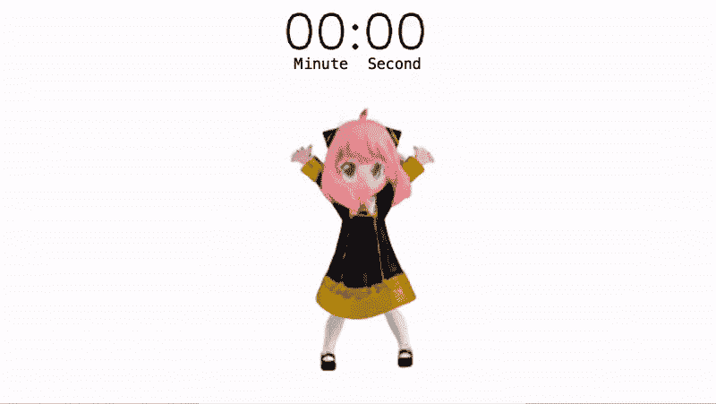

图 1. DG4D 在四分半钟内可实现四维内容优化基本 收敛

**问题和挑战**

生成模型 可以极大地简化多样化数字内容（如二维图像、视频和三维景物）的生产和制作，近年来取得了显著进步。四维内容是诸如游戏、影视等诸多下游任务的重要内容形式。四维生成内容也应支持导入传统图形学渲染引擎软件（比如，Blender 或者 Unreal Engine），以接入现有图形学内容生产管线（见图 2）。

尽管有一些研究致力于动态三维（即四维）生成，但四维景物的高效和高质量生成仍然存在挑战。近年来，越来越多的研究方法通过结合视频和三维 生成模型 ，约束任意视角下内容外观和动作的一致性，以实现四维内容生成。

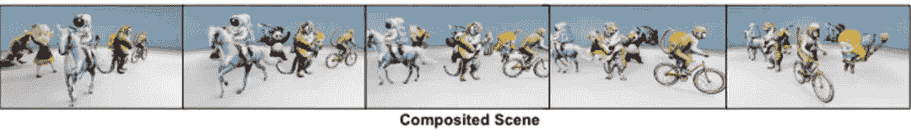

图 2. DG4D 生成的四维内容支持导入到传统 计算机图形 学渲染引擎中

目前主流的四维内容生成方法都基于四维动态神经辐射场（4D NeRF）表示。比如，MAV3D [1] 通过在 HexPlane [2] 上提炼文本到视频的扩散模型，实现了文本到四维内容的生成。Consistent4D [3] 引入了一个视频到四维的框架，以优化级联的 DyNeRF，从静态捕获的视频中生成四维景物。通过多重扩散模型的先验，Animate124 [4] 能够通过文本运动描述将单个未处理的二维图像动画化为三维的动态视频。基于混合 SDS [5] 技术，4D-fy [6] 使用多个预训练扩散模型可实现引人入胜的文本到四维内容的生成。

然而，所有上述现有方法 [1,3,4,6] 生成单个 4D NeRF 都需要数个小时，这极大地限制了它们的应用潜力。此外，它们都难以有效控制或选择最后生成的运动。以上不足主要来自以下几个因素：首先，前述方法的底层隐式四维表示不够高效，存在渲染速度慢和运动规律性差的问题；其次，视频 SDS 的随机性质增加了 收敛 难度，并在最终结果中引入了不稳定性和多种瑕疵伪影现象。

**方法介绍**

与直接优化 4D NeRF 的方法不同，DG4D 通过结合静态高斯泼溅技术和显式的空间变换建模，为四维内容生成构建了一个高效和强力的表征。此外， 视频生成 方法有潜力提供有价值的时空先验，增强高质量的 4D 生成。具体而言，我们提出了一个包含两个主要阶段的整体框架：1）图像到 4D GS 的生成；2）基于视频大模型的纹理图细化。

1. 图像到 4D GS 的生成

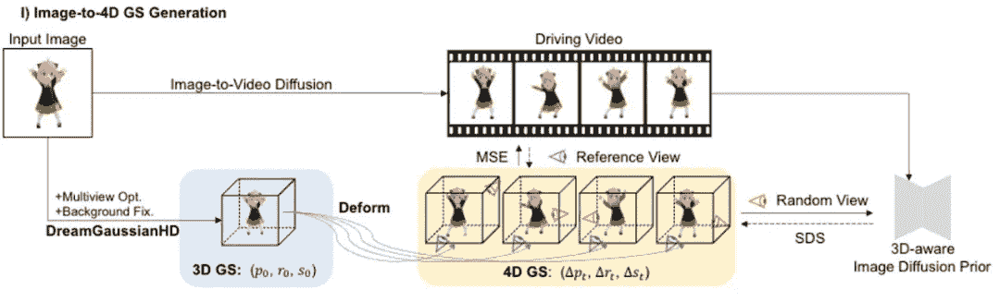

图 3 图片到 4D GS 生成框架图

在这一阶段中，我们使用静态 3D GS 及其空间变形来表示动态的四维景物。基于一张给定的二维图片，我们使用增强方法 DreamGaussianHD 方法生成静态 3D GS。随后，通过在静态 3D GS 函数上优化时间依赖的变形场，估计各个时间戳处的高斯变形，旨在让变形后的每一帧的形状和纹理都与驱动视频里面的对应帧尽力保持吻合。这一阶段结束，将可以生成一段动态的三维网格模型序列。

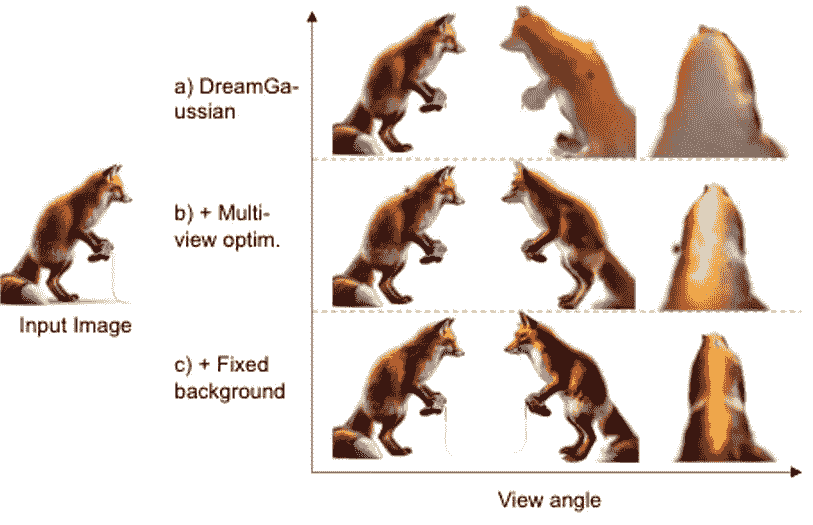

图 4 DreamGaussianHD 初始化基于 3D GS 的三维物体模型

+   DreamGaussianHD 基于近来使用 3D GS 的图生三维物体方法 DreamGaussian [7]，我们做了一些进一步的改进，整理出一套效果更佳的 3D GS 生成和初始化方法。主要改进的操作包括有 1）采取多视角的优化方式；2）设定优化过程中的渲染图片背景为更适合生成的黑色背景。我们称呼改进后的版本为 DreamGaussianHD，具体的改进效果图可见图 4。

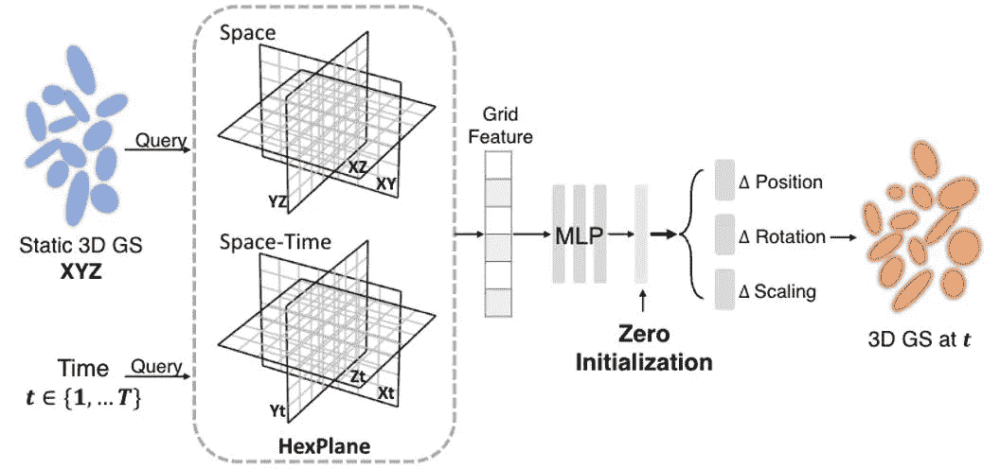

图 5 HexPlane 表征动态形变场

+   Gaussian Deformation 基于生成的静态 3D GS 模型，我们通过预测每一帧中高斯核的变形来生成符合期望视频的动态 4D GS 模型。在动态效果的表征上，我们选用 HexPlane（如图 5 所示）来预测每一个时间戳下高斯核位移、旋转和比例尺度，从而驱动生成每一帧的动态模型。此外，我们也针对性地调整设计网络，尤其是对最后几个线性操作的网络层做了残差连接和零初始化的设计，从而可以平滑充分地基于静态 3D GS 模型初始化动态场（效果如图 6 所示）。

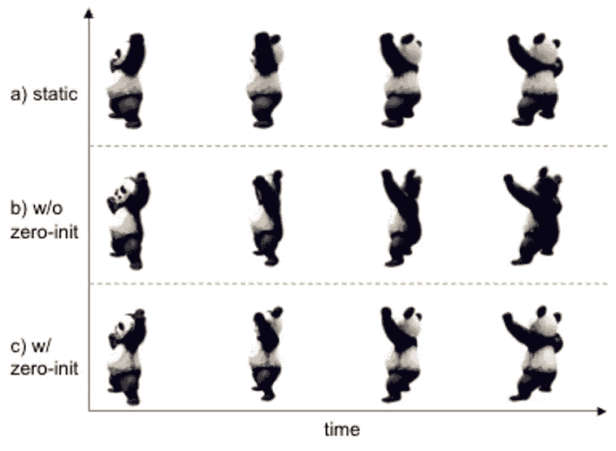

图 6 零初始化动态形变场对最后生成效果的影响

**2. 视频到视频的纹理优化**

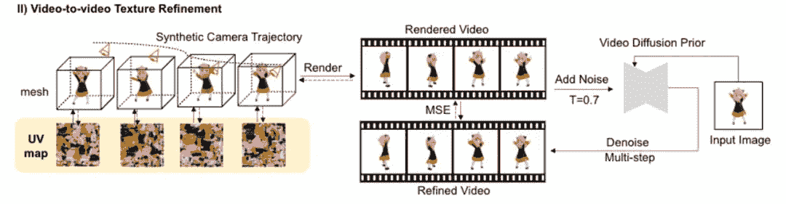

图 7 视频到视频纹理优化框架图

类似于 DreamGaussian，在第一阶段基于 4D GS 的四维动态模型生成结束后，可以提取四维的网格模型序列。并且，我们也可以类似于 DreamGaussian 的做法，在网格模型的 UV 空间中对纹理做进一步的优化。不同于 DreamGaussian 只对单独的三维网格模型使用图片 生成模型 做纹理的优化，我们需要对整个三维网格序列做优化。

并且，我们发现如果沿用 DreamGaussian 的做法，即对每个三维网格序列做独立的纹理优化，会导致三维网格的纹理在不同的时间戳下有不一致的生成，并且常常会有闪烁等瑕疵伪影效果出现。鉴于此，我们有别于 DreamGaussian，提出了基于 视频生成 大模型的视频到视频的 UV 空间下纹理优化方法。具体而言，我们在优化过程中随机生成了一系列相机轨迹，并基于此渲染出多个视频，并对渲染出的视频做相应的加噪和去噪处理，从而实现对生成网格模型序列的纹理增强。

基于图片生成大模型和基于 视频生成 大模型做的纹理优化效果对比展示在图 8 中。

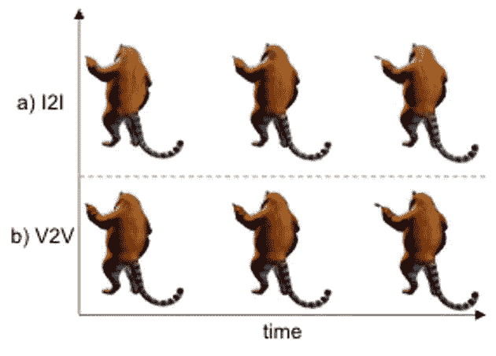

图 8 基于视频到视频的纹理优化可以实现时序上纹理的稳定性和一致性

**实验结果**

相比之前整体优化 4D NeRF 的方法，DG4D 显著减少了四维内容生成所需的时间。具体的用时对比可见表 1。

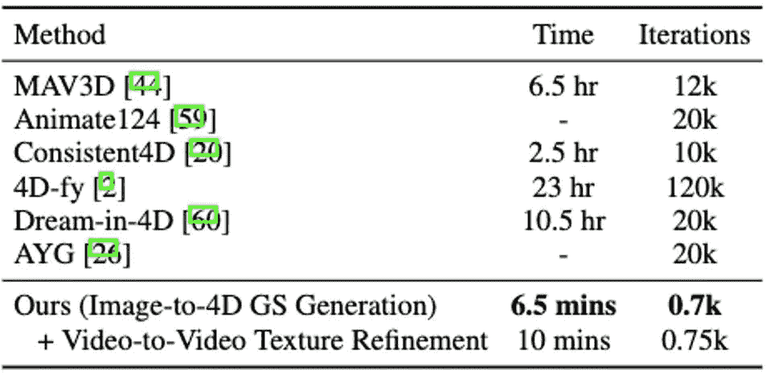

表 1 四维内容生成方法用时对比

对于基于单 图生成 四维内容的设置，我们跟随之前方法的对比方式，将生成的四维内容与给定图片的一致程度汇报在表 2 中。

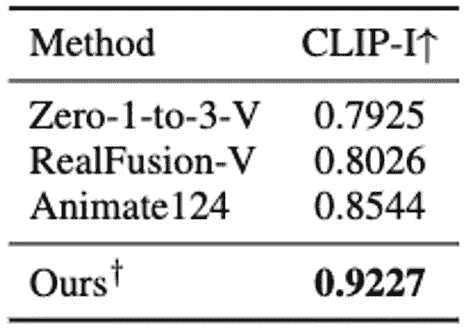

表 2 基于单 图生成 的四维内容与图片的一致性对比

对于基于 视频生成 四维内容的设置， 视频生成 四维内容方法的数值结果对比可见表 3。

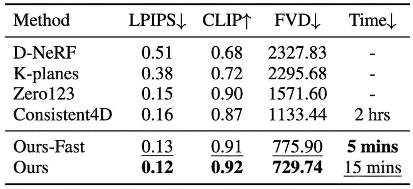

表 3 基于 视频生成 的四维内容相关方法的数值结果对比

此外，我们还对最符合我们方法的单 图生成 四维内容的各个方法的生成结果做了用户采样测试，测试的结果汇报在表 4 中。

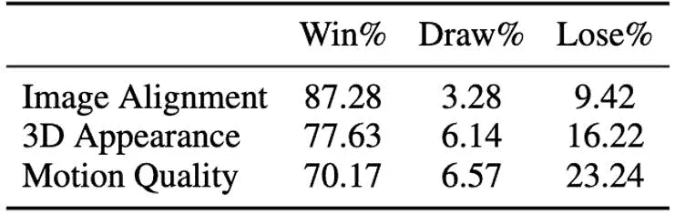

表 4 基于单 图生成 的四维内容的用户测试

DG4D 与现存开源 SoTA 的 图生成 四维内容方法和 视频生成 四维内容方法的效果对比图，分别展示在图 9 和图 10 中。

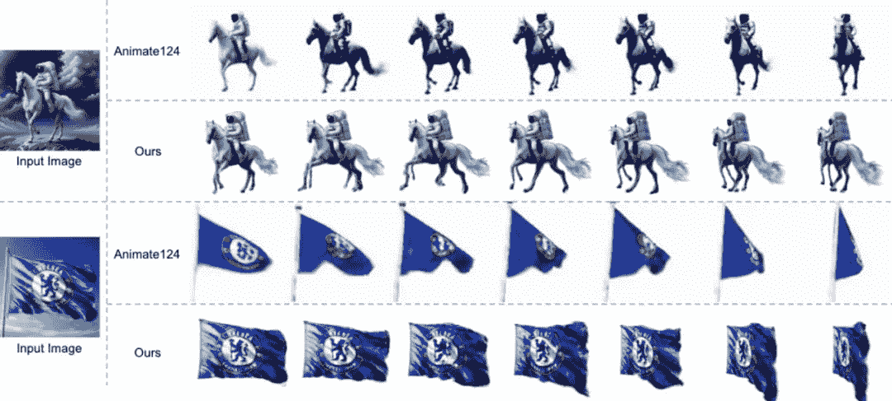

图 9 图生四维内容效果对比图

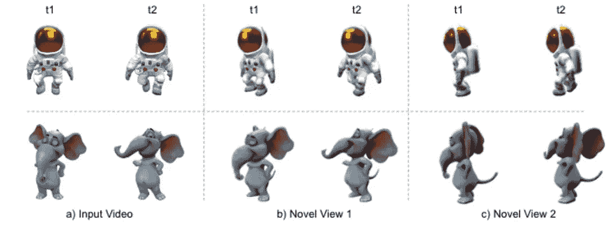

图 10 视频生四维内容效果对比图

此外，我们还基于近期的直接前馈实现单 图生成 3D GS 的方法（即非使用 SDS 优化方法），做了静态三维内容的生成，并基于此初始化了动态 4D GS 的生成。直接前馈生成 3D GS，可以比基于 SDS 优化的方法，更快地得到质量更高，也更多样化的三维内容。基于此得到的四维内容，展示在图 11 中。

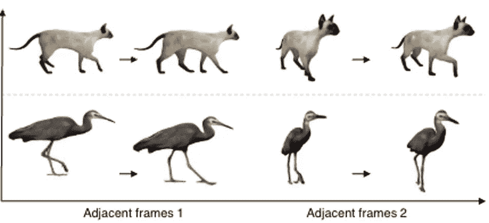

图 11 基于前馈生成 3D GS 的方法生成的四维动态内容

更多基于单 图生成 的四维内容展示在图 12 中。

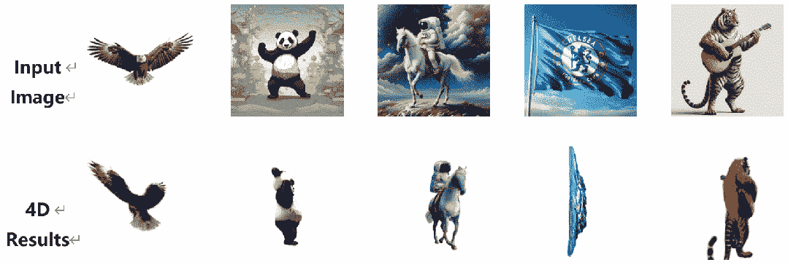

**结语**

基于 4D GS，我们提出了 DreamGaussian4D（DG4D），这是一个高效的图像到 4D 生成框架。相较于现存的四维内容生成框架，DG4D 显著将优化时间从几小时缩短到几分钟。此外，我们展示了使用生成的视频进行驱动运动生成，实现了视觉可控的三维运动生成。

最后，DG4D 允许进行三维网格模型提取，并支持实现时序上保持连贯一致的高质量纹理优化。我们希望 DG4D 提出的四维内容生成框架，将促进四维内容生成方向的研究工作，并有助于多样化的实际应用。

**References**

[1] Singer et al. "Text-to-4D dynamic scene generation." Proceedings of the 40th International Conference on Machine Learning. 2023.

[2] Cao et al. "Hexplane: A fast representation for dynamic scenes." Proceedings of the IEEE/CVF Conference on Computer Vision and Pattern Recognition. 2023.

[3] Jiang et al. "Consistent4D: Consistent 360° Dynamic Object Generation from Monocular Video." The Twelfth International Conference on Learning Representations. 2023.

[4] Zhao et al. "Animate124: Animating one image to 4d dynamic scene." arXiv preprint arXiv:2311.14603 (2023).

[5] Poole et al. "DreamFusion: Text-to-3D using 2D Diffusion." The Eleventh International Conference on Learning Representations. 2022.

[6] Bahmani, Sherwin, et al. "4d-fy: Text-to-4d generation using hybrid score distillation sampling." arXiv preprint arXiv:2311.17984 (2023).

[7] Tang et al. "DreamGaussian: Generative Gaussian Splatting for Efficient 3D Content Creation." The Twelfth International Conference on Learning Representations. 2023.