# 开源视频版GPT-4o？快速记忆，实时问答，拿下CVPR'24长视频问答竞赛冠军

> 来源：[https://agijuejin.feishu.cn/docx/JtBydSGJjoqAInxiGdCcHQQbntf](https://agijuejin.feishu.cn/docx/JtBydSGJjoqAInxiGdCcHQQbntf)

> 机器之心｜[阅读原文](https://www.jiqizhixin.com/articles/2024-07-08-12)

> 转载请联系原作者取得授权

+   张颢继： 清华大学 本科生，师从唐彦嵩老师，主要研究方向为视频理解。

+   **王逸钦： 清华大学 深圳国际研究生院硕士生，师从唐**彦嵩老师，主要研究方向为 多模态学习 。

+   **唐彦嵩博士： 清华大学 深圳国际研究生院助理教授，主要**研究方向为 计算机视觉 与 模式识别 。

+   **刘镛： 清华大学 深圳国际研究生院博士生，师从唐彦嵩**老师，主要研究方向为视觉分割、视频理解。

+   **冯佳时博士： 字节跳动 视觉研究的负责人，他的研究领域包括 **深度学习 及其在 计算机视觉 中的应用。

+   **代季峰博士： 清华大学 电子工程系副教授**，主要研究方向为视觉基础模型与自动驾驶。

+   **项**目 Leader，靳潇杰博士：现就职于 字节跳动 美国研究院，研究方向包括多模态基础模型、生成式学习、视频编辑等。

基于 ChatGPT、LLAMA、Vicuna [1, 2, 3] 等大 语言模型 （Large Language Models，LLMs）的强大理解、生成和推理能力，多模态大模型（Large Multimodal Models，LMMs）在图片视觉理解任务上取得了成功，如 MiniGPT-4、LLAVA [4, 5, 6] 等等。更进一步地，一些工作将 LMM 强大的图片理解能力迁移到视频领域，使得视频内容理解和推理成为可能，例如 Video-ChatGPT、Vista-LLaMA [7, 8] 等。

然而，大多数多模态模型 **仅能对较短的离线视频数据进行文本描述或问答，对**于长视频和在线视频流的理解能力比较有限 。让模型具有理解长视频的能力是通往更智能的模型甚至达到 AGI 的路径。这一研究空白限制了多模态大模型在许多在线场景中的实际应用，如具身 人工智能 、智能监控系统等。

针对这点，一些工作 [9, 10] 开始研**究如何增强对长视频的**理解能力，大多基于帧采样和特征融合的方法。然而，现有的方法存在以下缺点：1) 显存开销和回答延迟随输入帧数量增长 ，这为长视频理解带来困难，只能使用稀疏采样等方式，而这会显著影响模型性能。2) 无法处理在线视频流 ，只能将在线视频流进行分段处理，难以处理新输入的视频片段与旧视频片段之间的信息交互，阻碍了 LMM 对长视频流整体的理解能力。

为了解决此问题， 字节跳动 联合 清华大学 的研究人员仿照人类的 感知 和记忆机制，提出了 首个针对长视频流的在线理解多模态大模型 Flash-VStream 。

在具体介绍它之前，先来体验一下 Flash-VStream 的实时问答能力：

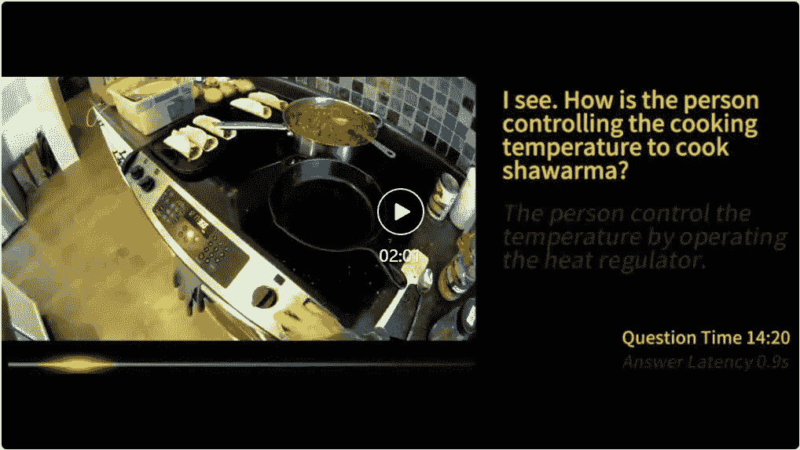

我们**可**以看到模型对长视频上下文有比较好的记忆能力，能够给出符合视频情景的回复。例如在 56:00 时刻提问抓取面粉（发生在十几分钟之前）之后主人公做了什么动作，模型能够迅速给出正确而详细的回答。 Flash-VStream 模型能够处理针对大时间跨度的视频问题，反映了模型具有高效记忆长视频视觉信息的能力 。

相比之前的工作，Flash-VStream 的优势在于：

+   能够 在线处理极长的视频 流数据 ，快速记忆重要信息，实时回答用户提问 。

+   随着输入帧数量的增加， 显存开销和回答延迟几乎没有变化 ，实现了高效的长视频理解。

+   利用 STAR 记忆机制 对不同粒度语义信息进行高效融合 ，在多个长视频问答 benchmark 上达到 SOTA。

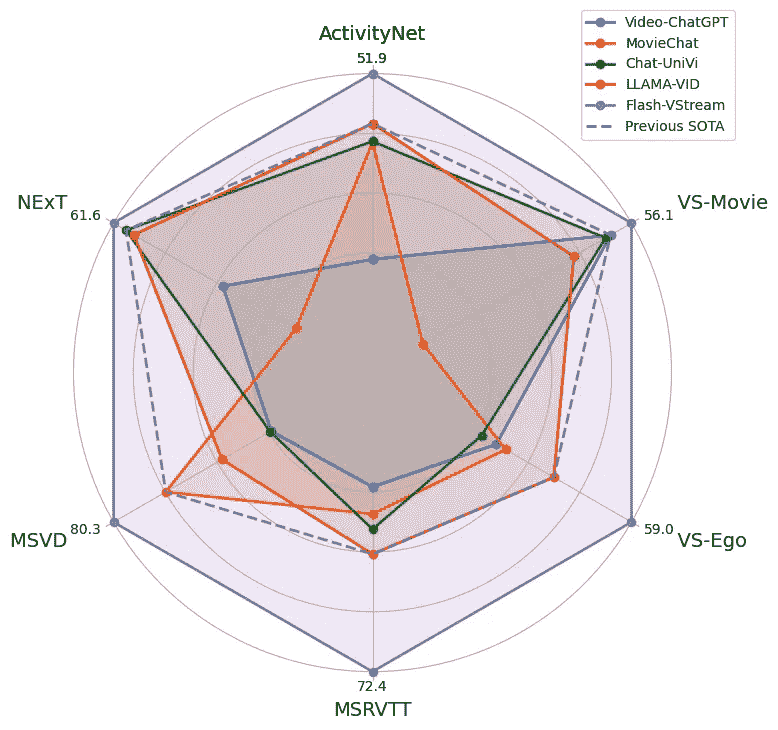

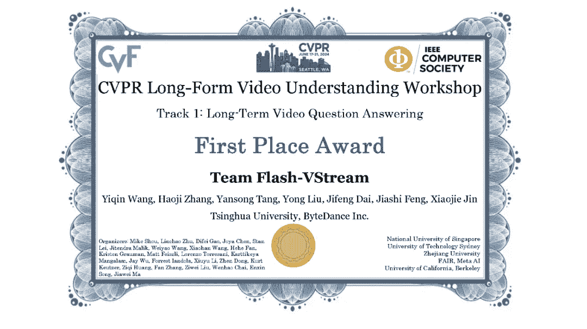

Flash-VStream 不仅在多个长视频理解 be**nch**mark 上表现优秀，还获得了 CVPR'24 长视频问答竞赛 Long-Term Video Question Answering Challenge @ CVPR 2024 Workshop 的 冠军 。

地址：https://sites.google.com/view/loveucvpr24/track1

更进一步，为了支持这一研究领域的模型评价和改进，研究团队在 Ego4D [11] 和 Movienet [12] 的基础上，借助 GPT-4V 构建了一个面向在线视频流问答场景的数据集 VStream-QA，它包含总计 21h 的视频，平均长度为 40min，每个问答对都基于特定的已标注的时间区间。在评价时，要求模型在多个时间点，基于到当时刻为止的视频片段回答问题。

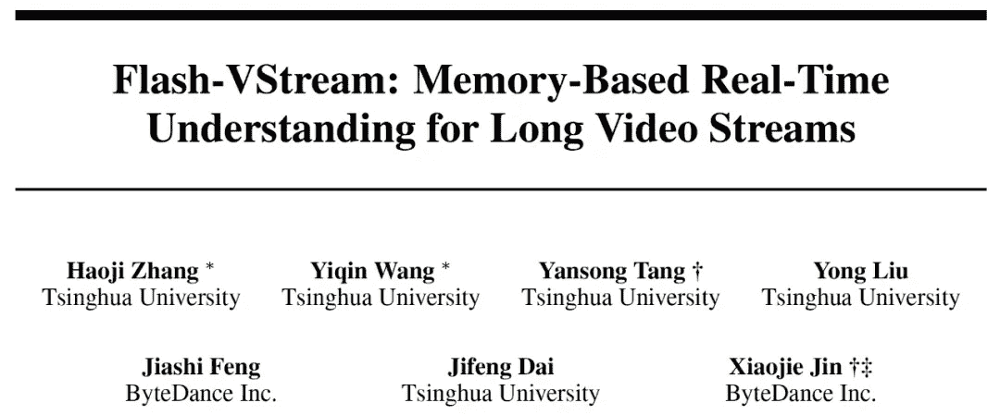

+   项目主页：https://invinciblewyq.github.io/vstream-page

+   论文链接：https://arxiv.org/abs/2406.08085

+   代码仓库：https://github.com/IVGSZ/Flash-VStream

+   在线体验：https://huggingface.co/spaces/IVGSZ/Flash-VStream-demo

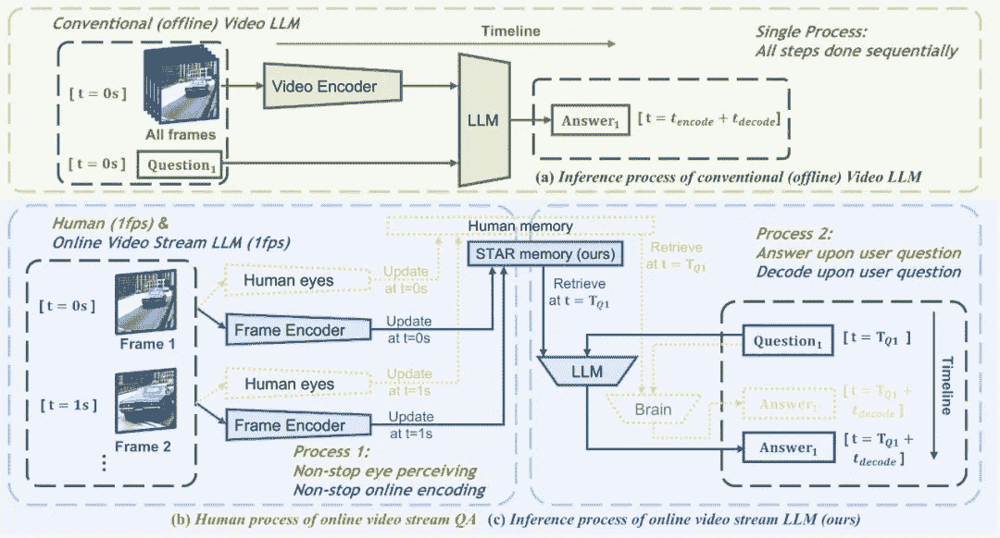

不同于传统视频理解 LMM，Flash-VStream 将视觉信息 感知 记忆和问答交互解耦，使用多进程系统实现了对长视频流的实时处理。那么这项研究具体是如何做的呢？

**模型核心：STAR 记忆机制**

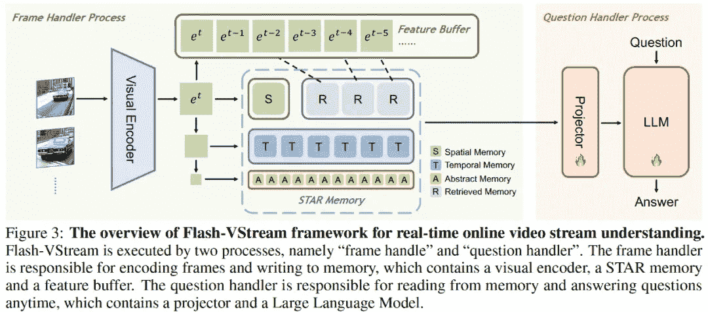

如论文中的框架图所示，Flash-VStream 架构十分简洁，由帧处理进程和问题处理进程组成，其模型包括四个主要部分：1) 预训练的 CLIP-ViT 视觉编码器；2) 大 语言模型 ；3）STAR 记忆机制；4）特征缓冲区。其中，后两者是 Flash-VStream 的核心。STAR 记忆包括 “空间”、“时间”、“抽象”、“检索” 四种记忆模块，用于高效融合不同粒度的语义信息，实现了帧级别的信息聚合。特征缓冲区辅助检索记忆，类似于人类回忆起印象深刻的事件一样，从历史视频中检索出关键信息，以提高模型对长视频中重要事件细节的理解能力。

其中，空间记忆和检索记忆每帧具有最多的 token 数量，时间记忆次之，抽象记忆每帧仅用 1 个 token 表示。这种设计高效表示了从最具体到最抽象的视觉特征。为了得到更小的特征图，Flash-VStream 在空间维度使用平均 池化 操作。

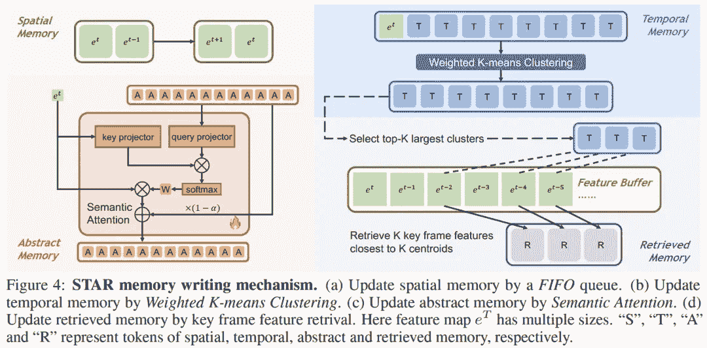

根据研究人员的描述，STAR 记忆采用了四种简洁高效的记忆更新机制：

+   对于空间记忆和特征缓冲区，通过 FIFO（First-In-First-Out）队列更新。队列维护了最新的若干帧，确保模型对最新的细粒度空间信息有较强的 感知 能力。

+   对于时间记忆，当输入 token 数量超过记忆容量时，采用加权 K-means 聚类 算法进行帧级别的特征聚合。该算法将时间记忆的 token 和新输入的 token 一起 聚类 为一些簇（簇的数量就是记忆容量，簇的大小是其所包含帧的数量），并用这些簇的质心作为新记忆，代表相应的关键事件信息。这种方法可以简洁高效地存储时序相关的上下文信息。

+   对于抽象记忆，引入了语义注意力模型（Semantic Attention），将空间与时间特征抽象成最高层次的语义特征。该模型用基于注意力和 动量 的方式更新抽象记忆，使其始终表示视频级别的高层次语义信息。

+   对于检索记忆，通过识别关键帧特征进行更新。首先从时间记忆中选择出最大的若干簇，然后从特征缓冲区中检索出与这些簇的质心 L2 距离最近的帧的特征，以此作为关键事件的回忆，为时间记忆补充相应的细粒度信息。

Flash-VStream 凭借其创新性的 STAR 记忆机制，不仅能够高效融合不同粒度的语义信息，还能通过特征缓冲区的辅助，精确地回忆和检索长视频中重要事件的细节信息，从而显著提升模型的理解能力与性能。

**VStream-QA 数据集**

有了上述实现方案，还需要有合适的测试数据来评价模型对在线视频流的理解能力。回顾现有的长视频问答数据集，它们的主要目的大多是评价模型的描述性问答能力、时序理解能力、电影理解能力等，均属于离线理解能力。并且它们的视频平均长度局限在 4 分钟以内。

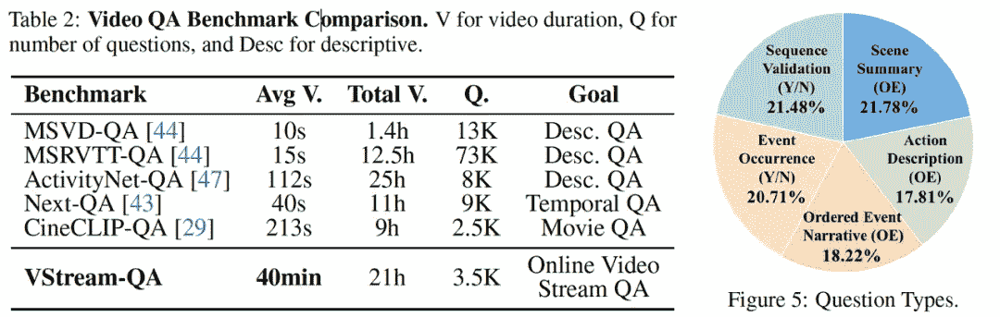

为了解决这些问题，研究团队筛选了 Ego4d 和 Movienet 中的一部分视频片段，为每个视频片段标注了多个问答对，并标记了答案所在的视频区间。在测试时，要求模型在多个时间点，基于到当时刻为止的视频片段回答问题，以此测试模型的在线视频流理解能力。这就是 VStream-QA 数据集，其样例如下图所示：

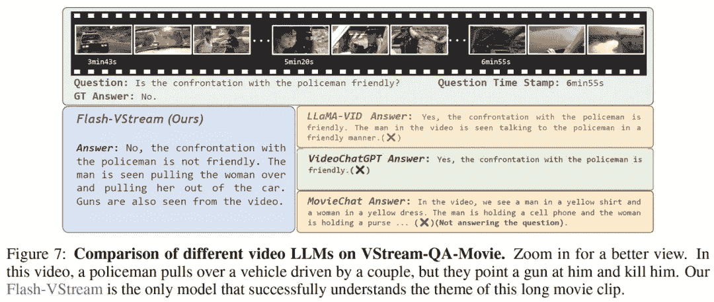

和主流的开放词典离线视频问答数据集相同，VStream-QA 数据集也采用基于 GPT-3.5 的评价指标。具体来说，向 GPT-3.5 输入问题、标准答案、模型的预测三元组，由 GPT 模型来判断该答案是否准确回答，以及可信度分数是多少。统计所有问题的指标即为 准确率 （Acc.）和可信度分数（Sco.）。

**算法测评**

研究团队在新提出的在线视频流问答 Real-time VStream-QA Benchmark 上评测了 Flash-VStream 的实时视频理解性能，包括 RVS-Ego 和 RVS-Movie 两个子集。得益于 STAR 记忆机制的高效设计，Flash-VStream 具有极低的回答延迟和显存占用，并且几乎不随输入帧的数量变化，为实时问答的性能提供保障。

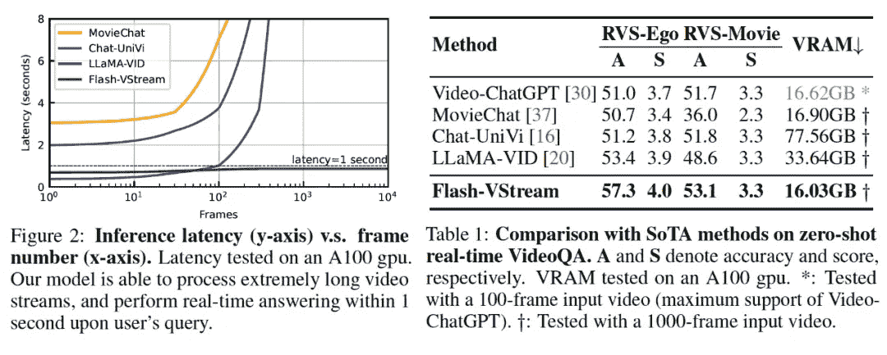

同时，为了评价 Flash-VStream 模型对于离线视频的理解能力，研究团队在四个离线视频问答 Benchmark 上评测了 Flash-VStream 的视频理解性能。此外，还在离线版 VStream-QA 数据集进行了测试，分为 VS-Ego 和 VS-Movie 两个子集。离线版 VStream-QA 数据集针对每个问题，只输入该问题答案所在的视频片段并进行提问，相比于在线版 Real-time VStream-QA 难度较低。

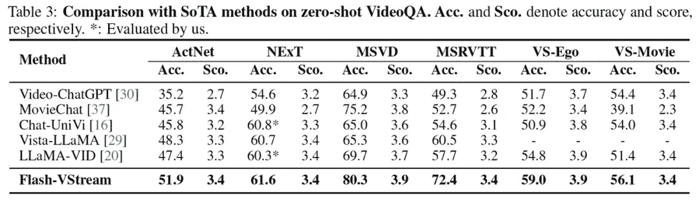

在六个 benchmark 的 准确率 和可信度分数上，Flash-VStream 的性能均优于其他方法，证明其强大的离线视频理解能力。

感兴趣的小伙伴可以关注一波，代码已经开源啦～

相关文献：

[1]: OpenAI. Chatgpt: A language model for conversational AI.

[2]: Hugo Touvron, Thibaut Lavril, Gautier Izacard, Xavier Martinet, Marie-Anne Lachaux, Timoth ́ee Lacroix, Baptiste Rozi`ere, Naman Goyal, Eric Hambro, Faisal Azhar, et al. Llama: Open and efficient foundation language models.

[3]: Wei-Lin Chiang, Zhuohan Li, Zi Lin, Ying Sheng, Zhanghao Wu, Hao Zhang, Lianmin Zheng, Siyuan Zhuang, Yonghao Zhuang, Joseph E Gonzalez, et al. Vicuna: An open-source chatbot impressing gpt-4 with 90% chatgpt qualit

[4]: Deyao Zhu, Jun Chen, Xiaoqian Shen, Xiang Li, and Mohamed Elhoseiny. Minigpt-4: Enhancing vision-language understanding with advanced large language models.

[5]: Haotian Liu, Chunyuan Li, Qingyang Wu, and Yong Jae Lee. Visual instruction tuning.

[6]: Liu, Haotian, Chunyuan Li, Yuheng Li, and Yong Jae Lee. Improved baselines with visual instruction tuning.

[7]: Maaz, Muhammad, Hanoona Rasheed, Salman Khan, and Fahad Shahbaz Khan. Video-chatgpt: Towards detailed video understanding via large vision and language models.

[8]: Ma, Fan, Xiaojie Jin, Heng Wang, Yuchen Xian, Jiashi Feng, and Yi Yang. VISTA-LLAMA: Reducing Hallucination in Video Language Models via Equal Distance to Visual Tokens.

[9]: Song, Enxin, Wenhao Chai, Guanhong Wang, Yucheng Zhang, Haoyang Zhou, Feiyang Wu, Haozhe Chi et al. Moviechat: From dense token to sparse memory for long video understanding.

[10]: Jin, Peng, Ryuichi Takanobu, Wancai Zhang, Xiaochun Cao, and Li Yuan. Chat-univi: Unified visual representation empowers large language models with image and video understanding.

[11]: Grauman, Kristen, Andrew Westbury, Eugene Byrne, Zachary Chavis, Antonino Furnari, Rohit Girdhar, Jackson Hamburger et al. Ego4d: Around the world in 3,000 hours of egocentric video.

[12]: Huang, Qingqiu, Yu Xiong, Anyi Rao, Jiaze Wang, and Dahua Lin. Movienet: A holistic dataset for movie understanding.