# 李飞飞「空间智能」系列新进展，吴佳俊团队新「BVS」套件评估计算机视觉模型

> 来源：[https://agijuejin.feishu.cn/docx/FULod59mHoSjfHxWuioc2HWwn0g](https://agijuejin.feishu.cn/docx/FULod59mHoSjfHxWuioc2HWwn0g)

> 机器之心｜[阅读原文](https://www.jiqizhixin.com/articles/2024-05-21-8)

> 转载请联系原作者取得授权

在不久之前的 2024 TED 演讲中，李飞飞详细解读了 空间智能（Spatial Intelligence）概念。她对计算机视觉领域在数年间的快速发展感到欣喜并抱有极大热忱，并为此正在创建初创公司

在此演讲中，曾提到斯坦福团队的一个研究成果 BEHAVIOR，这是他们「创建」的一个用来训练计算机和机器人如何在三维世界中行动的行为和动作数据集。

如今，吴佳俊带领团队发表了后续研究——「BEHAVIOR Vision Suite（BVS）」。论文也获得 CVPR 2024 Highlight。

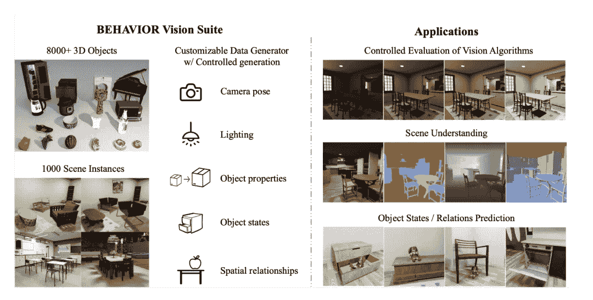

在计算机视觉领域，系统评估和理解模型在不同条件下的表现需要⼤量数据和全⾯、定制的标签。然⽽，现实世界中的视觉数据集往往难以满⾜这些需求。尽管⽬前的合成数据⽣成器为具⾝ AI 任务提供了有前景的替代⽅案，但在资产和渲染质量、数据多样性及物理属性的真实性⽅⾯，仍存在诸多不⾜。

为了解决这些问题，研究团队推出了 「BEHAVIOR Vision Suite（BVS）」。

BVS 是⼀套专为系统评估计算机视觉模型⽽设计的⼯具和资源集。基于新开发的具⾝ AI 基准BEHAVIOR-1K，BVS ⽀持⼤量可调参数，涵盖场景级别（如光照、物体摆放）、物体级别（如关节配置、属性）和相机级别（如视野、焦距）。研究⼈员可以在数据⽣成过程中⾃由调整这些参数，以进⾏精确的控制实验。

此⼯作还展⽰了 BVS 在不同模型评估和训练应⽤中的优势，包括参数可控地评估视觉模型在环境参数连续变化时的鲁棒性，系统评估场景理解模型（丰富的视觉标注），以及对新视觉任务的模型训练。

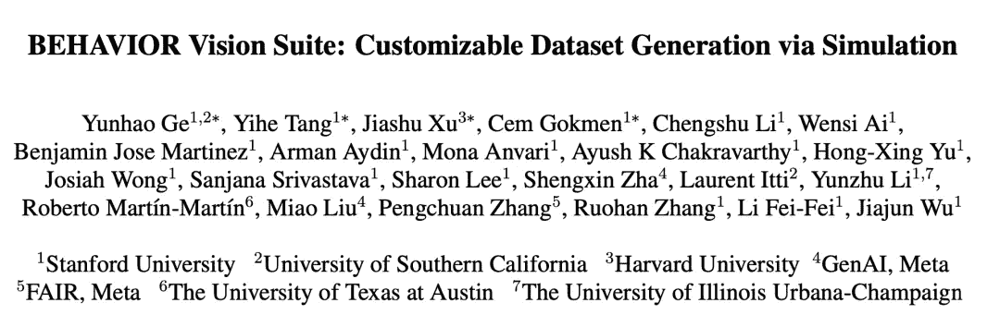

项目链接：https://behavior-vision-suite.github.io/

论文链接：https://arxiv.org/pdf/2405.09546

代码链接：https://github.com/behavior-vision-suite/behavior-vision-suite.github.io

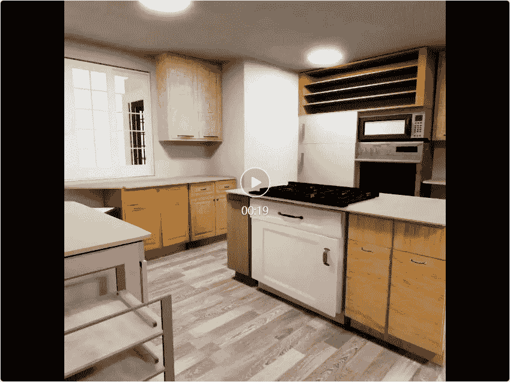

**BEHA**VIOR Vision Suite

BVS 包括两⼤部分：数据部分和基于此的可定制数据⽣成器。

数据部分

BVS 的数据部分基于 BEHAVIOR-1K 的资产拓展⽽成，共包括 8841个 3D 物体模型和由 51 位艺术家设计的室内场景，扩充为 1000 个场景实例。这些模型和场景均具备逼真的外观，并涵盖了丰富的语义类别。研究团队同时提供了一个脚本，让用户可以自动生成更多的增强场景实例。

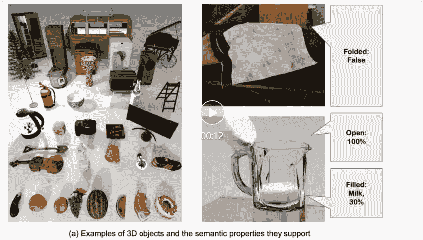

BEHAVIOR-1K的资产拓展

**

可定制数据⽣成**器

可定制数据⽣成器可以让⽤户⽅便地利⽤ BVS 的数据部分来⽣成满⾜他们需求的图⽚数据集，例如暗光下的室内场景。

BVS 可以保证⽣成的数据集在满⾜需求的同时，具备较⾼的语义多样性，同时确保其逼真性和物理合理性。具体来说，⽤户可以控制以下五个⽅⾯：相机位置、光照、物体属性（如⼤⼩）、物体状态（如开、关）和物体之间的空间关系。

**

应⽤场**景

研究者展⽰了在三个应⽤场景下 BVS 所⽣成数据的作⽤，包括：

+   参数可控地评估视觉模型在环境参数连续变化时的鲁棒性：探究模型在不同环境参数（遮挡程度，环境亮度，拍摄角度，物体关节移动，视野）连续变化情况下的表现，例如评估物体检测模型在冰箱门从完全关闭到完全打开过程中，模型能正确检测出存在冰箱的准确率，确保模型在实际应⽤中能够应对各种环境变化。还可以探究模型在不同极限参数条件的能力边界。

+   **评估场景理解模型**：使⽤拥有全⾯标注的图像，系统评估各种场景理解模型的性能。

+   **训练新视觉任务模型**：在合成数据上训练对象状态和关系预测的新视觉任务模型，并评估其从模拟到真实应⽤的转移能⼒，确保模型在真实环境中的有效性。
参数可控地评估视觉模型在环境参数连续变化时的鲁棒性

通过⽣成在某⼀维度上连续变化的数据，研究⼈员系统评估视觉模型在此变化下的鲁棒性。例如，⽣成同⼀场景中物体遮挡程度逐渐增加的数据，以评估视觉模型在部分遮挡物件下的表现。

通过评估不同 SOTA 模型，研究者发现，现有模型在常见分布之外的数据上的表现仍有不⾜。由于这些数据在现实世界中难以获得或标注，这些结论很难直接从真实图⽚数据集中得出。因此，BVS 可以帮助研究者评估模型在他们感兴趣的条件下的鲁棒性，从⽽更好地开发和提升模型。

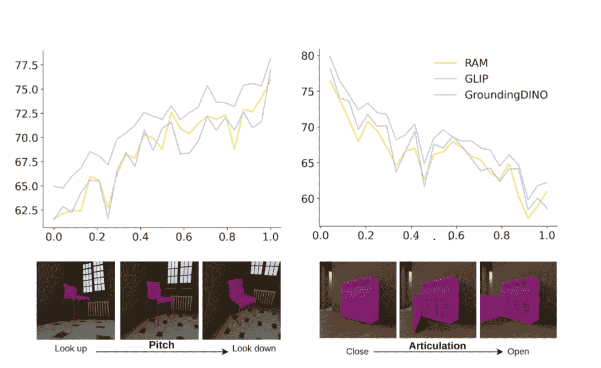

现有SOTA模型在条件变化下（例如相机仰⾓）仍有鲁棒性上的提升空间

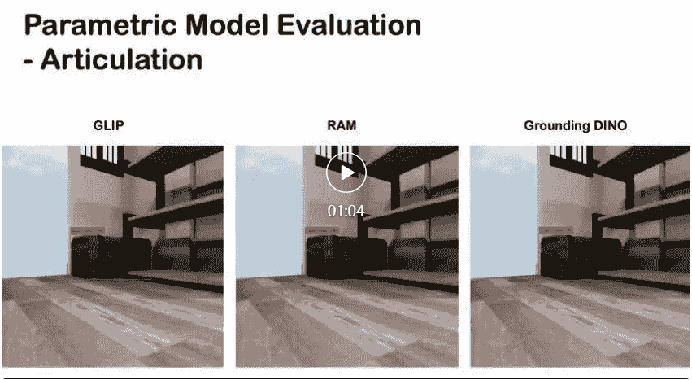

**不同检测模型在五**种环境参数连续变化时的表现

评估场景理解模型

BVS 所⽣成的数据集的另⼀⼤特征是其包含多模态的真实标签，如深度、语义分割、⽬标边界框等。这使得研究者可以利⽤ BVS ⽣成的数据在同⼀图像上评估不同任务的预测模型。

研究团队评估了开放词汇检测和分割、深度估计和点云重建四个任务的 SOTA 模型，并发现模型在 BVS 数据集上的表现顺序与在对应任务真实数据基准上的表现⼀致。这表明 BVS 生成的高质量数据真实地反映和代表了现实数据，研究者希望这样的数据集可以促进多任务预测模型的发展。

在开源的代码中，研究团队也提供了一个脚本，方便用户在场景中采样轨迹。

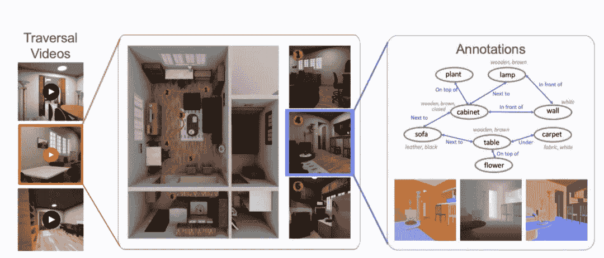

研究者收集了许多场景浏览视频⽤于评估场景理解模型

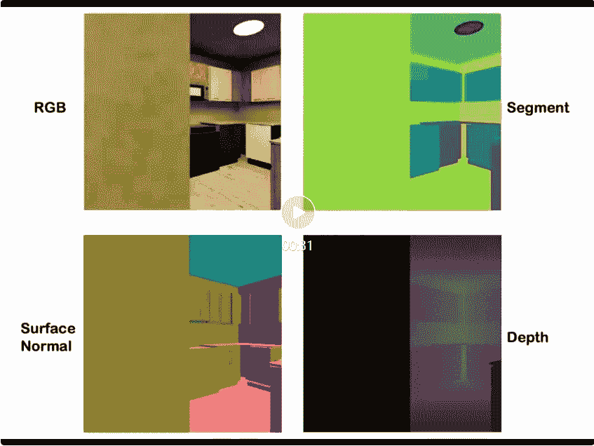

整体场景理解数据集。研究者在具有代表性的场景中生成了大量遍历视频，每个场景包含10多个摄像机轨迹。对于每个图像，BVS生成了各种标签（例如，场景图、分割掩码、深度图）

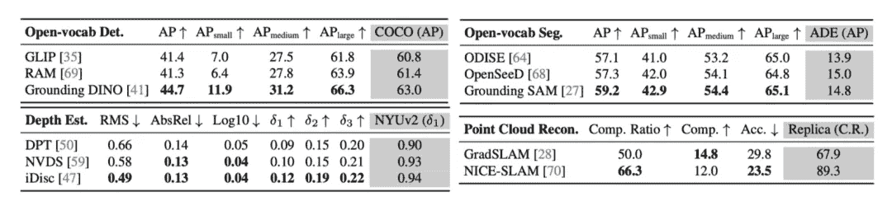

**SOTA模型在BV**S数据上的相对表现顺序与真实任务基准相符

训练新视觉任务模型

BVS 的数据⽣成不仅限于模型评估，对于难以在现实场景中收集或标注数据的任务， BVS 数据也可⽤于模型训练。

作者利⽤ BVS ⽣成了 12.5k 张图⽚，仅⽤其训练了⼀个物体空间关系和状态预测模型。该模型在未使⽤真实数据训练的情况下，仍在真实场景下达到了 0.839 的 F1 得分，体现了优秀的仿真到现实的转移能⼒（sim-to-real transfer）。

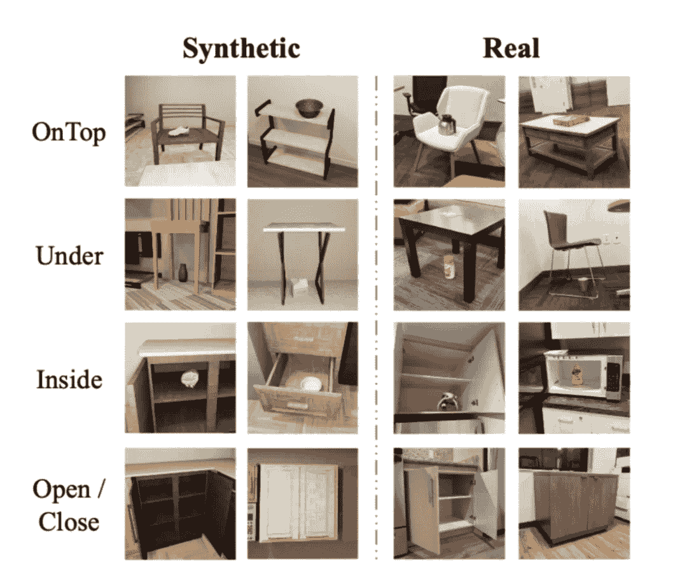

仿真⽣成训练数据集与真实测试数据集例图

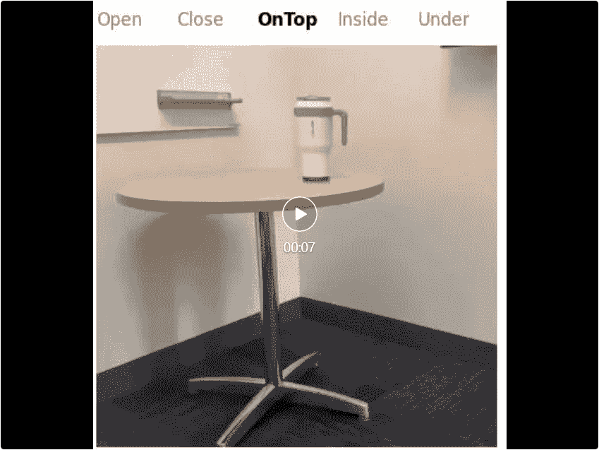

**使用**BVS生成的数据训练的物体空间关系和状态预测模型

总结

BVS 提供了⼀套强⼤的⼯具和资源集，为计算机视觉研究者⽣成定制的合成数据集提供了新的⽅法。

通过系统地控制和调整数据⽣成过程中的各项参数，研究⼈员可以更全⾯地评估和改进计算机视觉模型的性能，为未来的研究和应⽤奠定坚实基础。