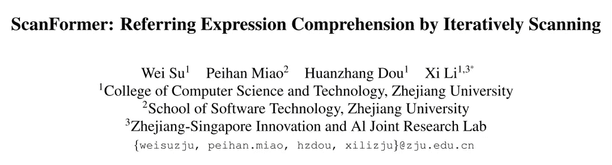
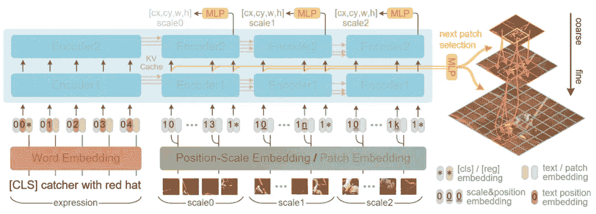
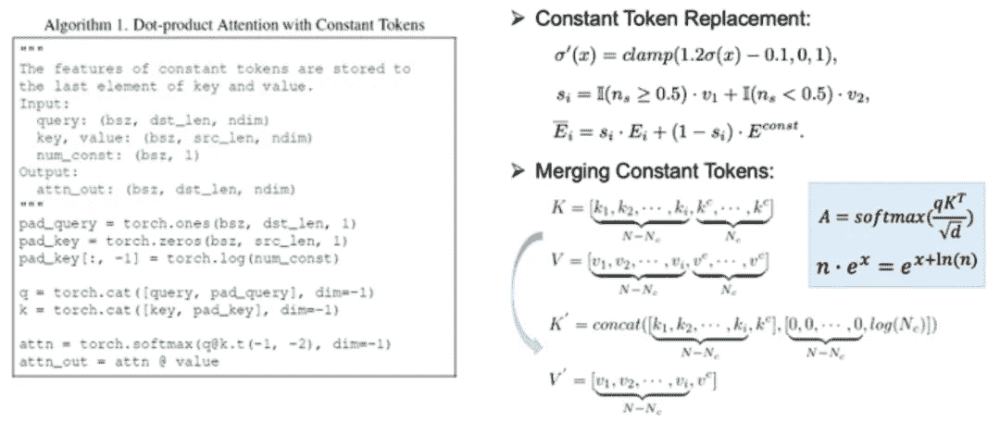
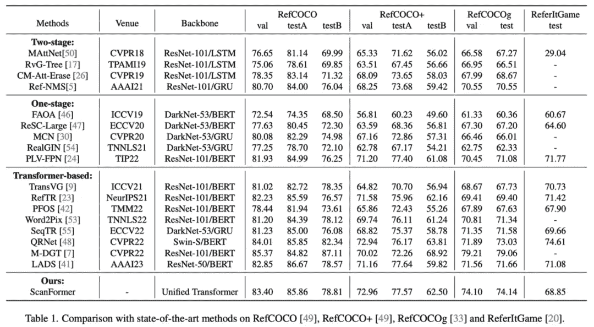
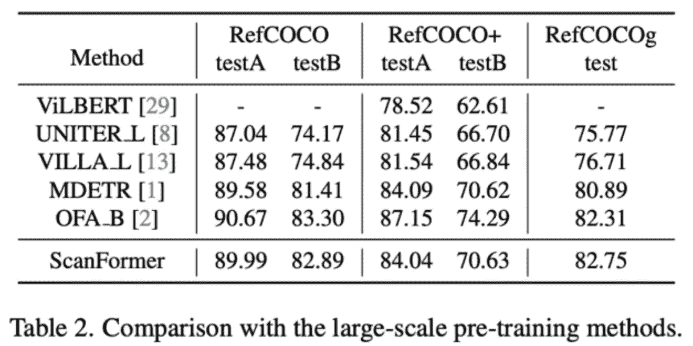
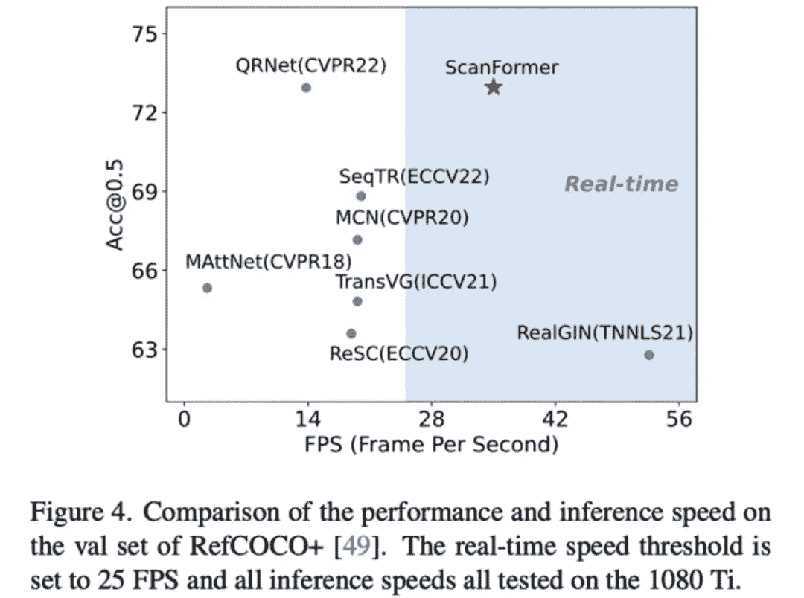
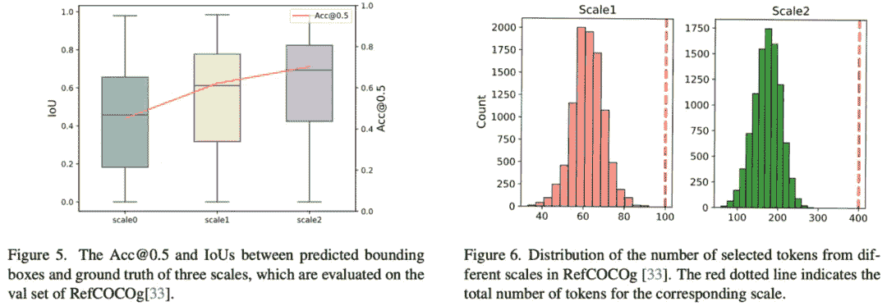
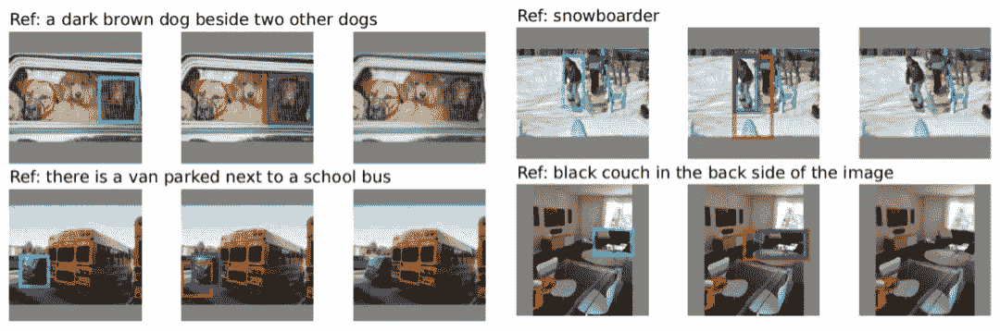

# 浙大李玺团队：指代表达理解新方法，ScanFormer粗到细迭代消除视觉冗余

> 来源：[https://agijuejin.feishu.cn/docx/NuCPd6WV4oREJFxSuYhcg5MonTh](https://agijuejin.feishu.cn/docx/NuCPd6WV4oREJFxSuYhcg5MonTh)

> 机器之心｜[阅读原文](https://www.jiqizhixin.com/articles/2024-08-20-2)

> 转载请联系原作者取得授权

**该论文作**者均来自于浙江大学李玺教授团队，论文第一作者为博士生苏伟同学，通讯作者为李玺教授（IET Fellow，国家杰青）。李玺教授团队近年来在国际权威期刊（如 TPAMI、IJCV 等）和国际顶级学术会议（ICCV、CVPR、ECCV 等）上发表 180 余篇 CV/AIGC 相关的研究工作，和国内外知名高校、科研机构广泛开展合作。

作为基础的视觉语言任务，指代表达理解（referring expression comprehension, REC）根据自然语言描述来定位图中被指代的目标。REC 模型通常由三部分组成：视觉编码器、文本编码器和跨模态交互，分别用于提取视觉特征、文本特征和跨模态特征特征交互与增强。

目前的研究大多集中在设计高效的跨模态交互模块以提升任务精度，缺少对视觉编码器探索。常见做法是利用在分类、检测任务上预训练的特征提取器，如 ResNet、DarkNet、Swin Transformer 或 ViT 等。这些模型以滑动窗口或划分 patch 的方式遍历图像所有的空间位置来提取特征，其计算复杂度会随图像分辨率快速增长，在基于 Transformer 的模型中更加明显。

由于图像的空间冗余特性，图像中存在大量低信息量的背景区域以及与指代表达无关的区域，以相同的方式在这些区域提取特征会增加计算量但对有效特征提取没有任何帮助。更加高效的方式是提前预测图像区域的文本相关性和内容的丰富程度，对文本相关的前景区域充分提取特征，对背景区域粗略提取特征。对于区域预测，一个较为直观的方式是通过图像金字塔来实现，在金字塔顶层的粗粒度图像中提前辨识背景区域，之后逐步加入高分辨率的细粒度前景区域。

基于以上分析，我们提出了 **coarse-to-fine 的**迭代 感知 框架 ScanFormer ，在图像金字塔中逐层 scan，从低分辨率的粗尺度图像开始，逐步过滤掉指代表达无关 / 背景区域来降低计算浪费，使模型更多地关注前景 / 任务相关区域。

+   论文标题：ScanFormer: Referring Expression Comprehension by Iteratively Scanning

+   论文链接：https://arxiv.org/pdf/2406.18048

**方法介绍**

一、Coarse-to-fine 迭代 感知 框架

为简化结构，我们采用统一文本和视觉模态的 ViLT [1] 模型，并将其沿深度维度分为 Encoder1 和 Encoder2 两部分以用于不同的任务。

首先，提取文本特征并将其存入 KV Cache；然后构造图像金字塔并从金字塔顶层依次往下迭代，在每次迭代中，输入当前尺度被选择的 patch，Encoder1 用于预测每个 patch 对应的下一个尺度的细粒度 patch 的选择情况，特别地，顶层图像的 patch 全部被选上，以保证模型能获得粗粒度的全图信息。Encoder2 进一步提取特征并基于当前尺度的 [cls] token 来预测该尺度的 bounding box。

与此同时，Encoder1 和 Encoder2 的中间特征会被存入 KV Cache 以方便被后续的尺度利用。随着尺度的增加，细粒度特征被引入，位置预测会更加准确，同时大部分无关的 patch 被丢弃以节省大量计算。

此外，每个尺度内部的 patch 具有双向注意力，同时会关注前序尺度所有的 patch 和文本特征。这种尺度间的因果注意力可以进一步降低计算需求。

**二、动态 patch 选择**

每个 patch 的选择情况由前一尺度生成的选择因子决定，对于应用的位置有两种方案，其一是用于 Encoder 每层 MHSA 的所有 head 中，然而，对于 N 层 H 头的 Encoder，很难获得有效的的梯度信息来更新，因此学到的选择因子不太理想；其二是直接用于 Encoder 的输入，即 patch embedding 上，由于只用在这一个位置，因此更容易学习，本文最终也采用了此方案。

另外，需要注意的是，即使输入 patch embedding 被置 0，由于 MHSA 和 FFN 的存在，该 patch 在后续层的特征仍然会变为非 0 并影响其余 patch 的特征。幸运的是，当 token 序列中存在许多相同 token 时，可以简化 MHSA 的计算，实现实际的推理加速。此外，为了增强模型的灵活性，本文并没有直接将 patch embedding 置 0，而是将其替换为一个可学习的常量 token。

因此，patch 的选择问题被转换成 patch 的替换问题。patch 选择的过程可以分解为常量 token 替换和 token 合并两步。未被选择的 patch 会被替换为同一个常量 token。由于这些未被选择的 token 是相同的，根据 scaled dot product attention 的计算方式，这些 token 可以被合并为一个 token 并乘上总数，等价于将加到维度上，因此点积注意力的计算方式不变，常见的加速方法依旧可用。

**实验结果**

本文方法在 RefCOCO、RefCOCO+、RefCOCOg 和 ReferItGame 四个数据集上取得了和 state-of-the-art 相近的性能。通过在大规模数据集上预训练并在具体数据集上微调，模型的性能可以进一步大幅提升，并达到和预训练模型如 MDETR [2] 和 OFA [3] 等相近的结果。

在推理速度上，提出的方法达到了实时的推理速度，同时能保证较高的任务精度。

此外，实验部分也对模型的 patch 选择情况以及每个尺度（scale1 和 scale2）定位精度的分布做了统计。

如左图所示，随着尺度的增加，细粒度的图像特征被加入，模型精度逐步提升。因此可以尝试加入早退机制，在定位精度满足要求时及时退出，避免进一步在高分辨率图像上计算，实现根据样本自适应选择合适的分辨率的效果。本文也进行了一些初步的尝试，包括加入 IoU、GIoU 和不确定性等预测分支，回归 early exit 的指标，但发现效果不太理想，如何设计合适且准确的 early exit 指标有待继续探索。

右图展示了不同尺度的 patch 选择情况，在所有的尺度上，被选择的 patch 占均比较小，大部分的 patch 都可以被剔除，因此可以有效地节省计算资源。对于每个样本（图像 + 指代表达），实际选择的 patch 数量相对较少，大概占总数的 65%。

最后，实验部分展示了一些可视化结果，随着尺度的增加（红→绿→蓝），模型的定位精度逐步提高。另外，根据由被选择的 patch 重建的图像，可以看出模型对于背景区域只关注了粗尺度的信息，对于相关的前景区域，模型能够关注细粒度的细节信息。

相关文献：

[1].Kim W, Son B, Kim I. Vilt: Vision-and-language transformer without convolution or region supervision [C]//International conference on machine learning. PMLR, 2021: 5583-5594.

[2].Kamath A, Singh M, LeCun Y, et al. Mdetr-modulated detection for end-to-end multi-modal understanding [C]//Proceedings of the IEEE/CVF international conference on computer vision. 2021: 1780-1790.

[3].Wang P, Yang A, Men R, et al. Ofa: Unifying architectures, tasks, and modalities through a simple sequence-to-sequence learning framework [C]//International conference on machine learning. PMLR, 2022: 23318-23340.