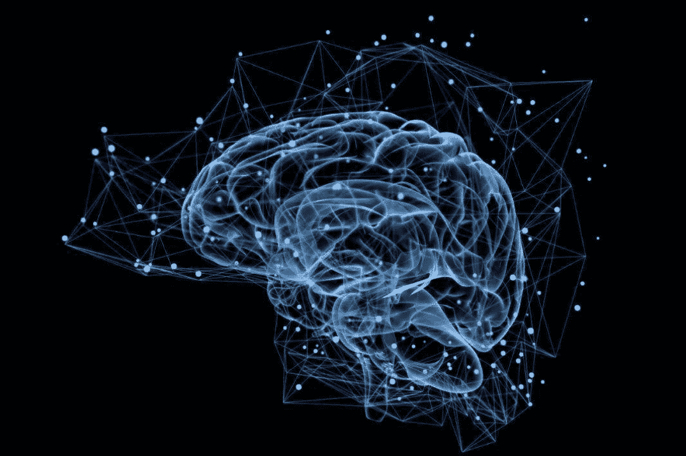
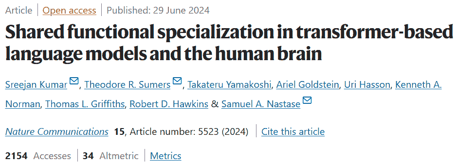
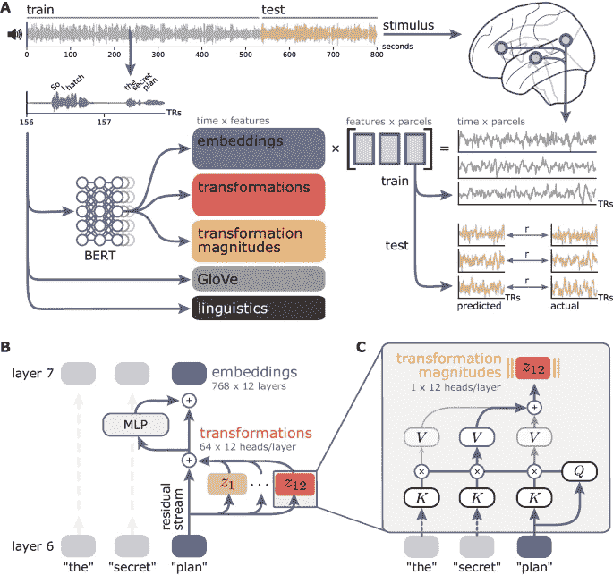
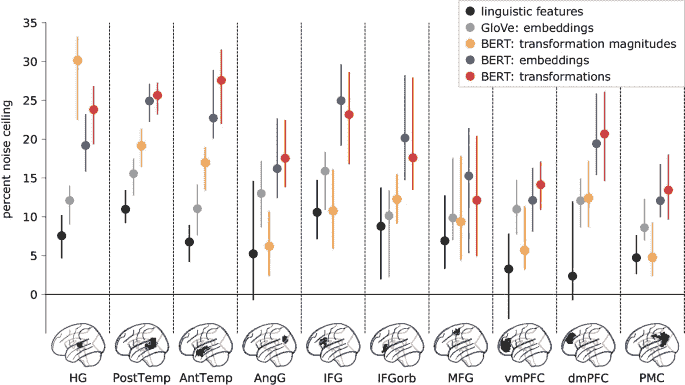
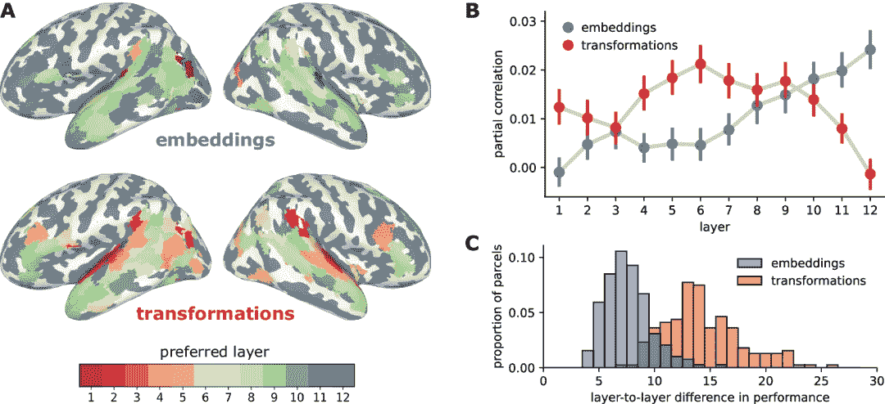
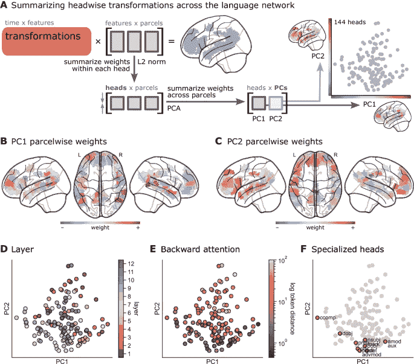
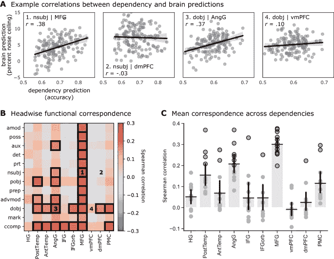

# 大脑如何处理语言？普林斯顿团队对Transformer模型进行分析

> 来源：[https://agijuejin.feishu.cn/docx/CTu1d8BnBo5WVCx71r3cPjWintd](https://agijuejin.feishu.cn/docx/CTu1d8BnBo5WVCx71r3cPjWintd)

> 机器之心 ScienceAI｜[阅读原文](https://www.jiqizhixin.com/articles/2024-07-17)

> 转载请联系原作者取得授权

编辑 | 萝卜皮

在处理语言时，大脑会部署专门的计算来从复杂的语言结构中构建含义。基于 Transformer 架构的人工神经网络是 自然语言处理 的重要工具。

普林斯顿大学的研究人员探讨了 Transformer 模型和人类大脑在语言处理中的功能特殊化问题。

Transformer 通过结构化电路计算整合单词间的上下文信息。不过，当前的研究主要集中于这些电路生成的内部表征（「嵌入」）。

研究人员直接分析电路计算：他们将这些计算解构为功能专门的「transformations」，将跨词语的上下文信息整合在一起。利用参与者聆听自然故事时获得的功能性 MRI 数据，研究人员验证了这些「transformations」是否可以解释整个皮质语言网络中大脑活动的显著差异。

研究证明，由各个功能专门化的「注意力头」执行的紧急计算，会以不同的方式预测特定皮层区域的大脑活动。这些注意力头沿着与低维皮层空间中的不同层和上下文长度相对应的 梯度下降 。

该研究以「 Shared functional specialization in transformer-based language models and the human brain 」为题于 2024 年 6 月 29 日发布在《 Nature Communications 》。

语言理解从根本上来说是一个建设性的过程。我们的大脑解决词语之间的局部依赖关系，将低级语言单位组装成高级意义单位，最终形成我们用来理解世界的叙述。

例如，如果说话者提到「秘密计划」，我们会隐性地处理此结构中单词之间的关系，从而理解「秘密」修饰「计划」。在更高层次上，我们使用周围叙述的上下文来理解这个短语的含义——这个计划包含什么内容，谁在保守这个秘密，他们又在向谁保密？

这种语境可能包含数分钟内展开的数百个单词。人们认为，人类大脑通过一系列功能专门的计算来实现这些过程，这些计算将语音信号转换成可操作的意义表示。

传统的神经影像学研究使用实验手段来分析特定的语言计算过程，并将其 映射 到受控环境下的脑活动上。然而，这种方法难以概括自然语言的复杂性。

图示：从 语言模型 的内部组件预测大脑活动的编码模型。（来源：论文）

近年来，基于 Transformer 架构的 深度神经网络 已经改变了 自然语言处理 的方式。这些模型通过自监督训练在大规模真实文本语料库上进行学习，从而实现了对长序列中每个词的上下文敏感的意义表示。

除了依赖 Transformer 模型内部的嵌入表示之外，Transformer 模型中的一些注意力头会实现特定的功能特殊化，如解析动词直接宾语或跟踪名词修饰语等。

在当前的研究中，研究人员认为 headwise transformations（由各个注意力头执行的功能专门的上下文计算）可以为大脑中的语言处理提供一个补充窗口。 自然语言处理 的神经计算理论最终必须指定如何跨单词构建意义。

Transformer 架构提供了对候选机制的明确访问，用于 量化 过去单词的含义如何融入当前单词的含义。

如果这是人类语言处理的重要组成部分，那么这些 transformations 应该为在 自然语言理解 过程中模拟人类大脑活动提供良好的基础。

研究人员从广泛研究的 BERT 模型中提取 transformations，并使用编码模型来评估这些 transformations 与其他几个语言特征系列在预测 自然语言理解 过程中的大脑活动方面的表现。

图示：比较跨皮质语言区域的三类 语言模型 。（来源：论文）

研究人员比较了三种 语言模型 的性能：经典语言特征、非上下文 词嵌入 （ GloVe ）和上下文 Transformer 特征（BERT）。

图示：嵌入和transformations的层偏好。（来源：论文）

研究人员发现，transformations 的表现与嵌入相当，并且通常优于非上下文嵌入和经典句法注释，这表明从周围单词中提取的上下文信息非常丰富。

图示：低维大脑空间中的 headwise transformations。（来源：论文）

事实上，模型早期层的 transformations 比嵌入本身更能解释大脑活动中的独特差异。最后，研究人员将这些 transformations 分解为由各个注意力头执行的功能专门计算。

图示：headwise 大脑和依赖性预测之间的对应关系。（来源：论文）

研究人员发现 headwise 的某些属性（例如回望距离）决定了 headwise transformations 与皮质语言耳之间的 映射 。研究人员还发现，对于某些语言区域，优先编码某些语言依赖关系的 headwise transformations 也能更好地预测大脑活动。

总之，该研究为理解人类语言处理提供了新的视角。

论文链接： https://www.nature.com/articles/s41467-024-49173-5