# 脑、网络与信息：大尺度脑网络结构与动力学建模

> 来源：[https://agijuejin.feishu.cn/docx/Bca0dBzbMoN7oBxFxIccojA1noh](https://agijuejin.feishu.cn/docx/Bca0dBzbMoN7oBxFxIccojA1noh)

> 集智俱乐部｜[阅读原文](https://mp.weixin.qq.com/s/Ionqs4hR-UCZkIEY4rmN3Q)

> 转载请联系原作者取得授权

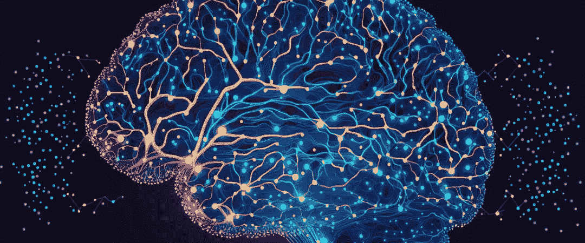

> **导语**

> [**大脑皮层具有复**](http://mp.weixin.qq.com/s?__biz=MzIzMjQyNzQ5MA==&mid=2247680541&idx=1&sn=3e8f6f04ff96462f44cf772c3b6c01f7&chksm=e8995890dfeed18623b4b88d0eb5c625931b945872f86b2da3d4169dec7f943b5c5a4ff5790e&scene=21#wechat_redirect)**杂的结构和动力学特性。在集智俱乐部「 计算神经科学 」读书会，上海交通大学自然科学研究院、数学科学学院教授李松挺介绍了大脑网络结构理论，并对其复杂网络特性如小世界和无标度性进行了详细的刻画。通过应用香农熵**量化网络的结构多样性，研究揭示了大脑网络结构符合在有限的材料和空间约束下最大化信息熵的原则。基于猕猴大脑皮层的详细连接组数据，可以构建一个大尺度的多脑区网络动力学模型，进而模拟大脑网络中不同皮层区域的时间尺度层级结构，揭示了信息在大脑中是如何按层级进行加工处理的。本文是此次读书会的文字整理。

>

> 研究领域：大脑网络结构，复杂网络，最大熵原理，神经动力学，因果度量

李松挺 **| 作者**

尹爱华 ** | 整理**

# **一、大脑网络结构的传统理论**

## **1、图论基础与小世界网络**

**• 图论基础**

七桥**问题是**图论和拓扑学的开端，欧拉通过将河岸抽象为顶点，桥梁抽象为边，从而圆满地解决**了这一问题。借**助于这种抽象和简化的数学方法，我们可以对大脑进行简化建模，构建其结构网络。在这一网络中，各个 节点 根据其位置、解剖学特征 （例如神经元密度） 及功能被划分为不同的脑区。而 网络的连接性 则通过扩散张量成像 （DTI） 、病毒的逆向及顺向示踪技术等手段确定。

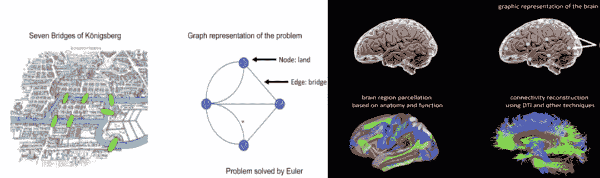

**路径长度和聚类**系数**是大脑结构网络****的基本性质**。两点间的 最短路径长度 和 平均路径长度 能够反映信息传递的速度，是衡量网络效率的关键指标；而 聚类系数 则描述了一个节点的相邻节点间的连通紧密程度，通常通过计算一个节点的相邻节点间实际连接数与可能连接数的比例来量化。这两个指标共同揭示了大脑网络在结构上的紧密度与信息处理的效率。

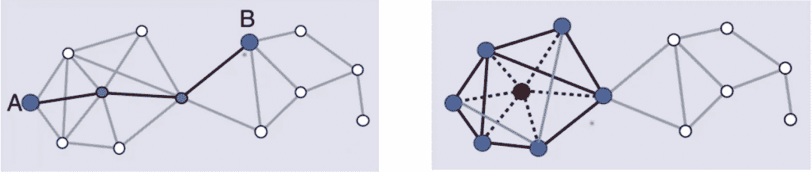

**• 小世界网络**

小世界网络是一种特殊的数学图，其特征在于网络中绝大多数节点不直接相连，但任一节点的邻居很可能彼此相连，且**大多数节点可**以通过较少的步或跳跃访问到其他节点。这一性质在社交网络中表现为不相识的人通过短的熟人链条相连，这也是所谓的 小世界现象 。许多实际的网络图，如社交网络、互联网基础架构、Wikipedia等百科网站及基因网络，均显示出小世界现象。

为了数学上更精确地描述小世界网络，通常从一个规则网络出发，比如一个环形网络，其中每个节点仅与其最近的几个邻居相连。随后，通过一个小概率 p 重新连接网络中的边以引入随机性。这种重连策略能有效减少网络的平均路径长度，同时因为只有少数边被重连，网络的聚类系数依然保持较高。

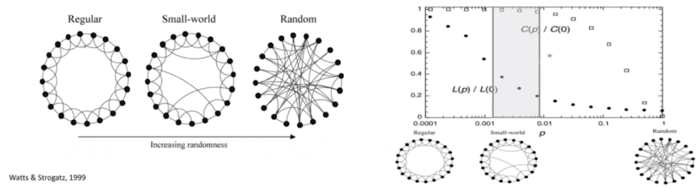

Collective dynamics of ‘small-world’ networks [1998]. Duncan J. Watts, Steven H. Strogatz

小世界网络广泛存在于社会和自然界中，例如电影演员的合作网络、电力系统、线虫的神经网络等。此外，研究还发现猕猴视觉皮层、猕猴整个皮层以及猫的皮层等生物结构，均表现出小世界网络的特征，具有较短的路径长度和较高的聚类系数。

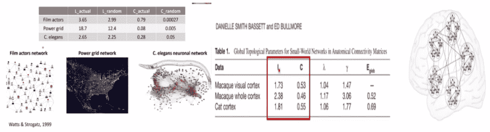

## **2、脑网络结构复杂性**

为 了用小世界网络模型刻画大脑，研究人员引入了点之间的有效连接强度，以适应大脑网络的高密度特性。研究表明，随着脑密度的增加，平均路径长度会相应减短，而传统的小世界网络模型并不完全适用于非常稠密的网络。通过考虑点之间的有效连接强度，研究者能够更准确地模拟大脑结构。

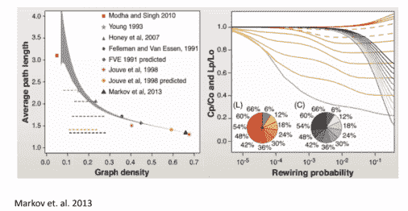

Cortical High-Density Counterstream Architectures. Nikola t. MarkovMária Ercsey-Ravasz

然而**，**这种建模方法的局限在于，它只考虑了脑区间的连接强度而忽略了连接的实际物理长度。脑区间的连接长度是与生物成本密切相关的因素，它直接影响大脑体积和生物能源消耗。定性分析表明， 大部分脑区之间的短程连接有助于节省生物成本，而少数长程连接则可以减少网络的平均最短路径长度，从而提高信息传输的效率 。尽管如此，网络中长程与短程连接的具体数量、它们的平衡点，以及网络长度分布的具体特征等问题尚未明确。

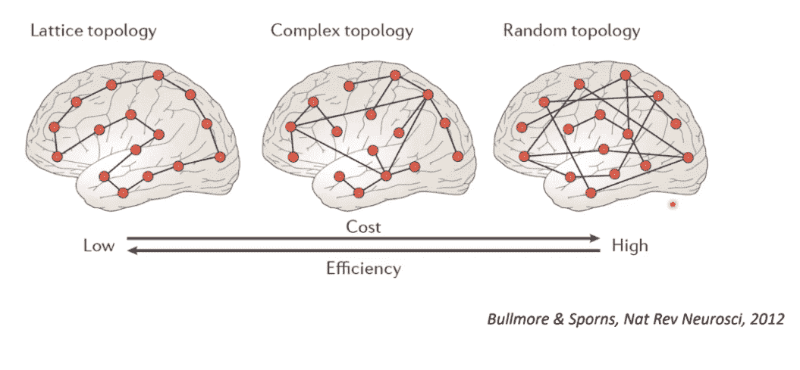

为了定量分析成本与信息传输效率之间的平衡，Betzel 和 Bassett 等研究人员绘制了人脑真实连接长度的分布，并以全连接图的分布作为比较的上界。Song 等人的对比分析发现， 与全连接图相比，短边连接在人脑中相对充分，而长边连接则相对不足 。

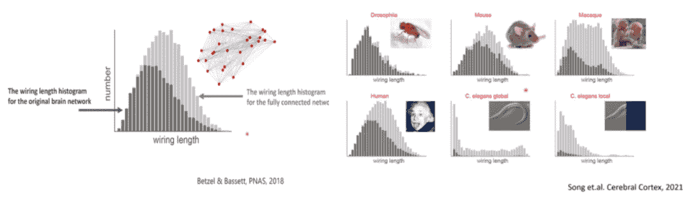

Maximum entropy principle underlies wiring length distribution in brain networks [2021] Song Y.Zhou D.Li S

类似的现象也在果蝇、小鼠、猕猴等其他生物中被观察到。然而，线虫的神经网络较为稀疏，主要是由神经元间的直接连接构成，因此其结果与人脑的不完全一致。这些普遍现象背后是否存在普遍适用的数学原理来刻画网络结构，仍是一个开放的研究问题。

# 二、大脑网络结构的最大熵原理刻画

## **1、最大熵描述与优化**

Song等人于大脑连接长度对大脑网络建模，引入了三个主要约束条件：概率约束 （确保连接长度的概率分布归一化） 、成本约束 （生物系统的物质成本限制） 、以及空间约束 （确保真实大脑中某一长度区间的连接数不超过同区间的全连接图的连接数） 。基于这些约束，研究者们定义了大脑连接长度的可行解空间，并进一步考虑通过优化目标函数来精细化模型。

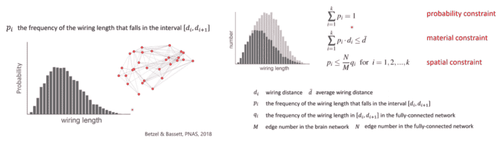

在人脑网络中，信息传递的效率被选定为优化目标。这种效率与网络结构的随机性紧密相关，并可以通过系统的熵来量化。较低的熵指网络接近规则网络，信息传递效率较低；而 较高的熵则意味着网络接近随机网络，平均最短路径较短，信息传递效率较高 。

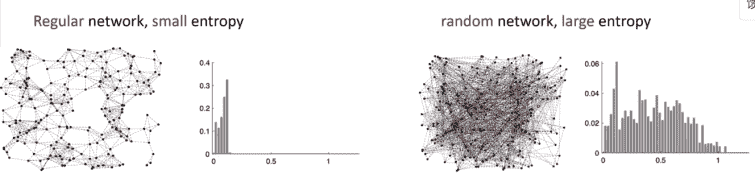

将最大化网络熵作为目标函数，并结合概率约束、成本约束、空间约束，研究表明模型有一个唯一的解。在各种物种中，这种模型的拟合效果相当好。值得注意的是，线虫虽然没有脑区只有神经网络，其从头到尾的分布需要长程连接来连接头尾，而去除长程部分后局部拟合效果良好。

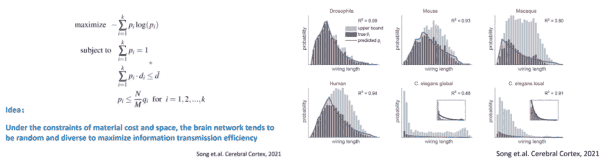

考虑到生成模型，即从一个无边的初始点状态开始，然后根据目标函数选择最优的边来逐步构建大脑的连接。如果目标函数同时考虑熵、成本约束以及节点的度约束，可以很好地恢复连接矩阵。仅有度约束或没有度约束的模型则无法有效恢复连接矩阵。

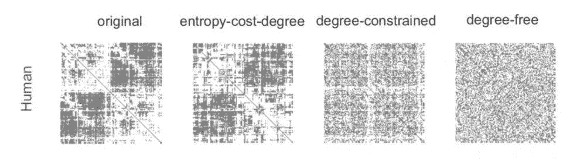

为什么要进行最大熵优化？ 理论上可以证明，熵与信息传递效率（即平均最短路径）之间存在反比关系 。在小世界网络中，随着熵的增加，平均最短路径减少。这种增加的熵可以提高信息传递的效率，可能是因为它允许大脑区间的信息传递在更多的突触延迟尺度上进行，从而使得功能更为丰富。

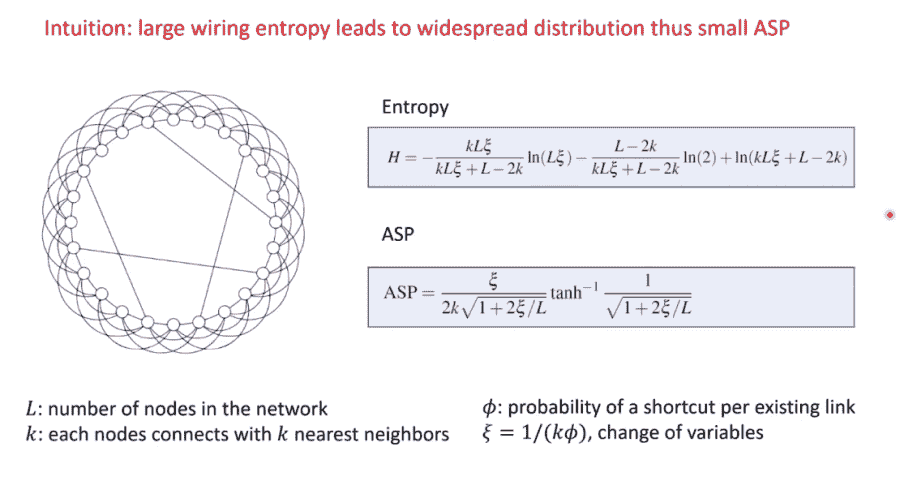

Song 等人的进一步分析显示，自然界中许多其他类型的网络，如地铁网络、航线网络、血管系统和叶脉等输运网络，也似乎遵循最大熵原理， 这些网络结构都旨在在节省材料的同时实现快速的物质或信息传输 。这种现象定性地表明了自然界中广泛存在的一个优化原则，即在保证效率的同时尽可能减少资源消耗。

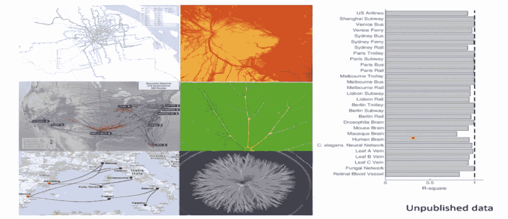

## **2、由神经活动逆推结构连接**

在神经科学中，确定复杂生物的神经元间连接是一大挑战，因为与线虫和果蝇相比，更复杂生物的神经连接往往难以完整记录。为此，科学家们采用了基于神经活动推断神经连接的方法。

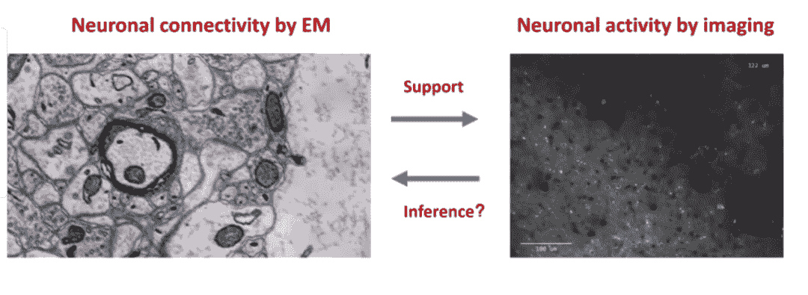

**Norbert** Wiener 在 1956 年提出了 因果推断理论 ，即如果利用变量 X 和 Y 的历史数据预测 Y 的未来效果比仅使用 Y 的历史数据更好，则表明 X 对 Y 有潜在的影响或连接。基于此理论，转移熵 这一概念被开发出来。

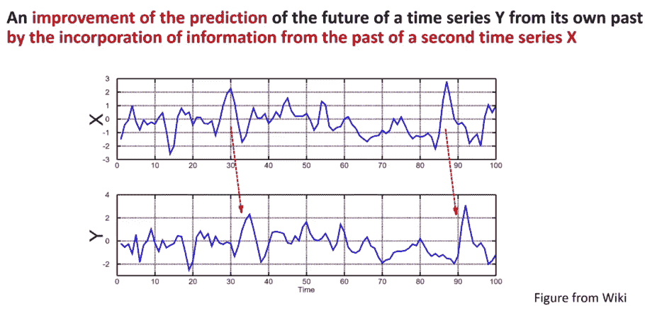

The theory of prediction. Norbert Wiener

**转移熵 ****(Transfer Entropy) 是一种非对**称的互信息度量，用于量化时间序列数据中信息从一个变量到另一个变量的方向性传递 。它的关键特性在于能够捕捉动态系统中变量之间的因果关系，而不仅仅是相关性。进一步地，条件转移熵是转移熵的一个变体，它在考虑信息传递时加入了第三个变量作为条件，帮助排除共同驱动因素或中介变量的干扰，使得信息传递的测量更加精确。截断成对转移熵则是一个更高效的方法，通过简化计算过程——仅考虑每对神经元之间的最近时间点历史，以提高计算效率。它们的定义如下：

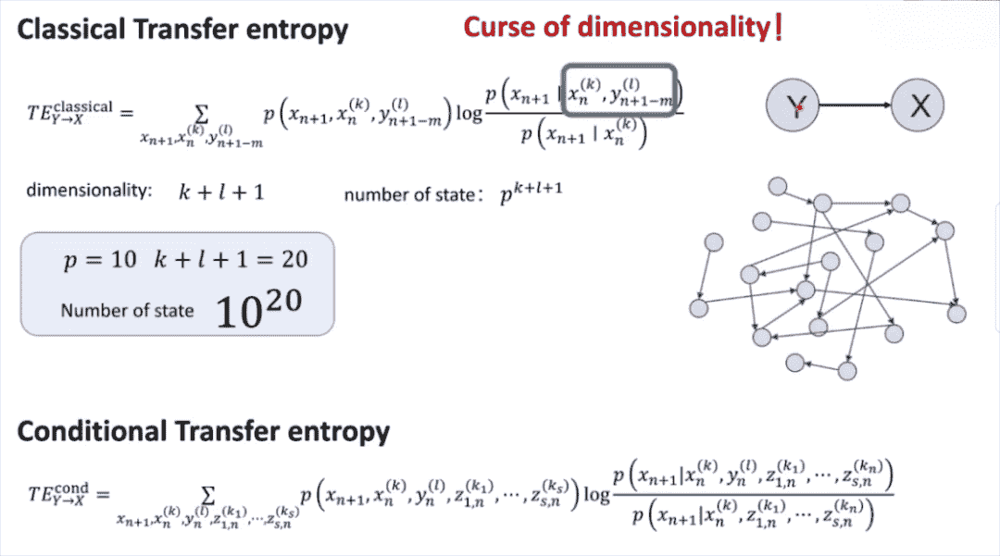

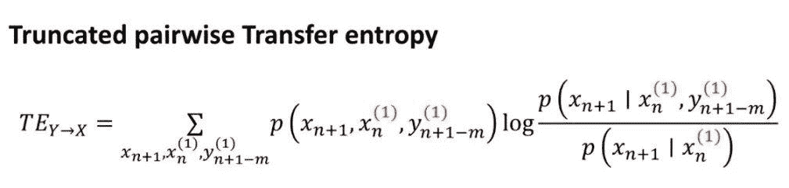

2024 年，Tian 等人在 PNAS 上发表的研究中，他们比较了四种常用的因果性度量方法 （时滞相关系数、时滞互信息、格兰杰因果关系和传递熵） 在计算神经元脉冲输出信号的因果连接时的数学理论关系。此外，他们在霍奇金-赫胥黎神经元模型网络 （HH网络） 和真实的小鼠脑网络中验证了这些理论的有效性。该研究展示了这些重构框架在真实实验数据中的有效应用，尤其是通过分析小鼠在观看不同视觉影像时记录的神经元活动脉冲序列数据，成功地重构了结构连接，并发现在不同视觉刺激条件下重构的结构连接具有较高的一致性。

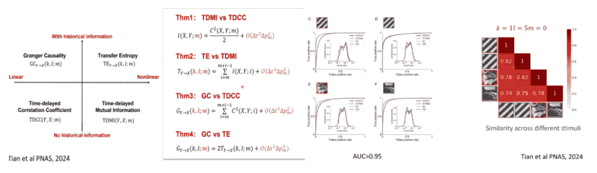

Causal connectivity measures for pulse-output network reconstruction: Analysis and applications [2024]. Zhong-qi K. TianKai Chen, Douglas Zhou et al.

这些进展为理解和重构复杂生物的神经网络提供了有力的数学和实验工具，使我们能够更深入地研究神经系统的功能和信息处理机制。

# 三、大脑结构与部分重要动力学性质的关系

## **1、从网络结构到时间尺度层级性**

网络结构对其动力学性质有深远的影响，尤其在复杂的神经系统中，如视觉信息处理系统。在这类系统中，网络结构通常呈现出明显的层级性，这对于神经元如何响应和处理信息起到了关键作用。

首先，从 **空间响应 **的角度来看，每个神经元的感受野特性对其功能至关重要。在视觉系统中，例如外侧膝状体 （LGN） 的神经元感受野通常较小，并呈现中心-周边对立的结构，使其对光斑亮度的微小变化非常敏感。而在视觉通路的下一级，即视觉皮层V1区，神经元的感受野则更大且更复杂。这是因为V1神经元接收来自多个LGN神经元的输入，能够对更复杂的视觉刺激如边缘、方向和运动产生响应。这种从简单到复杂的层级结构使得视觉系统能够逐步处理和整合信息，从而形成对复杂视觉场景的全面感知。

从 **时间响应 **的角度来看，不同层级的神经元在处理信息的时间尺度上也表现出层级性。通常，较高层级的神经元在处理更为复杂的信息时，其活动模式在较长的时间内保持一致，显示出较长的时间整合窗口和较慢的响应衰减。这种时间尺度上的层级结构允许大脑在不同时间尺度上整合信息，提高对动态和复杂环境的适应性和理解深度。

因此，神经网络的层级结构不仅在空间上通过增加感受野的复杂性和大小来增强信息处理能力，也在时间上通过调节信息处理的持续性和深度来优化响应。这种结构特性在不同物种 （如猕猴、人类和小鼠） 中的一致性表明，它是神经系统处理信息的一个基本而有效的原则。

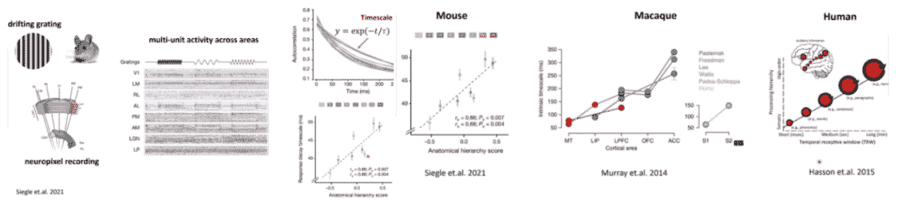

Specificity of monosynaptic connections from thalamus to visual cortex. R. Clay Reid and Jose-Manuel Alonso.

Hierarchical process memory: memory as an integral component of information processing. Uri Hasson and Janice Chen and Christopher J. Honey

## **2、狨猴皮层多区域模型**

网络结构特性对时间尺度层级性的影响主要来自于其连接模式、区域异质性以及神经元的电生理特性等方面。

**• 区域异质性和层级结构**

大脑中不同脑区具有不同的结构和功能，这种区域异质性影响了神经信号的传递方式和速度。例如，初级视觉皮层V1的反应速度较快，而更高级的脑区，如额叶皮层，处理的信息更为复杂，响应时间更长，展示了更慢的时间尺度。

考虑脑区的异质性和层级结构，构建脑区动力学模型如下，将脉冲电流或白噪声作为输入，可以观察到V1反应比高级脑区更快，越高级脑区反应变化越慢。

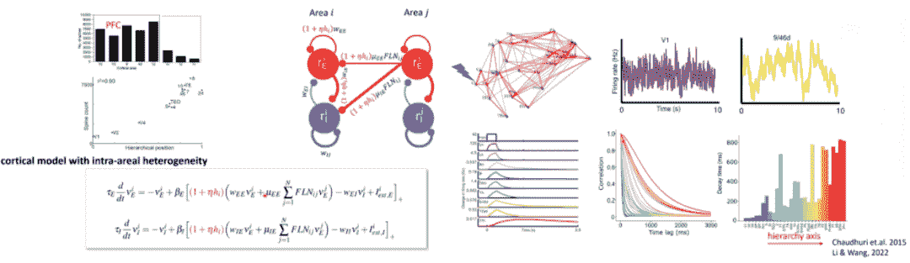

Hierarchical timescales in the neocortex: Mathematical mechanism and biological insights [2022] Songting LiXiao-Jing Wang

• **连接强度和拓扑结构**

前馈和反馈路径的连接强度不同，这些连接通常在不同层级的脑区间形成复杂的网络拓扑结构。前馈路径主要负责将感官信息传递至高级处理区域，而反馈路径则提供更高级的认知信息回馈至较低级的感官处理区。这种结构决定了信息流的方向性和效率，进而影响神经活动的时间尺度。

• **特征向量的局部化和正交性**

**Chaudhur**i等人通过理论分析和数值模拟，提出并验证了 时间尺度局部化 需要特征向量的局部化和正交性这一观点。特征向量局部化指的是特征向量在网络的某些局部区域内具有显著值，而在其他区域值较小。这种局部化使得网络在特定区域内具有特定时间尺度，由对应的特征值决定。特征向量的正交性意味着对应不同时间尺度的特征向量是没有重合的显著值。这种正交性确保了不同时间尺度的脑区能够明显分离。

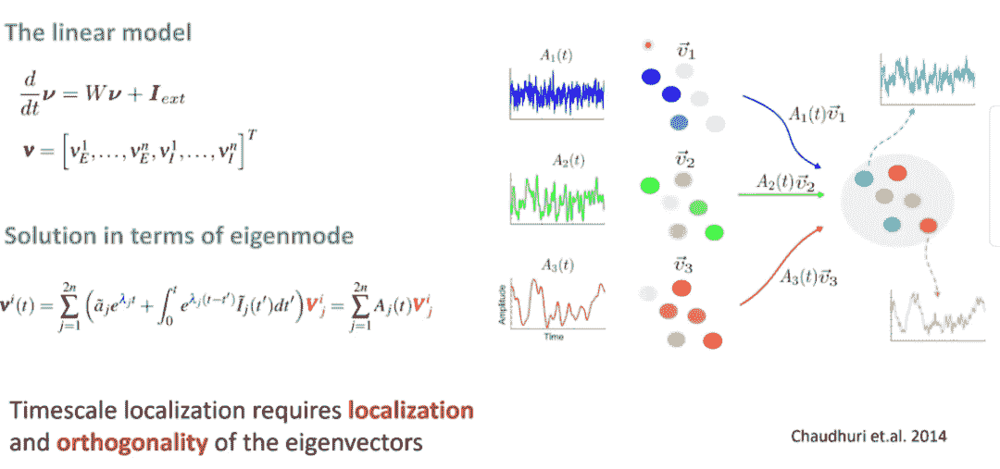

**• 连接矩阵的谱特性**

Li和Wang等人进行了基于猕猴大脑的解剖学大尺度皮层模**型的严格分析。使**用微扰方法，他们展示了 时间尺度的分离 是通过连接矩阵特征向量的局部化来定义的，这依赖于三个回路特性：突触兴奋的宏观梯度；兴奋性和抑制性神经元群体之间不同的电生理特性；每个区域之间的长程兴奋性输入和局部抑制性输入的细致平衡。

Li和Wang等人说明了谱间隙 （spectral gap） 和扰动元素的关系：

大谱间隙（Big spectral gap） ：强的区域异质性 （strong areal heterogeneity） 导致特征值之间的间隔较大，使得特征向量在特定区域内更加局部化。

小扰动（Small perturbation） ：弱的有效长程相互作用 （weak effective long-range interaction） 使得特征向量的局部化效果更好。

通过控制矩阵ΣUL的扰动和特征值之间的谱间隙，可以实现特征向量的局域化和正交性。这对于理解新皮层中时间尺度的分离机制至关重要。

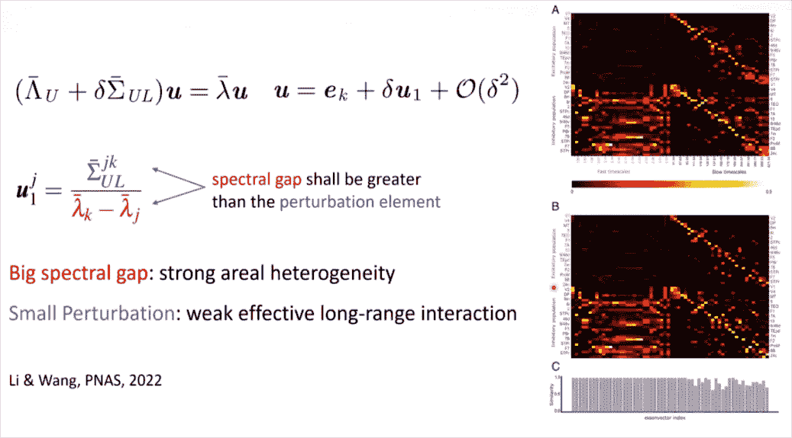

Hierarchical timescales in the neocortex: Mathematical mechanism and biological insights [2022] Songting Li，Xiao-Jing Wang

这些因素共同作用，形成了大脑中的时间尺度层级性，使得不同脑区能够在适应其功能需求的不同时间尺度上操作。这种机制是大脑处理复杂信息、维持灵活性和适应性的关键因素。

用**上述模型框架**同样可以研究决策或工作记忆中每个脑区的作用。之前研究发现，不同的刺激信号的不同维度可以表征在不同的脑区中，这被称为 分布式计算 ，这两篇研究证明了大脑在记忆和决策过程中不同的脑区对不同的信号进行编码。

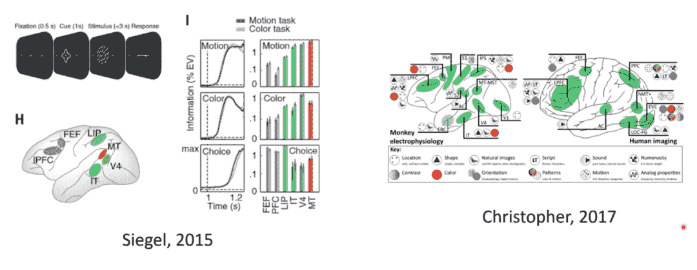

Cortical information flow during flexible sensorimotor decisions. Siegel Markus and BuschmanEarl K. et al.

# **四、总结**

本次分享深入探讨了大脑网络结构的传统理论，并对其复杂网络特性如小世界和无标度性进行了详细的刻画。通过应用香农熵量化网络的结构多样性，研究揭示了大脑网络结构符合在有限的材料和空间约束下最大化信息熵的原则，并指出该原则在不同物种间具有普遍适用性。

此外，本次分享基于猕猴大脑皮层的详细连接组数据，构建了一个大尺度的多脑区网络动力学模型。该模型能够模拟大脑网络中不同皮层区域的时间尺度层级结构，揭示了信息在大脑中是如何按层级进行加工处理的。通过严格的数学分析，进一步揭示了背后的生物机制。该模型框架还进一步模拟了大脑在决策过程中呈现出的多脑区分布式信息整合特点。

这一研究不仅加深了我们对跨物种大脑网络结构的理解，也为探索大尺度网络结构与动力学性质之间的定量关系提供了新的视角和深入的分析。这些发现有助于推动神经科学的理论发展，也为未来的神经网络模拟与疾病治疗策略提供了重要的科学基础。