# 具身大模型研究综述

> 来源：[https://agijuejin.feishu.cn/docx/L4RXduBMFoYXbtxvDRNcRcG2nbh](https://agijuejin.feishu.cn/docx/L4RXduBMFoYXbtxvDRNcRcG2nbh)

> 哈工大SCIR｜[阅读原文](https://mp.weixin.qq.com/s/I8OVIbzN1rZFDKKsT_ZSWQ)

> 转载请联系原作者取得授权

> **原创作者：** 陈一帆，张宇驰，孙楚芮，冯怀绪，宋浩，王寄哲

> **指导老师：** 张伟男

> **转载须标注出处：** 哈工大SCIR

# 1. 引言

## 1.1 机器人的智能——通用性和泛化性

在上个世纪六十年代，人类已经制造出机器人并且可以控制其执行给定的动作，例如机械臂前移五厘米，或者某个关节旋转九十度。但是对于复杂抽象的人类指令，例如，“我渴了，给我一瓶喝的”，早期需要专家人工设计动作轨迹，然后再由机器人执行[1]。

参考上述例子，如果想要实现一个智能机器人，需要以下三部分的工作：

+ 制造：机器人本体的制造，包括机械臂、机械狗、人形机器人，以及无人机、自动驾驶汽车等硬件设计制造（也包括成本的考量）。

+ 控制：机器人控制算法的研究，例如机器人手的位置控制和力控制，机器人全身站立行走和平衡。

+ 智能：机器人的智能通常分为三部分：感知、推理、执行，具体涉及机器人的环境感知、推理决策以及技能学习。

目前机器人的成本正在逐渐下降到可接受范围，机器人的控制算法也越来越完善，但机器人的智能程度却相对较为落后，这也是本文的主要关注点。以家务场景下的机器人为例，一个智能机器人需要能感知整个房子的环境信息，并且需要考虑到每个用户的房子都不一样；对于复杂的做饭任务需要进行任务规划，这同样需要考虑多种情况，例如厨房的场景配置，用户的指令细节；对于任务规划得到的各个技能需要正确执行，例如炒菜、洗碗等。目前对于这些任务场景均没有效果好、落地佳的解决方案。上述仅是一个家务场景，理想中的机器人应该可以像人一样应对多种场景，如展厅、超市、酒店、银行、工厂、医院等。若对于每一个任务场景都需要人工设计特定的解决方案，显然不够“智能”。从人工智能研究的角度出发，一个理想中的智能机器人应该是“通用”的，可以适用于各种场景，进行推理决策并执行相关技能，完成各种任务。

从人工设计专门的程序到通用型智能机器人，存在着巨大的技术发展空间，其中最关键的问题之一即为泛化性，包括人类指令、环境配置、物体形状位置、机器人类别上的泛化性。泛化性描述了机器人因为学习场景和应用场景的任务设置不一致导致的性能变化情况，这衡量了机器人在特定维度上的通用性。

## 1.2 泛化性的发展阶段

从泛化性的角度来看，智能机器人技术可以划分为以下几个阶段，如图1所示：

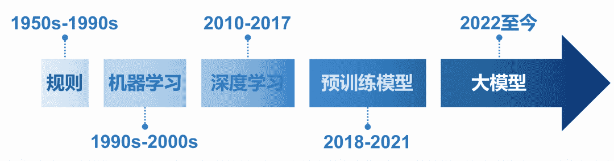

图1 泛化性角度下智能技术的发展阶段

1. 基于规则的方法：人工设计规则，用于应对不同的任务配置。例如，在早期的任务规划任务中，使用结构化的PDDL[4]语言描述待规划的任务，然后使用A*或Dijkstra算法搜索可行的动作序列。基于规则方法的难点在于，实际工作中存在的复杂任务难以设计可行、高效的算法。例如上述算法的搜索空间会随着可交互物体的增加而指数增长，并且该方法无法以图片和文本作为输入，需要人工使用PDDL语言进行建模。

1. 基于机器学习的方法：基于规则的方法重点在于为任务求解设计算法，而基于机器学习的方法，主要流程包括收集数据，基于数据求解算法参数，最后用于任务求解。算法参数包含了数据集的信息。例如，SVM算法可以基于数据求解参数矩阵和，进而用于图像分类任务。机器学习的方法不需要人工设计规则，而是对任务的数据分布进行建模，然后收集数据、训练参数。这种方法适用面更广，具有一定的鲁棒性和抗干扰能力。

1. 基于深度学习的方法：深度学习是机器学习的一种，其使用深度神经网络对数据分布进行建模，参数量更大。如果把对任务数据的建模视为函数拟合，则深度神经网络拟合能力更强，对于数据分布中线性和非线性的部分均能做到有效拟合。相比于一般机器学习方法，基于深度学习的方法可解释性较差，对数据量的要求一般更大。深度学习方法出现后，相关研究可以分为两类，即模型为中心和数据为中心。模型为中心的研究，旨在优化模型的结构、训练方法，本质是希望能够更好的拟合数据。而数据为中心的研究则希望收集更高质量、规模更大的数据，从数据的角度提高性能。纵观人工智能领域的研究发展，在给定数据集的情况下，提出新的模型结构和训练方法在前期可以取得很好的效果，但随着模型结构越来越复杂，模型性能的提升却开始减小，除非扩充数据集，使用更高质量的数据。因此一个合理的猜想是，优化模型的结构和训练方法对模型性能的提高存在上限，而提高数据的规模和质量却可以让这个上限不断提高，并且这个提高目前没有发现上限。因此以数据为中心的观点逐渐被重视，由此出现预训练模型。

1. 基于预训练模型的方法：预训练模型是深度学习模型在大规模预训练数据集训练后得到，例如计算机视觉（CV）中语言图像理解预训练模型CLIP[24]、ViT[13]，目标检测预训练模型YOLO[7]，语义分割预训练模型UNet[23]，自然语言处理（NLP）中文本理解预训练模型BERT[25]、文本生成预训练模型GPT[26]。使用预训练模型可以带来诸多优势，给定机器人任务训练集，如果基于预训练模型继续训练（微调），则训练出的模型效果一般要好于不基于预训练模型、从头训练的情况。这是由于预训练模型选择大量基础任务在大规模预训练数据集上训练，基于任务之间的相关性，这个预训练的过程可以为微调过程中新任务的效果带来增益。并且基于预训练模型进行微调，需要的数据量小于从头开始训练。除此之外，预训练模型含有丰富的世界知识，举例而言，若机器人任务训练集中没有可口可乐的图片，则从头训练的深度学习模型无法理解可口可乐是指一红色瓶装物体，而基于预训练模型则可以理解。

1. 基于大模型的方法：大模型相比于预训练模型，其模型规模一般更大，通常认为预训练模型参数量在几百M到1B之间，而大模型的参数量范围主要是1B到100B。除模型规模更大之外，大模型还存在两个特点，scaling law[56]与涌现现象[29]。scaling law是指，随着模型参数量、训练集大小、计算量的增加，模型的性能越会随之提高。涌现现象是指，当模型规模大于一定值之后，模型会涌现出之前所没有的能力，主要是复杂推理相关的能力。即，大模型不仅具有更好的综合能力，主要是语言图片的理解能力与推理能力，还具有更丰富的世界知识。除此之外，模型还具有零样本（zero-shot）和少样本（few-shot）学习的能力，即大模型可以不经过训练，只需要给定几个样例或者不需要样例，即可完成很多任务。

一般而言，上述五类方法，其泛化性逐渐变强。目前，人工智能领域的研究已经进入基于大模型的阶段，而目前机器人领域智能相关研究，主要处于深度学习和简单预训练模型的阶段，也有少部分最新工作使用了大模型。相比于基于大模型的方法，不基于大模型的方法大多存在智能水平不够的情况，具体表现为，对语言、图像的理解和推理能力不足，世界知识不丰富，需要训练或微调才能使用等。

## 1.3 人工智能技术如何提高机器人的泛化性

为提高机器人领域的智能水平，将人工智能领域的研究成果用于机器人学领域，我们将目前已有的方法主要分为以下三个类别：

1. 调用深度学习模型的方式浅层结合。目前许多人工智能领域的模型可以很方便的被调用，机器人领域一般使用计算机视觉中的物体分割、检测、识别模型，或者使用大模型完成简单的语义理解任务，如将视觉图像和文本转化为PDDL语言用于任务规划[30]。这种直接调用深度学习模型的方式简单便捷，一般根据需要选用，但这种方式下机器人的智能水平存在上限，取决于选用的深度学习模型性能，且人工智能领域的模型可能不太适用于机器人领域任务，但该种方式仅作为模型使用者，并不提高这些模型在机器人领域的表现。

1. 主动将使用深度学习技术和Agent技术应用于机器人领域任务。不同于简单的调用深度学习模型，非常多机器人领域的研究者将深度学习技术用于机器人领域任务，而不是仅作为一个使用者。例如Anygrasp使用深度学习模型建模物体的几何形状信息以估计物体的抓取位姿[2]，RPN设计了一个基于循环神经网络的模型预测中间目标进行任务规划[3]，Diffusion Policy创新性地将主要用于图像生成的扩散算法应用到机器人动作生成中，取得了很好的效果[55]。但这些深度学习小模型世界知识较为匮乏，仅在单一任务上表现了较高的性能，综合智能水平低于大模型。最近火爆的大模型可以无需训练即可使用，有研究选择以大模型为主题，探索以大模型为核心、以已有机器人方法作支撑的具身智能体框架，以一种Pipeline的方式，无需训练，组合大模型和已有的小模型，完成复杂指令。其主要利用大模型的图文理解能力、推理决策能力，对于6D位姿估计、机器人技能执行等则交由小模型执行。无论是基于大模型构建Agent，还是尝试使用SFT，这种智能性都受限于大模型本身的智能水平，而目前的大模型均为计算机视觉和自然语言处理领域，不能直接视为在机器人领域任务上的智能水平。

1. 将scaling law，压缩即智能[57]等观点用于机器人领域任务。机器人领域任务不同于人工智能领域，在数据上，机器人领域任务主要数据包括连续的图片观察，3D空间信息，机器人行为轨迹信息，真实世界物理属性信息等。这些信息在人工智能领域使用得较少，人工智能领域大模型的训练数据主要来自于互联网上的图片和文本。目前来看，大模型的智能来源于对数据集的无损压缩[57]，其会关注数据中共性的部分，因此数据集的构成分布很大程度上决定了大模型的能力主要体现在哪些方面，故而使用互联网信息训练的大模型并不能很好地适用于真实世界的机器人任务。因此有必要训练机器人领域的大模型，但是目前机器人领域的数据集并未达到足以训练大模型的规模，参考scaling law，我们可以首先基于已有数据训练规模较小的预训练模型，然后逐步扩大模型规模。

我们认为，将人工智能领域的研究成果应用于机器人领域最好的方式是，基于scaling law等已经在人工智能领域验证过的理论范式去打造机器人领域的大模型。scaling law等思维模式已经在人工智能领域取得成功，基于该思维模式发展出的大模型是目前已知的智能水平最高的人造物，考虑到基于互联网信息训练的大模型不太适合真实世界的机器人任务，因此我们认为，要想在机器人领域实现更高的智能水平，我们应该坚持scaling law等思维模式打造机器人领域的大模型。

## 1.4 Scaling law具体的技术路线

从压缩即智能，scaling law等观点出发，目前已经有一套具体的技术路线，其核心环节首先是数据，大模型需要大规模数据集，有必要设计一套高效自动化的大规模数据处理流程以及设计数据格式和配比。目前来看，自动化地收集机器人领域数据较为困难，如果使用人工手动控制或者遥操作机器人收集数据，则存在较高的成本，包括人力成本，时间成本，以及收集数据所需设备的成本。一种可行的方法是使用vr眼镜进行操作，不需要机器人硬件，机器人硬件在仿真环境中进行交互并收集数据，这样可以减少对设备成本的开销。除收集人类的专家演示外，一种可行的方式是在仿真环境中使用自动化的方式并行收集数据，其好处在于，使用强化学习策略等指导机器人交互，无需人工控制，减少人力成本。同时仿真环境配合自动化的强化学习策略，可以实现并行的数据收集，减少时间成本，由于无需机器人硬件，设备成本也大大减少，但是由于仿真环境和真实环境存在一定差距，因此需要考虑仿真环境下收集的数据质量的问题。除此之外，有研究表明互联网上的人类操作视频也可以为机器人操作提供参考。

解决数据的问题后，下一个值得研究的点是模型结构。人工智能领域的大模型主要为Tranformers架构，主要因为它方便并行训练，推理时则使用自回归的生成方式。对于机器人领域的任务，由于其数据的特殊性，可能存在其他更合理的模型结构，例如diffusion policy，对于模型结构，主要考虑三个因素，即能否较好的拟合训练数据，能否并行训练，以及推理速度。目前来看，并没有某个模型结构被证明非常适用于机器人领域，就如同Transformer之于人工智能领域。

最后是一些scaling law相关的配套技术，用于解决scaling law过程中的实际问题，例如模型参数变大需要的资源也非常庞大，因此有研究者提出混合专家（MoE）的方式，模型内部存在多个专家模块和一个路由模块，而非一个完全稠密的注意力层，这可以在计算资源有限的情况下进行更有效率的预训练。同样对于模型输入长度限制问题，有研究可以极大地拓宽模型上下文长度限制，或者采用检索增强的方式作为替代。对于模型参数量大导致推理速度慢的问题，可以研究模型量化相关的技术。

## 1.5 小结

我们将机器人的智能定义为泛化性，期望未来能实现通用的智能机器人，但通用、泛化性只是人工智能领域对智能的一种主流定义，自然存在对智能的不同的定义。但截止目前，以通用为目标创造的大模型是最符合普罗大众认知的智能。因此，将创造智能这一愿景，定义为实现通用型机器人，具体细化为提高各维度的通用性（即泛化性），是合理的。（至此，我们完成了对智能的定义：通用和泛化性）

对于实现通用的方式，经过尝试发现难以通过公式和程序设计算法来完成各种复杂任务，因此转向了基于学习的方法，主要思想是建模数据分布，实际工作是收集数据训练参数。实验结果表明，随着数据规模的增加，模型性能也会随之提高，由此产生了scaling law的观点和相应的技术路线，大模型的成功证明了这条技术路线的可行性。（如何实现通用智能体：scaling law）

为了将这种通用的能力也引入到机器人领域，实现大模型能力水平的泛化性，存在不同的方式：直接调用大模型，以大模型为中心构造机器人领域的Agent，训练机器人领域的大模型。根据压缩即智能的观点，大模型的智能能力来自于对数据的压缩，目前的大模型由互联网数据训练而来，而机器人领域主要为真实环境数据，因此如果追求更高水平的智能能力，有必要训练机器人领域的大模型。（是否有必要训练机器人领域的大模型，有）

最后我们介绍了scaling law具体的技术路线，设计一套自动化且高效的数据收集、处理流程，选择合适的模型结构和训练方法，最后配套一些相关技术。（scaling law的数据路线：核心为数据收集处理，其他包括模型结构等）

在接下来的部分中，我们会具体介绍现有的大模型用于机器人任务的工作，我们选择按照大模型发挥的功能进行分类，主要分为三部分：感知、推理和执行。在感知部分，我们会讨论大模型如何用于机器人任务的环境感知。在推理任务，我们会重点介绍大模型如何用于任务规划。在执行部分，我们会介绍大模型如何学习各种技能、生成动作轨迹。

# 2. 具身感知

具身大模型的整体环境感知，其目标是通过“考虑其内容的几何和语义上下文以及它们之间的内在关系”来理解环境[5, 6]。面对多样的下游任务，具身大模型感知环境的方法也不尽相同，下面按照调用大模型、构造基于大模型的Agent框架、具身大模型训练中感知模块的方式进行分类。

## 2.1 调用大模型

在大模型出现前，机器人领域已经参考或直接应用CV中成熟的小模型感知环境。所应用的小模型以语义分割或物体检测为主。预训练模型出现后，在物体分割、检测、识别上取得了比小模型更好的效果，但就使用方法而言，完全可以将其视作效果更好的小模型，例如YOLO[7]、TaPA[8]使用的Mask RCNN[9]、RobotGPT[10]使用的Fast SaM[11]等。大模型出现后，同样可以作为感知能力更强的工具使用，但其可以用于处理更加一般的感知请求，具体而言，以往的小模型和预训练模型只能完成主流的物体分割检测识别任务，返回的均是结构化的感知结果，而大模型可以根据任务实际需要，输入特定的文字指令，返回自然语言格式的场景理解结果，完成更一般的感知任务。

+ DiscussNav[16]，如图2所示，它所使用的感知模块由物体检测专家和场景描述专家组成，其中物体检测专家使用了RAM[17]模型，这是一种基于神经网络的图像标记模型，在本任务中被用于发现场景中大多数存在的物体；场景描述专家使用了InstructBLIP[18]模型，其为具备多任务高泛化能力的视觉语言大模型，在本任务中被用于根据任务指令观察特定的场景级信息。

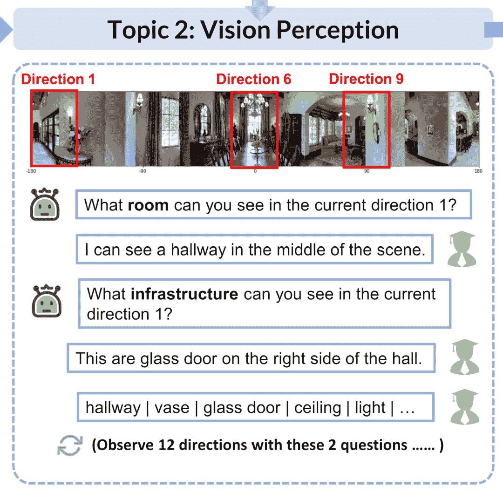

图2 大模型根据指令观察特定的场景信息

+ Octopus[19]，如图3所示，它使用GPT-4V[20]动态地根据当前阶段任务生成对观测图像的描述及分析，包括场景中可被交互的物体及其所处的空间相对位置等。这部分描述作为语言大模型的输入，用于生成下一步行动的决策。

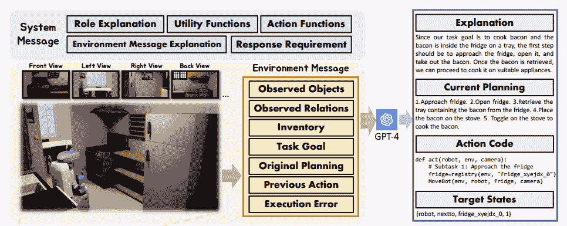

图3 GPT-4V在不同的任务阶段生成场景描述

+ AlphaBlock[21]，如图4所示，其研究人员发现GPT-4V提供坐标时往往得不到满意结果，他们认为这种缺陷可能归因于基于文本的GPT-4模型固有的有限空间感知。因此提出了近于COT[22]的改进方式，即要求GPT-4V生成坐标前进行推理，并给出对布局的理解和描述。这部分感知信息被用于实时反馈当前任务的执行状况。

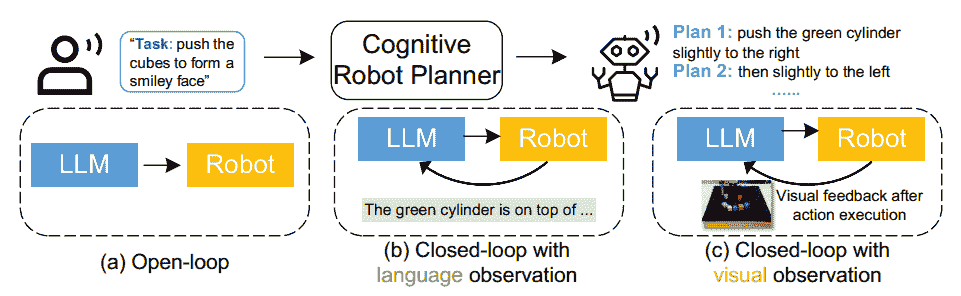

图4 大模型生成感知信息

## 2.2 基于大模型的Agent技术

在上一小节中我们提到，大模型可以作为一个通用的场景感知器，依据任务的时间要求获取环境中的信息。但这并没有发挥大模型的全部能力，大模型可以在感知的基础上进行进一步的理解，给出更有价值的环境信息，而这一般以大模型为主体，大小模型组合构成Pipeline，形成Agent框架。

+ Voxposer[27]，如图5所示，其应用多模态大模型获取物体的空间几何信息，生成其3D坐标。物体坐标用于填充代码中的参数，从而辅助生成基于机器人观察空间的一系列3D功能图和约束图。

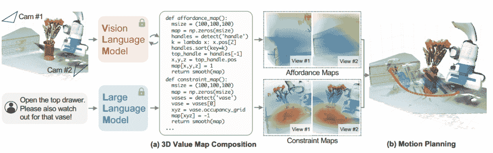

图5 大模型渲染点云用于场景感知

+ CoPa[28]，如图6所示，其应用GPT-4V在观测图像上直接绘制生成物体的特定抓取部分及候选抓取位姿，实现细粒度的物体理解。而后应用GraspNet作为抓取位姿的检测器，选取出置信度最高的姿势作为抓取姿势并执行。

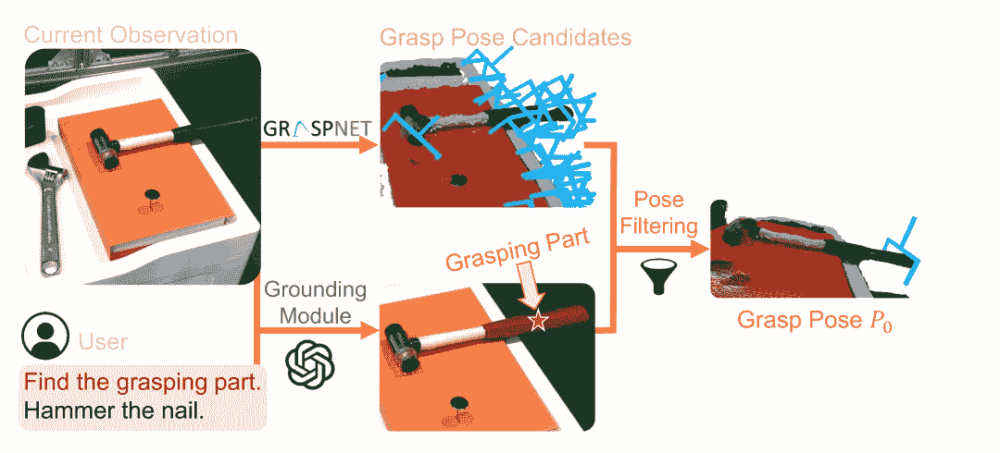

图6 大模型生成抓取点位用于物体感知

## 2.3 大模型训练中的感知模块

目前机器人领域的大模型，或者说具身大模型，一般没有纯用于感知的大模型，具身大模型一般用于决策或执行任务，而感知只是其中的一个模块，通过端到端的方法进行训练，实现感知功能。例如如`PaLM-E`[12]和`RT-2`[41]使用的`ViT`[13]，`RoboFlamingo`[14]使用的`perceiver resampler`[15]、`Openvla`使用的`Dinov2`和`SigLIP`、`RT-1`使用的`EfficientNet-B3`等。这类感知方法因其完整融入了模型的整体训练过程（有一类`VLM`的训练方式是在训练过程中冻结视觉感受器参数，但现有研究表明`VLA`的训练过程中对视觉感受器的参数微调能起到积极效果），对人类指令、环境配置、物体形状位置、机器人类别上的泛化能力均有提高。

+ `PaLM-E`[12]，如图7所示，在训练`PaLM-E`多模态具身大模型的过程中，其引入一个`ViT`视觉编码器用于理解环境图片，以一种端到端的形式训练，环境信息以隐表示的情况传递给`PaLM`模型，主要用于决策任务。

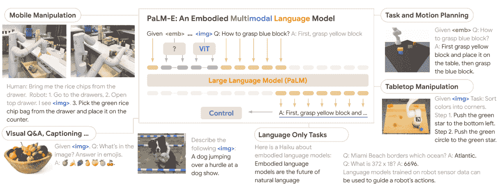

图7 `PaLM-E`内部基于`ViT`的视觉感知模块

+ `RT-1`[40]，如图8所示，`RT-1`使用`EfficientNet-B3`模型用于编码图片数据，作为感知模块。其同样将图片编码成隐表示的形式，用于后续的执行任务。通过训练，感知部分可以编码出更有利于执行任务的信息表示。

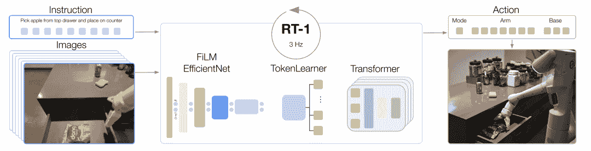

图8 `RT-1`内部基于`EfficientNet-B3`的图片编码器

# 3. 具身推理

具身智能中一个关键的研究领域是任务规划，目标为从一个给定的初始状态，将高级指令分解为可行的动作序列来实现任务。

早期的任务规划方法主要依赖符号化语言（`PDDL`、`ASP`）对规划任务进行建模，然后通过`Dijkstra`或`A*`算法等搜索最优的动作序列。这些方法可以解决较为简单的规划任务，但是当环境复杂，可交互物体增加时，搜索空间也会指数增长，搜索效率降低。并且使用符号化语言建模规划任务，使得系统无法以图片和自然语言文本作为输入，需要人工使用`PDDL`语言进行建模。

随着深度学习技术的发展，有工作提出了基于深度学习的任务规划方法，通过训练高效的预测网络，可以直接基于观察到的环境信息，如图片和指令，生成子动作或子状态序列。也有深度学习方法基于任务规划训练，得到基于隐表示的离散化状态，以及转移模型，然后使用传统的任务规划算法求解。无论哪种方式，深度学习的方法均解决了以往任务规划语言需要人工对任务进行建模的缺点，并且直接使用神经网络进行预测的方式相较于以往搜索算法效率更高。

大模型出现后，相较于一般深度学习模型，其对语言、图像的理解能力均大幅提高，推理能力也更强，因此将大模型用于任务规划任务已经成为必然趋势。根据大模型使用方法的不同，我们同样分为调用大模型、基于大模型的`Agent`技术、训练具身推理大模型。

## 3.1 调用大模型

类似于深度学习模型解决传统规划问题的两种思路：获取隐表示的离散化状态和转移模型，然后使用传统求解器求解，以及直接基于图片求解。大模型同样存在这种两种使用方法，第一种便是调用大模型辅助传统方法，第二种是一般是构建一个`agent`进行推理决策。在本节我们介绍第一种方法，将大模型作为一种转换器，将原始数据转换为传统方法可处理的形式，一般是文本或者隐表示，充分利用了大模型的理解能力。

+ `LLM+P`[30]，如图9所示，使用`GPT-4`把自然语言描述的任务翻译为`PDDL`语言，然后交给经典规划器求解；

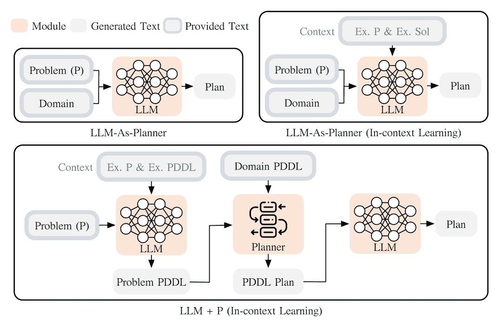

图9 大模型将自然语言任务建模为`PDDL`语言

+ `GRID`[31]，如图10所示，该方法将大模型作为一个图编码器，对自然语言形式指令、场景信息和机器人状态进行编码，使用其他模型解码输出机器人动作和目标对象；

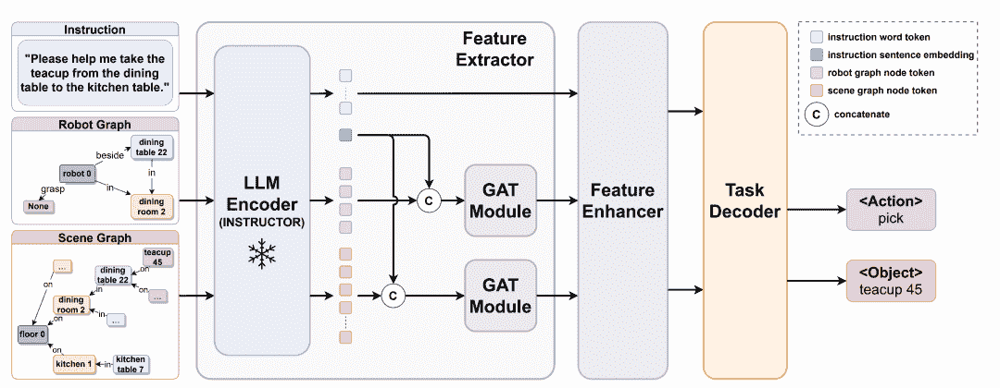

图10 大模型编码图结构信息

+ `LLM-MCTS`[32]，如图11所示，该算法利用大模型为`MCTS`（蒙特卡洛树搜索）提供先验知识并结合大模型生成的策略作为启发式方法提升搜索效率。

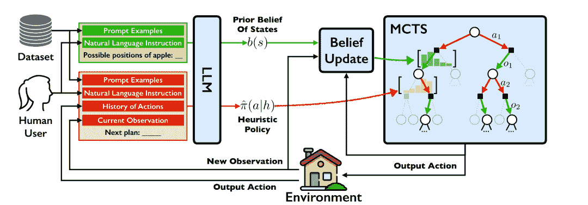

图11 大模型为蒙特卡洛搜索提供先验

## 3.2 基于大模型的Agent技术

上述方法将大模型作为转化器，充分利用了大模型的图文理解能力，却忽略了大模型的推理决策能力。在本节中我们介绍如何基于大模型构建智能体，充分发挥大模型的理解、决策的能力。具体而言，直接将大模型用于规划任务[33]。

+ `TaPA`[34]，如图12所示，预先构建包含室内场景、自然语言指令和动作计划的三元组数据集微调大模型，之后再将场景信息和具体指令作为文本`prompt`输入大模型得到规划后的自然语言指令（测试在`AI2-THOR`虚拟环境中进行）。

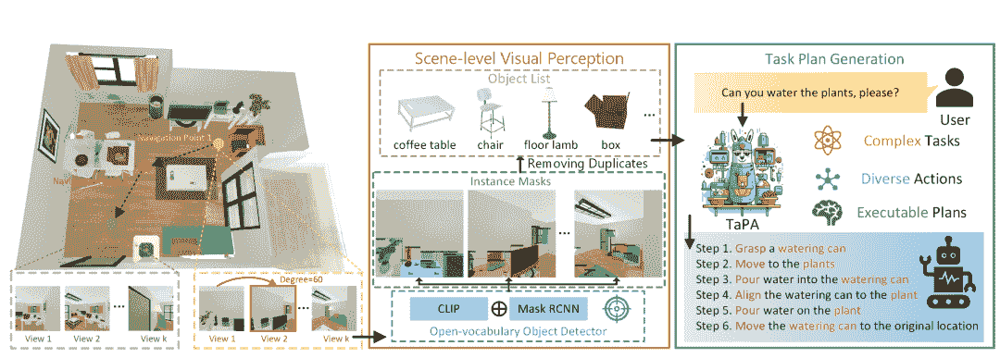

图12 结合物体检测模型的大模型任务规划

+ `ProgPrompt`[35]，如图13所示，接受高级任务和预定义的可执行操作`API`（与机器人能执行的操作和能对环境中物品施加的操作有关），大模型理解自然语言后将高级任务映射到对应的低级指令序列，结合视觉信息（物体位置和距离）给出结构化输出，测试环境为`Vitrualhome`。

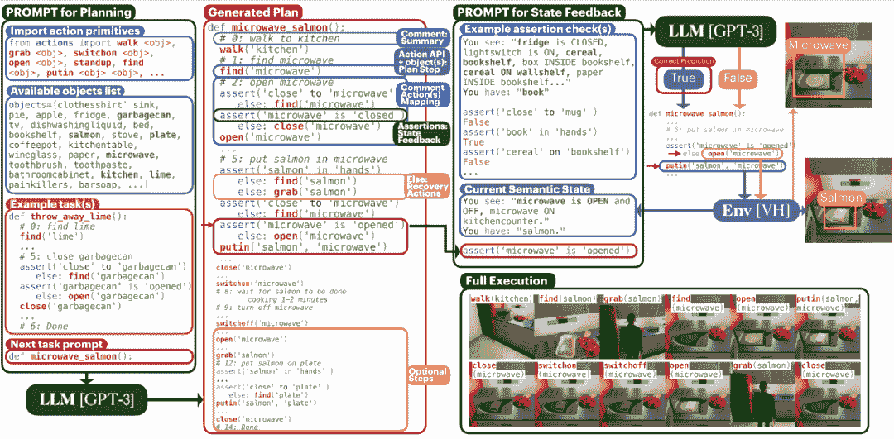

图13 大模型任务规划

+ `Saycan`[36]，如图14所示，接受视觉图像信息和自然语言指令，让大模型自主评估生成子任务的有用性（是否对整个高级任务的完成有帮助）并计算每个动作的可执行性（从当前状态执行任务的成功率），根据两者概率值乘积重排序可能的子任务。

对于应用大模型进行复杂的交互式推理任务，目前大致有如图15所示四种框架：

+ 根据自然语言指令直接调用大模型生成多个可能动作后结合环境信息进行重排序[36]；

+ 在生成具体子任务前引入一个虚拟的`think`动作[37]；

+ 任务执行失败后，让大模型进行反思（总结原因）[38]；

+ 利用小模型进行任务与环境的识别进行迅速决策，在遇到困难时改用大模型进行难度较高的长期的行动规划[39]。这种方法综合了大模型和小模型的优点，大模型可以在复杂任务中成功生成执行计划，但调用大模型时间成本较高，会降低推理效率，同时大模型也存在幻觉问题。因此对于一些简单、单一的环境识别任务可以用小模型。

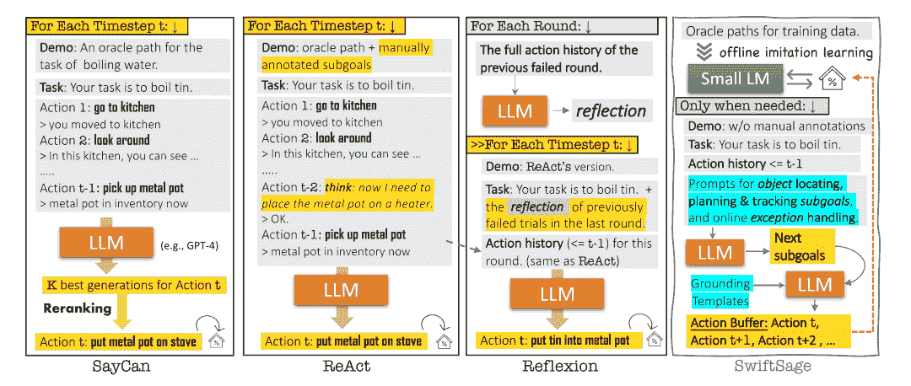

图14 基于大模型的4种`Agent`框架

## 3.3 补充机器人任务数据提高大模型决策能力

对于具身推理相关的任务，除任务规划外，还包括导航、具身问答等，是否有必要针对机器人领域的决策任务，针对性的训练一个机器人领域决策大模型？对于这个问题我们并没有一个好的答案，目前来看，基于互联网数据训练的大模型，或更有针对性而言，多模态大模型，在处理这些推理决策任务时已经表现出了较好的能力，虽然仍然存在生成结果在动作集之外、缺乏可行性、规划结果有用性不够的问题，但这些问题或许可以通过补充相关任务数据微调来解决，而不需要从头训练，例如`TaPA`[34]和`PaLM-E`[12]。但同样有可能这些问题正是多模态大模型缺乏现实世界知识所导致的，这便需要补充更多的与现实世界任务相关的数据，甚至是从头训练。

# 4. 具身执行

在具身执行部分，我们会重点讨论技能学习，即机器人操作任务。机器人操作数据与互联网图文数据截然不同，机器人操作数据输入一般为观察图片、人类指令，输出一般为机器人末端执行器轨迹，具体为一组`6D`轨迹点序列。可以看到其输出为连续的浮点数序列，而互联网图文数据的输出一般是离散的。在信息类别上，互联网图文数据主要是对图片和文字的理解和生成，而机器人操作数据则是机器人在真实世界中机械臂的移动轨迹，主要是空间中移动信息。这也导致基于互联网数据训练的大模型无法直接用于机器人操作中，无论是直接调用大模型，或者是基于大模型设计`Agent`结构，大模型均不可能直接输出连续的轨迹数据。

因此我们会直接介绍如何训练具身执行大模型，需要注意的是，目前已有的机器人操作领域数据集规模并不支持从头训练一个执行大模型，一般选择基于多模态大模型继续微调，或者是从头训练一个相对较小的预训练模型。

对于执行大模型，我们主要讨论Google的`RT`系列，包括`RT1`[40]，`RT2`[41]，`RT-H`[42]。同样出自Google的还有结合`diffusion`策略的`Octo`[43]，基于`Llama2`的`OpenVLA`[44]。使用`Mamba`的`RoboMamba`[45]，结合视频预训练的`VPDD`[46]，还有`RoboFlamingo`[47]等。

对于执行大模型的结构，可以分别两部分讨论：视觉表示、动作解码。这既是模型结构上两部分适合采用不同结构的模块进行处理，同时也有相关的研究将二者分开讨论，一篇非常相关的文章为[58]，该文章重点讨论了视觉表示的重要性，这与很多其他的文章重视动作解码、忽略视觉表示的特点相反。

## 4.1 视觉表示

现有工作通常使用手腕视角或者第三人称视角的`RGB`图片，来作为模型的视觉输入。手腕视角的图像能够提供机器人手臂操作的细节视图，方便精确控制和操作。而第三人称视角的图像则能够提供更全面的环境信息，帮助机器人进行全局规划和任务执行。这两种视角的结合，使得机器人能够在复杂和动态的环境中，具备更强的适应性和灵活性，从而更好地完成各种任务。

### 4.1.1 单帧图片编码

+ 如图16所示。对于`RT2`，该模型直接继承了视觉语言模型（`VLM`）的视觉处理部分，使用的是参数量为`22B`的`ViT`[48]模型对图片进行编码，`OpenVLA`则采用`DINOv2`[49]和`SigLIP`[50]对图像进行编码。`DINOv2`注重空间推理，以提供细粒度的视觉信息；而`SigLIP`则侧重语义理解，以丰富视觉特征。这些特征经过拼接和多层感知器（`MLP`）投影后，输入到语言模型，最终实现了图像和语言指令的融合，使机器人能够精确执行复杂任务。

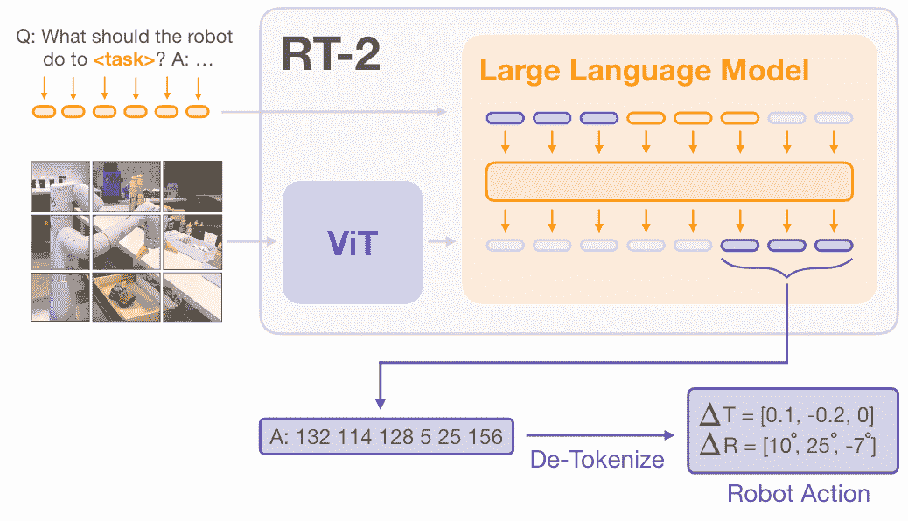

图16 `RT-2`使用`ViT`模型编码单张图片输入

### 4.1.2 图片序列编码

+ 如图17所示，`RT1`采用了一种对图片序列进行编码的策略。具体过程如下：首先通过预训练的`EfficientNet-B3`[51]模型将图像转换为特征图，然后利用`FiLM`层[52]将自然语言指令嵌入到图像特征中。接着，通过`TokenLearner`[53]模块将81个视觉标记压缩为8个，以减少计算量。通过这种方法，`RT1`能够有效地将高维图像数据和语言指令转换为紧凑的标记，实现实时的机器人控制，并在各种任务和环境中表现出色。

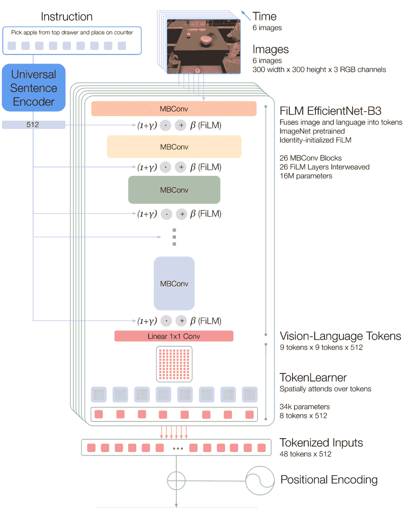

图17 `RT-1`使用`EfficientNet-B3`编码图片序列

+ 如图18所示，微软的一篇工作[54]同样采用图片序列编码的方式处理视觉信息，使用`CLIP` `ViT-B16`作为视觉编码器，通过线性层将视觉特征转换为`Transformer`模型的输入标记，结合文本指令和先前的动作及视觉帧进行预测。通过联合训练视觉、文本和动作模型，实现多模态输入的高效编码和处理，适应机器人、游戏和医疗等多领域任务。

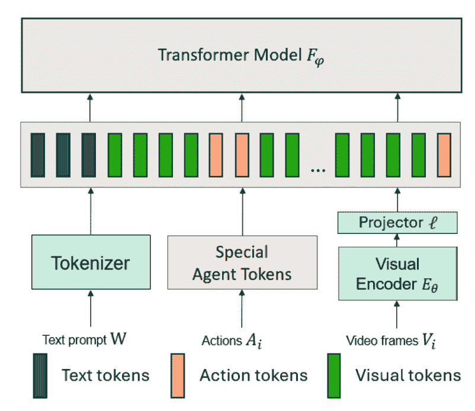

图18 `CLIP` `ViT-B16`编码图片序列

### 4.1.3 视频编码

+ 如图19所示，`VPDD`首先使用`VQ-VAE`将人类和机器人视频压缩成统一的视频`Token`，将高维视频片段编码为离散的潜在代码。然后，通过离散扩散模型在大规模无动作视频上进行预训练，预测未来的视频`Token`。在少量带动作标签的机器人视频上进行微调，将预训练阶段预测的未来视频与实际机器人视频相适配，从而指导低层次动作学习，实现高效的机器人策略学习和执行。

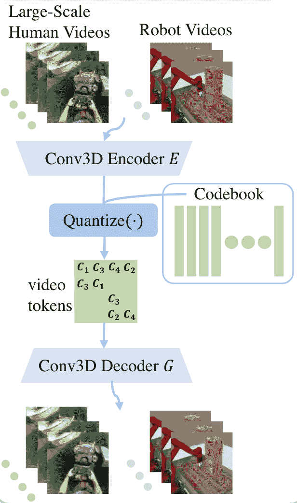

图19 `VQ-VAE`编码视频为离散代码

## 4.2 解码策略

生成机器人动作的关键在于如何高效地对视觉信息进行编码，并将这些编码后的信息转化为具体的动作轨迹。基于模仿学习的解码策略有很多种，包括行为克隆、隐行为克隆[59]、`Behavior Transformer`[60]、`diffusion policy`[55]、最近邻居算法[58]。但是我们只选取行为克隆（搭配离散化的动作空间）、`diffusion policy`两种方法介绍，因为只有这两种算法相关的工作涉及到了`scaling law`的思想。

### 4.2.1 Diffusion Policy

`Diffusion Policy`[55]，如图20所示。核心方法是将机器人的视觉运动策略表示为条件去噪扩散过程。

扩散模型生成动作序列（或称为轨迹）的输入输出分别为：以最近几张历史观察图片作为输入，输出为多步动作，即一小段轨迹。

扩散模型生成动作序列的推理过程为：首先从随机高斯分布中采样出一段轨迹，然后以观测数据作为条件，预测噪声，然后随机采样的轨迹减去噪声，称为一次去噪过程。经过多次去噪过程，最后得到预测的动作序列。

扩散模型生成动作序列的训练过程为：从数据集中取一段轨迹，以及当前观测，给定任意迭代次数，基于其随机采样噪声，以当前轨迹加上噪声作为输入，以噪声作为标准输出，选择`MSE`计算`Loss`，训练噪声预测模型。

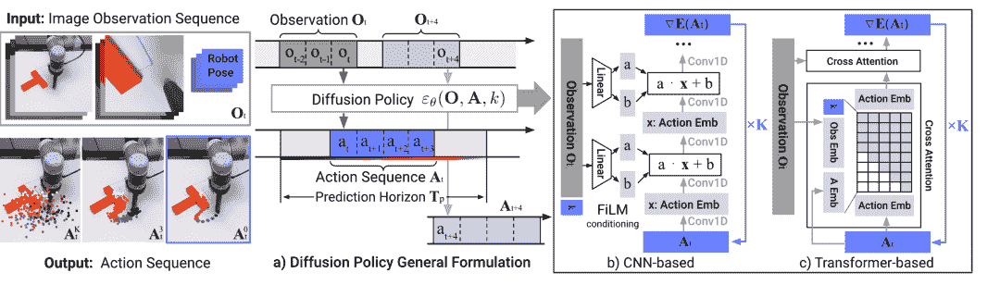

图20 基于去噪过程的机器人动作策略算法 `Diffusion Policy`

基于`diffusion policy`方法，使用更多的机器人轨迹数据进行预训练，即为如图21所示的预训练模型`Octo`[43]。`Octo`使用基于`transformer`的架构和扩散策略来生成机器人操作的动作。首先，它将语言指令、目标和观察数据进行标记化，语言指令通过预训练的语言模型进行编码，观察数据则通过轻量级卷积神经网络进行处理。接着，这些标记化的数据被输入到`transformer`中，`transformer`通过块状注意力机制处理这些数据序列，生成嵌入向量。然后，这些嵌入向量通过条件扩散解码头生成动作。这种方法使`Octo`能够预测连续的、多模态的动作分布，从而在复杂和多变的环境中生成精确且多样化的动作。

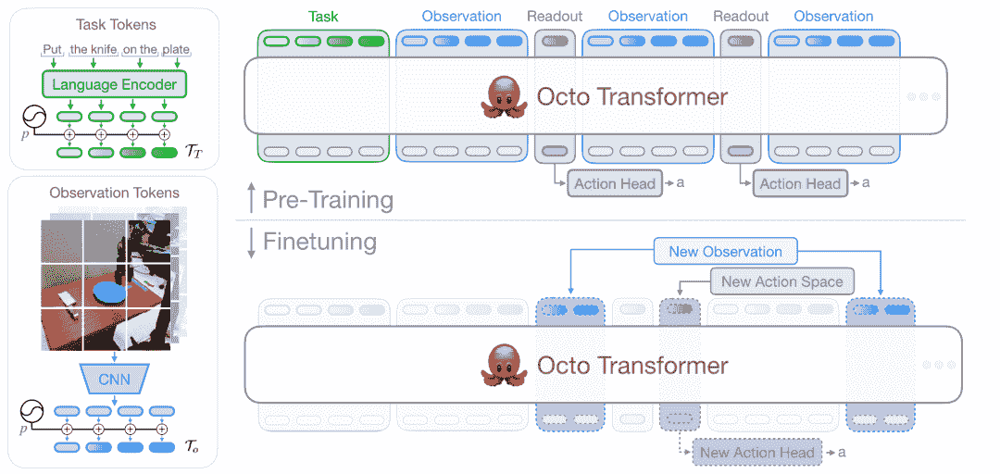

图21 使用`Diffusion Policy`作为解码策略的预训练机器人动作策略模型`Octo`

### 4.2.2 模型学习+动作空间离散化

机器人数据建模的一个难题是需要自回归的预测连续动作数据。为了简化动作生成并提高模型的稳定性，一种常用的方法是将动作空间离散化。这一方法最早由`RT1`提出，并被后续许多工作所采用。思路是将连续的动作空间离散化为有限的离散类别集合，这样可以将连续动作预测问题转化为离散的多分类问题。

`RT1`具体是通过将动作空间划分为256个`bins`，使得每个动作分量（例如，末端执行器的`x`、`y`、`z`坐标变化量、欧拉角变化量等）都映射到一个离散值。编码时将采集到的连续动作数据按照离散值的划分规则进行编码。例如，将某个动作分量的值映射到最近的离散值上；解码时将模型输出的离散值解码为相应的连续值，从而生成具体的机器人动作。

对于`RT`系列的工作和`OpenVLA`，都直接复用词表中的`token`代表这256个离散值，末端执行器的`x`、`y`、`z`坐标变化量、欧拉角变化量、夹住开合程度和执行结束标识位都直接使用`MSE Loss`，`Roboflamingo`的区别是处理夹爪时用的是`BCE Loss`，`RoboMamba`还额外加了执行方向的`loss`。

离散化后的动作空间使得模型训练更加稳定，因为离散值的选择比连续值的预测更容易优化；并且通过将动作分量离散化，模型可以更加精确地预测高频和低频动作特性，从而提高预测精度，同时离散化方法可以在多任务学习中复用，通过统一的离散值集合，可以在不同任务之间共享动作表示，提高模型的泛化能力。

## 4.3 已有工作是否验证了Scaling law

`Octo`比较了三种不同尺寸的模型：`Octo-Tiny`（`10M`）、`Octo-Small`（`27M`）和 `Octo-Base`（`93M`）的表现。结果表明，随着模型大小的增加，在`UR5`和`WindowX`这两个机械臂上的`zero-shot`表现也在增加。同时该工作指出，他们发现`Base`模型比`Small`模型对初始场景配置有更强的鲁棒性，更不容易出现过早执行抓取尝试的情况，表明较大的模型具有更好的视觉场景感知能力。

然而`RoboFlamingo`发现，在使用 `CALVIN` 全部训练数据时，较小的模型与较大的模型相比具有竞争力，使用`1B`的`MPT`模型作为基座，效果并不比`GPT-Neox`（`1B`），`MPT`（`7B`）和`LLaMA`（`7B`）差。为了进一步验证模型大小对下游机器人任务的影响，他们使用 `CALVIN` 中 10%的标注数据（仅为全部数据的 0.1%）来训练不同的大小模型。实验结果发现在训练数据有限的情况下，`VLM` 的性能与模型大小有很大关系。模型越大性能越好，这表明`VLM` 越大数据效率越高。

`RT2`同样探讨了`scaling`的问题，他们发现，从头开始训练一个非常大的模型，即使是 `5B` 模型的性能也非常差。其次，对模型（无论其大小）进行联合微调的泛化性能要优于仅使用机器人数据进行微调。这可能是因为在微调的时候保留原始数据，使得模型不会遗忘在 `VLM` 训练过程中学习的视觉理解能力。同时，该工作也展示模型规模的扩大会带来更好的泛化性能。

# 5. 大模型在应用中存在的问题

即使大模型技术能实现目前已知最高水平的泛化性，并在人工智能领域实现了通用，但其仍然存在一些问题，需要在实际应用的过程中加以考虑。

## 5.1 不确定性

## 5.1 不确定性

不确定性是深度学习领域的关键概念，反映了模型预测的可靠性和准确性。大模型本身是基于概率统计的深度学习模型，以最大似然估计的方式进行训练，在理论上它存在两种不确定性：数据不确定性和模型不确定性。数据不确定性，具体指测量系统导致的数据内在的噪声，该误差无法避免；模型不确定性，具体包括：模型结构设计带来的误差、模型训练过程随机性带来的误差、数据领域迁移带来的误差、完全未知的数据带来的误差。模型不确定性可以通过针对性的调整（如增加训练数据等）来缓解甚至解决。[61]

学术界希望通过对不确定性的研究，减少模型训练过程中的误差，并能给出可信赖的模型不确定性的估计值，从而拒绝预测或者交由人类专家，这对于关键项目或者重视安全性的领域有很大的参考意义。工业界更注重效率和实用性，希望借助人工智能减少对人力资源的开销。

## 5.2 推理速度慢

大模型存在推理速度慢的问题，根本原因在于大模型的参数规模。具体影响因素包括：计算量（模型推理所需的计算次数，影响模型生成单个token的时间）、参数量（模型中的参数总和，影响模型加载耗费的时间）、访存量（模型推理时所需访问存储单元的字节大小。访存量大则时间开销大）、内存占用（内存占用不会直接影响推理速度，但内存占用大会导致给定硬件资源下无法部署多个模型并行进行推理，间接影响速度）

模型推理分为访存密集型算子（推理时长主要取决于访存过程）和计算密集型算子（推理时长主要取决于计算过程），大模型的访存和计算开销均远高于小模型，因而总耗时更长。

对于推理速度慢的问题，主要有以下方法实现加速过程：

+ 模型压缩：通过剪枝技术减少模型大小从而降低计算需求，提高推理速度。

+ 硬件加速：换用GPU、TPU等专用硬件加速器提高计算效率。

+ 并行计算：通过模型并行、数据并行等技术，将计算任务分配到多个处理器，以提高推理速度。

+ 量化技术：将模型中的浮点数参数转换为低精度的表示，减少模型大小和计算需求，同时保持模型性能。

+ 模型蒸馏：通过训练将大模型的知识转移到小模型中，可以尽可能保持性能的同时提高速度。

+ 调整计算单元：通过利用更高速的上层存储计算单元，减少对低速更下层存储器的访问次数，来提升模型的训练性能，如flash attention。

## 5.3 数据需求大

目前人工智能领域人员在训练大模型时遇到的最主要的问题是缺乏大规模高质量的数据。主要包括以下因素：

+ 数据量：目前在实际训练中发现，7B量级的模型需要1万亿以上的token，例如Baichuan-7B使用了1.2万亿token，而Llama 3使用了15万亿token。一份高质量的数据量除规模大之外，还包括数据配比、数据多样性和数据质量等指标；

+ 数据配比：相关研究表明不同领域数据比例对模型的综合性能影响较大，即使是垂域大模型也需要保证专业领域数据与通用数据比例合理；

+ 数据多样性：从鲁棒性的角度出发，多样的训练数据具备更为丰富的特征空间，能有效避免大模型过拟合的现象（考虑到大模型参数量极大，事实上更容易出现过拟合）。从泛化性的角度出发，多样的训练数据能包含多种类型的样本，帮助大模型学习到更广泛、更一般化的特征，改善大模型多任务学习综合质量；

+ 数据质量：更高质量的数据意味着更少的噪声，现有研究表明模型的训练上限并非由数据量决定，而是由其中高质量数据量决定。根据数据质量相关研究，扩充低质量数据（不单指噪声数据，同样包括信息增益低的数据）会影响训练质量。因此在构建大模型训练数据集时，有必要进行数据清洗工作。

目前来看，数据集规模和质量直接影响大模型的性能，而收集大规模、高质量数据集耗费的资源非常巨大，一般需要构建高效的自动化数据收集、处理流程。

## 5.4 幻觉问题

幻觉问题（hallucination）是大模型的生成内容与客观事实或用户要求不一致的现象。在具身智能领域中，幻觉问题可以分为事实类幻觉和忠实类幻觉两大类。事实类幻觉是指模型的生成内容与真实世界不一致，忠实性幻觉指模型的生成内容不符合用户指令。

幻觉的来源可能出现在数据、训练和推理三个阶段，可以分别在三个阶段针对性进行缓解和限制。在数据阶段可以减少错误信息，最直观的方法是收集高质量的事实数据，并进行数据清洗以消除错误；在训练阶段可以通过完善预训练策略、确保更丰富的上下文理解来改善；在推理阶段可以通过在解码过程引入事实性检测从而缓解这一问题。

## 5.5 单一领域低于特定模型

大模型在通用领域的能力要显著优于特定领域模型，并且涌现出小模型不具备的上下文学习能力，然而其在特定领域的能力可能不如特定模型可靠和精准。这是训练目标导致的差异，本文认为是正常现象，类比于通才和专家。小模型的能力可以通过微调的方式迁移到大模型，但这样可能会导致大模型的通用能力出现一定程度的下降。目前一种比较好的做法是大小模型混合，负责不同的功能，进而达到更好的效果。

## 5.6 小结

本文列举了五个大模型在机器人领域应用中可能出现的问题，包括：

+ 不确定性（深度学习理论的问题）

+ 推理速度慢（模型规模大必然导致的问题，可以优化）

+ 数据需求大（模型规模大必然导致的问题，可以承担）

+ 幻觉问题（模型能力上的特定问题，可以限制）

+ 单一领域低于特定模型（正常现象）

# 6. 结论

大模型是人工智能领域发展的重大突破，其智能水平相比已有的模型显著增强，并在生产生活中逐渐普及。本文经过详细的分析认为，大模型技术同样可以为机器人领域带来智能水平的提高，并介绍了大模型在机器人感知、推理、执行领域现有的研究工作，重点关注其如何提高机器人应用的泛化性，希望为具身智能领域的研究人员提供参考，实现通用智能机器人。

# 参考文献

[1] Trends and challenges in robot manipulation. 2019 Science

[2] Learning 6-DOF Grasping Interaction via Deep Geometry-aware 3D Representations. 2018 ICRA

[3] Regression planning networks. 2019 NIPS

[4] Plan Constraints and Preferences in PDDL3. 2006 ICAPS

[5] Indoor scene understanding in 2.5/3d for autonomous agents: A survey. 2018 IEEE access

[6] Making sense of real-world scenes. 2016 Trends in cognitive sciences

[7] You only look once: Unified, real-time object detection. 2016 CVPR

[8] Embodied task planning with large language models. 2023 arXiv

[9] Mask r-cnn. 2017 ICCV

[10] Robogpt: an intelligent agent of making embodied long-term decisions for daily instruction tasks. 2023 arXiv

[11] Fast segment anything. 2023 arXiv

[12] Palm-e: An embodied multimodal language model. 2023 arXiv.

[13] An image is worth 16x16 words: Transformers for image recognition at scale. 2020 arXiv

[14] Vision-language foundation models as effective robot imitators. 2023 arXiv

[15] Flamingo: a visual language model for few-shot learning. 2022 NIPS

[16] Discuss before moving: Visual language navigation via multi-expert discussions. 2023 arXiv

[17] Recognize anything: A strong image tagging model. 2024 CVPR

[18] InstructBLIP: Towards General-purpose Vision-Language Models with Instruction Tuning. 2023 arXiv

[19] Octopus: Embodied vision-language programmer from environmental feedback. 2023 arXiv

[20] Gpt-4 technical report. 2023 arXiv

[21] Alphablock: Embodied finetuning for vision-language reasoning in robot manipulation. 2023 arXiv

[22] Chain-of-thought prompting elicits reasoning in large language models. 2022 NIPS

[23] U-net: Convolutional networks for biomedical image segmentation. 2015 MICCAI

[24] Learning transferable visual models from natural language supervision. 2021 ICML

[25] BERT: Pre-training of Deep Bidirectional Transformers for Language Understanding. 2019 NAACL

[26] Language models are few-shot learners. 2020 NIPS

[27] Voxposer: Composable 3d value maps for robotic manipulation with language models. 2023 arXiv

[28] Copa: General robotic manipulation through spatial constraints of parts with foundation models. 2024 arXiv

[29] Emergent abilities of large language models. 2022 TMLR

[30] Llm+ p: Empowering large language models with optimal planning proficiency. 2023 arXiv

[31] Grid: Scene-graph-based instruction-driven robotic task planning. 2023 arXiv

[32] Large language models as commonsense knowledge for large-scale task planning. 2024 NIPS

[33] Language models as zero-shot planners: Extracting actionable knowledge for embodied agents. 2022 ICML

[34] Embodied task planning with large language models. 2023 arXiv

[35] ProgPrompt: program generation for situated robot task planning using large language models. 2023 Autonomous Robots

[36] Do as i can, not as i say: Grounding language in robotic affordances. 2022 arXiv

[37] React: Synergizing reasoning and acting in language models. 2022 arXiv

[38] Reflexion: an autonomous agent with dynamic memory and self-reflection. 2023 arXiv

[39] Swiftsage: A generative agent with fast and slow thinking for complex interactive tasks. 2024 NIPS

[40] RT-1: Robotics Transformer for real-world control at scale. 2022 arXiv

[41] RT-2: Vision-Language-Action Models Transfer Web Knowledge to Robotic Control. 2023 arXiv

[42] RT-H: Action Hierarchies Using Language. 2024 arXiv

[43] Octo: An Open-Source Generalist Robot Policy. 2024 arXiv

[44] OpenVLA: An Open-Source Vision-Language-Action Model. 2024 arXiv

[45] RoboMamba: Multimodal State Space Model for Efficient Robot Reasoning and Manipulation. 2024 arXiv

[46] Large-Scale Actionless Video Pre-Training via Discrete Diffusion for Efficient Policy Learning. 2024 arXiv

[47] Vision-Language Foundation Models as Effective Robot Imitators. 2023 arXiv

[48] Scaling Vision Transformers to 22 Billion Parameters. 2023 ICML

[49] DINOv2: Learning Robust Visual Features without Supervision.2024 TMLR

[50] Sigmoid Loss for Language Image Pre-Training. 2023 ICCV

[51] EfficientNet: Rethinking model scaling for convolutional neural networks.2019 ICML

[52] Film: Visual reasoning with a general conditioning layer.2018 AAAI

[53] Tokenlearner: Adaptive space-time tokenization for videos.2021 NIPS

[54] An Interactive Agent Foundation Model. 2024 arXiv

[55] Diffusion Policy: Visuomotor Policy Learning via Action Diffusion. 2023 arXiv

[56] Scaling Laws for Neural Language Models. 2020 arXiv

[57] Language Modeling Is Compression. 2024 ICLR

[58] The Surprising Effectiveness of Representation Learning for Visual Imitation. 2022 RSS

[59] Implicit Behavioral Cloning. 2022 CoRL

[60] Behavior Transformers: Cloning modes with one stone. 2022 NIPS

[61] A survey of uncertainty in deep neural networks. 2023 Artificial Intelligence Review

编辑： 杨 昕

初审： 张伟男 、丁 效

复审：张伟男、冯骁骋

终审：单既阳
