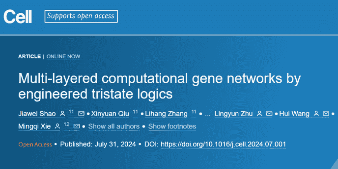
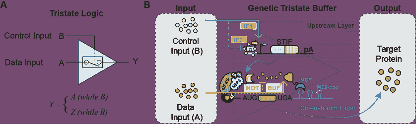
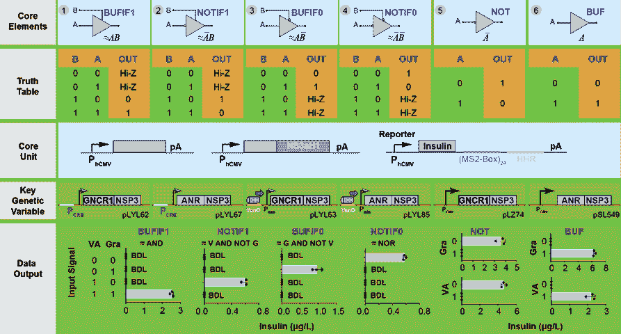
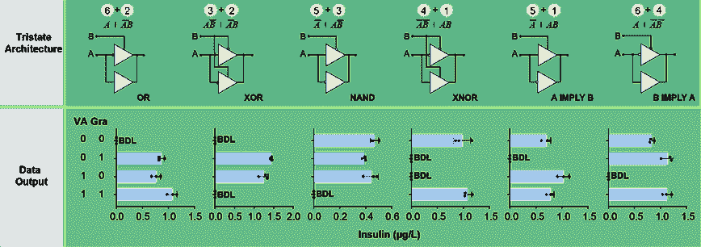
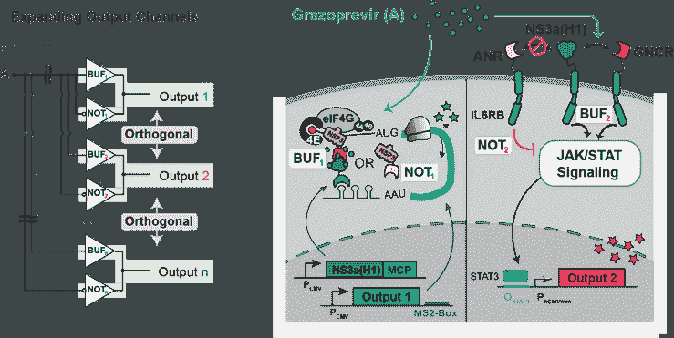
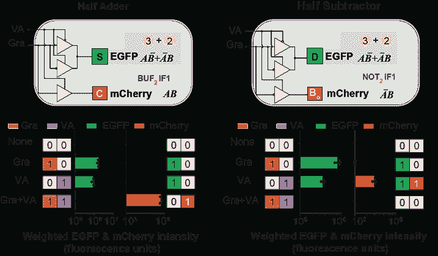
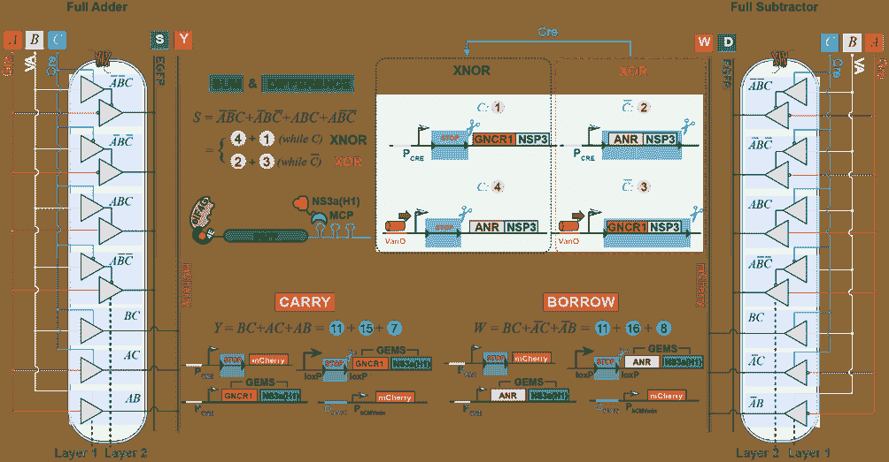
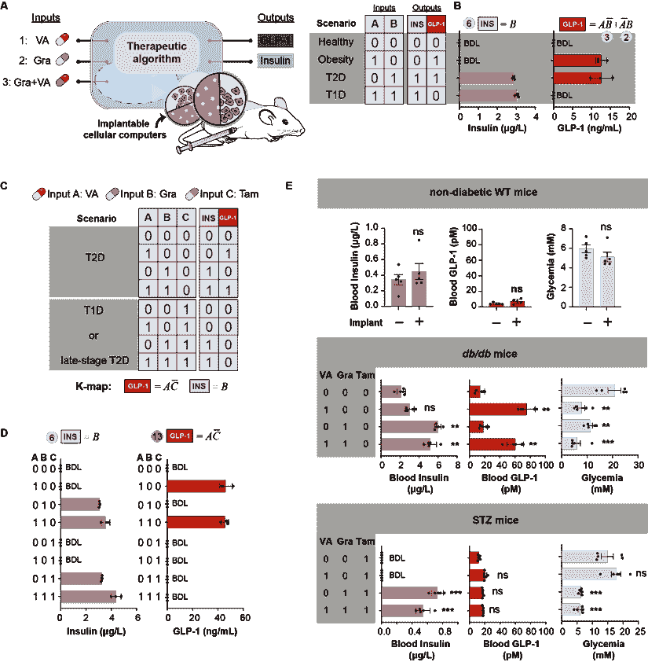

# 如何让细胞进行计算？国内四高校提出生物计算元器件设计全新方法，登Cell

> 来源：[https://agijuejin.feishu.cn/docx/V0PzdCgkJophzvx6hCUcr6qPnBg](https://agijuejin.feishu.cn/docx/V0PzdCgkJophzvx6hCUcr6qPnBg)

> 机器之心 ScienceAI｜[阅读原文](https://www.jiqizhixin.com/articles/2024-08-01-9)

> 转载请联系原作者取得授权

编辑 | 萝卜皮

作者 | 论文团队

细胞犹如一台计算机，每时每秒都在接收、分析和处理来自环境中的不同信息：外界信息通过细胞内高度并行的信号转导途径进行分析和处理，进而以预定义的方式从「存储设备」（即 DNA）中读取信息（基因的表达）或写入指令（DNA 修饰和编辑），指导自身或周围细胞对环境信息做出响应。

一直以来，如何有效利用生物体本身的计算能力，通过对生物体进行改造使之能够执行人类给定的计算任务，并由此开发出基于生物系统的新概念计算机都是计算机科学与生物技术领域交叉融合的热点问题。

近期，来自国防科技大学、西湖大学、浙江大学和之江实验室的研究人员合作提出了名为 TriLoS 的设计方法，通过多层基因表达调控网络在细胞内实现了组合 逻辑 线路的高效设计与构建，使得以模块化的方式开发执行组合 逻辑 运算的生物计算元器件成为了可能。

该研究以「 Multi-layered computational gene networks by engineered tristate logics 」为题，于 2024 年 7 月 31 日在《 Cell 》杂志在线发表。

论文链接： https://www.cell.com/cell/fulltext/S0092-8674(24)00716-5

向细胞自身学习设计细胞的 逻辑 单元

细胞内单个基因的表达可以被理解为处于活跃（即被表达）或非活跃（即不表达）两种状态之一，这使得我们可以从基因表达中抽象出「开/关」或者「0/1」的概念。

从这种角度来看，细胞可以被理解为一个由组合 逻辑 和时序 逻辑 构成的数字电路，而设计和改造这一电路的基础自然就是创造出适用于细胞的「晶体管」、「 逻辑 门」。

自本世纪初起，合成生物学家一直在尝试通过设计控制基因表达的人工基因线路来开发具有 逻辑 计算功能的生物元器件。

但由于缺乏理论体系指导、细胞基因调控本身的复杂性和可用基因调控手段的不足，现有的元器件设计很大程度上仍然依赖于设计者的经验和反复试错，严重制约了该领域的发展。

该研究通过分析细胞内基因表达调控的层次结构发现，细胞内基因表达受到转录、翻译等不同层次调控，这一调控过程的基本单元可以被抽象为类似于电子电路中三态门的结构。

例如，在 DNA 经转录、翻译到最终生成蛋白的过程中，转录调控（B）可以视作翻译调控（A）的上游控制通路。转录调控的开或关将会使得翻译调控系统最终的产生三种状态：0（关）、1（开） 或者 Z（高阻态，即翻译系统相关调控元件不发生转录）。

研究人员意识到，这样的三态门结构可以作为构建多层基因表达调控网络的基本 逻辑 单元，通过多层三态门单元的组装实现对细胞内 DNA 编辑、转录、翻译等不同层次调控过程的充分利用，从而构建更加复杂和鲁棒的组合 逻辑 器件（图 1）。

图 1：TriLos 设计方法图示。

在这一思想的指导下，研究人员开始尝试在哺乳动物细胞中利用转录和翻译过程实现「三态门」基因电路。

通过将 Vanillic acid（VA，输入 B）调控的转录调控开关作为「上游」基因开关控制 Grazoprevir（Gra，输入 A）调控的蛋白质翻译开关，研究人员成功构建出了 BUFIF1、NOTIF1、BUFIF0 和 NOTIF0 四种基本 逻辑 单元，并在细胞中展现出了良好的性能（图 2）。

图 2：TriLoS 的标准 逻辑 单元。

与传统的 逻辑 基因线路设计方式相比，以「三态门」为基础 逻辑 单元的设计方式展现出了更强的模块化特征和更好的可拓展性，例如，对于一直困扰合成生物学家的异或 逻辑 （XOR），研究人员通过简单组合 NOTIF1 和 BUFIF0 便可高效实现（图 3）。

这一被命名为 TriLoS 的思想显著提高了哺乳动物细胞的「可编辑空间」，为更高效的设计生物计算元器件、突破细胞计算极限打下了坚实的基础。

图 3：基于 TriLoS 构建简单组合 逻辑 线路。

基于标准 逻辑 单元设计和组装生物计算元器件

在构建标准 逻辑 单元的基础上，该研究进一步阐明了利用标准 逻辑 单元构建复杂组合 逻辑 器件的工程原则。

与电子电路设计中不同的电子线路之间严格绝缘所不同的是，细胞内的调控过程存在着各类复杂的相互作用，存在着各类绝缘性问题，明确各 逻辑 单元之间的正交性约束是设计生物计算元器件的特别之处。

针对这一问题，该研究从拓展输出信号数量和拓展输入信号数量两个角度出发对多层基因计算网络设计过程中的正交性约束进行了详细讨论。

在输出信号数量拓展方面，研究人员分析提出，控制不同输出信号的多层基因调控网络必须选择相互正交/绝缘的最底层调控元件，而较高层的调控过程则可以共享调控元件。

为满足这一约束，研究人员设计了另一组完全正交的 Grazoprevir 调控开关。该设计将受 Grazoprevir 诱导的二聚或互斥的基因元件 NS3a(H1)/GNCR1（二聚） 或者 ANR/GNCR1（互斥） 接入到人工合成的GEMS基因调控框架中。Gra 的存在会促使作为受体的膜外信号接收部分相互亲和或者排斥，从而通过胞内 JAK/STAT3 信号通路，控制外源基因开关的开或者关。

数据表明，将这一开关与 Vanillic acid 调控的转录调控开关组合同样可以构建出在细胞中稳定运行的基本 逻辑 单元，并可通过 TriLoS 设计和构建具有两个输出的半加器和半减器 逻辑 器件（图 4）。

图 4：基于 TriLoS 在细胞中实现半加器和半减器。

在输入信号数量的拓展方面，研究人员则将视线转向了在转录调控上游的基因表达调控方式，提出了利用与下游信号正交的输入信号调控基因编辑、染色质可及性等方法拓展输入信号的数量。

为展示这一思想的可行性，研究人员利用控制基因重组过程的 Cre 重组酶作为第三个输入，构建了具有基因序列调控、转录调控和翻译调控三层调控结构的基因调控网络，便捷地实现了具有 3 输入 2 输出的全加器和全减器（图 5）。

这一结果成功突破了单细胞全加器和全减器构建这一 逻辑 基因线路设计的「天花板」，进一步体现了 TriLoS 在构建复杂 逻辑 计算网络过程中的高效性和有效性。

图 5：基于 TriLoS 在细胞中实现全加器和全减器。

**探索生物计算的无限可能**

自生物计算的概念被提出以来，科学家们致力于寻找展现生物计算系统优势的应用场景， 「生物计算究竟有什么用？」值得思考。

在本研究中，研究人员针对这一问题给出了自己的答案，即在疾病精准治疗等场景下利用细胞计算开发集诊断、治疗为一身的「智能细胞」，使其自主判断疾病的发病类型，从而指导产生合适的治疗蛋白，更加精准的实现疾病的分阶段、分层次、定制化治疗。

该研究以糖尿病为例展示了一种潜在的生物计算应用场景。为简单起见，研究人员将糖尿病根据其严重程度和发病机制人为区分成了肥胖、2 型糖尿病和 1 型糖尿病三种状态/类型，并根据每一类型的特点制定了使用两种治疗药物胰高血糖素样肽 1（GLP-1）或胰岛素（INS）的治疗方案。

研究人员借助 TriLoS 开发了可针对不同输入给出不同治疗药物组合的「智能细胞」，可以在不更换植入细胞的情况下根据疾病状态调整生产治疗药物，在细胞和小鼠体内都实现了疾病的自适应精准治疗（图 6）。

图 6：利用具有计算能力的智能细胞在动物模型中进行糖尿病治疗。

该研究首次提出了以基因电路「三态门」为基础 逻辑 单元的多层细胞计算网络设计策略（TriLoS），为更复杂的细胞计算器件设计提供了基础性理论，一定程度上解决了现有研究中只能通过经验来盲目设计和反复试错的设计模式，也为开发自动化设计工具打下了坚实基础。

本研究由国防科技大学与西湖大学、浙江大学、之江实验室合作完成，其中浙江大学邵佳伟研究员，国防科技大学邱鑫源助理研究员，西湖大学博士研究生/前之江实验室工程专员张力航为该论文的共同第一作者；浙江大学邵佳伟研究员、国防科技大学朱凌云教授、之江实验室王慧研究专家和西湖大学解明岐研究员为共同通讯作者。

注：封面由 Midjourney 生成。