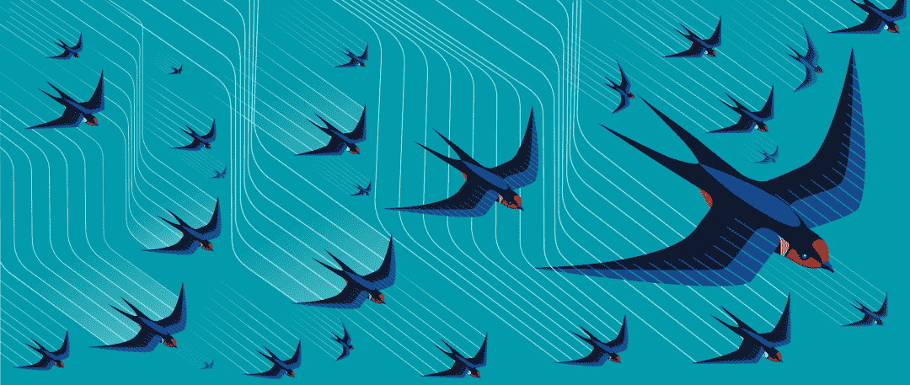

# 从动物群体行为到大脑空间决策，复杂性如何启发智能探索？

> 来源：[https://agijuejin.feishu.cn/docx/Ml3OdWtRloRQ76xcSQhc3OVInre](https://agijuejin.feishu.cn/docx/Ml3OdWtRloRQ76xcSQhc3OVInre)

> [集智俱乐](https://mp.weixin.qq.com/s/JEaYtRbOIJHKHPB3SWmnPg)部 Strogatz&Couzin｜阅读原文

> 转载请联系原作者取得授权

> 导语

> 鸟群、蝗虫群、鱼群，在这些看似混乱的生物群体中，秩序奇迹般地涌现。不同物种的群体行为在细节上有所差异，但它们大致遵循物理学家们几个世纪以来总结出的集群运动规律。现在借助最新的技术，研究人员能够比以往更仔细地研究这些动物的行为模式。这篇文章是进化生态学家 Iain Couzin（艾恩·库津）与应用数学家 Steven Strogatz（斯蒂文·斯托加茨）的对话，他们讨论了动物群体行为以及背后的原因，集群作为一种生物计算形式，能够通过相互作用调整网络结构，让系统处于兼具灵活性与稳定性的临界状态。此外，动物的群体行为也可能启发我们理解大脑智能：大脑如何处理各种感官信息，简化复杂性，并做出决策。

> 集智俱乐部联合加利福尼亚大学圣迭戈分校助理教授尤亦庄、北京师范大学副教授刘宇、北京师范大学系统科学学院在读博士张章、牟牧云和在读硕士杨明哲、清华大学在读博士田洋共同发起「 AI By Complexity 」读书会，从复杂网络、统计物理、算法信息论、因果涌现、自由能原理、自组织临界等视角出发，探讨如何理解复杂系统的机制，这些理解是否可以启发我们设计更好的AI模型。读书会于6月10日开始，每周一晚上20:00-22:00举办。欢迎从事相关领域研究、对AI+Complexity感兴趣的朋友们报名读书会交流！

> 研究领域： 群体行为，群体智能，临界性，复杂网络，大脑空间决策

**Stev**en Strogatz, Iain Couzin | 作者

何安夏 ** | 译者**

王朝会 ** | 审校**

> 文章题目：How Is Flocking Like Computing?

> 文章链接：https://www.quantamagazine.org/how-is-flocking-like-computing-20240328/

Steven Strogatz ： 在整个动物王国中，从小小的飞虫到鱼、鸟、瞪羚，甚至像我们这样的灵长类动物，生物群体往往会形成大规模移动的模式 （pattern） ，去追求一个看似自发的集体目标。通常，在这些生物群体中没有哪个个体看起来像领导者在指挥这场大规模运动。相反，这些动物只是无缝地排队行进。

尽管感觉这样的系统会陷入混沌或不稳定，这些群体却能够以极其协调和目标明确的方式移动，任何看过鸟群飞行 （a murmuration of starlings） 或鱼群游动的人都可以证实。那么，驱动这种行为的力量是什么呢？在这期节目中，我们将深入探讨动物为何会产生集群行为。最新的人工智能和3D摄像机等技术，如何提供新的见解？研究动物群体行为又能告诉我们关于自身的哪些信息，无论是作为个体还是集体？

我们请到了进化生态学家 Iain Couzin 来揭示这些谜团。Iain 是马普所动物行为研究所集群行为系主任，康斯坦茨大学全职教授。他获得过许多荣誉，包括国家地理新锐探险家奖、复杂科学领域最高荣誉拉格朗日奖以及德国最高研究荣誉莱布尼茨奖。

### 鱼群、鸟群、昆虫群，动物群体行为是否存在共同特征？

**Strogatz ： **我想我们应该先聊聊，你的研究对象是谁？你所研究的动物以及它们在你研究过的系统中表现出的各种集群行为有哪些？

**Couzin ： **这正是研究集群行为最神奇的地方之一。集群行为对地球上许多生命过程至关重要，因此我们研究的生物范围非常广泛，从地球上最简单的动物——扁盘动物门 （placozoa） ，它是一个基础门类，可能是地球上最简单的多细胞动物，由数千个细胞构成，并且能像鸟群或鱼群那样移动——再到无脊椎动物，如具有惊人协调行为的蚂蚁，或者形成最大、最具破坏性的蝗虫群体。再到脊椎动物，如鱼群、鸟群、有蹄哺乳动物群体，以及灵长类动物，包括我们人类自己。

**Strogatz ： **所以，看起来确实涵盖了所有范围，从——我必须承认我之前从未听说过这个，扁盘动物门，对吗？

**Couzin ： **是的，扁盘动物门。这种小生物是在热带水族馆的玻璃上爬行时被发现的。用肉眼看，它大约有一毫米长，如果很大的话，能达到一毫米半。直到最近科学家们才开始关注这种特别的生物。因为这种奇特的小型细胞群实际上具有通常会认为属于更复杂生物的遗传复杂性。例如，尽管没有神经元，它却具有大量的神经递质。

它具有Hox基因。在发育生物学中，Hox基因与复杂的身体结构有关，但扁盘动物门却没有复杂的身体构造。所以你可能会想，这种生物可能曾经进化到更复杂的形态，然后再次进化简化了自己，从而保留了这些复杂特征。

但是，遗传学研究人员在《自然》杂志上发表了一篇具有里程碑意义的论文，证明了实际上这是一群最原始的细胞。而且，细胞聚集形成一个生命体这种集群行为是最美妙的例子之一。这就是我们研究它的一个原因，试图理解集群行为在地球复杂生命起源中的核心作用。

**Strogatz： **这对我来说太有趣、新奇了，我惊呆了。它们具有与神经系统相关联的特性却没有神经系统？它们有发育生物学基因，这个基因能帮助进化出一个像果蝇那样的复杂身体结构，但实际上，它们并没有那样的身体结构？

**Couzin **：完全正确，就是这样。因此，它们确实可以为我们提供关于智能起源的线索。我们2023年在PNAS上发表的研究[1]表明，它们所拥有的身体构造在行为上确实非常像鸟群或鱼群，细胞之间进行局部相互作用，并倾向于对齐它们的移动方向。它们之间彼此吸引，就像一张弹性布一样连接在一起，但也会移动。它们的底部有小纤毛，从而能够在环境中流动。通过对邻居施加力来对齐细胞的移动方向。

所以，如果我们在显微镜下追踪这些细胞，观察它们的对齐和个体间吸引力，我们使用的技术、模型和思维方式与研究鸟群或鱼群等其他类型集群行为时非常相似，只是将它们应用到这些动物身上。我认为集群行为中最令人惊奇的一点就是，无论是细胞还是鸟类，尽管系统属性非常不同，但当你观察集群行为、集群属性时，底层的数学原理非常相似。因此，我们可以找到普遍规律来连接这些看似截然不同的系统。

> [1] Davidescu, Mircea R., et al. "Growth produces coordination trade-offs in Trichoplax adhaerens, an animal lacking a central nervous system." Proceedings of the National Academy of Sciences 120.11 (2023): e2206163120.https://dx.doi.org/10.1073/pnas.2206163120

**Strogatz ： **这也是让我对集群行为研究着迷的原因，那些似乎适用于从细胞到我们人类自身不同尺度的普遍数学原理。你提到“flocks” （鸟群） 和“schools” （鱼群） ，有时我们也听到人们谈论“swarms”，比如昆虫。为什么对于同一种事物我们会有三个不同的词汇来描述呢？当我们谈论集群行为时，它们真的不是同一种现象吗？是否有理由让我们不应该说成“schooling birds”或“swarming fish”？

**Couzin ： **不，我认为我们创造了这些词汇，而且不同的语言有不同的词汇表达。德语是一种拥有大量词汇的语言，但实际上相关的词汇相对较少。而在英语中，我们有许多不同的词汇来形容集群行为，例如乌鸦群也被称为“a murder of crows”。你刚刚也用了一个很棒的词，“a 'murmuration' of starlings” （椋鸟群） 。我认为正是这种令人着迷的集群行为的美，才催生了可以和特定例子相关联的优美词汇 （“flocking”、“schooling”或“swarming”等） 。

因此，我认为这非常有用。因为刚刚我强调了数学上的共性，但也存在差异。细胞群和鸟群之间确实有区别。为了理解这些系统，我们既要考虑它们的共性原则，也要考虑系统之间的差异。从某种程 度上说，语言在人类自然地将其划分为不同类别时捕捉了这些差异。

**Strogatz ： **有趣。你提到了“细胞群”和“昆虫群”，我猜你是这么说的，尽管我们使用同样的词汇，但它们之间可能存在一些差异。那么，在这些例子中，我们应该区分哪些东西呢？

**Couzin： **是的，我认为**真正令人兴奋的是为什么存在**共性，因为差异是如此深刻。动物有大脑，它们接受复杂的感觉信息，并试图根据环境做出决策。总体来说，动物能够表现出比细胞复杂得多的行为。但细胞本身也有复杂的内部过程。它们的相互作用在很大程度上受到物理力量的支配，受到它们作用的尺度和在细胞群中形成的物理张力的影响。而对于动物、鸟群，群体中的互动是无形的，没有物理实体。所以人们一开始会认为，这只是一个类比。实际上，在大约五到十年前，我也认为这只是一个类比。我认为这些差异一定非常重要。但我们开始明白的是， 它们共享的共同特征是计算 。

这些元素聚集在一起，以它们单独无法实现的方式对环境进行计算。每个个体，即使你有一个非常复杂的人脑，你生活在世界中，除非你与他人有社交互动，或者更进一步，在我们出生进入生活时积累并建立了文化复杂性后才可能实现，否则我们的能力将受到很大限制。因此，这里有一些深刻且引人入胜的问题，我们才刚刚开始探讨关于计算和复杂生命涌现的问题。

**Strogatz **：这是一个非常有趣的观点。当你说它们都有某些共同之处时，我并不知道你会说出什么词。我猜不出来，但是我喜欢它：计算。这让我想起了一个著名的场景，大家可能在YouTube或电视上看过相关的影片。那就是一群鸟——也许是椋鸟——突然有只猎鹰或者隼向它们飞速冲来。你能否为我们描绘一下接下来会发生什么，并解释为什么这个例子和计算有关？

**Couzin **：好的。就我来看，如果你观察这些群体，当有捕食者出现并攻击它们时，无论是鸟群还是鱼群，你会看到群体表现得像一种起伏的流体。你会看到光线或涟漪穿过它们。这表明个体实际上可以通过社会互动非常快速地传播关于捕食者位置的信息。例如，起初只有少数几只看到了捕食者，但通过转向，这种行为被其他个体模仿，密度和转向的变化极其迅速地在群体中传播开。

如果我们使用先进的成像工具来量化、测量这些转向波，它们的传播速度大约是捕食者最大速度的十倍。所以个体甚至可以对它们看不到的捕食者做出反应。这有点像神经元通过电信号传输信息。在这种情况下，它不是电信号，真正起作用的是密度和个体的转向变化，这些信息会在群体中逐渐扩散开，但这给了远处的个体关于威胁来源的位置信息，使它们能够迅速开始远离威胁。

**Strogatz **：我认为这是一个非常生动的例子，展示了在这种情境下计算意味着什么。我们可以看到恐慌或避让的波动如何在鸟群中流动。这非常有趣，因为它比个体单独行动要快得多，并且我猜测，也比捕食者自身能够达到的速度要快。

**Couzin **：我们认为这很可能是因为尽管自然选择作用于个体，关键是它们各自的适应性，但如果群体以某种方式行动起来，整个群体都会从中受益。

这与我们从物理系统中学到的知识有关，尤其是接近相变的物理系统。所以，一个接近于不同状态之间转换的系统，比如固态和液态之间，如果你正在冰冻水，它突然转变为固体，在这个转换点附近，系统的集群行为非常显著。这种分岔现象正是你的研究领域。现在我们明确知道，并且有很强的证据表明自然选择会推动系统接近这些分岔点，因为在这些分岔点上展示出了显著的集群特征。当我们首次测量这些特性时，个体的行为似乎违背了物理定律，它的信息传播速度如此之快。

在20世纪初，埃德蒙·塞洛斯 （Edmund Selous） 作为一位坚定的达尔文主义者，但他同时也被维多利亚时代对心灵感应的迷恋所吸引。他推测，在鸟群中，必定存在某种思想传递或者心灵感应，使得它们能如此快速地进行交流。当然，人们会认为，“这太荒谬了，怎么可能存在心灵感应。”但实际上，尽管可能存在争议，我认为我们仍然没有很好地理解感官模式以及这种信息在系统中如此迅速传播的方式。

**我当然不是在暗示存在心灵感应。我**想表达的是， 通过调节群体系统使其接近临界点，或分岔点，可能会产生一些显著的集群特征 。对于观察者来说，这看起来非常奇妙。在这些领域中的物理现象如此离奇、神秘和惊人，尽管科学可以对此进行解释。

> 相关阅读：

> Books by Selous, Edmund (sorted by popularity)：http://www.gutenberg.org/ebooks/author/45735

### **群体为何处在临界点？**

**Strogatz **：所以我在想，就集群行为来说，如果自然界将一群动物调整到接近某种不稳定或临界状态，你认为这就是群体如此有效的原因之一吗？

**Couzin **：是的。例如在我们2021年发表的一篇论文[2]中，我们探讨了如何在各种情况下获得最佳效果。一般情况下，你希望保持稳定、鲁棒，但有时候，你需要系统变得高度敏感。在自然选择中，生物系统必须平衡这种看似矛盾的状态，既稳健又敏感。那么是如何做到的呢？我们认为，将系统调节到接近临界点，实际上可以实现这一点。因为如果系统偏离，它实际上会自我稳定。 但当它被推向那个临界点时，它变得非常灵活 ， 对输入极其敏感， 例如捕食者就是一种输入信息。

如果一个鱼群远离那个临界点——例如，如果它们彼此非常紧密地对齐——当它们检测到捕食者时，实际上需要很大的努力才能让所有个体转向。它们彼此间如此强烈地相互影响，以至于外部输入很难改变它们的行为模式。另一方面，如果它们非常混乱，每个鱼都朝向不同的方向移动，那么一条鱼改变方向几乎不会被其他个体察觉。因此这种变化不会在系统中传播。因此，在这种中间状态，它们实际上可以优化作为一个群体行动的能力，既灵活又能传递信息。这是一个来自物理学的理论，但真正使用计算机视觉技术来追踪动物群体在遇到危险时如何改变互相作用方式，是最近几年的事情。

作为生**物**学家，我们通常认为，“如果世界变得危险和不稳定，我会对输入信息变得更加敏感。我会变得神经过敏，更容易发出误报。”这种情况，对于单独行动的动物或人类都是如此。但当我们在群体中测试这个理论时，因为这些群体是在集群环境中进化形成的，我们发现这对它们来说不适用。 群体 所做的是改变网络，改变信息在系统中流动的连接网络。它们调整网络，来平衡灵活性和鲁棒性，也就是将系统调节到我们所预测的临界状态。

> 相关阅读

> [2] Sridhar, Vivek H., et al. "The geometry of decision-making in individuals and collectives." Proceedings of the National Academy of Sciences 118.50 (2021): e2102157118. https://dx.doi.org/10.1073/pnas.2102157118

**Strogatz **：这些研究是在哪种动物上进行的呢？

**Couzin **：我们的研究主要是在小型群栖鱼类上进行的，因为它们需要解决同样类型的问题——避开捕食者，寻找合适的栖息地。而且这些鱼类在实验环境中易于操作。实际上，鱼有一种叫做“恐怖信号” （schreckstoff） 的化学物质，在德语中直译就是“恐怖的东西”。当捕食者攻击一条鱼时，这种化学物质会自然释放出来。所以我们可以在水中加入惊吓素，这样即使没有捕食者的位置信息，但是个体对环境的判断会改变，世界变得更加危险。

那么你会怎么做呢？你会改变大脑中的活动吗？还是改变与环境的互动方式？或者，像我们通常认为动物会做的那样，变得更加恐惧呢？或者，你可以想象一下，在一个网络系统或集群系统中，你会改变社交网络的拓扑结构吗？改变你与他人的沟通方式？因为这也会影响对威胁的反应能力，就像我们之前讨论过的转向波。

**我们发现，个体并没有改变。真正发**生变化的是网络。 个体通过移动来改变网络的结构，这种改变使得群体突然变得更加敏感和灵活。 人们过去认为彼此靠近的个体相互作用更强。但你可以想到在日常生活中，你可能会坐在公交车中的陌生人旁边，实际上你们之间没有形成强烈的社交关系。因此，个体的社交网络和易于测量得到的网络可能非常不同。

所以我们所做的，其实相当复杂，我们可以做到从它们的视角重构世界。我们使用了一种来自电子游戏和计算图形学领域的技术，叫作光线投射技术，通过将光线投射到个体的视网膜上，这样就能通过计算机看到它们在每一个时间点看到了什么。但问题在于，我们不知道它们究竟如何处理这些信息。

因此，我们可以使用机器学习方法，因为每一个大脑都是为了同样的目的而进化。它接受复杂的感官信息——就像今天听我们讲话的人一样。这是一种复杂的声音信息，但他们可能正在开车或做饭，所以同时他们还要处理复杂的视觉或嗅觉信息。但 他们的大脑必须将所有这些复杂信息简化降维用于决策 ，或者决定“我接下来要做什么？”。我们对于真实动物如何完成这个过程知之甚少。但我们可以重建它们的视野，然后我们可以使用相同类型的技术来降维，理解大脑如何将这些复杂性简化为运动决策。

我们研究的鱼类，它们的大脑后部只有少量神经元控制所有的运动。因此，大脑必须接受所有这些复杂信息，并将其简化，然后做出决策。我认为这是生物学中一个非常有趣的问题：大脑是如何完成这一过程的？

**Strogatz **：首先，我可以明确地说，我需要更频繁地阅读你的论文。你提到了通过在鱼的视网膜上投射光线来观察它们看到了什么，或者让我们有一种感觉知道它们正在看什么？我的理解对吗？

**Couzin **：实际上，并不是真的在投射光线，而是全部通过数字化完成的。想象一下，你在某一个时刻，拍摄了一张鱼群的快照。我们的软件可以追踪每条鱼的位置和姿势。然后我们可以创建这个场景的三维计算机版本，就像在电子游戏中一样。接着，我们可以问，每只鱼看到了什么？因此我们可以在每只鱼眼睛中放置虚拟的摄像机。

所以，光线投射有点像计算机图形学中的光线追踪，也就是描绘光线落在视网膜上的路径。我们全部通过数字化方式完成，因此我们可以创建现实的数字模拟。我们可以看到，在虚拟场景中，光线是怎样落到视网膜上的，一种类似照片级别的真实观察效果。这给了我们第一层信息：个体接受到的信息是什么？

当然，我们想要提出的重要问题是： 大脑如何处理这些信息？大脑如何将这种复杂性简化，并做出决策？ 例如鱼群和鸟群能够如此轻松优美地移动，几乎没有碰撞，而公路上的汽车却难以实现集群运动呢？我们是否能够从数千年的自然选择中学到一些东西，并将其应用到车辆和机器人上呢？因此，试图理解这一点还有其应用价值。我主要是因为觉得它很吸引人而想去理解，但同时，在某些情况下，这确实可以转化为现实应用。

### **蝗虫的群体行为**

**Strogatz ： **我想回到你在介绍中提到的，从细胞到灵长类动物等不同尺度的内容。大家可能对蝗虫的例子并不是很熟悉，我想知道我们是否可以谈谈集群行为在现实世界甚至经济方面的影响，因为蝗虫对世界有着重大影响，比我想象的要大得多。我看到一些统计数据，在蝗灾年中，蝗虫入侵了全球超过五分之一的陆地。它们影响了地球上十分之一人口的生计。那么，你能否向我们介绍一下这方面的研究，以及它如何与全球粮食安全问题相关联呢？

**Couzin **：是的，你说得完全正确。我也觉得非常惊讶。正如你刚才所说，它们通过造成粮食短缺和粮食安全问题，影响了地球上十分之一的人口。而且这种情况往往发生在诸如也门和索马里等国家，这些国家本身存在着重大问题、重大冲突、内战等。由于气候变化，蝗虫的活动范围正在扩大。因此，目前阿富汗的粮食产区正面临重大危机。几年前马达加斯加遭受了这样的灾难。在那之前一两年，肯尼亚经历了70年来最大规模的蝗虫入侵。

所以，为什么在我们拥有所有现代监测技术的情况下，蝗灾会变得更加猛烈和严重呢？其中一个原因就是气候变化。蝗灾是这样形成的——可能听众会对此感到惊讶，但实际上蝗虫并不喜欢互相靠近。它们是害羞、隐秘的绿色蚱蜢，喜欢独处。所以如果食物充足时，它们就彼此分开，避免接触。只有当它们被迫聚集在一起时才会转换状态。所以它们通常被称为“独居型”，这是因为它们的独居生活方式。但如果它们被迫聚集在一起，它们就会进化出快速转变的能力，会在一小时内行为上迅速转变为群居型，开始相互跟随，向彼此靠近。

另一件大家可能不知道的事情是，蝗虫在出生后的几个月内实际上并没有翅膀。所以当蝗虫刚出生时，它们是不能飞行的。这些无法飞行的幼体只有在成年后才会长出翅膀。所以，当雨水降临非洲、印度或其他地区时，就会有茂盛的植被，小规模的蝗虫群可以作为隐蔽的蚂蚱繁衍生息，种群规模迅速增长。随着种群的增长，它们吃得越来越多，往往还会伴随着干旱。

如果种群密度很高，突然间食物消失了，那么蝗虫就会转变为群居型，开始一起前进，一起移动。这些蝗虫群可以有数十亿只，所见之处全是统一行动的蝗虫，仿佛有共同的目标。一旦它们长出翅膀，就可以飞行。因为它们可以利用贸易风或其他环境条件进行长距离迁徙，在几百甚至上千公里范围内形成大规模的群体，情况会变得更糟。这是我们地球上最大和最具破坏性的集群行为之一。

**Strogatz **：我不能说对蝗虫行进这个过程非常熟悉。我们习惯于把它们想象成空中飞舞的云团。但是，请你多分享一些关于蝗虫行进的过程，我模糊记得你有一项关于蝗虫惊人的研究 [3]，包括它们之间的自相残杀。这个词用的对吗？

> [3] Collective Motion and Cannibalism in Locust Migratory Bands：https://dx.doi.org/10.1016/j.cub.2008.04.035

**Couzin **：是的，那项研究是在 2008 年进行的。我们对这些能够长距离迁移的大群蝗虫，无论你称它们为群或云，知之甚少，因为我们并没有足够先进的技术去研究它们。事实上，到现在我们仍然缺乏相应技术。所以，并非这个问题不重要，而是它其实极其重要。但我们也知道，这些飞行的蝗虫群出现之前——飞行的蝗虫群有点像已经失控的野火，一旦它们开始肆虐，就难以控制了。但如果能在它们长翅膀之前进行防治，在它们还在沙漠或其他环境中形成群体时进行防治，那么将会有很大可能性成功。

所以，出于实际考虑，我们将研究重点放在了这些无翅的蝗虫群上。事实上，你说得对，在2000年代中期我开始研究这个问题，现在我又重新回到对蝗虫的研究中。我们在今年早些时候，创造了世界上第一个真正意义上的实验室环境中的蝗虫群体。我们在康斯坦茨专门为此搭建了一个 15m×15m×8m 的成像环境，并在其中追踪了10000只蝗虫。所以你提到这个话题很有趣，因为我的研究现在又回到了这个系统。

但是，正如你所说的，我们发现的问题是，这些昆虫为什么要一起行进？我们最初认为它们必定像鱼群和鸟群那样。这肯定与信息有关，一定涉及到集群智能。然而，我们错了。这种认知存在极大的风险。如果你看到一群蚂蚁在移动，形成一个圈，像是在旋转；你看到一群鱼在转动，形成一个环或类似甜甜圈的图案；或者你看到一场旋风，这些模式看起来都一样，但它们可能由非常不同的现象驱动。我认为我被误导了，以为看到集群运动时，必定是相似的过程在起作用。但在蝗虫群中，并非如此，不是信息传递在起作用。实际上，在这些沙漠环境中，当食物突然短缺时，你会急需基本营养，特别是在沙漠中，包括蛋白质、盐和水。

在这种恶劣的环境中，还有什么比另一个个体更适合你呢？因为它们拥有完美平衡的营养成分。所以这些蝗虫会被彼此吸引，并倾向于相互捕食。它们进化出了追随那些正在离开的蝗虫的行为，并试图咬它们的腹部后端，这很难防御。头部有重甲保护，但腹部后端是一个弱点，显然因为那里更易进攻。因此，它们会攻击这个弱点，同时也避免自己成为别人的目标。追随逃离你的人，并躲避接近你的人，这种行为导致整个蝗虫群开始一起穿越沙漠环境行进。

它们还通过一起离开营养匮乏的地区来获益。因为如果你把一个人放在沙漠中，人会很容易于迷失方向，四处游荡。同样的情况也适用于蝗虫。但如果它们在群体中，个体之间的集体对齐和同步，数亿个体相互对齐，它们可以非常有方向性地离开这些营养贫乏的地区。它们也可以压倒捕食者。捕食者在这里几乎无从下手。

**Strogatz **：在我们讨论这些例子时，你是怎么对这些研究产生兴趣的，早期是怎么开始的？你提到那是在2008年？你在那之前就已经开始研究这个了，对吗？

**Couzin **：是的，我在九十年代末做了关于蚂蚁的博士研究。我对蚂蚁的行为非常着迷。老实说，这开始于我对于自然的热爱和对博物学的痴迷，我希望观察周围的一切。我小时候认为，一定有专家能解释为什么会形成蝗虫群、鱼群、鸟群等。我认为这是每一个人都在研究的东西。我小时候是个艺术家，对创意写作、诗歌和艺术非常感兴趣。因此，我最初是被这些东西的纯粹所吸引，被它们的美丽所迷住。

在高中时，我在科学方面并不是一个好学生。我在做陶艺和绘画。当我上大学时，我记得我父亲对我说：“儿子，你应该做你擅长的事情。学英语或艺术吧。你不是科学家，但确实是一个自然观察者。”他说的很对。后来当我攻读生物学学位时，我在第一堂生物课上就知道这是适合我的事情，我深信不疑。我进入了统计物理的世界。那段时间出版的论文让我的思维彻底打开，因为作者们看到了贯穿各种系统的深奥数学原理。

我的博士导师告诉我，为了找到工作，你应该成为某一种蚂蚁的世界专家，这样你才有价值。但是我读到一些科学家的研究恰好相反。他们研究的范围广泛，从物理系统到生物系统，并看到了其中的原理。而且，他们发现的模式、结构和结果都自然而美妙无比。所以我想这一定是做科学研究的正确方式。所以那时候开始，我被吸引进了物理学的世界。

**Strogatz **：后来你有没有机会和你父亲谈论过你研究方向的改变？

**Couzin **：我从未想过我的父亲还记得这件事。然后，当我在普林斯顿大学由助理教授升为正教授时，系主任打电话来对我说，“恭喜你，Couzin 教授。”你知道，那一刻我完全震惊到了。所以我立马打电话给我的父亲和母亲，告诉他们这个好消息。结果是我的父亲接的电话，然后他说：“想到我曾经把你叫作自然观察者。”那是几十年后唯一的一次。我从不知道他还记得这次谈话。

### **群体行为帮助理解大脑空间决策**

**Strogatz **：这真是个好故事，非常棒的故事。在这个节目中，我们喜欢讨论一些尚未解答的大问题。那么，在你看来，关于鸟群、鱼群以及集群行为方面最大且尚未解答的问题有哪些呢？

**Couzin **：当然有。这让我谈到现在非常兴奋的话题。早些年在我的职业生涯中，我曾经认为，大脑是一种非常美妙的集群计算实体——最好的例子之一。那么，大脑是如何做出决策呢？它由神经元组成，并且我们可以看到蚁群、蝗虫群、鸟群或者鱼群等各种不同个体相互作用形成了系统。那么，在这些不同系统间是否存在某种深层次联系？目前令我着迷的就是群体决策问题，特别是空间中的群体决策。

那么， **大脑是如何 表征 空间和时间的呢？这在决策 中有何重要性 ？ **这 与动物的 集群 行为有什么关系呢？ 大约五年前，我意识到，我认为存在一种深层次的数学相似性，也存在关于大脑如何表征空间和时间的深层几何原理。而其中最让人兴奋的一点就是再次使用数学。你知道，我在16岁时放弃了数学，但我刚刚在剑桥大学艾萨克·牛顿数学科学研究所作为杰出研究员度过了一个学术假期。然而，我不会解方程，你知道吗？

我喜欢和优秀的数学家们一起工作。通过和物理学家、数学家以及生物学家合作，并在虚拟现实中对动物进行实验——我们已经建立了一套技术体系。我们没办法给不到一厘米长的鱼戴上像Meta Quest 3那样的头盔，但我们可以创造出虚拟、沉浸式的全息环境，因此我们可以完全控制输入信息。也就是说，我们能够完全控制因果关系。

如果你知道，我在影响你，而你也在影响我，然后还有第三个人参与进来，他们是直接影响我还是通过你来间接地对我产生作用？或者两种方式都有？又或者当涉及到第四个、第五个人时呢？在我们的虚拟现实环境中，我们可以将这些个体放入像电影《黑客帝国》的世界中，每个个体都在自己的全息世界中与其他个体的全息影像实时互动。但在这个世界里，我们可以随意调整物理规则。我们甚至可以改变空间和时间的规则以更好地理解大脑是如何整合这些信息的。

所以**，这真的让我大开眼界，因为我们可以证明大脑不是以欧几里得方式**来表示空间。它采用的是一种非欧几里得坐标系统来表示空间。然后我们可以通过数学方法解释为什么这样做如此重要，因为当你开始处理三个或更多选项时， 实际上扭曲时空 ， 使得空间变成非欧几里得形式能够显著降低世界的复杂性，并将其转化为一系列 分岔点 。在每个分岔点附近，它会放大剩余选项之间的差异。所以这里有一个美妙的内部结构。

因此，我们认为我们找到了一个关于大脑如何做出空间决策的普遍理论，如果不研究像鱼、蝗虫和苍蝇这样的生物在这些类型的虚拟现实环境中的行为，我们永远无法得到这个理论，这就是我非常兴奋的原因。

**学者简介**

Iain Couzin ，德国马普所动物行为研究所集群行为系主任，康斯坦茨大学全职教授。他的研究旨在揭示进化的集群行为的基本原理，研究涵盖从昆虫群体到鱼群、灵长类动物群体的各种生物系统。为了表彰他的研究成就，他曾获得2019年拉格朗日奖（复杂科学领域首个也是最重要的国际认可奖项），2022年莱布尼茨奖（德国最高研究荣誉奖）。

个人主页：https://www.ab.mpg.de/person/98158/2736。

播客主持人：Steven Strogatz，Susan and Barton Winokur杰出教授，Stephen H. Weiss 总统学者，康奈尔大学数学系教授。研究重点是将动力系统研究应用于物理学、生物学和社会科学。出版书籍包括《非线性动力学与混沌》（Nonlinear Dynamics and Chaos: With Applications to Physics, Biology, Chemistry, and Engineering）《微积分的力量》（Infinite Powers: How Calculus Reveals the Secrets of the Universe）《同步》（Sync: The Emerging Science of Spontaneous Order）等。

个人主页：https://math.cornell.edu/steven-Strogatz。