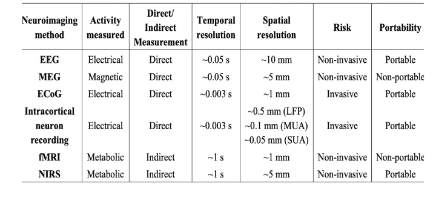
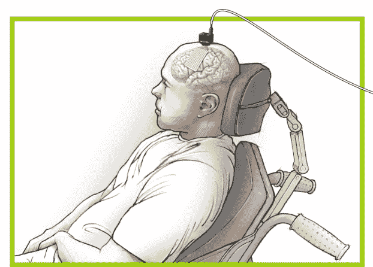
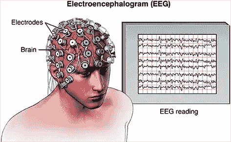
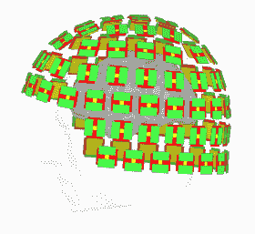
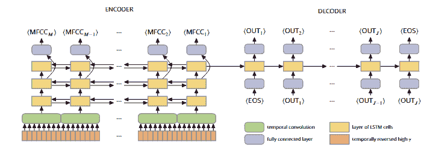
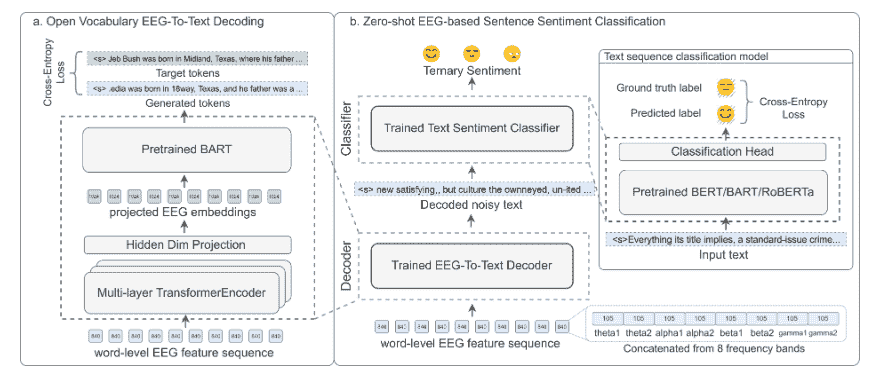
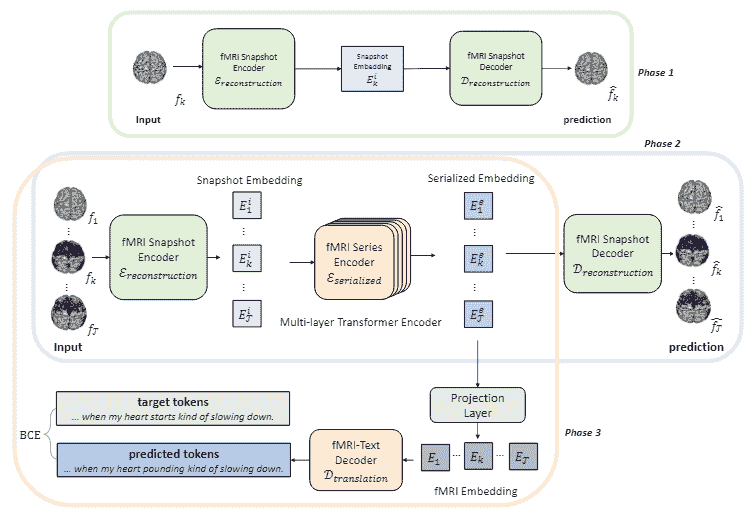
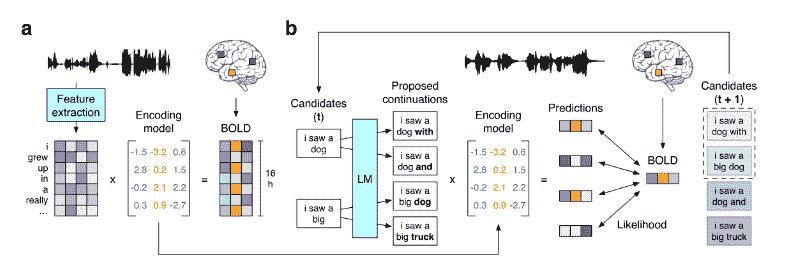

# 从大脑活动中解码自然语言：任务与前沿方法

> 来源：[https://agijuejin.feishu.cn/docx/PVnfdnB25o0yM9xnom9cQO72n4e](https://agijuejin.feishu.cn/docx/PVnfdnB25o0yM9xnom9cQO72n4e)

> 哈工大SCIR｜[阅读原文](https://mp.weixin.qq.com/s/OgX3vE5J_WkLBgKwcWsztw)

> 转载请联系原作者取得授权

> 原创作者：赵翼

> 转载须标注出处：哈工大SCIR

## 1 简介

语言不仅是人类交流的工具，更是思维和智能的基础。大脑如何解码和处理语言信息是揭示人类智能本质的关键。随着脑机接口（BCI）等技术的迅速发展，我们有了从大脑活动中解码自然语言的可能。这一研究方向不仅对认知科学和神经科学领域的发展至关重要，也为因神经退行性疾病和创伤而失去语言能力的人提供了新的希望。该方向的发展将极大地拓展我们对人类大脑处理语言的理解，并可能开启全新的沟通方式。

从大脑活动中解码自然语言的最大需求出现在那些因锥体束或下运动神经元的急性或退行性损伤而导致运动和语言障碍的患者中。当运动和语言障碍特别严重，如在锁定综合征（LIS）中，患者可能完全失去运动控制，从而无法独立发起或维持交流，仅限于用眨眼或眼球运动等轻微动作回答简单问题。BCI技术提供了大脑与外界之间的桥梁，读取人脑产生的信号并将它们转换成所需的认知任务，使得那些由于运动障碍而不能说话的人可以仅通过他们的脑信号进行交流，而无需移动任何身体部分。

在协助这类患者交流上，很多BCI范式已经取得了重大进展，包括P300、稳态视觉诱发电位（SSVEP）和运动想象（MI）等。P300和SSVEP利用外部刺激，如闪烁的屏幕或听觉蜂鸣声，以诱发有区分性的大脑模式。基于运动想象的系统则识别人脑自发的运动意图，无需外部刺激的辅助。然而，这些范式通常只能通过意念打字的形式输出文本，无法替代口头交流的速度和灵活性。在日常对话中，每分钟交流的平均单词数通常能达到意念打字速度的7倍。因此，从大脑活动中解码自然语言，更具体而言是从言语或想象言语时的大脑活动解码自然语言，相比之前的BCI范式具有明显的速度优势，同时也允许患者用更少的努力进行沟通。

## 2 数据采集

为获取大脑在言语或想象言语过程中产生的信号，已经有多种神经影像学方法被应用。这些方法主要包括脑电图（EEG）、脑磁图（MEG）、功能性磁共振成像（fMRI）等非侵入性方法，以及皮质脑电图（ECoG）等侵入性方法。侵入性方法能提供足够的时空分辨率，同时具有较高的信噪比（SNR），但更高的医疗风险限制了它们在临床和日常使用中的普及。这使得基于非侵入性方法的大脑活动解码也得到了关注和广泛研究。

图1 几种神经影像学方法的比较

### 2.1 ECoG

皮质脑电图（ECoG）是一种侵入性的神经记录技术，它通过在大脑硬脑膜下空间植入电极阵列来测量大脑皮层表面的电活动。这些电极通常是由铂铱制成的圆盘形电极，嵌入在柔软的硅胶片中。ECoG记录的信号具有很高的时空分辨率，可以提供关于大脑活动的精确信息。由于其准确性和较高的信噪比，ECoG在临床神经科学中有着广泛的应用，特别是识别药物难治性癫痫患者的癫痫发作源头，以及确定对大脑功能至关重要的皮质区域，以便在切除手术期间保留这些区域。ECoG的一个主要优点是它能够在皮层表面覆盖较广的区域，同时提供足够的空间分辨率，这对于研究广泛分布的神经网络，如语言和运动控制网络，具有重要的价值和意义。

图2 ECoG示意图

### 2.2 EEG

脑电图（EEG）是一种广泛使用的非侵入性神经记录技术，通过在头皮上放置电极来测量大脑活动产生的电信号。EEG主要用于监测和研究大脑的电生理活动，特别是用于诊断和研究癫痫、睡眠障碍、大脑损伤以及各种神经系统疾病。作为一种非侵入性方法，EEG有着较高的时间分辨率，能够捕捉大脑电活动的快速变化，提供亚毫秒级的时间信息，这对于研究大脑如何在短时间内处理信息非常有用。然而EEG的空间分辨率相对较低，难以精确定位大脑内特定区域的电活动，限制了其在精确脑映射方面的应用。EEG的另一个局限性在于信噪比（SNR）较低。信号中的目标成分难以从背景活动中识别出来，这些背景活动可能来自于肌肉或器官活动、眼球运动或眨眼。尽管存在上述问题，鉴于EEG的非侵入性、便携性和低成本，EEG仍然是神经科学、临床神经学和脑机接口研究中极其重要的工具。

图3 EEG示意图

### 2.3 MEG

脑磁图（MEG）是一种非侵入性神经成像技术，通过记录大脑神经元活动引发的磁场变化来测量大脑活动。在细胞层面上，大脑中的单个神经元具有电化学特性，导致带电离子通过细胞流动。这种缓慢的离子电流流动的净效果会产生电磁场。虽然单个神经元产生的场强度可以忽略不计，但特定区域内大量神经元共同激活时，会在头部外产生可测量的磁场。大脑产生的这些神经磁信号非常微弱，因此MEG扫描仪需要使用超导传感器，并置于磁屏蔽室中进行测量。MEG能够提供精度达到亚毫秒级的大脑活动时序特征，并提供比EEG更准确的神经活动空间定位。尽管MEG的使用条件相对严格，但其时空分辨率上的优势使其成为了神经科学和临床研究领域中极为重要的技术手段。

图4 MEG示意图

### 2.4 fMRI

fMRI（功能磁共振成像）的原理是利用`BOLD`（血氧水平依赖性）对比来检测大脑中的活动变化。`BOLD`对比利用了血液中氧合血红蛋白和脱氧血红蛋白在磁性质上的差异。当大脑的某一部分活跃时，它需要更多的氧来支持其功能。为了满足这一需求，血流会增加以带来更多的氧合血红蛋白。氧合血红蛋白和脱氧血红蛋白在磁性上有所不同：氧合血红蛋白是磁性中性的，而脱氧血红蛋白是磁性的。因此，当一个区域的血流增加时，该区域的`BOLD`信号也会增加。

fMRI具有较高的空间分辨率和较低的时间分辨率。fMRI一次扫描可以测量约100,000个体素，而MEG的传感器通常在300个以下。然而，一个神经活动的脉冲可能导致`BOLD`在大约10秒内上升和下降；对于自然说出的英语，每次扫描采集的大脑图像可能受到超过20个单词的影响。这意味着大脑活动的解码是一个不适定问题。尽管这为解码连续语言提出了挑战，仍然有一些工作在该方向做出了探索和尝试。

图5 fMRI示意图

## 3 前沿工作

下面将介绍几篇最近几年从大脑活动中解码自然语言的相关工作。目前比较主流的方法是从大脑活动端到端地解码文本。这些工作通常采用编码器—解码器的模型结构，将脑信号映射到连续文本。随着预训练语言模型的出现，前沿工作逐渐将其应用于大脑活动解码，通常作为解码器，和随机初始化的编码器共同训练。也有工作尝试使用非端到端的方式对大脑活动进行解码。在解码文本之外，还有工作研究将脑信号对齐到预训练模型生成的高质量表征，从而将脑信号映射到预训练模型输出构成的良好向量空间中。

### 3.1 端到端的解码

#### Machine translation of cortical activity to text with an encoder-decoder framework（Nature neuroscience 2020）

在这篇工作之前，大多数从大脑活动中解码自然语言的工作通常局限于孤立的音素或单音节词。解码连续文本的工作相对较少，且效果不佳。文章将问题建模为机器翻译问题，脑信号视为源语言，对应的连续文本视作目标语言，从而将机器翻译领域的模型方法迁移到大脑活动解码这一任务上。

文章设计了一个简单的编码器—解码器结构的神经网络，以从ECoG信号中解码连续文本。如下图所示，对于输入的原始ECoG信号，模型首先在时间维进行跨步卷积，以提取时序特征并下采样到16HZ，然后输入编码器—解码器结构的`LSTM`网络以解码得到连续文本。为了引导编码器编码有意义的信息，除了端到端地训练模型从ECoG信号中解码连续文本，文章在训练阶段还额外添加了一个辅助损失，强迫模型基于编码器每个时间步的隐藏层表征准确预测对应时刻语音的音频表征。（这里采用音频的梅尔频率倒谱系数`MFCC`作为音频的低阶表征）

图6 文章提出的编码器—解码器框架

文章从每位受试者收集了30至50个句子的重复口述，以及同一时间大脑临侧裂区大约250个电极记录下的ECoG信号。文章提出的方法在准确性方面相较以往研究有着显著提升，其中一部分参与者的平均词错误率（WER）降至了7%，这一成果显著优于以往研究中超过60%的错误率，为未来的研究提供了重要的参考意义。

#### Open Vocabulary Electroencephalography-to-Text Decoding and Zero-Shot Sentiment Classification（AAAI 2022）

在神经科学和脑机接口领域，大脑活动数据的采集通常面临一系列挑战，最终导致采集的数据集规模通常较小，成为相关研究和应用发展的重要限制。由于缺乏训练数据，传统的从大脑活动中解码自然语言的工作通常局限在小而封闭的词表上，且难以泛化到训练集之外的单词和句子上。这篇工作首次使用预训练语言模型（文章使用`BART`）进行EEG信号的连续文本解码。借助预训练语言模型在理解句法特征、语义特征以及长距离依赖方面的能力，这篇工作得以将词表扩展到约50000的规模（即`BART`的词表大小），同时在数据稀缺的条件下保持较好的泛化能力。

文章将人脑视作一种特殊的文本编码器，并提出了一个称作`BrainBART`的新颖框架。该框架将EEG特征序列视为编码的连续文本，并通过额外的编码器将输入的EEG特征序列映射到`BART`的嵌入层表征，如下图所示。训练期间的目标是最小化文本重建的交叉熵损失。此外，文章还提出了一个零样本情感分类方法，该方法首先将EEG特征序列转换为文本，然后通过文本分类器预测情感标签。

图7 `BrainBART`框架

这篇工作使用了ZuCo数据集，其中包含被试者进行自然阅读任务时记录的EEG和眼动追踪数据。`BrainBART`在连续文本解码上达到了40.1%的BLEU-1分数，并在零样本的三元情感分类上达到了55.6%的F1分数，显著优于有监督的基线。

#### UniCoRN: Unified Cognitive Signal Reconstruction bridging cognitive signals and human language（ACL 2023）

尽管EEG信号的连续文本解码已取得一定成功，但从fMRI信号生成连续文本的研究相对较少，这主要是因为fMRI的低时间分辨率。之前的fMRI信号解码方法通常依赖于对预定义的感兴趣区（`ROI`）进行特征提取，未能有效利用时间序列信息，且通常忽略高效编码的重要性。为解决这些问题，并避免使用单独的复杂流程从特定模态的脑信号解码语言，文章提出了一个通用的脑信号解码框架，称作`UniCoRN`（统一认知信号重构），可应用于各种模态脑信号的解码。`UniCoRN`采用编码器—解码器框架，利用了预训练语言模型的强大解码能力，并通过快照和序列重建构建了一个有效的编码器，使模型能够分析单个快照及快照序列之间的时间依赖性，从而最大化地提取脑信号中的信息。

下面以fMRI信号解码为例介绍模型的整体框架。`UniCoRN`包含两个阶段：脑信号重建，以针对特定模态的脑信号训练编码器；以及脑信号解码，即将第一阶段中脑信号的表征转换为自然语言。文章这里的深层思想是将脑信号的每个快照（如单个fMRI帧）视为“人脑所说语言”的单词级表征，并通过编码器获得这种语言的词嵌入，最终像传统的机器翻译任务一样，将其转换为真实的人类语言。脑信号重建阶段可细分为快照重建和序列重建两个子阶段，以训练编码器整合每个快照的内部特征和时间序列中快照间的时间关系。如图所示，快照重建阶段（phase 1）通过快照编码器分别编码每个fMRI帧，并以重建原始的fMRI帧作为训练目标；序列重建阶段（phase 2）将连续fMRI帧的编码表征输入序列编码器以生成序列化表征，并使用和上一阶段相同的目标继续训练。在脑信号重建阶段之后，之前用于重建原始fMRI帧的解码器被替换为文本解码器，以进行最终的文本生成（phase 3）。文章在这里选择`BART`作为文本解码器，并使用交叉熵损失进行训练。

图8 `UniCoRN`框架

`UniCoRN`在fMRI信号的连续文本解码任务上（Narratives数据集）达到了34.77%的BLEU-4分数，并在EEG的连续文本解码任务上（ZuCo数据集）达到了62.90%的BLEU-4分数，从而超越了之前的基线。实验结果表明从fMRI信号中解码语言是可行的，并且使用统一结构解码不同模态的脑信号是有效的。

### 3.2 非端到端解码

#### Semantic reconstruction of continuous language from non-invasive brain recordings（Nature Neuroscience 2023）

这篇工作提出了一种方法，从fMRI信号重建受试者正在听到或想象的听觉刺激（以自然语言的形式）。实现这一点需要克服fMRI的低时间分辨率。为解决这一问题，文章提出的解码器并未采用端到端的解码方式，而是通过猜测候选单词序列，评估每个候选项引发当前测得的大脑反应的可能性，然后选择最佳候选项来实现解码。

方法的框架如下图所示。三名受试者听了16小时的叙事故事，并记录了基于血氧水平依赖（`BOLD`）的功能磁共振成像（fMRI）反应。文章针对每位受试者训练了一个编码模型，以从文本刺激的语义表征预测对应的大脑反应。为了从大脑活动中重建语言，文章采用beam search算法以逐词生成候选序列。文章提出的方法维持着若干个最可能的候选序列，当通过大脑听觉和语言区域的活动检测到新词时，使用语言模型为每个候选序列生成最可能的若干延续。然后，使用之前训练的编码模型对每个延续引发当前测得的大脑反应的可能性进行评分，并保留最可能的延续。实验结果表明，方法的识别准确度明显高于偶然预期，证明了方法的有效性。

图9 文章提出的fMRI信号解码方法

### 3.3 信号对齐研究

#### Decoding speech from non-invasive brain recordings（Arxiv 2022, Meta AI）

这篇工作提出了一种使用单一架构的数据驱动方法，从MEG或EEG信号中解码自然语言。文章引入了一个卷积神经网络作为脑信号的编码器，并使用对比目标进行训练，以对齐预训练语音自监督模型`wav2vec-2.0`生成的深层音频表征。

理论上，可以通过回归损失训练脑信号编码器，预测对应音频的梅尔频率倒谱系数，并将编码器的输出作为脑信号的一种表征。然而在实践中，文章观察到这种直接回归方法生成的表征通常由不可区分的宽带成分主导。对于这一问题，文章首先推断回归可能是一种无效的损失，并将其替换为了`CLIP`模型的对比损失，该损失最初被设计用于匹配对齐文本和图像两种模态的深层表征。文章进一步判断梅尔频率倒谱系数不太可能与丰富的大脑活动相匹配，因为其仅包含声音的低阶表征。文章在这里将梅尔频率倒谱系数替换为`wav2vec-2.0`的输出表征，该模型有效地编码了多层次的语言特征，且有研究表明其与大脑的激活之间存在线性关系。最后，文章提出了一个考虑被试者差异的`CNN`网络，作为大脑活动的编码器。

图10 文章提出的脑信号对齐方法

文章在四个公开的MEG/EEG数据集上进行了验证，模型能够用3秒的MEG/EEG信号，识别匹配的音频片段（即零样本解码），在MEG上达到最高72.5%TOP-10准确率，在EEG上达到最高19.1%的TOP-10准确率。尽管文章中的实验仅限于音频片段和单个词的解码，但其方法和思想可以作为后续工作的基础，有效地迁移到包括连续文本解码在内的诸多任务上。

## 4 总结

本文回顾了从大脑活动中解码自然语言这一任务及前沿方法。前沿方法的不断发展不仅加深了我们对语言和大脑交互的理解，也为发展先进的脑机接口技术打下了坚实的基础。尽管已取得显著进展，但这一领域仍面临着缺少大脑活动数据，非侵入性方法信噪比低等问题，限制了方法在实际应用中的可用性。对于未来工作，一方面需要获取更高质量和更大规模的大脑活动数据，另一方面也需要算法和模型的创新，以最大限度利用有限的数据。最后，跨学科的合作，如神经科学、语言学、计算机科学的结合，将为理解大脑处理语言的复杂机制提供新的视角，推动该领域朝着更加精确和实用的方向发展。

## 参考资料

[1] Makin J G, Moses D A, Chang E F. Machine translation of cortical activity to text with an encoder–decoder framework[J]. Nature neuroscience, 2020, 23(4): 575-582.

[2] Wang Z, Ji H. Open vocabulary electroencephalography-to-text decoding and zero-shot sentiment classification[C]//Proceedings of the AAAI Conference on Artificial Intelligence. 2022, 36(5): 5350-5358.

[3] Xi N, Zhao S, Wang H, et al. UniCoRN: Unified Cognitive Signal ReconstructioN bridging cognitive signals and human language[C]//Proceedings of the 61st Annual Meeting of the Association for Computational Linguistics (Volume 1: Long Papers). 2023: 13277-13291.

[4] Tang J, LeBel A, Jain S, et al. Semantic reconstruction of continuous language from non-invasive brain recordings[J]. Nature Neuroscience, 2023: 1-9.

[5] Défossez A, Caucheteux C, Rapin J, et al. Decoding speech from non-invasive brain recordings[J]. arXiv preprint arXiv:2208.12266, 2022.

[6] Lewis M, Liu Y, Goyal N, et al. BART: Denoising Sequence-to-Sequence Pre-training for Natural Language Generation, Translation, and Comprehension[C]//Proceedings of the 58th Annual Meeting of the Association for Computational Linguistics. 2020: 7871-7880.

[7] Hollenstein N, Rotsztejn J, Troendle M, et al. ZuCo, a simultaneous EEG and eye-tracking resource for natural sentence reading[J]. Scientific data, 2018, 5(1): 1-13.

[8] Hollenstein N, Troendle M, Zhang C, et al. ZuCo 2.0: A Dataset of Physiological Recordings During Natural Reading and Annotation[C]//Proceedings of the 12th Language Resources and Evaluation Conference. 2020: 138-146.

[9] Nastase S A, Liu Y F, Hillman H, et al. The “Narratives” fMRI dataset for evaluating models of naturalistic language comprehension[J]. Scientific data, 2021, 8(1): 250.

[10] Baevski A, Zhou Y, Mohamed A, et al. wav2vec 2.0: A framework for self-supervised learning of speech representations[J]. Advances in neural information processing systems, 2020, 33: 12449-12460.

[11] Radford A, Kim J W, Hallacy C, et al. Learning transferable visual models from natural language supervision[C]//International conference on machine learning. PMLR, 2021: 8748-8761.

[12] Schoffelen J M, Oostenveld R, Lam N H L, et al. A 204-subject multimodal neuroimaging dataset to study language processing[J]. Scientific data, 2019, 6(1): 17.

[13] Gwilliams L, King J R, Marantz A, et al. Neural dynamics of phoneme sequencing in real speech jointly encode order and invariant content[J]. BioRxiv, 2020: 2020.04. 04.025684.

[14] Broderick M P, Anderson A J, Di Liberto G M, et al. Electrophysiological correlates of semantic dissimilarity reflect the comprehension of natural, narrative speech[J]. Current Biology, 2018, 28(5): 803-809. e3.

[15] Brennan J R, Hale J T. Hierarchical structure guides rapid linguistic predictions during naturalistic listening[J]. PloS one, 2019, 14(1): e0207741.

本期责任编辑：丁 效

本期编辑：童彦澎
