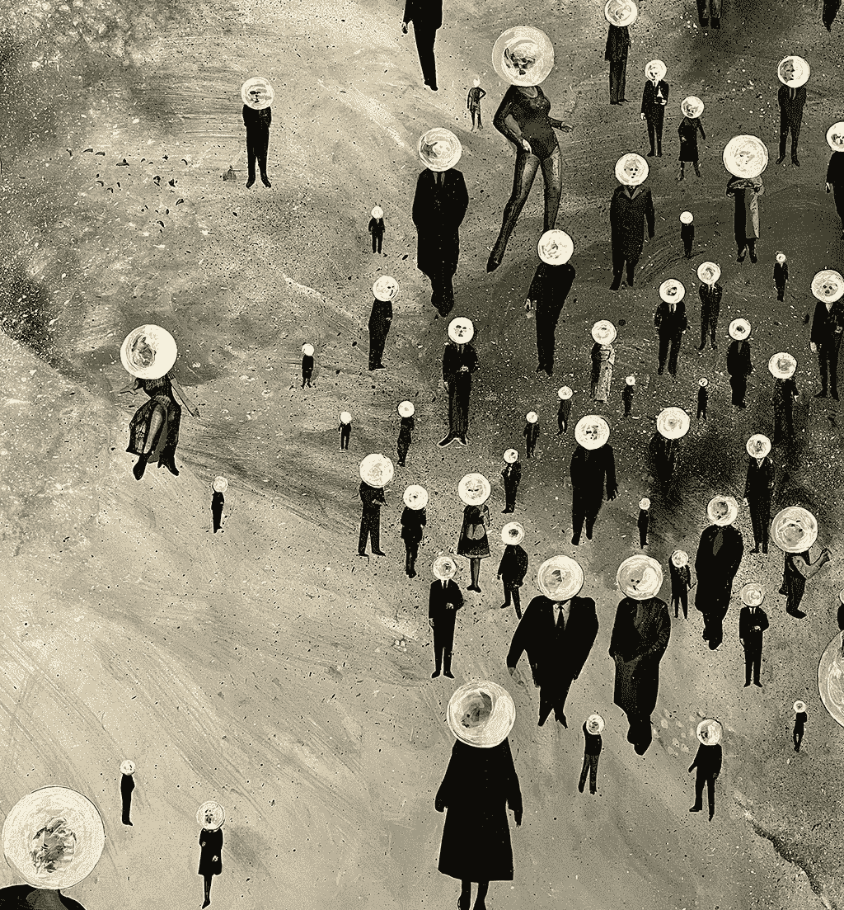
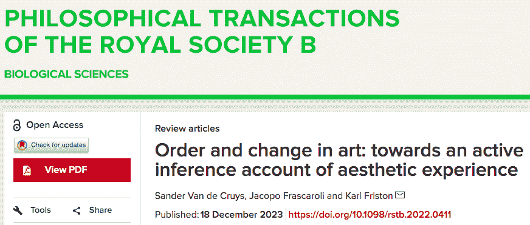
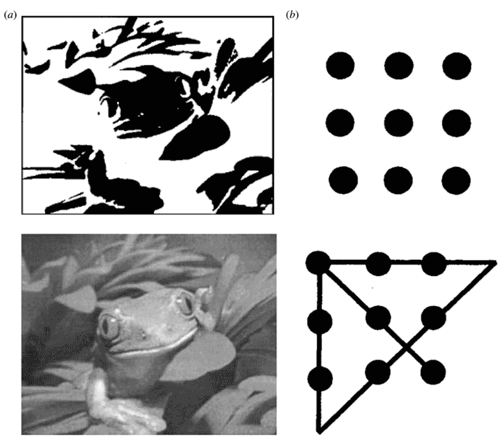
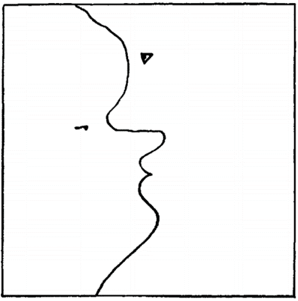
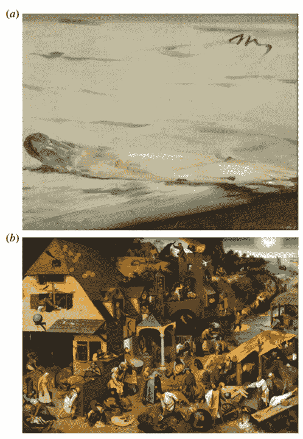
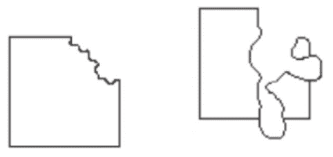
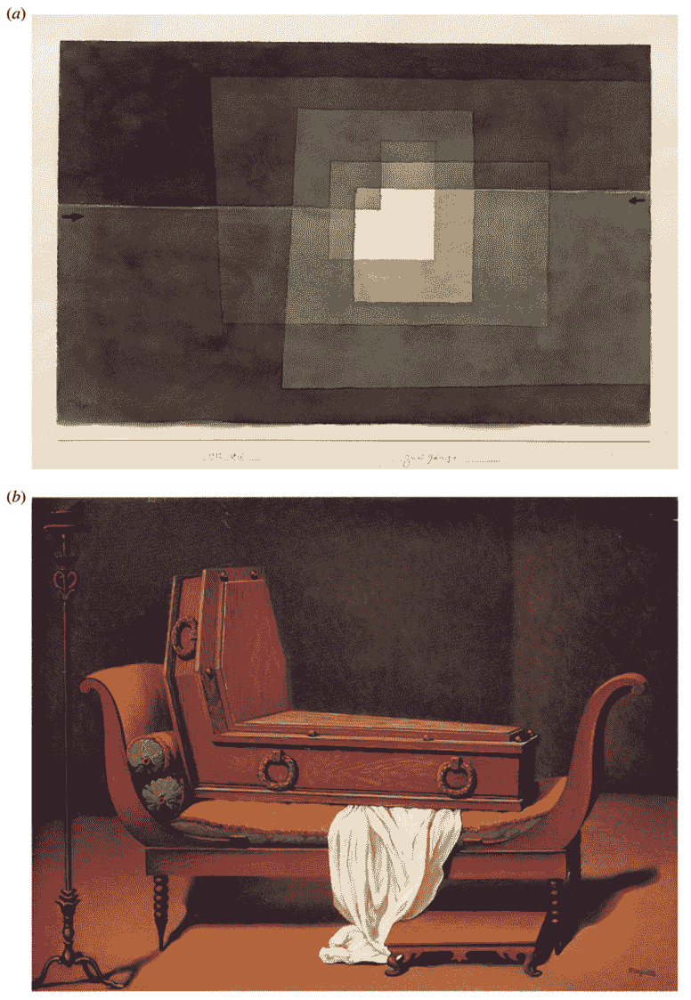

# 艺术中的秩序与变化：主动推理如何解释美的体验

> 来源：[https://agijuejin.feishu.cn/docx/TIG1dnA6PokwdrxE9RjceWiNnqe](https://agijuejin.feishu.cn/docx/TIG1dnA6PokwdrxE9RjceWiNnqe)

> 集智俱乐部｜[阅读原文](https://mp.weixin.qq.com/s/grcEyLxfwX2XtJth9hiFRA)

> 转载请联系原作者取得授权

> **导语**

> **如何解释艺术对我们的影响力？为什么艺术作品会深深地触动我们？自由能****原理提出者 Karl Friston 等人在这篇发表于《皇家****学会哲**学会刊B》（ Philosophical Transactions of the Royal Society B ）的论文中认为，问题的答案可能来自于认知科学中的预测加工理论（predictive processing theory），或者说主动推理。简而言之，审美体验源自对世界模型的意外验证，这些验证增加了我们能够应对的不确定性。它是关于向秩序的转变，以及发生变化的秩序。

> **自由能**[**原理在感知和学习领域的一个应**](http://mp.weixin.qq.com/s?__biz=MzIzMjQyNzQ5MA==&mid=2247684648&idx=1&sn=31d359ae9b22f282bca47889e403764e&chksm=e89948a5dfeec1b3c61a686df6920c48a55dfe3d59dd974827877cf3d6b83922e42cd58dc591&scene=21#wechat_redirect)**用是预测加工理论。预测加工理论将预测视**为大脑认知的核心，认为大脑是一台多层概率预测引擎，只要大脑致力于预测与评估不确定性，知觉、想象、推理和行动等认知活动就会从这些预测和评估过程中涌现出来。本周二（7月16日）晚19:00的「 自由能原理与强化学习读书会 」将由北京师范大学系统科学学院博士生牟牧云介绍意识的预测加工理论（详情请见： 从主动推理到预测加工理论：预测作为大脑认知的核心 ）。欢迎感兴趣的朋友和我们一起探索！

>

> **研究领域：自由能原理，主动推理，**预测加工理论，世界模型，审美体验，认知弧

S**ande**r Van de Cruys, Jacopo Frascaroli, Karl Friston | 作者

张俊杰 ** | 译者**

> 论文题目：Order and change in art: towards an active inference account of aesthetic experience

> 论文地址：https://royalsocietypublishing.org/doi/full/10.1098/rstb.2022.0411

如何解释艺术对我们的影响力？为什么艺术作品会深深地触动我们，安慰、改变或激励我们？在本文中，我们认为这个问题的答案可能来自认知科学中一个丰富的框架，即预测加工 （predictive processing，即主动推理） 。我们通过“认知弧 （epistemic arc） ”的概念来解释这种方法如何将意义建构和审美体验联系起来，认知弧由三部分组成 （好奇心、认知行动和顿悟体验） ，我们将其视为主动推理的不同方面。然后，我们展示了艺术品如何构建和维持认知弧，为我们提供那些倾向于称之为“审美”的令人满意的体验。接下来，我们化解了对这种方法的两个主要反对意见：它过分强调了我们审美遭遇的认知成分——以牺牲情感方面为代价；强调封闭性和不确定性最小化 （秩序） ——以牺牲开放性和始终存在的不确定性 （变化） 为代价。我们表明，这种方法为解释审美体验中固有的开放、自由和有趣的行为提供了重要资源。结果是一种有前途但又令人沮丧的方法，既符合哲学原理又符合心理学原理，为理解我们的审美经历开辟了新的实证途径。

### **1. 引言**

如何解释艺术对我们产生的强大影响？例如，当人们坚称一件艺术品 （无论是文学、视觉艺术还是音乐） 帮助他们度过了艰难时刻时，他们的意思是什么？显然，他们的意思并不是“帮助”的字面意思：艺术并不像抗生素那样有帮助，可以消除世俗的痛苦根源。相反，艺术通过改变我们的心理状态 （我们对世界上残酷事实的建构） 来缓解痛苦，并由此开辟新的行动机会。它提供了表达、理解并最终接受或改变我们的处境和我们自己的方式。

艺术不是通过美化现实来实现这一点的，也不是简单地满足我们对所应遇见的世界的预期。紧张 （tension） 、不确定性以及对预期的**违背是优秀艺术不可或缺的要素，这一点在美学哲学的**最早文献中就有所记录。事实上， 艺术所激发的真正发现时刻似乎既需要紧张和不确定性（变化），也需要封闭性和确定性（秩序） 。此外，通过艺术达到的秩序往往是进一步探索变化的动力：它充当着自我验证的角色，让我们有自由再次进入这个多变和不稳定的世界，探索新的环境和存在方式 （改变） 。这种新的自主性拓宽了视野，并 （重新） 聚焦了一个人的行为和价值观。这也许就是为什么我们与艺术的接触通常也被认为是变革性的、伦理的体验：它们塑造了 （行动的） 自由。

在这篇论文中，我们试图使用预测加工 （predictive processing，PP） 或称主动推理 （active inference） 的框架，来更广泛地阐明我们对艺术和审美体验的这些方面的理解。初步看来，这个框架认为生物体由最小化不确定性的唯一指令所控制，似乎与刚刚描述的那种丰富的审美体验的可能性格格不入。的确，它似乎与所有启迪我们存在的艺术的、有趣的和创造性的追求相抵触。然而，在这种看似肤浅和保守的原则之下，这个框架能够揭示我们从最普通的到最崇高的美学经验的关键特征。

### **2. 审美体验的概况**

在深入探讨我们提议的细节之前，我们应该先明确我们的解释目标是什么。首先要注意的是，我们认为艺术提供或旨在提供一种特别强烈和令人满意的体验，这种体验——尽管可以通过许多非艺术性的体验来引发——但在艺术中，它找到了一个典型和程序化的触发因素：“审美体验 （aesthetic experience） ”。接下来的问题就是具体阐述这种体验的特有特征。这将在我们论文的其余部分呈现，但一些要点可以在文章开头就提出。

基于康德的认知，沙维罗 （Shaviro） **通过与欲望进行对比来描述审美体验的核心**：“ 欲望是自我如何投射到世界中并重塑世界；审美体验是世界如何投射到自我并重塑自我 ”[1, p. 27]。这突出了适应的不同方向：欲望是让世界适应心灵，而审美体验是让心灵适应世界。审美体验会抓住你，而不是你抓住某样东西 （因为你需要它） 。审美体验是被感动或触动[2]，而不是成为世界的操纵者。有趣的是，这意味着一种接受能力——一种适应的意愿——但也意味着某种超出你的接受能力、超出你当前理解范围的东西。

强调适应是从世界到心灵的方向 （重塑自我） **也**暗示了审美体验并非一种独特的、例外的体验类型。可以说， 生活是一个持续的协商过程，有时我们按照自己的意愿重塑世界，有时我们不得不让步并应对世界所提供给我们的一切 。从这种最基本的意义上讲，任何体验都具有审美维度，而且当我们——我们自身和对世界的心理模型——被推动得越多，而不是成为“推动者”时，这一维度就越为强烈。这也暗示了美学本质上是关于我们心智的重构；也就是说，是学习[3,4]，尽管不一定是我们即将看到的“大脑 （cerebral） ”类型的学习。这个观点 （有些人会认为杜威[5]是其重要的先驱） 暗示着，正如我们将艺术视为提供非艺术也能提供的强化的审美体验一样，我们也应该将审美体验视为以一种增强的方式呈现体验本身的某些基本特征。

可接受性和不可理解性之间的张力凸显了我们的理**论需要解决的四种审美**体验的特性。首先， 审美体验是一个过程 ，而不是一个瞬间或对静态事物 （“艺术作品”） 的即时评价。它是客体和主体之间的互动，其时间动态需要阐明[2]。本文试图从基础出发来描述这些动态特征。同样，遵循康德的第三批判[6]和杜威的《艺术即体验》 （ Art as Experience ） [5]的传统，审美似乎标志着体验的发展，这是任何进一步深思熟虑的判断或行动的先决条件。这种包容性的、基本的审美意义表明，日常体验和成熟的、典型的审美体验之间存在着连续性，两者之间的差异在于程度而非结构。

其次，可接受性和不可理解性之间的张力——以及对审美体验作为过程的重视——也为成熟的审美体验中经常出现的矛盾因素提供了空间：积极情绪和消极情绪[7]、混乱与和谐、秩序与变化、内在的封闭感和外在的开放性。然而，正如我们将要论证的那样，这些元素单独来看都不足以构成审美体验。

**第三，由于可接受性和不可理解性**之间的张力，我们发现 审美吸引力的个体差异普遍存在 。艺术作品观看者的主观体验[8,9]决定了一个人能接受什么，以及一个人能理解什么，这不可避免地塑造了我们的审美体验。有些东西对我来说可能不会产生特别强烈的审美体验，但对你来说可能会。我甚至可能在某一天，在某一种特定的心态下，对一件艺术作品不屑一顾，但在第二天却发现它极其吸引我。这并不意味着我们不能尝试对引发审美体验的对象类型进行特征描述 （即采取“刺激导向（stimulus-oriented）”的方法；[2,10]） ，但表明这种分析总是不完整的。在后续论述中，审美体验在本质上是普遍的，但当我们认为审美吸引力是对象的一个属性时，我们正在进行不合理的投射。

第四，也是最后一点，可接受性和不可理解性之间的张力表明， 我们的审美体验是短暂的、不可重复的 。审美体验不能以同样的方式重新体验，因为它涉及到与触发它的对象的关系的变化 （下面将详细说明） 。这并不是说同一作品不能引起新的审美体验，而是意味着，正如我们将看到的，这些体验将是由具有相似结构的不同生成过程所引起的新情况。这也进一步意味着我们应该区分将某物标记为具有审美吸引力的标签[2]和经历一次真正的审美体验。当我们标记或判断某物为“审美上吸引人的”、“美丽的”或“更可取的”的标签或判断时，并不一定是因为在这一刻我们享受了审美体验的特有生成过程。这可能只是因为我们认识到，这种刺激 （或类似的刺激） 在过去促成了那个关键的过程。因此，即使没有经历即时的审美体验，我们也可以将事物归类为美丽的或具有审美吸引力的，因为我们已经了解了它们往往会在我们身上唤起的那种过程。

在列出了审美体验理论的一些必要条件之后，我们现在可以开始介绍神经认知框架，它将作为预测加工理论的基础。

### **3. 认知弧**

简而言之， **预测加工 认为生物体不断地、在很大程度上隐含地生成自上而下的预测**，以捕获其感官输入中的模式（规律性），并使用这些预测与感官样本之间随后的不匹配 （自下而上的预测误差（注释1）） 来更新和适应产生我们下一次预测的生成模型 （对于预测加工的全面但易于理解的介绍，见[11-13]） 。这样，预测加工为激进的建构主义格言提供了计算基础，即我们只在失败 （预测误差） 中遇到现实，而不是在任何绝对意义上[14,15]。通过最小化这些预测误差，我们推断出可能产生近端感觉的隐藏原因。例如，我们根据物体对我们感官的影响，推断出世界上物体 （如“云”） 的存在是隐藏的原因。重要的是，我们的生成模型是分层结构的，这意味着较低级区域的预测可以作为更高级预测的目标，使更高级别的预测能够跨越空间或时间利用 （并预测） 更抽象的规律。例如，对一个句子将如何结束的预测，是基于对叙事中下一个事件的预测，并且这种预测是相互影响的。

从这一观点来看，任何体验，无论是审美的还是非审美的，都始于最低限度的主动参与，这种参与体现为基于情景推断的预测。与我们的预测相匹配的感官数据会退居为背景，而违反我们预测的感官数据 （增加了我们对其隐藏原因的不确定性） 能够吸引我们的注意。它们可以成为好奇心的 （显著） 线索。我们好奇的事物并不会立即揭示一切——它们被某些不确定性所笼罩，或违反了我们在特定情境中的预期[16]——但它们提供了一种我们不得不去追求的认识论上的可及性 （epistemic affordance） [17]。

但仅仅是不确定性、混乱或不可**预测性不足以激发我们的好奇心 （想想电视上的雪花屏幕）**。 相反，我们需要感觉到——也就是说，有一种内在的期望——我们可以在解决不确定性方面取得一些进展 。近期关于好奇心的计算理论将其描述为预期的不确定性解决，也被称为预期信息获得或学习进展[18-20]。这些理论表明，维持注意力并推动我们进一步探索刺激的是认知承诺 （epistemic promise） ：我们将能够解决不确定性的承诺，如果我们继续研究我们的感知 （即积极测试我们的感知假设[21,22]） ，并让它对我们产生更多的影响，“事情就会变得更有意义”[23]。至少，艺术家的工作是维持这样的承诺，鼓励我们进行进一步的探索。

请注意，我们最初体验到的不确定性和我们能够解决这种不确定性的预期，都是完全依赖于主体的 （注释2） ：个人应用于特定情境的特定心理 （即生成性或世界的） 模型决定了哪些不确定性被突显和体验。同样地，一个人是否能够处**理特定类型的不确定性**，也取决于他/她的模型是否已经捕捉到了这个领域中的一些相关规律，从而有助于理解它 （包括已知的未知） 。对于新手来说，一段自由爵士乐是不可预测的 （他们可能会走神或结束体验） ，但对于爵士乐爱好者来说，它却是 可预测的不可预测性 。

一些关于好奇心的解释将我们对环境中那些确保不确定性解决的部分的吸引力描述为对我们能够减少预测误差 （即不确定性） 速率的敏感性[24,25]。这种元期望 （meta-expectation） 不是关于预测我们环境的特征，而是关于预测我们自己预测这些特征的能力。如果心理功能是关于最小化预测误差的，那么在当前环境或活动中，关于我们减少预测误差速率的预测可以衡量我们的应对能力，以及我们是否需要投入更多资源[26]。我们如何获得这些元期望？可能和我们获得所有期望的方式是一样的：通过经历类似的情境或活动——比如演奏乐器、欣赏艺术或遇到某种特定类型的刺激——并体验我们在那里减少不确定性的能力。

当然，好奇心表现为积极的探索：这是一种通过自己的行动来解决不确定性的冲动[17]。与此一致，在主动推理中，好奇心或预期信息获取是计划性或反事实行动的一个特征[13]，量化了搜寻感官数据的潜力，这些感官数据是人们用来解释特定情况或刺激 （隐藏原因） 的预测的诊断性 （显著性） 。这种所谓的“认知觅食” （epistemic foraging） 可以从眼球运动到互联网搜索 （注释3） 。虽然它通常涉及到在系统的较低层次上预测误差的即时增加，但它旨在揭示世界的构造，以减少未来在抽象层次上的预测误差。这里有一个常见的类比，一个迷路的人想要回家，但可能会先去一个明显的地标，尽管这个地标离家更远 （增加了预测误差） ，但它能够使人更可靠地回家[18]。

所有这些都是概率性的，并且世界是多变的，然而，我们寻求信息的过程实际上可能增加了预测误差和不确定性，而不是减少了它们。但是，如果调整得当，不确定性通常会被解决，并且在我们持续采样的过程中，预测误差 （平均而言） 会减少。看似可减少的不确定性激发了好奇心，随着时间或认知行为的推进，好奇心可能会导致实际的不确定性减少。当这种情况发生时，通常感觉很良好 （参见Ruan等人[28]关于不确定性解决的愉悦的实验研究） 。

还需要记住的是，在主动推理中，任何心理过程 （包括行动） 都假定是为了减少不确定性，所以即使是在公园里散步这样平凡的事情也是由预测模型所驱动的，这些模型将不确定性最小化——相对于预期行动计划和相关预测的感官后果 （有关将行动视为预测的概述，见[29]） 。为了解何种不确定性解决会产生积极情感，我们可以再次求助于对不确定性解决速率的元期望。如果好奇心的渴望感觉与预测误差最小化的预期速率相关联，则实际速率可能会决定认知行为后体验到的情感。具体而言，当不确定性以比预期更快的速率减少时，这可能会以强烈的积极情感为标志[25,30-34]。在心理学上，关于这种认知感受 （epistemic feeling） 有大量的文献，被称为啊哈体验 （Aha Erlebnis） 或“顿悟”。在神经生物学中，对不确定性解决的识别已与多巴胺放电 （与奖励处理相关的那种） 联系起来 [18]，并在情感推理的背景下以“情感负荷” （affective charge） 来解释[33]。

这种顿悟体验之前通常会存在一个僵局，即一个不确定性阶段，在这个阶段，尽管已经付出了一些努力，但我们仍在努力理解一个情境或解决一个问题。引发顿悟的“谜题”表面上通常足够简单 （例如，一些可识别形状的穆尼图像、远距离联想任务中的三个常用词，或九点任务中的九个点；参见图1中的示例[35-37]） ，因此我们有足够的好奇心去参与它们，并承诺进行认知行为以收集更多信息。我们感觉解决方案就在眼前。

图1. 通常用来诱发顿悟体验的两个谜题。(a)穆尼或双色调图像，解决方案或源图像在下方。(b)九点问题[35]，解决方案在下方。参与者被要求在不把笔从纸上拿开的情况下，用四条直线把九个点连起来。

如果我们经过长时间的努力仍然不能解决问题，关于能够减少预测误差速率的元期望将会被修正。当我们最终突然确定了一个好的问题结构 （导向解决方案） 时，将会比预期更快地解决不确定性，从而产生一种愉悦的洞察感。Dubey等人[38]确实发现证据表明，顿悟体验的强度与比预期更快地解决谜题 （即元认知预测误差） 有因果联系。

顿悟体验的范围可能涉及从微妙的知觉洞察 （如穆尼图像） 到深思熟虑的认知问题解决的洞察。它们在实验室中极难可靠地引发，因为它们主要依赖于主观因素，特别是心理转变：对问题或刺激的重构，或者发现潜在的规则、对称性或规律性。就主动推理而言，它涉及到选择最能解释感觉输入的假设。获胜的假设或模型将尽可能简单且准确，这意味着它将既能很好又能简洁地解释感觉证据。 （注释4） 确定这样的假设意味着对新发现的结构的精度或置信度的意外跃升，正如我们在与顿悟体验相关的 置信度 评级中所看到的那样[39]。一旦发现了新的结构，问题常就会变得微不足道并自动化：那些最小化不确定性的隐含行动现在已成为主导性的“习惯”。你能够自己 （重新） 构建刺激或解决方案的事实，使它感觉更真实，并 （讽刺地） 存在于世界中，独立于你：你对世界的把握加强了，世界似乎更加真实，更“触手可及” （参见[40]） 。的确，人们不能“忽略”穆尼图像的解决方案。在我们的现象学中，解决方案变成了刺激，可以说是我们的努力在Metzinger的意义上变得清晰透明[41]。

顿悟体验似乎在参与者能够自主发现解决方案时更为强烈；也就是说，使用他们自己的认知能动性，而不是被别人告知。认知能动性 （epistemic agency） 涉及基于输入中的不同感知特征，对假设或预测进行迭代测试。更准确地说，这个过程是放弃 （降低权重） 自己先前对感觉数据的先入为主的、主导性的 （先验的） 假设，并激活一个可能具有更大解释潜力的、不太可能的假设，就像科学家提出一个新的假设来支持其下一个实验。我们倾向于假设并附加结构、规则或意义，即使是对部分感知线索，并且将这些意义置于外部世界而非我们的心智中，这常常阻碍我们找到更好、更简单、更有证据支持的解决方案：在与世界的感知交流中，我们有时是相当不科学的[42]。

随着顿悟体验中意外且愉悦的不确定性解决，我们能够完成从好奇心开始、紧接着认知行动 （最后到顿悟体验） 的认知弧 （参见图2） 。由此产生的积极情绪在强度上可以从较平淡的“哦，好的”到较强烈的“啊哈！”不等。我们假设，不确定性解决的具体动态及我们对此的期望将决定情绪的强度。心流体验[44]可能是由于预期的不确定性降低率与实际的不确定性降低率之间良好的匹配，高于预期的不确定性降低率可能会产生像顿悟体验那样更明显的积极体验。我们自己的行动为积极的顿悟体验提供基础这一事实可能表明，情感价值尤其取决于对预期能够迅速减少不确定性的行动的信心 （也即精确度） [13,33]。

图2. 来自Hebb[43]的模糊图像。为什么这样的图像会吸引人？在预测加工中，缺失可以变得有意义（作为障碍或预测误差）。简单的线条可能让你预期它没有太多意义。但当你稍微多看一会儿时，情况就会改变，可能是因为你的视觉系统注意到这条线偏离了你预期的一条随机绘制的线条的样子（预测误差）。这个预测误差暗示了绘图者的意图，这反过来又创造了预测误差的预期可减少性，这在（经过简短搜索后）发现一张脸时得到了实现。但这留下了一些剩余的误差：一张脸有一个奇怪的轮廓，这导致了第二张脸的发现。然后，当一个人专注于这张新面孔时，另一张脸失去了它的“优势”（一个新的误差），因为我们的视系统只能将其分配给一个对象，以此循环。在非常简单的刺激中，已经存在了好奇心、认知行动和发现的微观循环。图片改编自Van de Cruys等人[25]。

### **4. 艺术中的意义创造**

回到艺术和审美体验，现在很容易看出艺术家通过创造这些认知弧的机会 （即这些好奇心—认知行为—顿悟体验的循环） 来获得人们的兴趣和欣赏。当然，认知弧是一种理想化的体验。好奇心可能不会得到满足，认知行为可能是徒劳的 （导致我们终止审美体验） ，而且，根据我们解决问题的动态 （比预期快还是不快） ，顿悟体验可能会或不会使其圆满结束。但作为一个整体，认知弧可以被视为意义构建的最小单元，也是艺术产生愉悦的关键组成部分。在一件艺术作品为特定观察者提供的体验接近这种理想情况时，可以认为这件艺术作品为该观察者提供了一种审美体验。在这里，我们可能有一个原则性的方法来阐明杜威的直觉，即审美体验以一种增强的方式呈现了体验本身的某些特征。

为了提供这样的体验，艺术家利用预测误差，并使其凸显， （注释5） 从而赋予它们信息获取或不确定性减少的承诺。这启动了一个认知弧。因为艺术作品是由具有特定意图和技能的人创造的刺激[48]，我们知道这种“疯狂”背后有方法，有一个我们可以推断的隐藏原因，使“异常”的感觉阵列变得可预测。隐藏的原因可能像一些被描绘的对象一样简单 （就像我们推断无生命环境的其余部分） ，例如，当几笔画在正确的情境中唤起了一艘船的轮廓 （例如在莫奈的画作中） 。但隐藏的原因也可能在于事物被描绘的方式，艺术家在创作这些特定的物理印记时的感觉和意图 （就像我们从社交伙伴的表情中推断他们的思想和情感） 。在艺术领域，推理过程通常并不像我在日常生活中所习惯的那样流畅 （见图3） 。艺术家有意识地推迟不确定性的解决或意义构建；可能是为了扩展认知弧的影响范围。这意味着即使在短暂的时间内，也需要认知行动，以形成对艺术作品的良好生成模型 （即刺激是如何产生的模型） 。预测误差所带来的摩擦创造了一种可能性，即 （出乎意料地） 在构建刺激结构上取得进展，并且当这种构建是通过个体的认识论 （认知—行为） 能力实现时，它会激发积极的情感，并将发现的结构定位到外部世界中。

图3. (a) 爱德华·马奈（Édouard Manet）的《芦笋》。(b) 彼得·勃鲁盖尔（Pieter Bruegel de Oude）的《荷兰谚语》。这两幅画都允许有解谜的时刻，最终得出明确的结论，无论是在感知层面（马奈：所描绘对象的感知组织和发现）还是在概念层面（勃鲁盖尔：对对象的分组和发现所描绘的谚语）。在这两种情况下，自上而下的预测（例如，对荷兰语和烹饪的熟悉程度）对于发现和欣赏画作至关重要。马奈通过违反相似性分组（物体与背景之间缺乏对比）增加了不确定性，勃鲁盖尔则通过拥挤的画面以及对熟悉的谚语进行字面描述的荒谬性（违反期望）来增加不确定性。

既然我们已经勾勒出了预测加工方法在审美体验方面的应用，让我们尝试解决可能对它提出的两个反对意见：第一，过分强调认知、解决问题的方面，第二，过度关注认知闭合性。

#### **（a）过分偏向认知方面？**

对我们所提出观点的第一个可能的批评是，它过于认知主义：它侧重于我们的认知系统对感觉输入不断形成的隐含假设的“问题解决”。的确，我们将我们与艺术作品之间的接触描述为一种“认识论的”或寻求信息的过程，这似乎与艺术能够激发的深刻情感和存在体验相去甚远 （关于美学认知主义的其他讨论，见[49,50]） 。

然而，对于预测加工，存在论和认识论的关注从一开始就交织在一起。转述诗人保罗·瓦莱里 （Paul Valéry） 的话：如果某物存在，它就在创造未来。要创造未来，有机体必须体现其环境的模型——最重要的是，体现其自身行为的后果。预测加工将认知动力学 （epistemic dynamics） 形式化，使有机体能够进行抵抗热力学分散 （thermodynamic dispersion） 的存在性工作。如果理解到，相对于有机体所体现的模型 （即有机体本身） 不确定性的减少总是只定义为相对于该模型的，那么很明显，这种认知驱动总是具有内在的存在相关性。通过最小化不确定性，有机体是自我证明的：最大化其自身存在的证据[51]。正如被归因于诺瓦利斯 （Novalis） 的格言所说：“我们在世界中寻找结构——我们就是那个结构。”完全相同的 （可证明的） 结论巩固了早期的控制论运动[52]。

作为人类，我们为维持生命存在而调谐和创造的结构 （或模式） 是多样且广泛的。在我们的模型中获得的模式范围从我们外部环境中的简单感知规律，到表征我们内部环境的规律：我们自己身体系统的特殊运作方式，以及外部环境如何塑造这些内感受模式[53,54]。这些模式也可以是抽象的故事，我们告诉自己我们是什么样的人，分解成我们期望自己进行的行为，以及我们期望自己所处的 （社会） 环境。正如Ramstead等人[55,第233页]所指出的：“生成模型是‘根据我是哪种生物，应该是什么情况’的规范性模型。”因此，个人主体的模型不仅仅是认识论 （表征性） 的手段，也是规范性和愿望性的手段[56]，即使它们不断地与世界进行着协商。

至关重要的是，认知弧及其相关的不确定性的增减也是相对于层级模型发生的，层级模型关注我们内感受状态的动态，并且在更高的层级上涉及自我及其用来解释特定内感受和外感受状态组合的感觉[57-60]。感受作为高层级的“经验性先验 （empirical priors） ” （注释6） 或习得的预测出现，它们有效地总结了多模态感觉流的常规模式，包括由我们自身行为所引起的感官流[57]。这与我们的感受是通过推断或构建而非既定的观点一致[58,59]。这些“感受”预测随后可以应用于我们自己以及他人的行为中识别出的新情况 （参见心理理论） 。重要的是，它们也可以用来推断人类行为 （例如艺术） 的无生命产物 （表达） 背后隐藏的原因。愉悦来自于艺术作品的生成模型 （作为艺术家的“代理”） 与观察者的生成模型之间不断增加的调谐。

这种对艺术的看法与亚里士多德[61]和托尔斯泰[62]对共鸣在艺术中的作用的普遍直觉一致。艺术捕捉了我们 （情感） 生活中隐含的规律，这些规律很少在有意识的、可言说的概念中得到表述，尽管它们是我们体验的重要组成部分。托尔斯泰写道：“对于真正的艺术印象的接受者来说，似乎他之前就知道这件事，但却无法表达出来”[62, 第144页]。注意对发现 （顿悟） 及其意外性的间接引用。内在的 （情感） 模式，作为个人化和独特的体验，却意外地在外部世界中找到了它们的证据或验证[63]。通过这种方式，我们对艺术的积极的认识参与提供了一种独特的、 （准） 社会形式的自我证明[51]：它为自我 （模型） 的存在提供了证据 （即减少了存在的不确定性） 。或许有些矛盾的是，我们可能会体验到这是我们自己与外部世界 （或其他主体） 之间认知和存在边界的暂时消解。正如托尔斯泰敏锐地观察到的[62, 第197页] ：“一件真正的艺术作品，在接收者的意识中，摧毁了他与艺术家之间的分离，不仅如此……在这种将我们的个性从分离和孤立中解放出来，与他人结合的过程中，是艺术的主要特征和巨大吸引力。”根据这种观点，从与艺术的接触中获得的愉悦是由于这种意外的、不断增加的调谐或“视野融合”的过程[64]。

#### **（b）对闭合性的过度迷恋?**

其他对我们所提出的审美体验描述的批评者可能会争辩说，它过分强调了“完成”、“洞察”或“掌握”以及与之相关的瞬间愉悦结果。然而，随着我们将洞察或不确定性的解决嵌入到认知弧中，我们已经消除了这种观点，即认为这种完成可以在不确定性增减的动态之外孤立地实现。并非每一次“完成”的积极审美体验都需要长时间的准备阶段 （人们可以迅速做出审美评价；[65,66]） ，但是认知弧的成分应该存在。这也意味着，除非艺术作品允许新的和不同的认知弧的出现，否则随后对同一作品的体验将是原始体验的微弱复制品 （无论我们多么希望重新审视它） 。

然而，人们可能会问，一个失败的模型——仅仅是不确定性、不和谐、差异或模糊性——是否足以构成审美体验，即使没有任何解决 [67,68]。这个问题在当代艺术中尤其突出，因为当代艺术通常会以不和谐和颠覆来挑战感知者 （例如Kesner[69]，他讨论了Dominik Lang的《东西方》（ EastWest ），该作品仅由“纸板墙上的两个洞”组成） 。这样的作品经常遭到（潜在）观众的直接拒绝，原因是挫败感或无聊。挫败感可能是因为获取隐藏原因的认知弧 （寻求额外信息的努力） 比预期的或习惯的要长得多。这是关于未能找到作品提出的问题 （或者说作品本身构成的问题） 的解决方案，以及缺乏信任，不相信有问题值得去探究，更确切地说，在这种情境下，对可减少的预测误差的元期望很低。感到无聊可能是因为观众坚信作品中再无更多深意可寻，或者即便有所深意，要想发掘出来也得投入远超艺术家创作时的努力。 （注释7） 同样，这可以被视为对信任的破坏 （艺术作为沟通方式的努力平衡） ，因为在预测加工理论框架下，信任可以被解释为对预测误差可靠减小的预期：因为是人类创造了艺术作品，作为人类，我期望自己能够理解他们所创造的东西。严格来说，这一模式不一定是由艺术家刻意置入其中的，尽管相信作品中蕴含着某种深意会让我们继续探索 （顺便说一句，这与人工智能生成的艺术作品形成了一个关键区别） 。

因此，只要好奇心持续存在，“纯粹的不确定性”就能构成一种审美体验。这意味着，具有特定过往经验的个人——不论是与相似作品的接触经历，还是刚刚对同一作品的体验——仍然期待能够减少预测误差。换言之，艺术家需要在某些时候满足一部分观众的需求，哪怕这可能需要通过文化学习过程，使观赏者的预测模型达到能够理解作品的“可减少状态 （regime of reducibility） ”。

即便如此，当一件艺术品抵抗我们的“规范化”努力时，这或许意味着在某种“元”层次上，艺术家的陈述 （作品背后的生成理念） 正是关于这种模式本身的探讨 （例如，我们对艺术家的信任引领我们找到可解决的模式） 。艺术家确实非常善于在我们找寻模式失败之处发现模式。他们的对象不仅仅是所描绘内容，还有我们感知和认知，甚至是艺术历史意义构建系统的假设[71,72]。正如我们之前指出的，艺术可以涉及现实或想象世界中的模式，或者是你自己 （身体） 运作的模式。更普遍地说，发现的模式通常与明显的“错误”处于不同的层次。

以一个非常简单的例子来说，一个角落变形的正方形仍然会被看作是一个正方形 （见图4） ，但人们会认为这个正方形发生了一些事情 （比如，根据变形情况的不同，正方形的角像是融化了或被咬掉；参见[73]以获取更多例子） 。这样的事件也是一种模式，因为我们很容易推断并感知到感官输入的因果历史 （生成模型） [74,75]。对于艺术作品中的新“错误”，艺术观察者揭示了类似的情况：付出了更多的努力，因此也承担了更大的风险 （可能会一无所获地结束体验） ，但当取得意料之外 （冒险性的） 预测进展时，也会感受到更多的愉悦。

图4. 我们不仅能立即看到形状，还能看到它们发生了什么（它们的因果历史）。改编自Pinna[73]。

在这种层次化的视角下，一个层面上的闭合可能会在下一个层面上带来开放性 （例如，在一幅画中识别出物体后，可能会产生关于它们之间关系的疑问） 。即使存在闭合，这并不意味着作品中只有一种确定的 （由艺术家创造的） 闭合。优秀的艺术通常是开放式的，我们现在可以具体理解为允许多个认知弧，多个主动 （认知） 推理的循环。虽然即时的闭合会破坏审美体验，但走向闭合的过程，以及随之而来的方向感，是至关重要的——如果坚持“纯粹的不确定性”立场就会忽略这一点。艺术家会本能地在他们的作品中提供良好的“结构不确定性来源 （supply of structural indeterminacy） ”[76]，因为稳定状态意味着推理旅程的结束，随之而来的愉悦和与对象的互动的结束 （见图5） 。因此，开放性和持续的不确定性是艺术家试图维持的那种艰难的辩证法的一部分，以使我们为预测进展做好准备。

图5。(a) 保罗·克利（Paul Klee）的《两条路径》（Zwei Gänge）。(b) 马格里特（Magritte）的《雷卡米埃夫人》（Perspective: Madame Récamier de David）。克利和马格里特的这些作品说明了，暂时的发现是如何通过持续存在的、无法最终解决的不协调性得以实现的。在感知层面，克利在他的悖论性的、多稳态的图像中，明确并有意识地利用了眼睛的局限性，及其解决不确定性所需的认知行动，正如这句话所表明的：“眼睛的局限性在于它无法同时在所有点上清晰地看到哪怕是小面积的表面。眼睛必须‘掠过’表面，一部分接一部分地清晰把握，将它们传达给收集和储存印象的大脑”[77, 第33页]。在概念层面，马格利特通过画作中躺椅上的棺材这一奇异元素，同样激发了推理和认知行动——无论是之前对大卫原作的经验，还是对马格利特其他《透视》系列作品的了解，都在引导我们探索：这仅仅是一个提醒死亡的象征吗？它是某种绘画风格或绘画方式的象征性死亡？这是对委托此类肖像画的上层阶级的短暂价值的幽默解构吗？没有任何单一的解释能够彻底解决这一问题（而从我们的角度来看，这或许也是幸运的）。（在线版本为彩色。）

我们推测，“纯粹的不确定性”这一反对意见的来源可能部分在于预测加工文献中使用的语言。当我们谈论“解释预测误差”时，我们的想法并不是要移除或“整理”那些“不守规矩的元素”，而是要赋予它们作为艺术作品整体象征经济的一部分的意义。事实上，艺术中的预测误差或不和谐正是新模式涌现的来源[48]。预测误差不过是我们需要解释的“有新闻价值”的感官信息，是我们需要解释的内容；它们促使我们寻求解释并推动进一步的学习 （信念更新） 。通过预测误差，艺术家使世界变得不再熟悉[78]：他们让我们感受到当我们第一次体验世界时的情形，那时我们还有最大的学习收益要实现，还有最多的模式等待发现。

类似的术语误解可能出现在“自我证明” （self-evidencing） 这个概念上。这个词决不意味着单方面努力使世界 （即艺术作品） 符合一个静态的自我。事实上，我们之前已经看到，认知弧的“洞察”阶段包含了个人模型的重构，目的是为了更好地与世界相协调。自我证明只是意味着最大化我们从世界中抽取的感觉的 （边际） 可能性。这是为了把握住这个世界。艺术 （以及可能所有文化适应的生态位构建） 提供的转折是，建筑师、艺术家、音乐家和诗人为我们提供了额外的、非常精细的自我重构和构建我们感知世界的可能性。

以经典的九点“顿悟”谜题 （图1） 为例，参与者被要求在不将笔从纸上拿起来的情况下，用四条直线连接九个点[35]。在这类问题中，必须首先识别并放弃自己的背景假设，然后解决方案才会出现[70]。在挣扎或僵局之后，放弃假设 （即降低我们模型的复杂性） ，同时获得解释现有或未来数据的能力 （找到解决方案） ，可以提供比预期更快的不确定性解决 （顿悟体验） 。

在解谜游戏中，这种紧张与释然的情绪仅仅关乎世界中偶然出现的模式，而在艺术中，它们可能涉及到定义我们的假设或模式。这些更高层级的先验知识组织着我们行为和感官模式大部分，因此，除非我们能通过艺术品找到新的先验知识——这些知识能以更好或更全面的方式捕捉到我们环境或自我中的模式，否则会产生抵抗情绪 （比如表现为对艺术品的排斥或回避） 。由艺术中的冲突激发的新的与自我相关先验知识，能够验证 （之前相互矛盾的） 思想或行为模式，并且能更有效地利用我们自身行为产生的过去证据，从而启动常被视为审美体验的最高形式的深刻自我转变[79]。

作为这部分的总结，可能看起来认知弧方法对艺术的解释过于宽泛。它不允许我们在真正的艺术作品和其他文化产品 （如侦探故事、笑话、网络梗、谜题、游戏[80]等） 之间划出非常明确的界限。以一种简化的方式，所有这些活动都依赖于认知弧，这些弧线上有着由模式和不确定性操纵带来的障碍、积极寻求信息和情绪缓解。可以说，所有这些活动中确实存在审美元素，但它通常是一种汇聚闭合的美学：一种实际上是提前设计好的结果，一个供所有人发现的单一模式。在侦探故事中可能存在多个认知弧，但它们通常都以一种特定方式解决。在这类情节中，可能存在转移和不确定性 （信息的逐步揭示） ，但线索是经过预先处理的，不是由个人节奏驱动的，并且导向唯一解决方案(8)，期间几乎不需要太多认知努力。相比之下，伟大的艺术作品往往在时间上延伸认知弧，并辐射出多重模式。

这种开放性美学与闭合性美学之间的关系是什么呢？我们在此的推理，以及之前对审美体验的阐释，往往倾向于从闭合性的立场回顾认知弧[81]：相对于某些“预期集合”——基于个人的预测或先前的偏好——减少误差会令人感到愉悦，特别是当这种减少出乎意料时。这一组成成分至关重要，但正如我们现在所见，它也是有限的并具有局限性。我们能否不只回顾过去，还能超越当前的认知弧向前展望呢？

### **5. 向前看以拓展认知弧**

仅基于“顿悟”体验或“闭合性”来解释审美现象的问题在于，这类认知参与具有自我消减的特性。在预测加工理论中，所有认知都是由预期驱动的，这不可避免地限制了我们的感知。我们的感知是相对于我们偶然放置在世界上的那些参照点进行的。一个资源有限、目标导向的系统必须以这种方式缩小其感知范围，但存在一个真实的危险，即我们可能会陷入自己的建构之中：过早或永久性地关闭我们的认知弧，例如在错误的解离现象中 （在计算精神病学领域，关于这一现象有大量的文献记载，例如[82-84]） 。虽然顿悟体验是由我们思维和行为模式的重构引起的，但它们也会强烈地巩固这些新模式，这一点可以从与这些体验相关的高 置信度 评级中可以看出，即使它们被证明是错误的[39]。在预测加工中至关重要的认知行动，在这里看似能够解决问题，因为它们导致了直接面对预测误差 （见上文） ，而非回避这些预测误差。但是，即便出于好奇，人们希望通过某些行动获取信息，这仍然基于人们能够对感觉输入的原因形成的模型或假设。顿悟体验甚至还可能产生自我封闭的效果，也就是说，达到闭合意味着任何进一步的思考和探索 （认知行为） 都被终止了[85-87]，至少对于引起认知弧的那个特定问题而言是这样。

然而，顿悟体验似乎对随后的信息搜寻行为也有更广泛、更有益的影响。最近的一项实证研究报告称，经历过顿悟的人在面对风险决策任务时，对不确定性的容忍度会增加[88]。我们推测，作为过去认知成功的一个标志，顿悟体验产生了一种普遍的期望，即不确定性将迅速减少 （积极的预期不确定性减少率；另见[3]） 。因为完成的认知弧涉及了个人的 （认知） 行动，所以即将采取的行动会得到信心上的增强，这种增强效果似乎超越了顿悟出现的具体情境。这可能使得个体能够“与不确定性共存”，而不是急于寻求确定性的结论，从而使下一个认知弧可能变得更长。这或许就是艺术如何逐步拓展认知弧的方式，以一种可克服的路径逐步增加认知投入以及相关的收益。较长的认知弧不仅需要信任，同时也在建立信任。在游戏行为中，我们也可以看到通过紧张—缓解循环建立信任的相似机制[89]。

将其与作为典型短认知弧范例的网络模因 （meme） 进行对比。 （注释9） 网络模因中包含易于克服的认知不流畅性——即快速的紧张与缓解的认知弧——但同样能感受到真实或完成的感觉。网络模因中的“顿悟”同样指向了重构或学习，但它是一种无需信任的学习形式，因为挑战极小，且重构往往浮现自观察者已拥有的信念 （模式） ，只是最初并未被网络模因的“设定”激活。因此，它几乎没有带来新的认知。随着网络模因式的交流因其在缺乏信任、渴望关注的社交媒体上的成功而成为常态，我们或许 （在元认知层面上） 学会了期待这种认知投入的快速回报，并远离任何需要更长认知过程的事物。因此，当我们认为艺术为诸如延后判断、细致入微且审慎的推理等人文学科的追求提供了基础时，我们大概是在认可艺术训练可以避免过早认知封闭，使我们在不确定性中放松，并持续进行认知探索。

### **6. 自由向前**

让我们回到九点连线谜题这个略显简单的例子。为了开启包含解决方案的假设空间，可以说必须牺牲解法的直观美感：一个强烈而隐含的预设，即所画线条将保持在完全规则、对称的点阵框架之内。然而，唯有打破这一预设，另一种美学才得以实现：通往答案的行动自由得到了重新焕发。尽管这一例证剥离了所有存在性的含义，但它阐述了我们在审美体验中观察到的另一个原则。至少从康德和席勒开始，审美体验就以许多不同但相关的方式与自由联系在一起。康德认为，美丽事物的创造者不仅仅是遵循既定规则，而是自由地设定这些规则[6]；反过来， 美丽的物体被认为展示了某种不受外部规律影响的一定自由 （“美是外表上的自由”，席勒如此说[90, 第152页]） ，这进而唤醒了观察者的类似自由，其认知能力被置于“自由游戏”的状态[6]，或者引发其意志开放性 （游戏行为的典型特征） [91]。席勒甚至断言，“只有通过美，人才能走向自由”[91, 第90页]。康德和席勒的这些思想仍然影响着当代美学讨论，常常与自主性、无利害性等其他关键概念相联系[48,92,93]。因此，可以说，在我们对审美体验的良好解释中，自由应当扮演重要的角色。

在主动推理框架中，这种自由是如何体现的呢？在展望未来时，主动推理非常明确地阐述了如何选择行动 （策略） 和进行计划，超越了减少此时此地遇到的预测误差的范围 （这有时被称为规划即推理[13,94,95]） 。简单来说，它主张我们应该选择那些预期自由能或不确定性最小化的行动。 （注释10） 不深入到具体的细节，预期自由能 （expected free energy） 包含两个部分：认知部分——构想的行动是否是我解决关于观察结果是如何引起的不确定性的最佳方式？实用部分——这个行动是否是我实现先验偏好的最佳方式？[13,18,99]。根据预期不确定性对我们的潜在行动序列进行评分，自然意味着在探索 （认知价值或预期信息获取） 和利用 （实用价值或预期效用：实现个人的目标） 之间进行平衡。

简而言之，只要在行动、推断出的原因与观察结果之间的关系上存在不确定性，那么那些认知价值超过替代行动实用价值的行动就会胜出[18]。有趣的是，如果消除了这些映射的模糊性，并且也去除了先验偏好，“剩下的唯一指令就是最大化观察 （或状态） 的熵”[13]。在这种情况下，通过对所有选项进行抽样 （也称为不确定性采样） 来最小化预期不确定性是最优的：行动的目的在于增加可达到状态的分散度 （熵） 。换句话说，我们期望“保持各种可能性开放”。在这些特定情况下，即你对世界结构的不确定性较低，且没有迫切需要关注的先验偏好，“当主体选择一个政策 （行动序列） 以增加访问新状态的可能性时，惊奇可以最小化”[100]。实证上，Rens等人[101]最近的研究显示，人类的选择行为确实能被一个模型更好地解释，该模型中人类不仅在最大化预期效用，同时也在增加可选项的可及性。这种选择的可及性也给人们带来了更大的自由感。在另一项研究中，Navarro等人[102]表明，在动态多臂老虎机任务 （dynamic multi-armed bandit task） 中，人们厌恶选项的丧失。

这听起来可能有些自相矛盾：一个从根本上旨在最小化不确定性和惊奇的主体，也会通过其行为力求最大化熵 （不确定性） 。这里需把握的一个微妙而重要的区别在于，这种最大化关注的是主体在行动前后信念的相对熵：即最大化信息获取，减少对事物状态的不确定性[13]。从概念上讲，最小化不确定性意味着尽可能准确地解释和预测观察结果，同时避免对缺乏充分证据的过度具体解释或假设做出承诺[13,14,103]，这方面的证据很少。在机器学习和统计学中，未能遵循隐含的最大熵原则[104]会导致“过拟合”。简而言之，虽然过去的观察结果需要尽可能地被预测准确，但为了以最小误差预测未来的观察结果 （从长远来看，最大限度地减少不确定性） ，重要的是不要执着于那些与过去观察结果过度拟合的信念，而应在过往证据允许的情况下，尽可能地拓宽解释的范围。

在行动选择中，这转化为以一种能最大程度改变信念的方式采样观察结果。只有当观察结果改变了我们的信念，或在我们心中以有意义的方式发生变化 （即实现了信息获取） 时，观察结果才有意义。如果不是这样，输入则是无信息量的，可以被忽略[14]。因此，通过我们的行动体验到的尽可能多的隐含原因的驱动力，是自我证实的关键组成部分。信息寻求与目标追求之间相互作用的另一种视角，是将行动的指令分解为不确定性最小化和风险最小化。不确定性最小化是在推断出的原因与观察结果之间找到明确的对应关系，而风险最小化则减少预期结果 （我们的先验偏好或目标） 之间的差异。过度稳定是过度约束或固化的、威胁到适应性 （应对未来变化的能力） 的行为，而过度分散或可塑则会威胁到有机体的物理完整性 [13,105,106]。注意主动推理如何捕捉到过度稳定和过度分散之间的根本张力以及在这两者之间找到的折衷。或者，用怀特海 （Whitehead） 的话说：“ 进 步的艺术在于在变化中保持秩序，在秩序中保持变化 。生活拒绝被活生生地制成标本。”[107,第339页]。

有了这个关于如何通过主动推理“展望未来”的基本草图，我们可以尝试为康德、席勒等人提出的将审美体验与自由相联系的略显神秘但直观的想法添加一些计算层面的解析。在主动推理中，自由的价值是不确定性最小化的不可分割的一部分，在满足两个条件时尤其能够发挥作用。首先，当先验偏好退居幕后时，这是一个 （无风险） 条件，可能捕捉到哲学文献中经常提到的特征，即我们的审美体验所具有的无利害性 （disinterestedness） [108]：与艺术的相遇通常发生在更基本需求得到满足或至少不占据首要位置的时候。其次，关于推断出的原因 （包括我们自己的行为） 如何共同形成我们的观察结果的模糊性或不确定性也需要减少。正如我们在上文中读到的，顿悟体验标志着对世界结构突然清晰理解的时刻：不确定性得到解决的时刻。这两个条件释放了优化函数 （预期自由能量） 对未来行动选择的重要约束，也使我们能够进行更激进、更自由的探索。如前所述，即便是顿悟体验本身似乎也让我们比平时更能接受不确定性。

实际上，这可能表现为对当前情境下不太可能 （概率较低） 、较少占主导地位的假设或策略 （行动序列） 的选择，并体验为行动自由的重获。当没有迫切需要以确定的方式组织你的感官时，就具有了无利害性，这让你自由地探索不同的可能组织方式。虽然带有一定的推测性，但这种推理开辟了一种方式，为审美体验中一些更难以言喻和深刻的特征提供了实质内容。的确，艺术 （如心理治疗[109]） 被认为可以重新激活自主能动性和探索充满变数的世界 （和新思想） 的动机。作为一个恰当的例子，想象一下登顶山峰俯瞰壮丽景色时那种压倒性的审美体验。在我们费力攀登山峰这一强烈的认知行为之后，独特的认知洞察与行动机会的意外开放相融合，展现出一片广阔的视野，为我们规划下一步行动提供了无限可能。

但是，自然之美在现实空间中实现这一点，而艺术则能在精神空间中达成同样的效果。因此，那种扩展和赋权的感觉[110]，那种获得与环境互动并控制环境的更多选择的感觉，有时与最高层次的审美体验相伴相生 （参见尼采关于艺术作为升华的权力意志的观点[111]） 。这可能正是自由能评估的那些特定“区域”中的现象学。在这里，行动与价值得以拓展，我们不仅仅依据已有欲望和预期来优化接近目标和价值，而是首先学习什么是真正有价值的[112]。这确实是自成目标的生物 （autotelic creatures） ，也就是那些能够自我创造目标的主体所做的事情[113]。为此，我们需要处于一种能够承受环境和内部模型扰动的状态[114]，以安全地扩大我们的假设空间。事实上，我们不能使用当前的假设 （预期价值） 或预期信息获取来理解深层次未知事物[115]。

因此，艺术如同游戏一样，是一种促进主动推断的“沙盒”模式，使我们能够在计算预期不确定性时放松一些通常的约束。然而，一旦允许激进的新颖性进入，测试新结构可行性的标准工具 （认知价值和实用价值） 便再次启动，并引起我们论文前半部分所述审美愉悦的部分。艺术可能是一种涵盖成熟推理过程的方式，可以尝试采纳新假设[116,117]，甚至是新的主体或自我形态[80]，使其免受通常在积累证据之前就阻碍其发展的限制[118]。因为为先前不太可能的构想积累证据——即意外的自我证明——感觉很好。再次强调，既不是视野的扩展也不是狭窄，既不是秩序也不是变化，而是两者之间的循环互动，维持着艺术 （和生活） 。

这种审美和创造性模式的条件，以及它对不确定性的接纳度，需要更详细地加以考察。一些答案可能在我们可以维持的生成模型的特定形态中找到，特别是它们的层级结构和反事实时间深度[119,120]。这些模型的层级组织将大幅度减少对新颖假设的搜索空间，并能引导随机搜索进入最具信息量的区域[121]。此外，自信的 （高精度的） 高层级预测可以适应低层级经验学习先验的更多变化，从而允许观测数据中的更多不确定性过滤 （见上文关于正方形的“发生模式”的例子） 。这种以更抽象方式表述的模型也能应用于新的领域 （类比思维） 。

具有反事实时间深度的模型使我们能够从任意假设出发，并以一种在推理上隔离的方式“预演”其含义，使其免受常规约束 （先验） 的影响。这里的不确定性可以被允许存在更长时间。总之，所有这些“架构”的模型属性都能够以一种更有条理、更有控制的方式向系统中引入有用的不确定性[25]。但也有更多依赖于情境、特质和状态的方式，让我们的认知系统处于自我组织不稳定状态[122]，这些方式围绕好奇心、顿悟、信任以及情绪/心境等现象，我们知道这些现象影响我们对不确定性的开放程度，正如我们希望已经展示的那样，这些可以用主动推理的方式来表述。

### **7. 结论**

我们已经看到，审美体验源自对世界模型 （即我们自身的模型） 的意外验证，这些验证增加了我们能够应对的挑战 （不确定性） 。它是关于向秩序的转变 （认知弧中的不确定性减少） 以及发生变化的秩序 （为自由地开启新选项提供安全基础） 。它是关于意料之外的保证，即在给定参考框架 （先验信念、目标等） 的前提下，一个人的情感动态是可以预期的 （正常的） ，从而使得个人的经历变得可预测且富有意义，而非异常、非理性或不可预测。但这也关乎这种“缓解”在进一步的、更长时间的与非我、与尚未被建模的事物相遇时所开启的可能性。与环境的调谐过程让人感觉良好，但这需要这种相遇，当它提出可克服的挑战 （可减少的预测误差） 时，建立了信任。只有通过互动，我们才能确定适当的、经过协商的挑战，这些挑战建立了信任：为犯新错误 （预测误差） 提供余地。我们在游戏中、对话中、治疗中[123]、音乐创作中，或在艺术的间接互动中都是这样做的。在这里，主动推理恰当地颂扬了认知的、审美的和伦理的 （行动自由） 经典融合。

然而，至此为止，主动推理对艺术的解释可能仅仅让人感觉到是对著名美学学者 （沿途提及） 更加生动描述的一种统一且更精确的重新表述。但是，除了统一性之外，主动推断框架为复杂体验带来了一种前景广阔也更为简约的方法。虽然大多数关于审美体验的理论都是从这些体验的多维和丰富性出发，描述看似构成这些体验的不同认知和情感成分 （感知、注意、记忆、分类、掌握、元认知等；[124,125]） ，但预测加工的方法则是从最简单、通用的基本要素开始。这里的视角是衡量我们能在多大程度上构建起那丰富的复杂性，遵循着费曼 （Feynman） 的名言：我们无法理解那些我们无法创造的事物。的确，主动推理的一个主要优势就在于，这些最简单的要素 （例如，隐藏原因、预测误差等） 可以用数学方程精确捕捉，并且可以初步映射到神经回路和生理机制上[13]。

对于实验美学来说，另一个含义是，**为了更好地理解美学，并不一定需要以实际的**艺术作品作为刺激物进行研究。这消除了我们对这些刺激物缺乏实验控制的问题，以及参与者针对这些刺激物所应用的内在模型的不确定性，以及因此所体验或减少的任何不确定性。主动推理方法提醒我们，更深入地揭示诸如认识行为和顿悟体验等组成部分的过程，对于理解美学同样具有启发性 （参见[126]） 。 艺术的特殊之处可能更多在于上述组成部分之间的相互作用，而非任何通用组成部分本身 。最后，我们希望所呈现的解释可能有助于弥合实验美学中的显著差距，即我们主要研究的内容 （纯粹的偏好） 与我们宣称要研究的内容 （丰富而深入的审美，这些体验充满了强烈情感与崇高底蕴的交融，可能会改变我们的人生观） 之间的差距 [127]。

## **注释**

1 预测误差可以解读为惊奇，或在信息论中称为自信息。这表示平均预测误差等同于平均自信息或熵，是衡量不确定性的一个指标。

2 虽然我们提到“我们体验的不确定性”，但不确定性并不总是显著地体现在好奇心的体验中。这里我们主要从次个人层面上讨论（可解决的）不确定性，这取决于我们用来看待世界的模型。我们不体验导致好奇心的次个人生成过程，而只体验到它的结果，即我们称之为好奇心的认知情感的“直接”体验。因此，可以说好奇心是认识到可解决不确定性时的感觉。

3 值得注意的是，主动推理并不在明显的行为和隐藏（心智）行为之间划出严格界限。信息的搜寻可以是内在的，意味着可以通过提高它们的获取或精确度来选择特定的预测误差。[27]

4 从技术角度来说，贝叶斯信念更新和模型选择旨在最大化模型证据（也就是在模型下某些数据的边际似然）。至关重要的是，模型证据的对数可以总是表述为精确性减去复杂度。这就是说，我们被迫寻找尽可能简单的精确数据解释（参考奥卡姆剃刀原则或詹宁斯的最大熵原则）。

5 主动推理中的显著性（salience）被视作预期的信息获取或认识价值。这在机器学习和神经机器人学中，有时被称作内在动机或价值[20,45–47]。

6 实证先验是层级模型中中间层次的信念或预期的专业术语。它们在高层次视角中充当似然性，在低层次则是先验概率。关键的是，面对新数据时，实证先验总是被更新。

7 技术上，在主动推理中，努力的程度是对信念更新的度量[70]。按定义，认知弧内嵌了适当量的努力，这意味着解决不确定性本质上就是信念更新。

8 作者假设能够保持你的关注直到‘文末’。

9 另一个快速解决认知弧带来愉悦的例子是流行歌曲中轻微不可预测的 “钩子”，它们迅速转变为更易预测的节奏或旋律。

10 技术上，预测加工根植于贝叶斯大脑[96]和自由能原理[13]。变分自由能是贝叶斯模型证据负对数的上界[-lnP(õ|m)]，亦称为惊讶或惊异。在某些简化的假设下，自由能就是预测误差或不确定性的平均值[13,97,98]。

**参考文献**

1.  Shaviro S. 2012 Without criteria: Kant, Whitehead, Deleuze, and aesthetics. Cambridge, MA: MIT Press.

1.  Wassiliwizky E, Menninghaus W. 2021 Why and how should cognitive science care about aesthetics?Trends Cogn. Sci. 25, 437–449. (doi:10.1016/j.tics.2021.03.008)

1.  Sarasso P, Neppi-Modona M, Sacco K, Ronga I. 2020 ‘Stopping for knowledge’: the sense of beauty in the perception-action cycle. Neurosci. Biobehav. Rev. 118, 723–738. (doi:10.1016/j.neubiorev.2020.09.004)

1.  Sarasso P, Frascaroli J, Neppi-Modona M, Sacco K, Ronga I. (submitted) Three theories of aesthetic appreciation: fluency, learning, or both?

1.  Dewey J. 2005 Art as experience. London, UK: Penguin.

1.  Kant I. 1987 Critique of judgment. Indianapolis, IN: Hackett Publishing.

1.  Menninghaus W, Wagner V, Hanich J, Wassiliwizky E, Jacobsen T, Koelsch S. 2017 The distancing- embracing model of the enjoyment of negative emotions in art reception. Behav. Brain Sci. 40, e347. (doi:10.1017/S0140525X17000309)

1.  Seth AK. 2019 From unconscious inference to the beholder’s share: predictive perception and human experience. Eur. Rev. 27, 378–410. (doi:10.1017/s1062798719000061)

1.  Gombrich EH. 1977 Art and illusion: a study in the psychology of pictorial representation, 5th edn. London, UK: Phaidon Press.

1.  Graham DJ, Redies C. 2010 Statistical regularities in art: relations with visual coding and perception. Vis. Res. 50, 1503–1509. (doi:10.1016/j.visres.2010.05.002)

1.  Clark A. 2015 Surfing uncertainty: prediction, action, and the embodied mind. Oxford, UK: Oxford University Press.

1.  Hohwy J. 2013 The predictive mind. Oxford, UK: Oxford University Press.

1.  Parr T, Pezzulo G, Friston K. 2022 Active inference: the free energy principle in mind, brain, and behavior. London, UK: MIT Press.

1.  Jost J. 2004 External and internal complexity of complex adaptive systems. Theory Biosci. 123, 69–88. (doi:10.1016/j.thbio.2003.10.001)

1.  von Glasersfeld E. 1995 Radical constructivism: a way of knowing and learning. Studies in mathematics education series 6. Bristol, PA: Falmer Press, Taylor & Francis Inc.

1.  Loewenstein G. 1994 The psychology of curiosity: a review and reinterpretation. Psychol. Bull. 116, 75.

1.  Metcalfe J, Kennedy-Pyers T, Vuorre M. 2021 Curiosity and the desire for agency: wait, wait … don’t tell me!. Cogn. Res. Princ. Implic. 6, 69. (doi:10.1186/s41235-021-00330-0)

1.  Friston KJ, Rigoli F, Ognibene D, Mathys C, Fitzgerald T, Pezzulo G. 2015 Active inference and epistemic value. Cogn. Neurosci. 6, 187–214. (doi:10.1080/17588928.2015.1020053)

1.  Gottlieb J, Oudeyer P-Y, Lopes M, Baranes A. 2013 Information-seeking, curiosity, and attention: computational and neural mechanisms. Trends Cogn. Sci. 17, 585–593. (doi:10.1016/j.tics.2013.09.00 1)

1.  Schmidhuber J. 2010 Formal theory of creativity, fun, and intrinsic motivation (1990–2010). IEEE Trans. Auton. Ment. Dev. 2, 230–247.

1.  Gregory RL. 1980 Perceptions as hypotheses. Phil. Trans. R. Soc. Lond. B 290, 181. (doi:10.1098/rstb.1980.0090)

1.  Friston KJ, Adams RA, Perrinet L, Breakspear M. 2012 Perceptions as hypotheses: saccades as experiments. Front. Psychol. 3, 151. (doi:10.3389/fpsyg.2012.00151)

1.  Cochrane T. 2021 The aesthetic value of the world. Oxford, UK: Oxford University Press.

1.  McReynolds P. 1971 The three faces of cognitive motivation. In Intrinsic motivation: a new direction in education (eds HI Day, DE Berlyne, DE Hunt), pp. 33–45. Toronto, Canada: Holt, Rinehart and Winston of Canada.

1.  Van de Cruys S, Bervoets J, Moors A. 2022 Preferences need inferences. In The Routledge international handbook of neuroaesthetics (eds M Nadal, M Skov), pp. 475–506. London, UK: Routledge.

1.  Carver CS, Scheier MF. 1990 Origins and functions of positive and negative affect: a control-process view. Psychol. Rev. 97, 19–35. (doi:10.1037/0033-295X.  97.1.19)

1.  Limanowski J, Friston K. 2018 ‘Seeing the dark’: grounding phenomenal transparency and opacity in precision estimation for active inference. Front. Psychol. 9, 643. (doi:10.3389/fpsyg.2018.00643)

1.  Ruan B, Hsee CK, Lu Z Y. 2018 The teasing effect: an underappreciated benefit of creating and resolving an uncertainty. J. Mark. Res. 55, 556–570. (doi:10.  1509/jmr.15.0346)

1.  Friston KJ, Daunizeau J, Kilner J, Kiebel SJ. 2010 Action and behavior: a free-energy formulation. Biol. Cybern. 102, 227–260. (doi:10.1007/s00422-  010-0364-z)

1.  Joffily M, Coricelli G. 2013 Emotional valence and the free-energy principle. PLoS Comput. Biol. 9, e1003094. (doi:10.1371/journal.pcbi.1003094)

1.  Kiverstein J, Miller M, Rietveld E. 2019 The feeling of grip: novelty, error dynamics, and the predictive brain. Synthese 196, 2847–2869. (doi:10.1007/  s11229-017-1583-9)

1.  Fernandez Velasco P, Loev S. 2020 Affective experience in the predictive mind: a review and new integrative account. Synthese 198, 10 847–10 882. (doi:10.1007/s11229-020-02755-4)

1.  Hesp C, Smith R, Parr T, Allen M, Friston KJ, Ramstead MJD. 2021 Deeply felt affect: the emergence of valence in deep active inference. Neural Comput. 33, 398–446. (doi:10.1162/neco_  a_01341)

1.  Solms M. 2018 The hard problem of consciousness and the free energy principle. Front. Psychol. 9, 2714. (doi:10.3389/fpsyg.2018.02714)

1.  MacGregor JN, Ormerod TC, Chronicle EP. 2001 Information processing and insight: a process model of performance on the nine-dot and related problems. J. Exp. Psychol. Learn. Mem. Cogn. 27, 176–201. (doi:10.1037/0278-7393.27.1.176)

1.  Van de Cruys S, Damiano C, Boddez Y, Król M, Goetschalckx L, Wagemans J. 2021 Visual affects: linking curiosity, Aha-Erlebnis, and memory through information gain. Cognition 212, 104698. (doi:10.  1016/j.cognition.2021.104698)

1.  Webb ME, Little DR, Cropper SJ. 2018 Once more with feeling: normative data for the aha experience in insight and noninsight problems. Behav. Res. Methods 50, 2035–2056. (doi:10.3758/s13428-017-0972-9)

1.  Dubey R, Ho MK, Mehta H, Griffiths T. 2021 Aha! moments correspond to meta-cognitive prediction errors. PsyArXiv. (doi:10.31234/osf.io/c5v42)

1.  Danek AH, Wiley J. 2016 What about false insights? Deconstructing the Aha! experience along its multiple dimensions for correct and incorrect solutions separately. Front. Psychol. 7, 2077. (doi:10.  3389/fpsyg.2016.02077)

1.  Seth AK. 2014 A predictive processing theory of sensorimotor contingencies: explaining the puzzle of perceptual presence and its absence in synesthesia. Cogn. Neurosci. 5, 97–118. (doi:10.1080/17588928.  2013.877880)

1.  Metzinger T. 2007 Self models. Scholarpedia 2, 4174. (doi:10.4249/scholarpedia.4174)

1.  Bruineberg J, Kiverstein J, Rietveld E. 2018 The anticipating brain is not a scientist: the free-energy principle from an ecological-enactive perspective. Synthese 195, 2417–2444. (doi:10.1007/s11229-  016-1239-1)

1.  Hebb DO. 1949 The organization of behavior. New York, NY: John Wiley.

1.  Csikszentmihalyi M, Csikzentmihaly M. 1991 Flow: the psychology of optimal experience. New York, NY: Harper Perennial.

1.  Oudeyer P-Y, Kaplan F. 2007 What is intrinsic motivation? A typology of computational approaches. Front. Neurorobot. 1, 6. ( doi:10.3389/  neuro.12.006.2007)

1.  Barto A, Mirolli M, Baldassarre G. 2013 Novelty or surprise? Front. Psychol. 4, 907. (doi:10.3389/fpsyg.  2013.00907)

1.  Schwartenbeck P, Passecker J, Hauser TU, FitzGerald TH, Kronbichler M, Friston KJ. 2019 Computational mechanisms of curiosity and goal-directed exploration. Elife 8, e41703. (doi:10.7554/  eLife.41703)

1.  Bateson G. 2000 Steps to an ecology of mind: collected essays in anthropology, psychiatry, evolution, and epistemology. Chicago, IL: University of Chicago Press.

1.  Christensen AP, Cardillo ER, Chatterjee A. 2023 Can art promote understanding? A review of the psychology and neuroscience of aesthetic cognitivism. Psychol. Aesthet. Creat. Arts. ( doi:10.  1037/aca0000541)

1.  Gibson J. 2008 Cognitivism and the arts. Philos. Compass 3, 573–589. (doi:10.1111/j.1747-9991.  2008.00144.x)

1.  Hohwy J. 2014 The self-evidencing brain. Noûs 50, 259–285. (doi:10.1111/nous.12062)

1.  Conant RC, Ashby RW. 1970 Every good regulator of a system must be a model of that system. Int. J. Syst. Sci. 1, 89–97. (doi:10.1080/00207727008920220)

1.  Seth AK. 2013 Interoceptive inference, emotion, and the embodied self. Trends Cogn. Sci. 17, 565–573. (doi:10.1016/j.tics.2013.09.007)

1.  Barrett LF, Simmons WK. 2015 Interoceptive predictions in the brain. Nat. Rev. Neurosci. 16, 419–429. (doi:10.1038/nrn3950)

1.  Ramstead MJ, Kirchhoff MD, Friston KJ. 2020 A tale of two densities: active inference is enactive inference. Adapt. Behav. 28, 225–239. (doi:10.  1177/1059712319862774)

1.  Van de Cruys S, Friston KJ, Clark A. 2020 Controlled optimism: reply to Sun and Firestone on the dark room problem. Trends Cogn. Sci. 24, 680–681. (doi:10.1016/j.tics.2020.05.01 2)

1.  Clark A. 2019 Consciousness as generative entanglement. J. Philos. 116, 645–662. (doi:10.  5840/jphil20191161241)

1.  Van de Cruys S. 2017 Affective value in the predictive mind. In Philosophy and predictive processing (eds TK Metzinger, W Wiese). Frankfurt am Main, Germany: MIND Group.

1.  Barrett LF. 2014 The conceptual act theory: a précis. Emot. Rev. 6, 292–297. (doi:10.1177/  1754073914534479)

1.  Russell JA. 2003 Core affect and the psychological construction of emotion. Psychol. Rev. 110, 145–172. (doi:10.1037/0033-295X.110.1.145)

1.  Tracy HL. 1946 Aristotle on aesthetic pleasure. Class. Philol. 41, 43–46. (doi:10.1086/362919)

1.  Tolstoy L. 1995 What is art? London, UK: Penguin.

1.  Van de Cruys S, Chamberlain R, Wagemans J. 2017 Tuning in to art: a predictive processing account of negative emotion in art. Behav. Brain Sci. 40, e377. (doi:10.1017/S0140525  X17001868)

1.  Gadamer H-G. 2013 Truth and method. London, UK: A & C Black.

1.  Brielmann AA, Vale L, Pelli DG. 2017 Beauty at a glance: the feeling of beauty and the amplitude of pleasure are independent of stimulus duration.J. Vis. 17, 9. ( doi:10.1167/17.14.9)

1.  Belfi AM, Kasdan A, Rowland J, Vessel EA, Starr GG, Poeppel D. 2018 Rapid timing of musical aesthetic judgments. J. Exp. Psychol. Gen. 147, 1531–1543. (doi:10.1037/xge0000474)

1.  Muth C, Carbon C-C. 2023 Predicting instabilities: an embodied perspective on unstable experiences with art and design. Phil. Trans. R. Soc. B 378, 20220416. (doi:10.1098/rstb.2022.0416)

1.  Pepperell R. 2023 Being alive to the world: an artist’s perspective on predictive processing. Phil. Trans. R. Soc. B 378, 20220429. (doi:10.1098/rstb.  2022.0420)

1.  Kesner L. 2023 Hole in a cardboard and the predictive brain incomprehension of modern art in the light of the predictive coding paradigm. Phil. Trans. R. Soc. B 378, 20220417. (doi:10.1098/rstb.  2022.0417)

1.  Parr T, Holmes E, Friston KJ, Pezzulo G. 2023 Cognitive effort and active inference. Neuropsychologia 184, 108562. (doi:10.1016/j.  neuropsychologia.2023.108562)

1.  Pepperell R. 2011 Connecting art and the brain: an artist’s perspective on visual indeterminacy. Front. Hum. Neurosci. 5, 84. (doi:10.3389/fnhum.  2011.00084)

1.  Pepperell R. 2006 Seeing without objects: visual indeterminacy and art. Leonardo 39, 394–400. (doi:10.1162/leon.2006.39.5.394)

1.  Pinna B. 2010 New Gestalt principles of perceptual organization: an extension from grouping to shape and meaning. Gestalt Theory 32, 1–67.

1.  Chen Y-C, Scholl BJ. 2016 The perception of history: seeing causal history in static shapes induces illusory motion perception. Psychol. Sci. 27, 923–930. (doi:10.1177/0956797616628525)

1.  Leder H, Bar S, Topolinski S. 2012 Covert painting simulations influence aesthetic appreciation of artworks. Psychol. Sci. 23, 1479–1481. (doi:10.  1177/0956797612452866)

1.  Lotman JM, Lotman Y. 1990 Universe of the mind: a semiotic theory of culture. Bloomington, IN: Indiana University Press.

1.  Klee P, Moholy-Nagy S. 1953 Pedagogical sketchbook. New York, NY: Praeger Publishers.

1.  Shklovsky V. 2017 Art as technique. In Literary theory: an anthology (eds J Rivkin, M Ryan),pp. 8–14. Chichester, UK: John Wiley & Sons Ltd.

1.  Pelowski M, Akiba F. 2011 A model of art perception, evaluation and emotion in transformative aesthetic experience. New Ideas Psychol. 29, 80–97. (doi:10.1016/j.newideapsych.  2010.04.001)

1.  Nguyen CT. 2017 Philosophy of games. Philos. Compass 12, e12426. (doi:10.1111/phc3.12426.

1.  Van de Cruys S, Wagemans J. 2011 Putting reward in art: a tentative prediction error account of visual art. Iperception 2, 1035–1062. (doi:10.1068/  i0466aap)

1.  Adams RA, Stephan KE, Brown HR, Friston KJ. 2013 The computational anatomy of psychosis. Front. Psychiatry 4, 47. (doi:10.3389/fpsyt.2013.00047)

1.  Powers AR, Mathys C, Corlett PR. 2017 Pavlovian conditioning-induced hallucinations result from overweighting of perceptual priors. Science 357, 596–600. (doi:10.1126/science.aan3458)

1.  Van de Cruys S, Van Dessel P. 2021 Mental distress through the prism of predictive processing theory. Curr. Opin. Psychol. 41, 107–112. (doi:10.1016/j.  copsyc.2021.07.006)

1.  Van de Cruys S, Bervoets J, Gadsby S, Gijbels D, Poels K. 2023 Insight in the conspiracist’s mind. Pers. Soc. Psychol. Rev. (doi:10.1177/  10888683231203145)

1.  Nguyen CT. 2021 The seductions of clarity. R. Inst. Philos. Suppl. 89, 227–255. (doi:10.1017/  S1358246121000035)

1.  Król ME, Król M. 2018 ‘Economies of experience’— disambiguation of degraded stimuli leads to a decreased dispersion of eye-movement patterns. Cogn. Sci. 42, 728–756. (doi:10.1111/cogs.12566)

1.  Yu Y, Becker M, Salvi C, Beeman M. 2022 Solving problems with an Aha! increases uncertainty tolerance. OSF Preprints. ( doi:10.31219/osf.io/z3ng5)

1.  Bekoff M. 2015 Playful fun in dogs. Curr. Biol. 25, R4–R7. (doi:10.1016/j.cub.2014.09.007)

1.  Schiller F. 2003 Kallias, or Concerning Beauty: Letters to Gottfried Körner. In Classic and romantic German aesthetics (ed. JM Bernstein), pp. 145–183. Cambridge, UK: Cambridge University Press.

1.  Schiller F. 2016 [1795] On the aesthetic education of man. London, UK: Penguin Classics.

1.  Matherne S, Riggle N. 2020 Schiller on freedom and aesthetic value: part I. Br. J. Aesthet. 60, 375–402. (doi:10.1093/aesthj/ayaa006)

1.  Wolfendale P. 2017 Art and value. International Symposium on Contemporary Art Theory.Mexico City, Mexico. See https://deontologistics.files.wordpress.com/2018/02/sitac.pdf.

1.  Attias H. 2003 Planning by probabilistic inference. In Proc. 9th Int. Workshop on Artificial Intelligence and Statistics (eds CM Bishop, BJ Frey), pp. 9–16. https://proceedings.mlr.press/r4/attias03a.html.

1.  Botvinick M, Toussaint M. 2012 Planning as inference. Trends Cogn. Sci. 16, 485–488. (doi:10.  1016/j.tics.2012.08.006)

1.  Lee TS, Mumford D. 2003 Hierarchical Bayesian inference in the visual cortex. J. Opt. Soc. Am. A 20, 1434–1448. (doi:10.1364/JOSAA.20.001434)

1.  Wiese W, Metzinger T. 2017 Vanilla PP for philosophers: a primer on predictive processing. In Philosophy and predictive processing (eds T Metzinger, W Wiese). Mainz, Germany: Predictive- mind.net.

1.  Gershman SJ. 2019 What does the free energy principle tell us about the brain? arXiv [q-bio.NC]. (doi:10.48550/arXiv.1901.07945)

1.  Parr T, Friston KJ. 2019 Generalised free energy and active inference. Biol. Cybern. 113, 495–513. (doi:10.1007/s00422-019-00805-w)

1.  Hartwig M, Peters A. 2020 Cooperation and social rules emerging from the principle of surprise minimization. Front. Psychol. 11, 606174. (doi:10.  3389/fpsyg.2020.606174)

1.  Rens N, Lancia GL, Eluchans M, Schwartenbeck P, Cunnington R, Pezzulo G. 2023 Evidence for entropy maximisation in human free choice behaviour. Cognition 232, 105328. (doi:10.1016/j.cognition.  2022.105328)

1.  Navarro DJ, Tran P, Baz N. 2018 Aversion to option loss in a restless bandit task. Comput. Brain Behav. 1, 151–164. (doi:10.1007/s42113-018-0010-8)

1.  Ramstead MJD, Sakthivadivel DAR, Heins C, Koudahl M, Millidge B, Da Costa L, Klein B, Friston KJ. 2023 On Bayesian mechanics: a physics of and by beliefs. Interface Focus 13, 20220029. (doi:10.1098/rsfs.  2022.0029)

1.  Sakthivadivel DAR. 2022 Entropy-maximising diffusions satisfy a parallel transport law. arXiv [math-ph]. ( doi:10.48550/arXiv.2203.08119)

1.  Ginsberg S, Jablonka E. 2019 The evolution of the sensitive soul. Cambridge, MA: MIT Press.

1.  James WM. 1879 Are we automata? Mind os-4, 1–22. (doi:10.1093/mind/os-4.13.1)

1.  Whitehead AN. 2010 Process and reality. New York, NY: Free Press.

1.  Hilgers T. 2016 Aesthetic disinterestedness: art, experience, and the self. London, UK: Routledge. (doi:10.4324/9781315696089)

1.  Connolly P. 2021 Instability and uncertainty are critical for psychotherapy: how the therapeutic alliance opens us up. Front. Psychol. 12, 784295. (doi:10.3389/fpsyg.2021.784295)

1.  Klyubin AS, Polani D, Nehaniv CL. 2008 Keep your options open: an information-based driving principle for sensorimotor systems. PLoS ONE 3, e4018. (doi:10.1371/journal.pone.0004018)

1.  Nietzsche F. 2017 The will to power. London, UK: Penguin.

1.  Chu J, Schulz LE. 2020 Play, curiosity, and cognition. Annu. Rev. Dev. Psychol. 2, 317–343. (doi:10.1146/  annurev-devpsych-070120-014806)

1.  Locker A, Coulter Jr NA. 1976 Recent progress towards a theory of teleogenic systems. Kybernetes 5, 67–72. (doi:10.1108/eb005409)

1.  Constant A, Friston K, Clark A. 2023 Cultivating creativity: predictive brains and the enlightened room problem. Phil. Trans. R. Soc. B 378, 20220415. (doi:10.1098/rstb.2022.0415)

1.  Chu J, Schulz LE. 2023 Not playing by the rules: exploratory play, rational action, and efficient search. Open Mind 7, 294–317. (doi:10.1162/opmi_  a_00076)

1.  Hoel E. 2020 The overfitted brain: dreams evolved to assist generalization. arXiv, 2007.09560. (doi:10.  48550/arXiv.2007.09560)

1.  Hoel E. 2019 Enter the supersensorium. Baffler 45, 118–133.

1.  Kelly GA. 1964 The language of hypothesis: man’s psychological instrument. J. Individ. Psychol. 20, 137–152.

1.  Corcoran AW, Pezzulo G, Hohwy J. 2020 From allostatic agents to counterfactual cognisers: active inference, biological regulation, and the origins of cognition. Biol. Philos. 35, 32. (doi:10.1007/s10539-  020-09746-2)

1.  Friston K, Da Costa L, Hafner D, Hesp C, Parr T. 2021 Sophisticated inference. Neural Comput. 33, 713–763. (doi:10.1162/neco_a_01351)

1.  Crutchfield JP. 1994 The calculi of emergence: computation, dynamics and induction. Physica D 75, 11–54. (doi:10.1016/0167-2789(94)90273-9)

1.  Friston K, Breakspear M, Deco G. 2012 Perception and self-organized instability. Front. Comput. Neurosci. 6, 23035. (doi:10.3389/fncom.2012.00044)

1.  Sarasso P, Francesetti G, Roubal J, Gecele M, Ronga I, Neppi-Modona M, Sacco K. 2022 Beauty and uncertainty as transformative factors: a free energy principle account of aesthetic diagnosis and intervention in Gestalt psychotherapy. Front. Hum. Neurosci. 16, 906188. (doi:10.3389/fnhum.2022.906188)

1.  Leder H, Belke B, Oeberst A, Augustin D. 2004 A model of aesthetic appreciation and aesthetic judgments. Br. J. Psychol. 95, 489–508. (doi:10.  1348/0007126042369811)

1.  Leder H, Nadal M. 2014 Ten years of a model of aesthetic appreciation and aesthetic judgments: the aesthetic episode—developments and challenges in empirical aesthetics. Br. J. Psychol. 105, 443–464. (doi:10.1111/bjop.12084)

1.  Skov M, Nadal M. 2020 A farewell to art: aesthetics as a topic in psychology and neuroscience. Perspect. Psychol. Sci. 15, 630–642. (doi:10.1177/  1745691619897963)

1.  Makin ADJ. 2017 The gap between aesthetic science and aesthetic experience. J. Conscious. Stud. 24, 184–213.