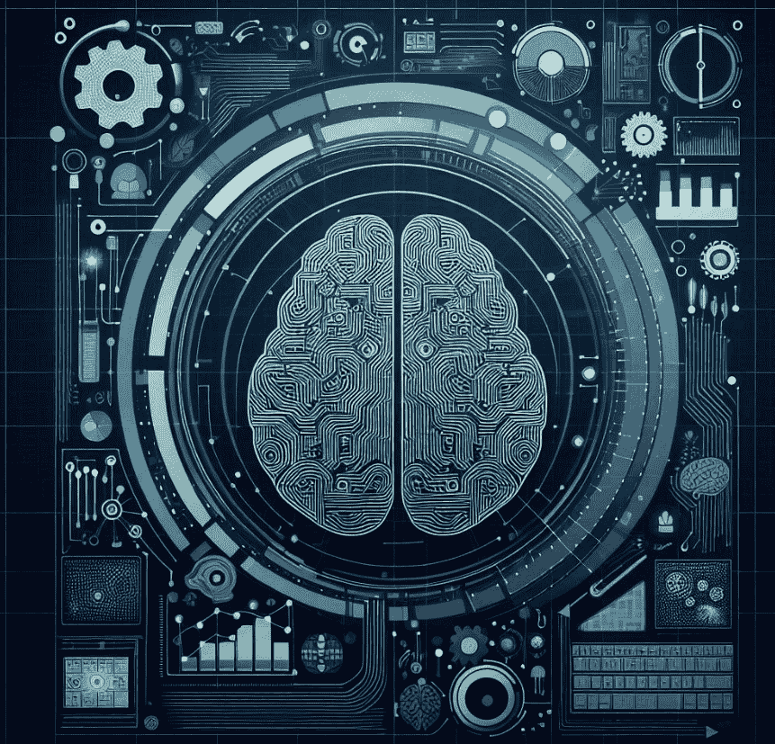
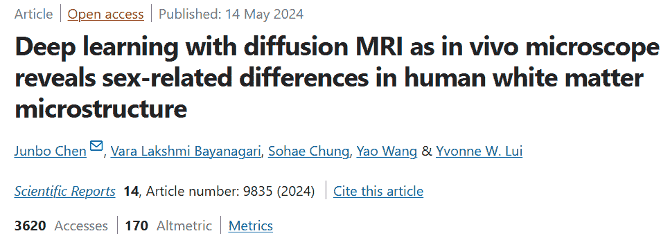
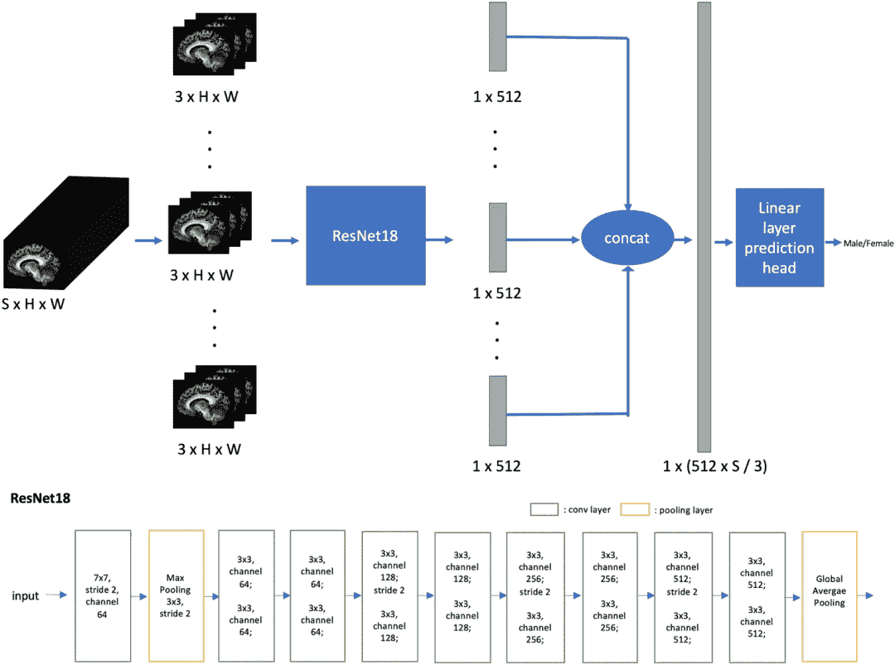
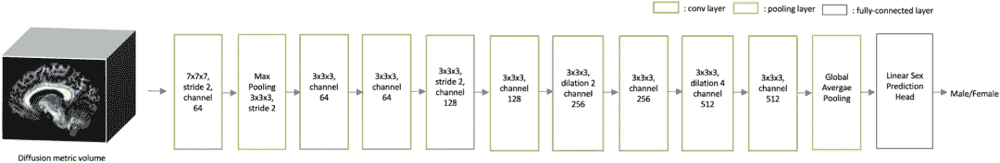
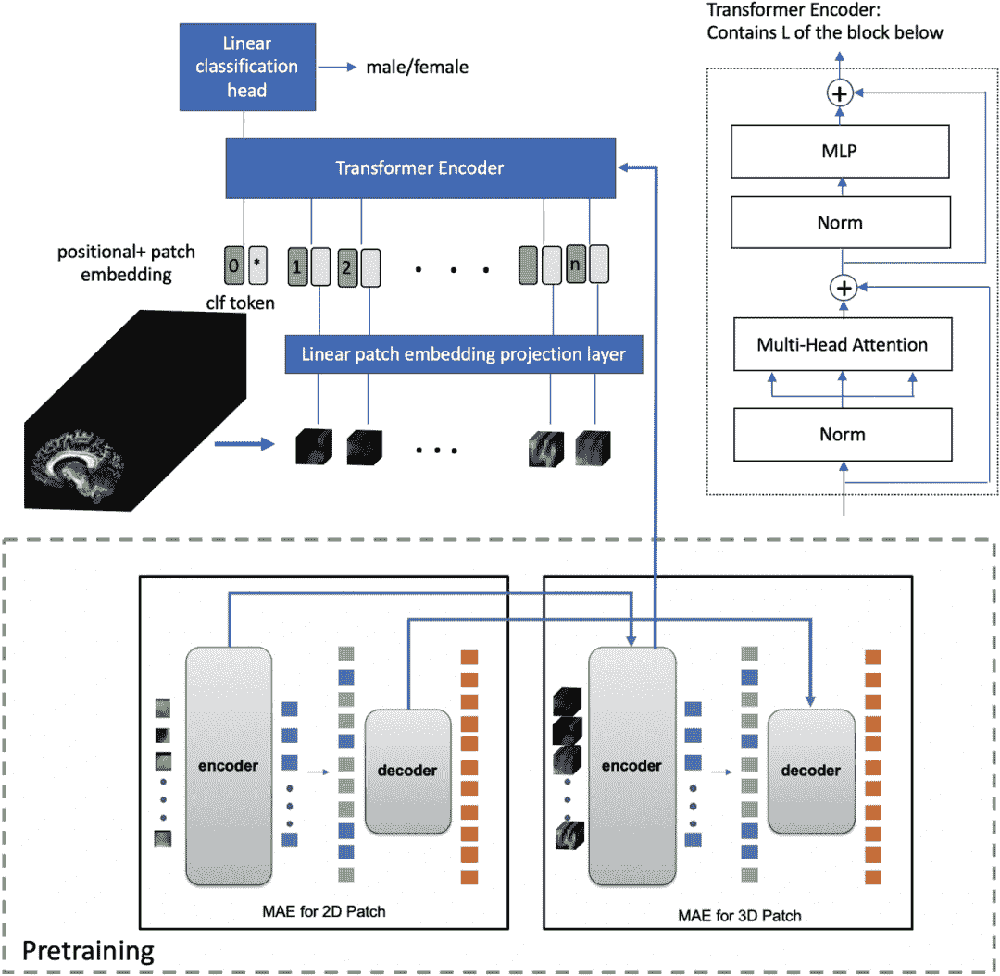
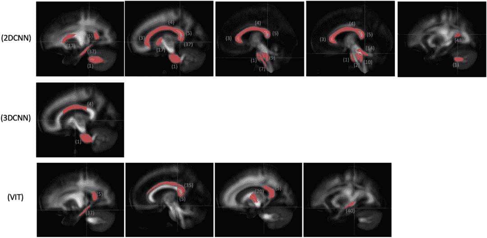

# 准确率92~98%，人工智能揭示大脑结构中与性别相关的差异

> 来源：[https://agijuejin.feishu.cn/docx/Lyt8daLkto2x4YxCHBgc5dI3ndf](https://agijuejin.feishu.cn/docx/Lyt8daLkto2x4YxCHBgc5dI3ndf)

> 机器之心 ScienceAI｜[阅读原文](https://www.jiqizhixin.com/articles/2024-06-06-8)

> 转载请联系原作者取得授权

编辑 | 白菜叶

在神经科学研究领域，生物性别作为关键变量，对认知功能和神经精神疾病中的性别差异研究至关重要。

尽管先前已在大脑宏观结构如皮层厚度或区域大小上观察到显著的统计学差异，但关于可能揭示脑健康与疾病机制的细胞层面微观结构的性别差异仍知之甚少。

探究男性与女性之间的这些微观结构差异，对于理解在不同性别中表现各异的大脑疾病具有重要意义。

一项新研究显示，处理 MRI 结果的人工智能（AI）计算机程序显示出男性和女性大脑在细胞层面的组织方式存在差异。这些差异在大脑白质中，白质是人类大脑最内层的组织，负责大脑各区域之间的联系。

这项新研究由纽约大学朗格尼健康中心的研究人员牵头，利用一种名为人工智能技术分析了 471 名男性和 560 名女性的数千张 MRI 脑部扫描图。结果显示，计算机程序可以通过识别人眼无法察觉的结构和复杂性模式，准确区分男性和女性的大脑。

该研究以「 Deep learning with diffusion MRI as in vivo microscope reveals sex-related differences in human white matter microstructure 」为题，于 2024 年 5 月 14 日发布在《 Scientific Reports 》。

众所周知，在患多发性硬化症、自闭症谱系障碍、偏头痛等脑部问题的概率和症状方面，男性和女性各不相同。因此，详细了解生物性别如何影响大脑，被视为改进诊断工具和治疗方法的一种方式。然而，虽然已经探索了大脑的大小、形状和质量，但研究人员对大脑在细胞层面的布局只有部分了解。

扩散磁共振成像（Diffusion MRI）作为一种重要的、非侵入性的活体检测方法，为了解脑组织微观结构提供了一扇窗口。

纽约大学的研究人员开发了多种端到端分类模型，能够利用体积扩散 MRI 数据准确估计受试者的性别，并通过这些模型识别出男性与女性间差异最大的白质区域。

图示：2D CNN 模型。（来源：论文）

图示：基于 ResNet10 的 3D CNN 模型。（来源：论文）

研究纳入了来自人类连接组计划的 471 名男性和 560 名女性健康受试者（年龄范围：22-37 岁），使用分数各向异性、平均扩散率和平均峰度等指标来捕捉脑组织微观结构特征。为了减少由脑大小和轮廓等宏观解剖学差异引起的偏差，将扩散参数图注册至标准模板。

该研究得到了三种不同的人工智能模型的验证，这些模型旨在利用它们在集中关注小部分白质或分析大脑较大区域之间的关系方面的相对优势来识别生物性别。三种主要模型架构包括：二维卷积神经网络、三维卷积神经网络以及带有自监督预训练的视觉 Transformer。

图示：用于扩散 MRI 性别分类的视觉 Transformer。（来源：论文）

这项研究的资深作者、纽约大学格罗斯曼医学院放射学系教授兼研究副主任 Yvonne Lui 说：「我们的研究结果更清楚地描绘了活体人类大脑的结构，这反过来可能为理解许多精神和神经疾病的发生过程以及为什么这些疾病在男性和女性身上的表现不同提供新的见解。」

Lui 指出，之前对大脑微观结构的研究很大程度上依赖于动物模型和人体组织样本。此外，过去一些研究结果的有效性也受到质疑，因为它们依赖于「手绘」感兴趣区域的统计分析，这意味着研究人员需要对他们选择的区域的形状、大小和位置做出许多主观决定。Lui 说，这样的选择可能会扭曲结果。

研究人员表示，新的研究结果避免了这个问题，因为它利用机器学习来分析整组图像，而无需计算机检查任何特定位置，这有助于消除人类的偏见。

在这项研究中，研究小组首先向人工智能程序提供健康男性和女性脑部扫描的现有数据示例，并告诉机器程序每个脑部扫描的生物性别。由于这些模型被设计成使用复杂的统计和数学方法，随着时间推移积累更多的数据而变得「更智能」，它们最终「学会」自行区分生物性别。重要的是，这些程序无法使用整体大脑尺寸和形状来做出判断，Lui 说。

根据结果，所有模型正确识别受试者扫描结果性别的准确率在 92% 到 98% 之间。有几个特征尤其有助于机器做出判断，包括水通过脑组织的难易程度和方向。

图示：基于遮挡分析的 FA 分类概率具有显著 (p < 0.05) 影响的 WM 区域。（来源：论文）

「这些结果强调了在研究人类大脑疾病时多样性的重要性。」这项研究的共同主要作者、纽约大学坦登工程学院博士生 Junbo Chen 说道。

「如果像历史上的情况一样，将男性作为各种疾病的标准模型，研究人员可能会错过关键的见解。」这项研究的共同作者、纽约大学坦登工程学院的研究生助理 Vara Lakshmi Bayanagari 补充道。

Bayanagari 提醒道，虽然人工智能工具可以报告脑细胞组织的差异，但它们无法揭示哪种性别更有可能具有哪些特征。她补充说，这项研究根据遗传信息对性别进行分类，并且只包括顺性别男性和女性的 MRI。

该研究小组下一步计划探索与性别相关的大脑结构差异随时间的演变，以更好地了解可能在这些变化中发挥作用的环境、激素和社会因素。

论文链接： https://www.nature.com/articles/s41598-024-60340-y

相关报道： https://medicalxpress.com/news/2024-05-artificial-intelligence-tool-sex-differences.html