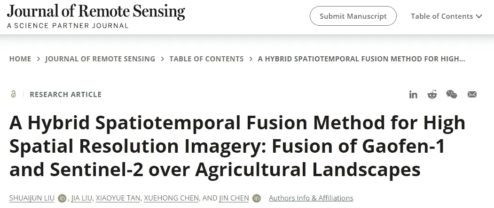
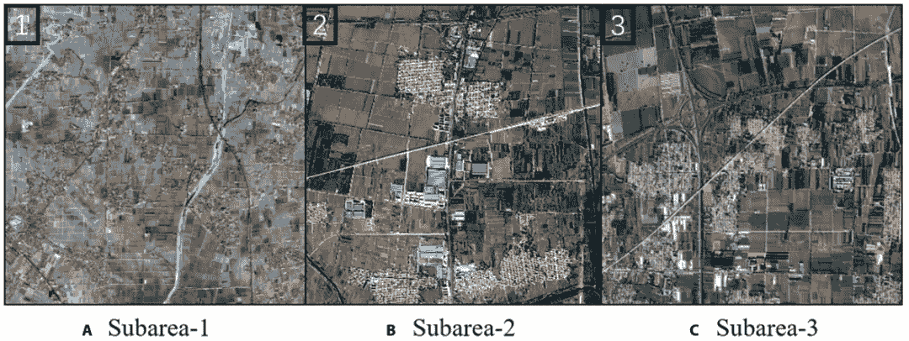
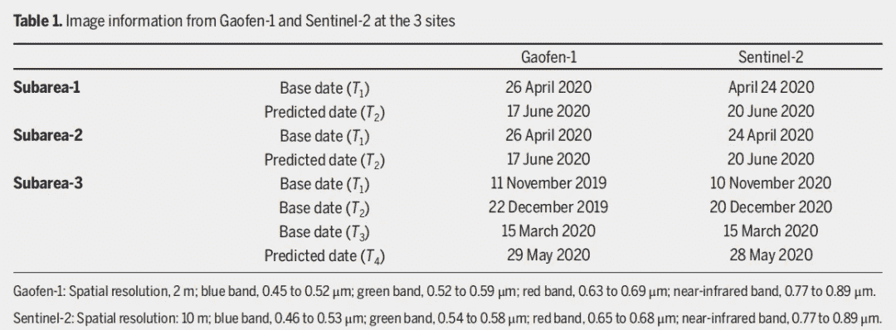
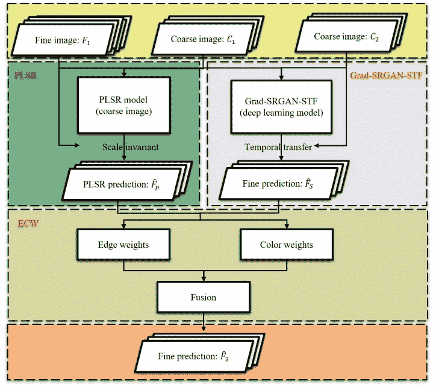
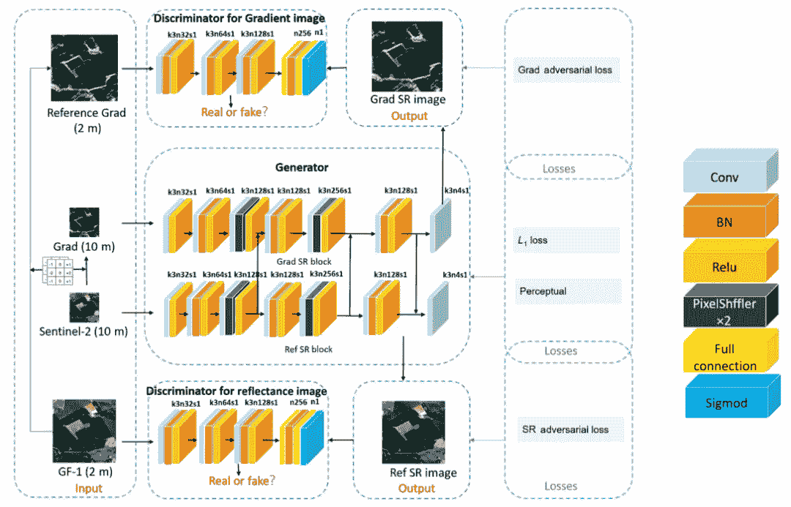
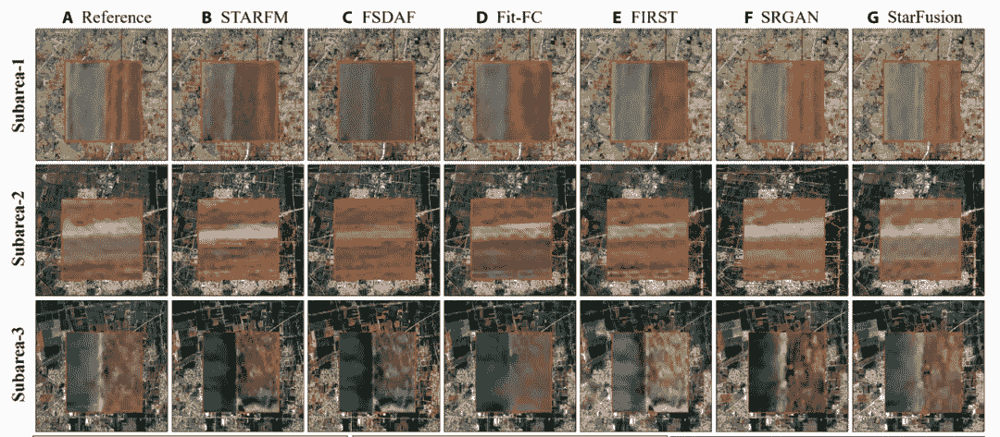
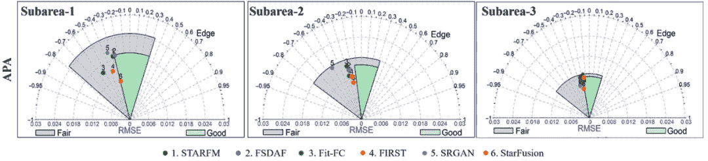
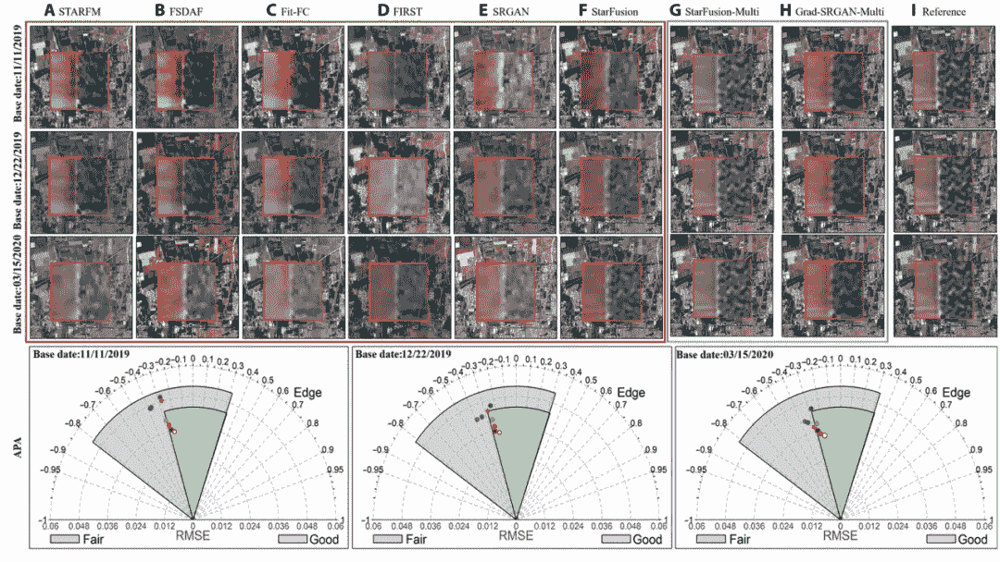
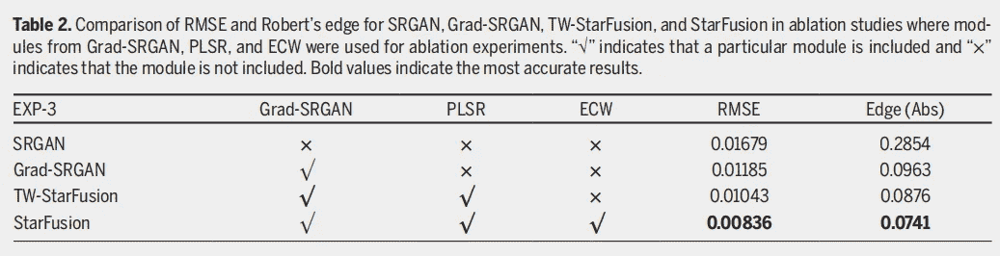

# 基于 2,500 平方公里实景数据，北师大团队提出 StarFusion 模型，实现高空间分辨率图像预测

> 来源：[https://agijuejin.feishu.cn/docx/T51HdRvjAoljpkxvN7ZcS7yQnpd](https://agijuejin.feishu.cn/docx/T51HdRvjAoljpkxvN7ZcS7yQnpd)

> 作者：田小幺      [阅读原文](https://hyper.ai/news/34254)

**在科技浪潮是推动下，传统农业正经历一场智能化变革。作为现代农业的「千里眼」，农业遥感通过收集**卫星和无人机等平台的遥感数据，被广泛应用于监测作物生长状况、土地利用与覆盖变化、病虫害情况、水资源管理和农业环境的演变等多个方面。农业遥感能够为决策者提供实时、深入的洞察力，确保了信息的精确性和决策的前瞻性。

然而，遥感数据在农业中应用通常需要高空间分辨率 (HSR) 和频繁的观测。受限于光学卫星影像的重访周期和云层污染等因素，卫星监测作物生长的能力经常会受到严重的影响。

为了获得高时空分辨率的合成图像，人们开发了许多时空融合方法，但现有方法在模型开发和验证方面主要集中在融合中低空间分辨率卫星数据，当涉及到融合中等和高空间分辨率图像时，其适用性仍然面临各种挑战。

为了解决这些问题，**北**京师范大学地表过程与资源生态国家重点实验室陈晋团队，提出了一种双流时空解耦融合架构模型 StarFusion，该模型将传统的 STF 方法与深度学习相结合，能够克服大多数现有深度学习算法需要 HSR 时间序列图像进行训练的问题，充分实现高空间分辨率图像的预测。

**研究亮点：**

+   StarFusion 融合 Gaofen-1 和 Sentinel-2 卫星数据，以生成高时空分辨率的图像

+   StarFusion 通过结合基于深度学习的超分辨率方法和偏最小二乘回归模型，并通过边缘和颜色加权损失函数，保持了高融合精度和良好的空间细节

+   StarFusion 模型在 3 个不同区域的实验地点，相比于传统的时空融合方法和基于深度学习的方法，表现出更优的整体性能和时间传递性

**论文地址：**** **

https://doi.org/10.34133/remotesensing.0159

关注👸号，后台回复「高时空分辨率」获取完整 PDF

**数据集下载地址：**

https://go.hyper.ai/LGmkW

**开源项目「awesome-ai4s」汇集了百余篇 AI**4S 论文解读，并提供海量数据集与工具：

https://github.com/hyperai/awesome-ai4s

## **数据集：立足山东两县，集成使用 Gaofen**-1 和 Sentinel-2 卫星数据

**该**研究设计了全面的评估实验，使用了来自 Gaofen-1 和 Sentinel-2 卫星的数据集，每个数据集都覆盖了相同的地理区域。

+   **研究地点**

该研究选择在山东省的费县和郓城县进行，研究区域面积约为 2,567 平方公里，具有多种土地覆盖类型。为确保景观多样性，该研究确定了 3 个子区域作为实验地点，这些区域都是农田、水体、道路和建筑物的混合体，并且区域内景观的异质性也表现出明显的区别。

费县和郓城县的 Gaofen-1 卫星场景

+   **数据预处理**

如下表所示，该研究主要采用 Gaofen-1 卫星产生分辨率为 2 米的画质相对清晰的图像，采用 Sentinel-2 卫星产生分辨率为 10 米的画质相对粗糙的图像。然后，该研究将 Sentinel-2 图像与 Gaofen-1 数据相匹配的 2 米空间分辨率进行了对齐与地理校正。

Gaofen-1 和 Sentinel-2 在 3 个站点的图像信息

为了协调 Gaofen-1 和 Sentinel-2 的光谱特性，该研究使用了线性回归模型，将 Sentinel 数据的每个波段作为因变量，相应的 Gaofen-1 数据波段作为自变量，构建了单变量回归模型，然后将构建模型的斜率和截距应用于每个波段 Gaofen-1 图像的每个像素。这个拟合过程确保了转换后的 Gaofen-1 图像能够密切反映 Sentinel-2 的光谱响应，从而有效地减少了它们之间的光谱不匹配。

## **StarFusion：模型整合 SRGAN** 和 PLSR ，增补 ECW 加权函数

如下**图所**示，StarFusion 融合了在基准日期 (T1) 获得的 Gaofen-1 数据，以及在基准日期 (T1) 和预测日期 (T2) 获得的 Sentinel-2 数据。基于采集到的数据，StarFusion 将 SRGAN (Grad-SRGAN-STF) 和 PLSR 的两大融合模型整合到一个双流时空解耦融合架构中，从而可发挥出两个模型的优势。

StarFusion 方法流程图

在偏最小二乘回归模型 (PLSR) 部分，该研究基于尺度不变假设 (Scale invariant)，建立了具有更高自由度的多变量回归关系模型，进而更准确地预测时间变化。考虑到 Sentinel-2 相对于 Gaofen-1 图像的空间分辨率较低，该研究还设计了一种梯度图 SRGAN 模型 (Grad-SRGAN) 来处理粗糙图像到精细图像的降尺度任务。

进一步地，该研究中还提出了一个带有梯度图的 SRGAN-STF** **模型（Grad-SRGAN-STF），如下图所示，Grad-SRGAN-STF 基于时间迁移性能 (Temporal transfer)，主要由 3 部分组成：

Grad-SRGAN-STF 流程图

1.  生成器 (Generator)：由 2 个并行的表面粗糙度 SR (surface roughness) 参数组成，一个用于采集粗糙的反射图像 (Ref-SR)，另一个用于采集粗糙的梯度图 (Grad-SR)。

1.  判别器 (Discriminator)：设计了 2 个独立的判别器 DRef 和 DGrad，可分别判断生成的反射图像和梯度图是真实的还是伪造的。

1.  损失函数 (Loss function)：由内容损失和对抗损失两部分组成，生成器的 Ref-SR 和 Grad-SR 的损失函数是内容损失和对抗损失的加权和。其中，内容损失可用于评估预测图像与参考图像之间的差异，对抗损失则能够测量生成图像被判别器识别为真实图像的概率。

更重要的是，该研究还设计了一个新的权重函数，称为边缘和颜色权重 (ECW)。ECW 结合了 SRGAN 方法强大的空间细节恢复能力和 PLSR 方法的准确时间变化估计，能够提供更为精准的预测。

## **研究结果：StarFusion 表**现最佳，Grad-SRGAN 贡献度最大

实验 I：StarFusion 相较其他算法的空间细节保真度最佳

为了评估 StarFusion 的有效性，该研究基于 3 个子区域在 2 个不同日期拍摄的 Gaofen-1 和 Sentinel-2 图像，围绕预测图像生成的准确性和空间细节等因素，将 StarFusion 与其他代表性算法 (STARFM、FSDAF、Fit-FC、FIRST 和 SRGAN) 进行了比较。

结果如下图所示，**S**tarFusion 方法预测的图像（下图 G）与参考图像（下图 A）显示出显著的相似性，表现出了优越的空间细节保真度。相比之下，STARFM、FSDAF、Fit-FC、FIRST 和 SRGAN 生成的图像都显示出了一些模糊区域的斑块，而且田间边界也不够清晰。

3 块区域的参考图像和融合结果图像

**此外，如下的 APA 图还显示，StarF**usion 方法具有强大的空间转移能力，没有显著的准确性或空间细节损失。值得注意的是，StarFusion 在视觉上处于「良好」范围的边缘，但没有落入该范围，这表明其性能在未来仍有改进的空间。

所有方法的 APA (全面绩效评估)图像

实验 II：StarFusion 在长时间跨度下的预测图像质量最佳

由于子区域-3 具备复杂的景观特征，该研究计划利用该区域不同基准日期 (T1、T2、T3) 的图像及其梯度图预测 T4 的高分辨率图像。同时，该研究还训练了 GradSRGAN (Grad-SRGAN-Multi) 和 StarFusion (StarFusion-Multi) 模型，并比较了两者的性能。

研究**发**现，当预测日期与基准日期较近时，所有融合方法效果良好，但时间跨度增大时，STARFM、FSDAF、Fit-FC、FIRST 和 SRGAN 的图像质量下降，出现模糊和色彩失真。StarFusion 则在不同基准日期的图像对输入下，均保持了较好的空间细节和色彩保真度，表现优于其他 5 种方法。

此外，**StarFusion-Multi 和 Grad-SRGAN-Multi 在采用多对图像训练时，比单对图像训练有更佳表现，且 **StarFusion-Multi 在 RMSE 和 Roberts 边缘方面持续超越 Grad-SRGAN-Multi。

区域 3 研究的参考图像和融合结果图像

**实验 III：Grad-SRGAN **对于 StarFusion 的贡献度最大

最后，该研究还在子区域-1 中进行了消融研究，以展示所提出的 StarFusi**on** 方法中每个部分的贡献度，包括 Grad-SRGAN、PLSR 和 ECW。结果表明，引入 Grad-SRGAN、PLSR 和 ECW 功能都有助于提高融合精度，就它们的贡献程度而言，引入 Grad-SRGAN 的贡献最大，其次是 ECW 加权函数和 PLSR。

消融研究的结果比较

## AI 助力，农业遥感进入智能驱动时代

随着 AI 技术的不断发展，数字化农业正逐渐成为农业发展的新趋势，农业卫星遥感行业逐步从传统的数据依赖模式转向以 AI 为核心的智能驱动模式的关键时期，越来越多的企业正在这一领域展开布局与角逐。

例如，以**商**汤科技为代表的人工智能企业曾基于其自主研发的基座大模型，推出面向遥感领域的「商汤地界」AI 遥感大模型，实现了耕地地块、作物识别、非粮要素识别的自动化、智能化、常态化。此外，以华为为代表的科技大厂利用旗下昇腾 AI，助力武汉大学打造遥感影像智能解译专用框架 LuoJiaNet 和遥感样本库 LuoJiaSET，加速遥感影像自动解译，让智能遥感技术在农业、自然资源等行业得以广泛应用。

而在学术领域，依托中国科学院遥感应用研究所、北京师**范大学联合共建的遥感科学国家重点实验室，我国已经涌现了包括本**文作者陈晋教授在内的大批业内精英，正逐步为农业遥感技术的发展与进步贡献重要力量。

早在 1988 年，该实验室就建立了全球农情遥感速报系统 (Cropwatch)，基于遥感和地面观测数据，该系统可以独立评估国家及全球尺度的作物长势、产量等相关信息。借助 AI 技术，该实验室在过去一段时间推出了 AGAR 算法的超高分辨率光学森林三维遥感新方法、内具遥感 AI 算法的野火卫星监测预警系统等多项成果。

AI 在农业遥感中的应用不仅提高了农业生产的效率和精度，还为农业的可持续发展提供了强有力的技术支持。可以预见的是，AI 在农业遥感中的应用将更加广泛，为植物病虫害监测、评估作物生长状况和产量、农业生产的高效管理和优化等提供越来越多的解决方案。