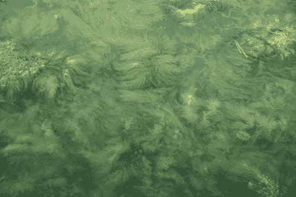
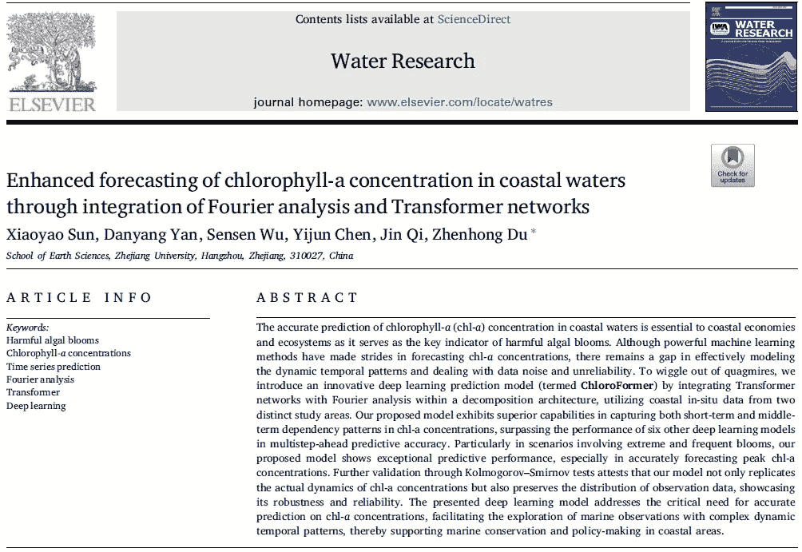
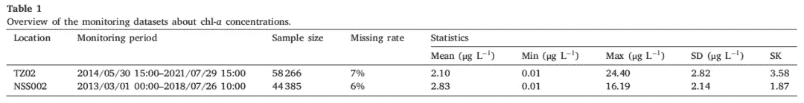
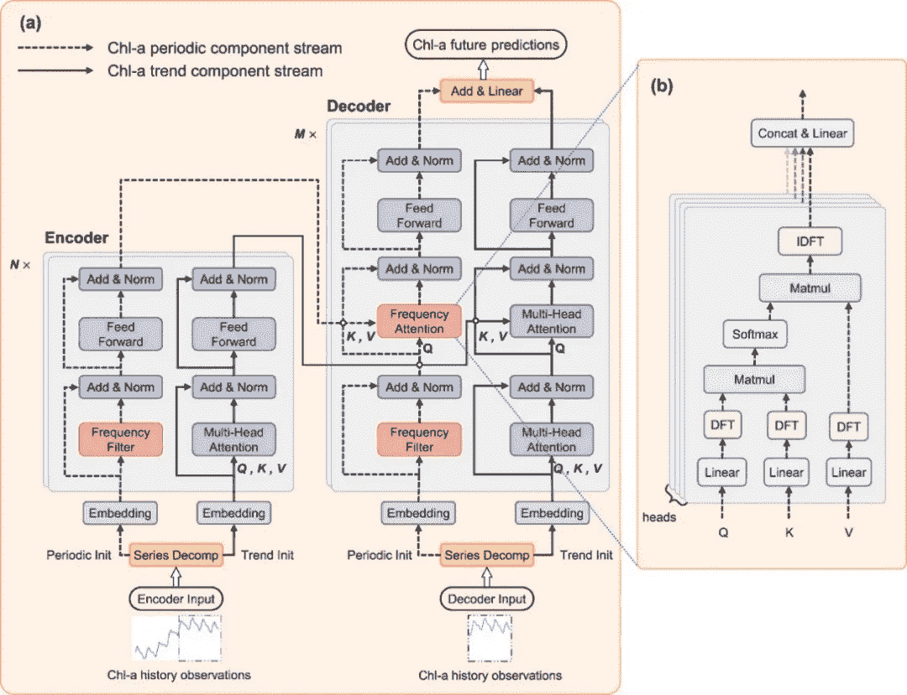
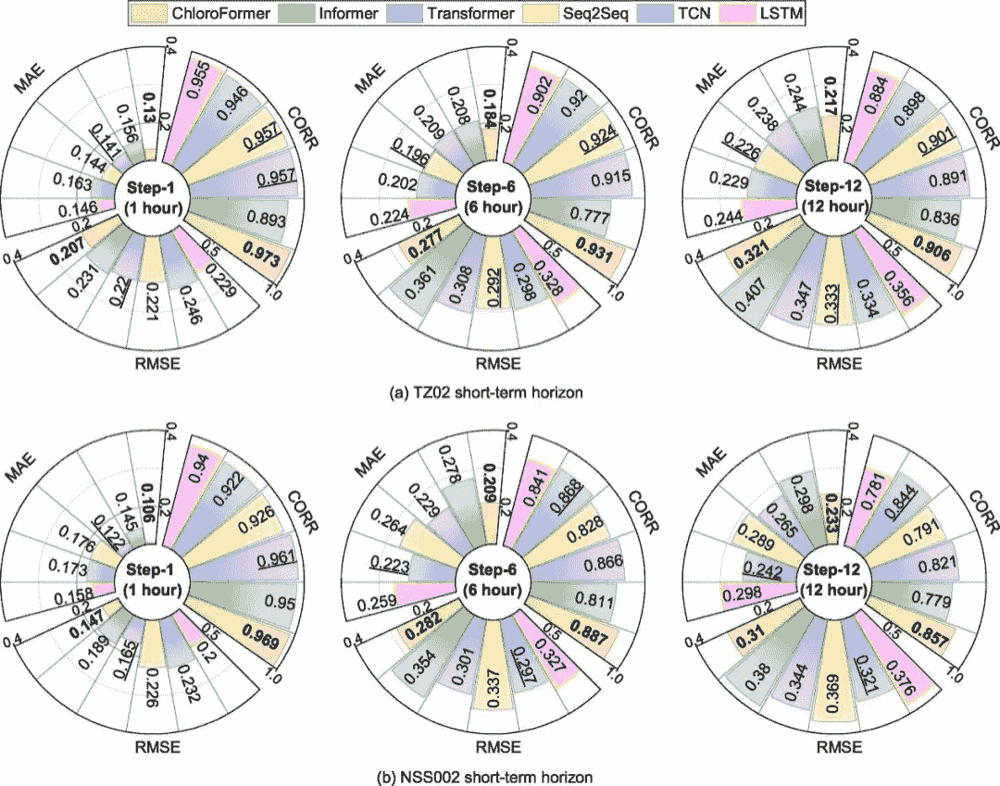
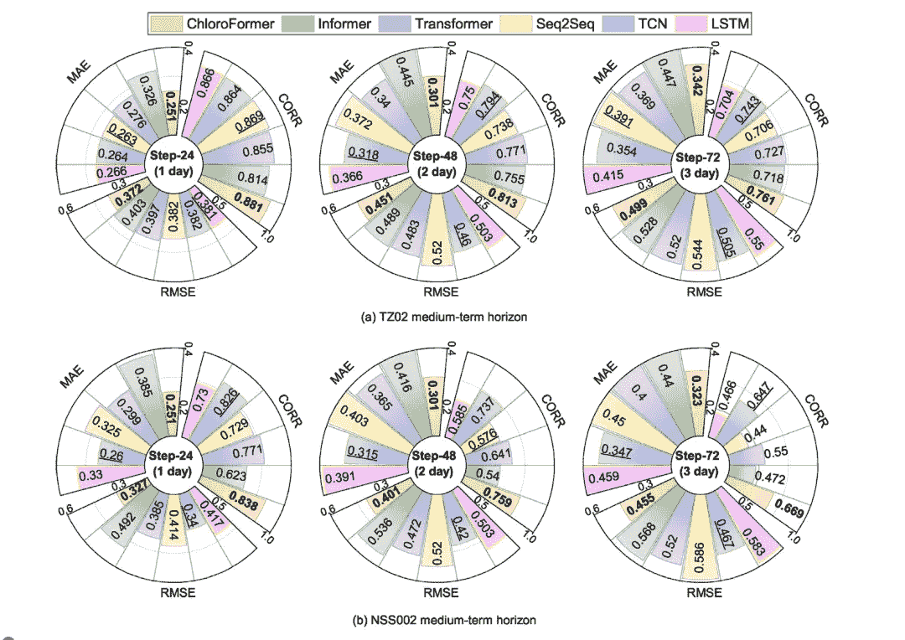
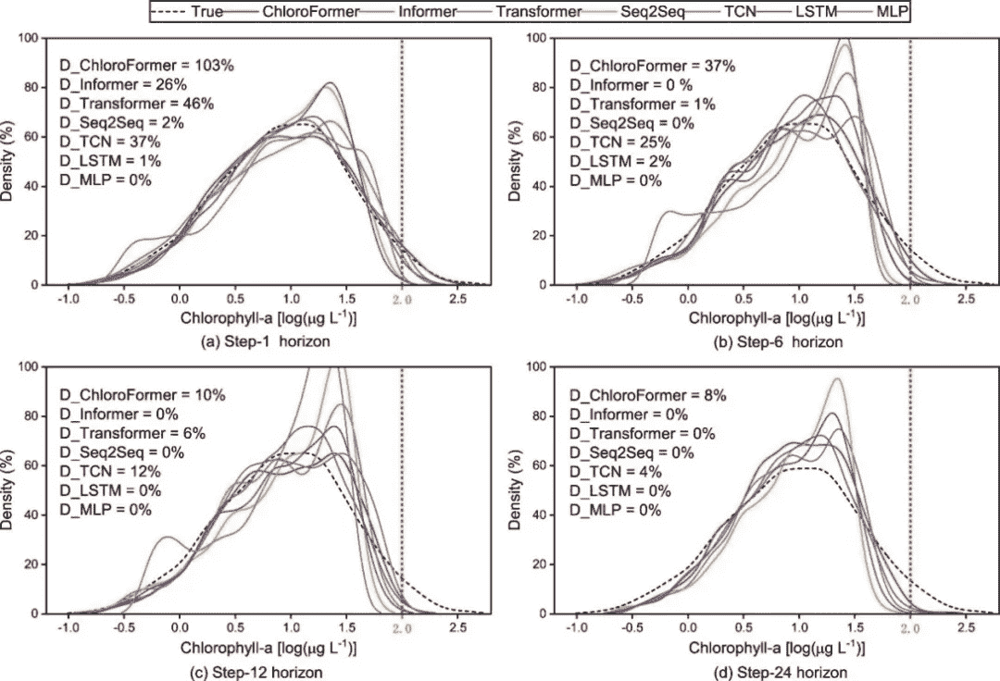

# 深度学习对抗海洋赤潮危机！浙大GIS实验室提出ChloroFormer模型，可提前预警海洋藻类爆发

> 来源：[https://agijuejin.feishu.cn/docx/GxW9dDdkLozLB8xCTPxcXNkJnlg](https://agijuejin.feishu.cn/docx/GxW9dDdkLozLB8xCTPxcXNkJnlg)

> 作者：孙逍遥，十九      [  阅读原文](https://hyper.ai/news/34544)

2014 年 8 月，美国俄亥俄州托莱多市超 50 万名居民突然收到市政府的一则紧急通知——不得擅自饮用自来水！

水是人类生存的基本供给，此通告关系重大，发出后也引起了不小的恐慌。究其原因，其实是美国伊利湖爆发了大规模的蓝藻繁殖，水面被数十亿单细胞藻类覆盖。当地 2 家水处理厂商检测到湖水中堆积的毒素已达到危险级别，水质不再适合居民饮用。

**这**种在特定环境下，由于海洋藻类生物爆发而导致的生态异常现象，就是人们常说的赤潮，又称有害藻华 (HABs)。专家表示，有害藻华对海洋生态平衡、当地经济和人类健康产生了严重威胁。具体而言，海水表面聚集的大量藻类生物可以通过遮蔽阳光、降低水体透明度，危及深层海洋生物的生存。这些生物分泌的粘液还可以粘附于鱼类的鳃上，导致它们呼吸困难，甚至窒息死亡。更进一步地，饮用水源受污染，赤潮生物引发的毒素还会通过食物链传递至人体，人类的健康也受到了严重影响。

赤潮现象

图源：前瞻网

**由此可见，对有害藻华进行观测、预警和防控至关重要。**通常情况下，叶绿素 a (chl-a) 浓度可以作为评价 HABs 是否泛滥的关键性指标，其准确预测将直接影响后续的防控策略。目前，机器学习在预测 chl-a 浓度方面取得了显著进步，然而，它在有效建模复杂动态时间模式、处理数据噪声和不可靠性方面，仍存在不足。

**对此，浙江大学 GIS 实验室的研究人员提出了一种全新的深度学习预测模型 ChloroFormer，该**模型将傅里叶分析和 Transformer 神经网络结合，采用时序分解架构，有效地改进了 chl-a 浓度预测的准确性。此外，研究人员还在 2 个不同沿海研究区域开展实验，结果表明，所提模型不仅在多步预测准确性上优于其他 6 种对比模型，在极端和频繁的藻华情况下也能保持相对优势。

该研究以「Enhanced forecasting of chlorophyll-a concentration in coastal waters through integration of fourier analysis and transformer networks」为题，发表在 Water Research 上。

+   **研究亮点：**
深度学习模型 ChloroFormer 在叶绿素 a 的短期和中期预测上，都超越了基线。

+   ChloroFormer 在预测叶绿素 a 峰值方面表现出色，准确度高，与观察到的数据分布保持较高的拟合优度。

**

论文地址：**

https://doi.org/10.1016/j.watres.2024.122160

关注👸号，后台回复「有害藻华」获取完整 PDF

**开源项目「awesome-ai4s」汇集了百余篇 AI**4S 论文解读，并提供海量数据集与工具：

https://github.com/hyperai/awesome-ai4s

## 数据集：以台州海域和 Ala Wai 港为例

**本研究选取了浙江省台州海域、夏威夷州**瓦胡岛 Ala Wai 港作为研究区域，这两个地方的有害藻华状况各异。其中，台州海域由于经济发展被过度集约利用，大量废弃污染物涌入，海水水质恶化导致赤潮频发。Ala Wai 港作为划船和游艇的热门场所，存在各种人类活动，例如冲浪、划船、帆船、游泳和钓鱼，HABs 很容易发生。

具体而言，台州海域数据 TZ02 包括 2014 年 5 月 30 日至 2021 年 7 月 29 日期间的叶绿素-a (chl-a) 浓度，以每小时为间隔进行监测。Ala Wai 港的数据 NSS002 则涵盖了 2013 年 3 月 1 日至 2018 年 7 月 26 日的 chl-a 浓度，数据通过 4 分钟间隔的水质监测传感器收集，并对 15 个时间点进行平均处理。更进一步地，数据集经过了标准化处理和自然对数转换，目的是为了减少数据范围并提升模型的预测精度。

用于叶绿素 a 浓度预测的数据集概述

## 模型架构：周期性和趋势性并存，多步预测 chl-a 浓度

本研究提出深度学习模型 ChloroFormer 来预测** ch**l-a 浓度。模型框架如下图所示：首先，将原始时间序列通过移动平均方法分解为周期性 (Periodic lnit) 和趋势性 (Trend lnit) 分量，并分别进行建模处理。

ChloroFormer 模型

(a) ChloroFormer网络架构，两条路径分别是周期和趋势序列成分

(b) 频率注意力模块的内部结构

**其次，**针对趋势组件，研究人员使用 Transformer 神经网络，利用其自注意力机制捕捉长程依赖关系。针对周期性分量，研究人员在 Transformer 网络的基础上设计了基于傅里叶分析的注意力机制，包括频率滤波器 (Frequency Filter) 和频率注意力机制 (Frequency Attention)，能够在频率上更有效地捕捉周期性模式。

**最后，**研究人员将建模后的 2 个子时序结合，通过线性投影直接映射到多步预测结果。

## 实验结论：可预测高度非平稳时间动态的 chl-a 浓度

研究人员将 ChloroFormer 模型用于短期和中期的** chl-a 浓度预测，结果如下图所示，短期预测中，Chl**oroFormer 在 2 个研究区域的精度均高于其他对比模型，误差率显著降低。

不同模型在短期预测范围中的性能

(a) TZ02监测站点中MAE、RMSE和CORR度量值的比较

(b) NSS002监测站点中3个度量值的比较

如下图所示，**在中期预测中，尽管整体预测精度有所下降，但 C**hloroFormer 仍优于其他模型。

不同模型在中期预测范围中的性能

(a) TZ02监测站点中MAE、RMSE和CORR度量值的比较

(b) NSS002监测站点中3个度量值的比较

此外，研究人员还在频繁藻华条件下比较不同模型预测峰值 chl-a 浓度的结果，如下图所示，ChloroFormer 在短期预测**中的准确性较高，但随着预测时间的增加，ChloroFormer** 在长期预测的准确性上有所降低。总体而言，与其他模型相比，ChloroFormer 在捕捉时间序列趋势、准确匹配极端点方面表现优异，这能为藻华预警提供重要信息。

使用NSS002检验数据集在1、6、12、24小时范围内真实值和模型预测值的分布密度

最后，本研究还通过 Kolmogorov - Smirnov 测试，证明了 ChloroFormer 的预测结果与实际观测数据分布具有高度一致性，这说明 ChloroFormer 模型稳健，能准确反映数据特征。另一方面，通过分析注意力权重分布，研究人员还发现 ChloroFormer 能捕捉到不同数据集中的关键时间模式。

综上所述，本研究提出了一种深度学习模型 ChloroFormer，它整合了傅里叶分析技术和 Transformer 网络，提高了具有高度非平稳时间动态 chl-a 浓度的预测准确性，是环境管理中有害藻华预测可靠且经济高效的工具。

## **以科技之力筑梦蓝色未来**

海洋是地球上最大的生命支持系统，保护海洋生物多样性就是保护我们共同的未来。然而，随着人类活动的不断扩张，气候变化、过度捕捞、栖息地破坏以及污染等危机不断涌现，海洋生态系统正面临着严峻的挑战。对此，国内外研究人员们纷纷响应，期待共筑蓝色防线。

近年来，随着数据的积累和深度学习等新技术的发展**，针对海洋保护领域的创新性研究不断涌现。比如，本文**所提到的浙江大学 GIS 实验室研究团队，就长期致力于海洋保护领域的探索与创新。他们曾将机器学习与卫星产品结合，深入研究了全球海洋溶解氧的高动态变化，并探索海洋缺氧现象的规律及其成因。

具体而言，研究人员开发了一个全球海表溶解氧综合建模框架 DOsurface-Pred Framework，并基于该框架生成了一个大规模海表溶解氧数据集 SSDO。研究结果表明，即使在氧气充足的海表区域，其溶解氧含量也出现了下降趋势，而这种下降主要归因于海表温度 (SST) 的变化。

[更多详情：解构海洋缺氧：浙大 GIS 实验室融合机器学习及](http://mp.weixin.qq.com/s?__biz=MzU3NTQ2NDIyOQ==&mid=2247507975&idx=1&sn=126ce1129f2c82019c338cbfc85a703b&chksm=fd20564dca57df5ba0e42f614a8ec167c8c250f2ea82a7cbbe1f947f7e501674c99a59d0f03b&scene=21#wechat_redirect)卫星测绘，发布全球海表溶解氧综合建模框架

此外，法国蒙彼利埃大学研究团队也曾结合随机森林模型和人工神经网络，对 4,992 种数据不足或未评估的海洋鱼类物种进行灭绝风险预测。研究结果表明，海洋鱼类的灭绝威胁实则远超先前的普遍认知，未来我们需要更加关注数据不足的物种和关键热点区域，确保后续的保护工作能够有的放矢，直击要害。通过此次研究，科学家们不仅填补了海洋鱼类保护领域的数据空白，还为全球保护优先级的调整提供了新视角。

这些前沿研究成果如同点点星光，汇聚成保护海洋的璀璨星河，未来，我们有理由相信，随着更多科研团队、政府机构、非政府组织以及公众的加入，这场守护海洋生态的战役将会愈发有力，我们定能为海洋生态筑起坚固的防线。

**参考资料：**

https://dialogue.earth/zh/3/42441/

https://m.thepaper.cn/newsDetail_forward_4890474