# 全球首个！复旦大学冯建峰团队开发数字孪生脑平台，具备 860 亿神经元规模

> 来源：[https://agijuejin.feishu.cn/docx/WgYcd1afpo4sqYxx9docPccYndg](https://agijuejin.feishu.cn/docx/WgYcd1afpo4sqYxx9docPccYndg)

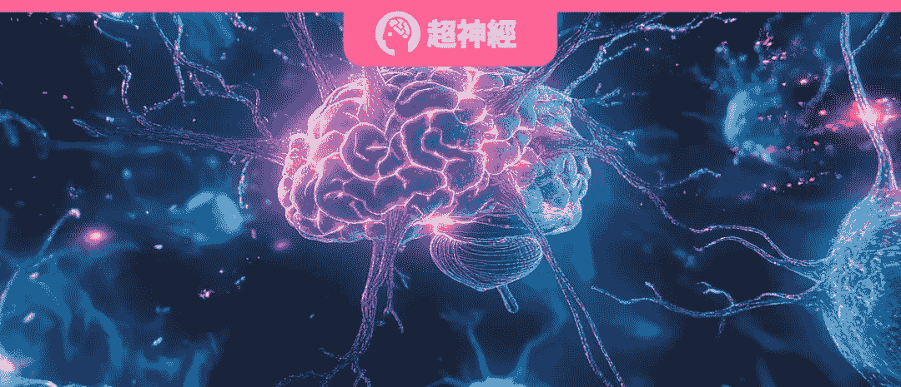

> 作者：田小幺        [ 阅读原文](https://hyper.ai/news/34573)

人类大脑是自然界中最复杂和神秘的信息处理系统之一，其约 1.4 千克的微**小**重量，仅占身体重量的 2%，却奇迹般地消耗了人们体内约 20% 的氧气和血液。在这个精密的网络中，大约有 860 亿个神经元相互交织，形成了超过 100 万亿个突触连接，构成了一个复杂的信息传递和处理系统。正是这个系统，赋予了人类思考、感受、记忆、学习、创造和行动的能力，造就了不同的人格、性格与行为方式。

为了破解人类大脑的奥秘，世界各国都在利用计算神经科学技术开展脑科学研究。尤其是随着数字孪生脑的问世，为解决这一难题提供了一个全新的视角和方法。它利用和借鉴数字孪生技术，通过逆向工程技术构建生物大脑的数字副本，「破译」脑在信息处理与神经编码原理的方式，可实现从结构仿脑到功能仿脑等重大突破。

**近期，复旦大学类脑智能科学与技术研究院冯建峰教授团队发布了数字孪生脑 (Digital Twin Brain,** DTB) 平台，这是国际上首个基于数据同化方法开发的、具备 860 亿神经元规模及百万亿突触的全人脑尺度大脑模拟平台。该研究发现，数字孪生脑在规模与结构上越接近人类大脑，会逐渐展现出类似在人脑中观测到的临界现象与相似的认知功能。

该研究以「Imitating and exploring human brain’s resting and task-performing states via resembling brain computing: scaling and architecture」为题，发表于国际著名期刊 National Science Review (NSR)。该文章还作为封面文章收录于 NSR「人类大脑计算与类脑智能」专题。

**研究亮点：**

+   该研究为数字孪生大脑提供了定量框架，可用于发现大脑结构和功能之间的关系，并对不同的认知、医学和损伤方法进行数字化的模拟与研究。

+   该研究建立了全脑范围内的尖峰神经元网络，包含多达 200 亿个神经元和数据约束结构，在尺度和多模态结构约束方面独一无二。

+   该研究用数据同化方法，通过拟合静息状态和动作状态下的 BOLD 信号，证明了其在估计「大」模型方面的有效性。

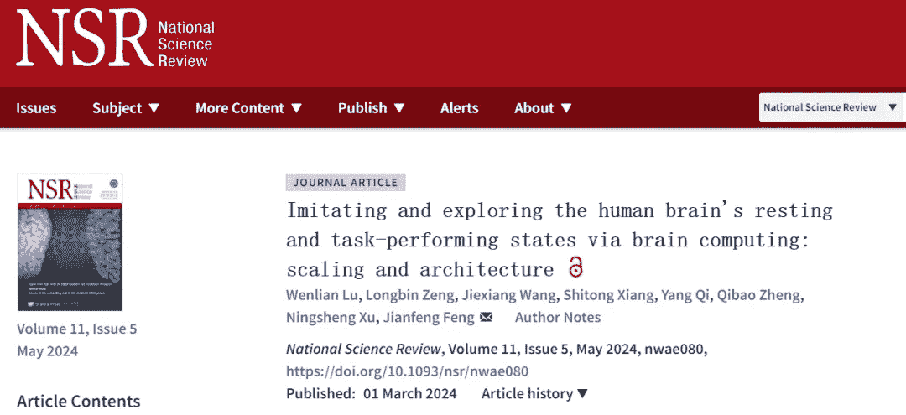

**论文地址：**

https://doi.org/10.1093/nsr/nwae080

关注公众号，后台回复「数字孪生脑」获取完整 PDF

**开源项目「awesome-ai4s」汇集了百余篇 AI**4S 论文解读，并提供海量数据集与工具：

https://github.com/hyperai/awesome-ai4s

## 生物数据采集与预处理：将多模态神经影像数据整合进 DTB 模型

**该研究采用了 3 特斯拉的磁共振成像技术，对单一**受试者进行了全面的多模态磁共振成像扫描。

首先，该研究利用快速梯度回波 (rapid gradient echo) 序列捕获了高分辨率的 T1 加权图像 (T1w)。随后，该研究通过梯度回波平面成像 (EPI) 序列收集了多壳层弥散加权成像 (DWI) 和功能性磁共振成像 (fMRI) 数据。这些数据分别用于分析灰质 (gray matter) 的体素基础形态学 (VBM)、结构连接性以及血氧水平依赖 (BOLD) 信号。

在数据预处理阶段，该研究执行了细致的数据清洗流程，旨在将这些多模态神经影像数据高效整合入动态拓扑基底模型 (DTB)。最终，该研究构建了一个包含 16,043 个体素 (voxels) 的 cortico-subcortical 模型，为深入理解大脑结构与功能提供了新的视角。

## **DTB 模型可采样高达 200 亿神经元，覆盖** 16,043 个体素和 374 个区域

**D**TB 流程下的神经元网络模型 (neuronal network model) 可灵活调整神经元数量和突触连接度。如下图 A 所示，体素神经元数与 VBM 灰质体积、突触密度与 PET SV2A 数据、兴奋性突触连接数与 DWI 轨迹密度在一般情况下成正比。特别是，每个皮层体素都模拟了一个 L2/3 至 L6 层的层状结构，每一层之间的神经元通过突触进行连接。如下图 B 所示，该模型可采样高达 200 亿神经元，覆盖 16,043 个体素和 374 个区域。

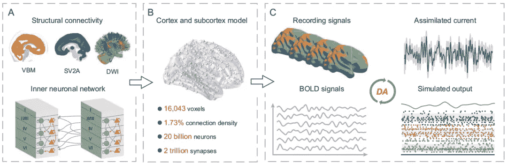

cortico-subcortical 模型的工作流程

如上图 C 所示，该模型中的神经元以 LIF 模型表示，背景电流由 Ornstein-Uhlenbeck (OU) 过程驱动，模拟 BOLD 信号则使用 Balloon-Windkessel 模型获得。在某些区域，神经元可注入 Gamma 分布的外部电流，然后通过使用 Vw-dHMDA 方法，基于从估计的超参数中采样电流 (recording signals)，来采集同一受试者在静息状态和执行任务期间的实验 BOLD 信号。最后，通过对比模拟数据 (simulated output) 与 BOLD 信号的时间过程相似性以及区域间功能连接性，从而可评估这种统计推断 (statistical inference) 的性能。

**为了对静息状态下的尺度进行研究，该研究首先通过拟合丘脑区域的静态 BOLD 信号来同化 cor**tico-subcortical 模型的静息状态，并测量模型与生物数据的相似性。

如下图 A 所示，在丘脑的所有体素中，模拟和实验 BOLD 信号之间的平均皮尔逊相关系数 (PCC) 为 0.977（左侧）和 0.981（右侧）。然后，该研究通过计算同化模型和真实大脑体素静态 BOLD 信号之间的 PCC 来测量同化模型与其生物对应物之间的相似性，以及通过测量同化和生物学静态 BOLD 信号的 Frobenius 范数 (F-norm) 来计算出的区域功能连接 (FC) 矩阵的相似性。

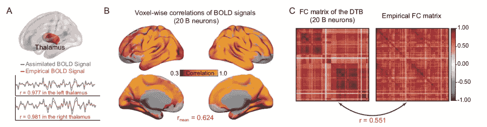

静息状态下 cortico-subcortical 模型的尺度分析

通过这种方式，该研究构建的 cortico-subcortical 模型包含 200 亿神经元，平均突触连接度为 100，与静息状态 fMRI 数据显著相似。如下图 B 所示，所有体素的 BOLD 信号平均 PCC 为 0.624，如下图 C 所示，模拟与实际 FC 矩阵的 PCC 为 0.551，F-norm 距离为 0.271。

## 数字孪生脑与真实大脑的规模尺度与连接结构越相似

该研究分析了神经元数量和平均突触连接度对模型与生物数据相似度的影响。结果如下图 D 所示，当平均突触连接度为 100 时，随着神经元数量的增加，整合静态 BOLD 信号与生物数据的相似度提高，FC 矩阵间的一致性增强，F-norm 距离减小。

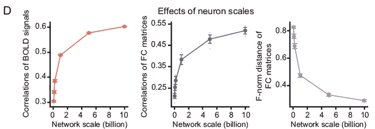

cortico-subcortical 模型在静息状态下的表现

如下图 F 所示，当神经元数量为 100 亿时，模拟与生物静态 BOLD 信号的 PCCs 随平均突触连接度增加先上升后稳定，FC 矩阵的 PCCs 增加，F-norm 距离减小。

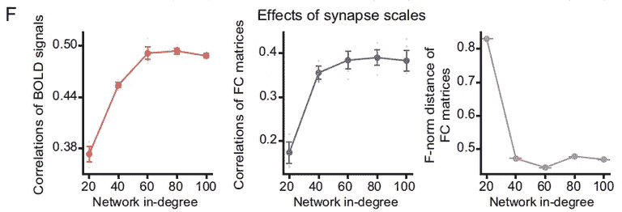

静息状态下不同平均突触连接度的 DTB 性能评估

如下图 E 所示，崩塌临界性分析显示，当神经元数量增至 50 亿时，模拟的静态 BOLD 信号更接近临界点，崩塌持续时间和大小呈幂律分布。

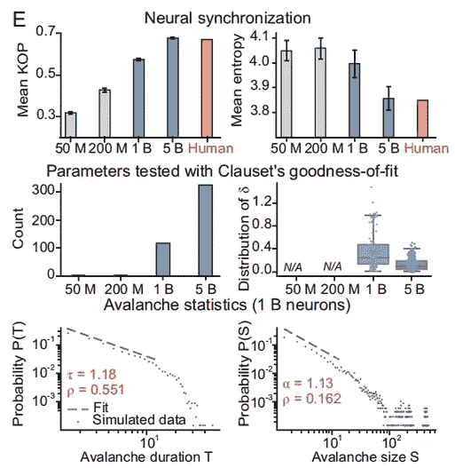

静息状态下 DTB 的相位同步分析和崩塌临界性分析

除了尺度 (scales) 外，计算模型的另一个重要**特征在于其依赖基于 DWI 的神经解剖学。为了证明这种依赖性的影响，该研究对神经**元网络进行了重新布线过程，将神经元数量设置为 10 亿，平均突触连接度设置为 100，以概率 P 随机选择连接到局部邻域。

通过将 P 值从 0 变化到 1，如下图 A 所示，人工体素级架构逐渐从基于原始 DWI 数据的架构变化到 k 近邻算法。如下图 B 所示，模型与生物数据之间的体素级 BOLD 时间过程的相关性以及 FC 矩阵的相关性随着 P 的增加而减少，而模型与生物数据之间的 FC 矩阵的 F-norm 距离随着 P 的增加而增加。因此，在静息状态下，这种重连破坏了模型与真实大脑之间的相似性。

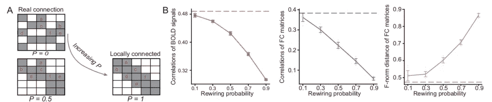

重布线程序示意与静息状态下的模型性能评估

为了进一步研究内感受回路对静息状态的影响，如下图 C 所示，该研究将海马体、岛叶、ACC、vmPFC/sgACC 和丘脑作为要拟合其体素级 BOLD 信号的内感受「输入」区域。结果如下图 D 所示，通过使用双样本 t 检验，该研究发现，将内感受区域作为输入时，同化静态 BOLD 信号与生物数据之间的相似性显著提高。

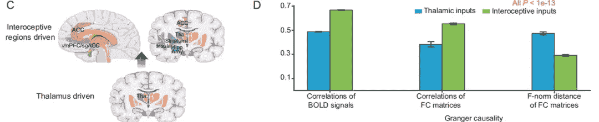

内感受区域的数字化研究示意图与指标评估

如下图 E 所示，该研究通过输入电流同化超参数的时间序列来计算 5 大平均活动度，最高光谱峰值在 0.02-0.025 Hz，几个较低的峰值约为 0.02-0.08 Hz。如下图 F 所示，该研究通过对平均电流超参数序列进行条件 Granger 因果分析，发现从丘脑到 ACC、从丘脑到岛叶、从 vmPFC/sgACC 到 ACC，以及从丘脑到海马体都具有相对较强的因果关系。

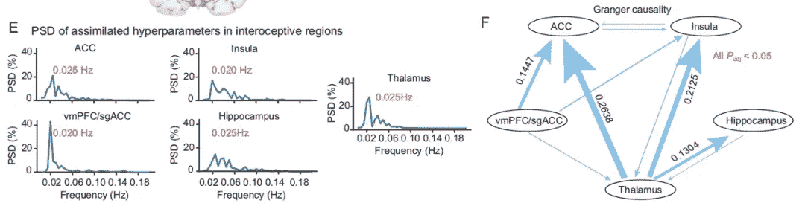

功率谱密度分析与 Granger 因果分析

**为了分析神经元和突触尺度对同化模型与其生物对应物之间相似性的影响，该研究首先拟合感知「输入」区域初级听觉皮层 **(A1) 的体素 BOLD 信号，然后通过估计该区域神经元接收的输入电流的 Gamma 分布超参数，从而建立了同化模型。

如下图 A-C 所示，该模型包含 200 亿个神经元，平均接入度为 100。同化和生物 BOLD 信号之间的所有体素平均 PCC 为 0.570，预测和实验评估数之间的相关性显著。

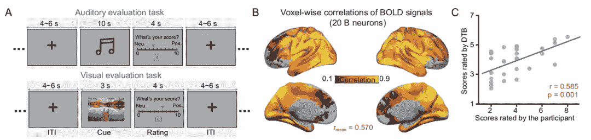

数字大脑在执行听觉评估任务时的预测表现

在研究具有不同神经元数量和平均突触连接度的神经元网络模型时，如下图 D-E 所示，该研究发现模拟信号与生物数据的相似性随着神经元数量和平均突触连接度的增加而提高。在进行与静态模型类似的重连破坏时，该研究发现模型预测和生物对应物之间的评估分数、体素级 BOLD 时间过程的相关性均随着 P 的增加而增加。

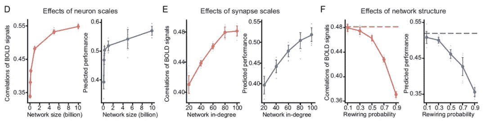

cortico-subcortical 模型性能评估

**cortico-subcortical 模**型还为某些「数字损伤」操作提供了新可能。如下图 A 所示，该研究对背侧和腹侧的视觉通路进行了从初级视觉区域 (V1) 到基本视觉通路的突触连接移除操作。研究表明，如下图 B 所示，这种操作未影响模型在 cortico-subcortical 区域与生物数据的相似性，这证实了视觉通路对海马体记忆和学习功能的重要性。如下图 C 所示，当移除 V1 到背侧或腹侧通路的连接时，这种操作显著降低了海马体 BOLD 信号与生物数据的相关性。相比之下，移除 V1 到运动区的连接对海马体的影响较小。

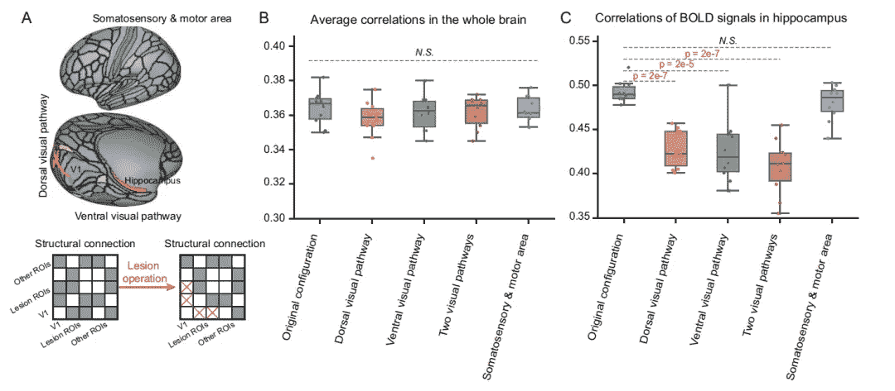

cortico-subcortical 模型的「数字损伤」评估

## 40 年坚守，冯建峰用数学方法研究脑科学

**作**为复旦大学类脑智能科学与技术研究院的首任院长，冯建峰同时还是上海数学中心首席教授，并兼任复旦大学大数据学院院长。尽管在脑科学领域颇有建树，但令人意外的是，冯建峰早期却是数学系出身，这为其后来的研究道路奠定了基础。

1981 年，冯建峰考入北京大学数学系。尽管最初对于数学研究有着崇高理想，但冯建峰很快就被应用数学领域所吸引。从大二起，冯建峰开始旁听生物系课程。由此开始，冯建峰始终坚持利用数学方法研究脑科学。到了写博士论文时，他已经开始将随机过程理论应用于神经网络研究。

从 2008 年正式加入复旦大学，到 2015 年受聘成为类脑智能科学与技术研究院首任院长，冯建峰在近 10 年中为破解大脑奥秘乐此不疲，用系统发展神经计算的数学理论解决了一类最优随机控制问题，成为国际生物信息领域的知名专家。

**

**2018 年，冯建峰团队首次搭建了由 7 千万个脉冲神经元组成的数字大脑。通过数学算法，该团队实现人脑全脑尺度千亿级神经元功能的精细计算模拟。通过计算模拟，进一步解析大脑感知觉、学习记忆、情感决策及信息处理等工作机制，为人工智能的原创突破提供实验及理论基础。到 2021 年底，数字大脑拥有的神经元数量已与真正的人脑相当。令人惊讶的是，这个数字大脑的原型就是冯建峰本人。

正是基于这种对于科学研究勇于探索的精神，以及在**计算精神病学领域和数字孪生脑上的卓越成就，冯建峰被授予** 2023 年度的洪堡研究奖 (Humboldt Research Award)。该奖项专门授予在基础研究、理论创新、学科引领等方面取得卓越成就，并在未来有望继续取得尖端成就的杰出学者，每年的获奖者不超过 100 人。

**

在冯建峰的带领下，如今的复旦大学类脑智能科学与技术研究院，已拥有一支 120 人的**教职工队伍，有认知神经科学、计算系统生物学、人工智能算法、全脑计算等多个研究团队，以第一或通讯作者身份在 Nature Medicine、Nature Human Behavior 等高水平期刊发表论文近百篇，成果曾入选《中国 2023 年度重要医学进展》，多次斩获日内瓦国际发明特别展银奖、世界人工智能大会 SAIL 奖等多项国内外大奖，牵头组建了「脑与智能科学青年学者联盟」等等。

目前**，复旦大学类脑智能科学与技术研究院正依托张江国际脑影像中心和张江国际**脑库这两大尖端实验技术平台，专注于数学、脑科学与人工智能等关键领域的交叉科学研究。未来，研究院将持续站在脑科学与类脑研究的世界前沿，致力于推动「首个类脑智能」的发展，不断为该领域的进步贡献智慧和力量。