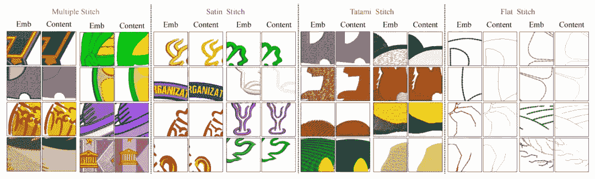
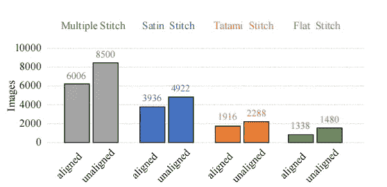
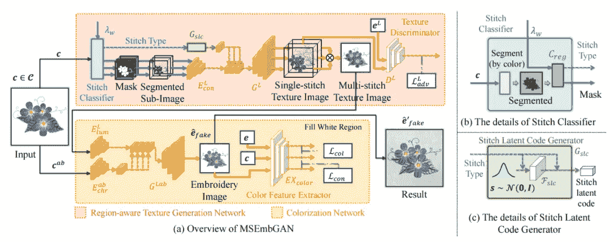
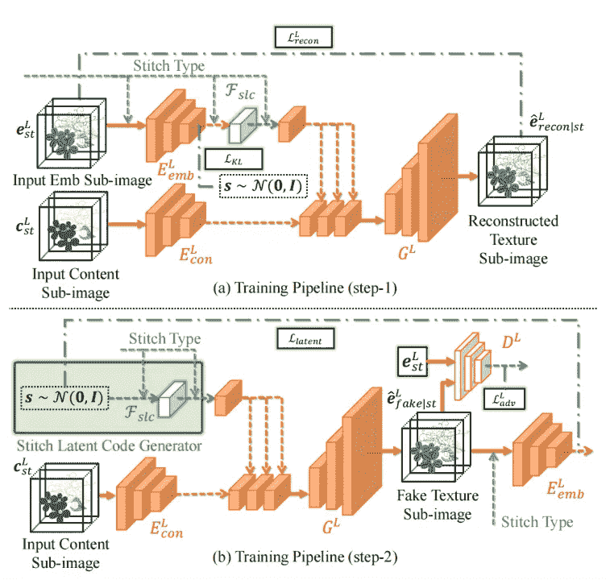
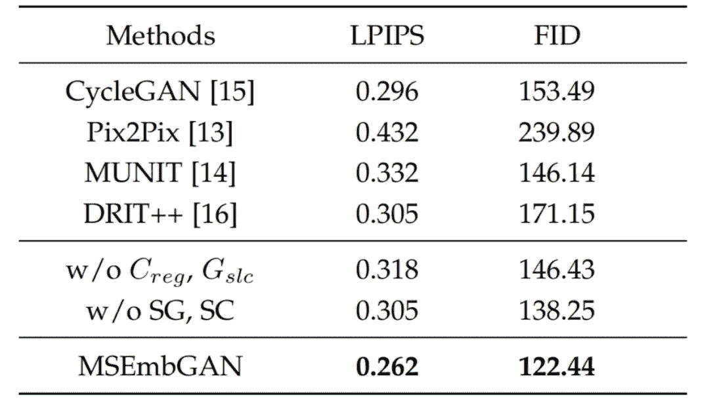
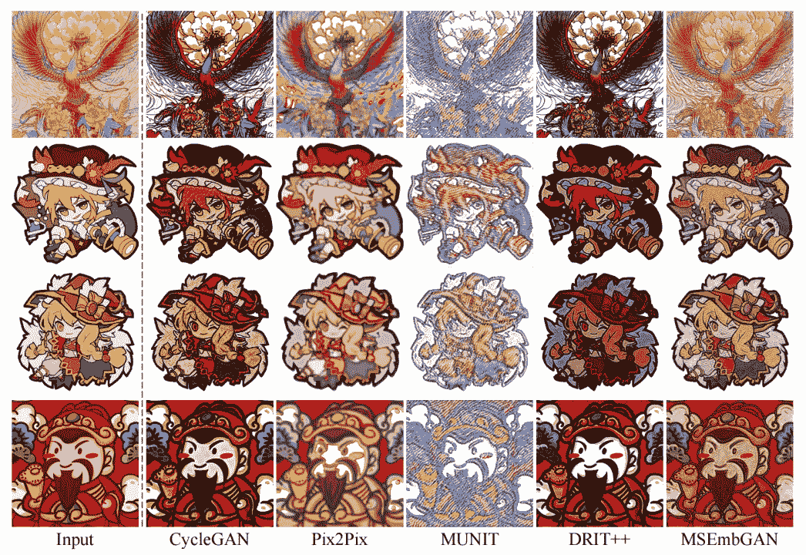
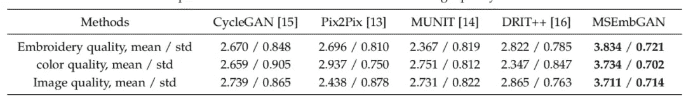
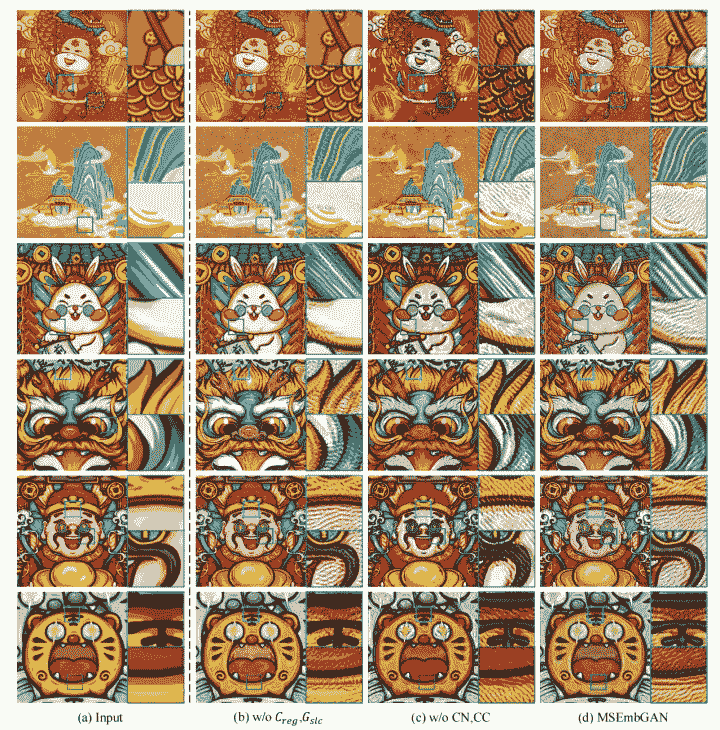
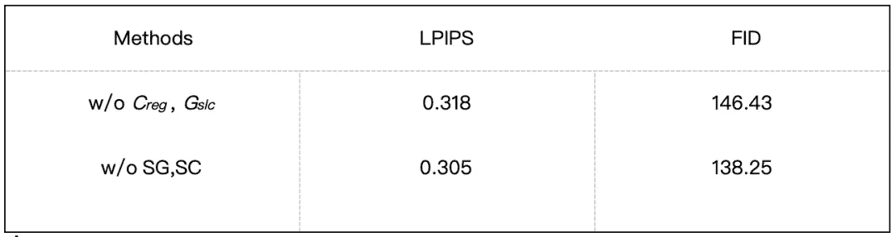

# 可智能生成刺绣图案！武汉纺织大学可视计算与数字纺织团队发布首个多缝线刺绣生成对抗网络模型，被顶级期刊 TVCG 录用

> 来源：[https://agijuejin.feishu.cn/docx/Ci5Fdb8QZo7EnzxRLZdcLHlTnAd](https://agijuejin.feishu.cn/docx/Ci5Fdb8QZo7EnzxRLZdcLHlTnAd)

> 作者：方菲  [    阅读原文](https://hyper.ai/news/34669)

绣成安向春园里，引得黄莺下柳条。作为非物质文化遗产的重要代表，我国的刺绣艺术历史悠久、技艺精湛，工匠通过不同的针脚、各色的丝**线，将主题丰富的图案活灵活现地展示于一方绣布之上。过去，刺绣工艺复杂、门**槛极高，需要有专业知识与实践经验的工匠才能完成。近年来，卷积神经网络 (CNN) 在图像分类、目标检测、图像生成和风格迁移等任务上展现出强大能力，研究人员也开始探索利用 CNN 在图像中合成刺绣特征。

然而由于刺绣具有复杂的针法、纹理和立体**感，并且包含着微小的细节和不规则的图案，所以 CNN 在合成刺绣**特征的应用中存在局限性，例如无法预测不同的缝线类型，使得它难以有效地提取缝线特征，从而无法有效生成连贯且自然的刺绣图案。因此还需要设计师手动选择和调整缝线类型和其对应的颜色，这一过程往往需要耗费大量的时间，才能达到理想的效果。

针对于此，**武汉纺织大学计算机与人工智能学院可视计算与数字纺织团队提出了一种多缝线刺绣生成对抗网络模型 MSEmbGAN。MSEmbG**AN 提高了刺绣中纹理真实度和色彩保真度等关键方面的精度，成为首个基于 CNN 成功完成刺绣预测特征的生成对抗网络模型。

相关**研**究以「MSEmbGAN: Multi-Stitch Embroidery Synthesis via Region-Aware Texture Generation」为题，被 IEEE Transactions on Visualization and Computer Graphics (TVCG) 录用，上海交通大学计算机科学与工程学院盛斌教授为通讯作者。TVCG 是计算机可视化领域的顶级期刊，被中国计算机学会 (CCF) 列为 A 类期刊。

**研究亮点：**

+   MSEmbGAN 是第一个成功合成包含多种缝线纹理和色彩的多针刺绣图像的基于学习的模型

+   提出了两个互相协作的子网络：一个是区域感知纹理生成网络，以确保刺绣纹理的多样性，以及缝线特征的准确性；而另一个是着色网络，以确保输入和输出图像之间颜色的一致性

+   建立了当前最大的多针刺绣数据集，同时它也是第一个通过单针和多针标签详细标注的刺绣数据集

**

论文地址**：

https://csai.wtu.edu.cn/TVCG01/index.html

关注👸号，后台回复「多针刺绣」获取完整 PDF

**数据集下载地址：**

https://go.hyper.ai/Jmj9k

**开源项目「awesome-ai4s」汇集了百余篇 AI**4S 论文解读，并提供海量数据集与工具：

https://github.com/hyperai/awesome-ai4s

## 数据集：包含 30K + 图像，为目前已知的最大刺绣数据集

**研究人员通过专业的刺绣软件 (Wilcom 9.0) 制作了超过 3 万的图像，包括**刺绣图像和相应的内容图像。并且所有图像都被调整为 256 × 256 的分辨率。多针刺绣数据集将开源，贡献给本研究领域的其他研究者。

值得一提的是，多针刺绣数据集中的图像标注有 4 种标签，分别对应 3 种单针类型和 1 种多针类型 (Multiple Stitch，指 3 种单针类型的混合)。其中 3 种单针类型分别指缎面 (Satin Stitch)、榻榻米 (Tatami Stitch) 和平针 (Flat Stitch)。

**这是第一个通过单针和多针标签详细标注的刺绣数据集，包括 1.3 万**多张已对齐内容刺绣图像和 1.7 万多张未对齐图像，是目前已知的最大刺绣数据集。

多针刺绣数据集图像示意图

制作多针法刺绣数据集的步骤如下：

+   绘制内容图像：在制作绣版前，刺绣师必须绘制包含刺绣色彩信息的内容图像作为模板。大多数内容图像色彩简单，形状清晰，可加快网络衔接。

+   缝线设计：对于不同形状的内容图像，必须选择缝线来填充每个区域。刺绣设计师会根据每个区域的形状匹配合适的缝线类型。此外，还必须合理设置每个缝线的相关参数（如间距和方向），以便进行后续的刺绣渲染任务。

+   创建刺绣数据集：刺绣设计师使用专业刺绣软件 (Wilcom 9.0) 设计和制作刺绣图案，并渲染相应的刺绣图像。

多针法刺绣数据集中不同标签的数据分布情况

## 模型架构：包含区域感知纹理生成网络与着色网络两个子网络

MSEmbGAN 模型首先识别输入图像区域内的缝线类型，根据识别的缝线类型生成相应的刺绣纹理，最后优化结果的整体颜色。

**为了**实现上述功能，研究人员提出了两个子网络，即区域感知纹理生成网络 (Region-aware Texture Generation Network, 见下图橙色方框) 和着色网络 (Colorization Network, 见下图黄色方框)。

MSEmbGAN 模型架构

**区域**感知纹理生成网络由缝线分类器模块 (Stitch Classifier, 见上图蓝色框) 和缝线潜码生成器模块 (Stitch Latent Code Generator, 见上图绿色框) 组成。区域感知纹理生成网络检测输入图像 C 的多个颜色区域，并根据每个局部颜色区域的形状特征，生成灰度单针刺绣图像。着色网络子网络则进一步细化整体图像，确保生成的多针织布图像的颜色与输入图像的颜色保持一致。

由于区域感知纹理生成网络的复杂性，研究人员对其进行了两步训练。第一步先生成刺绣纹理，使用重构网络来保留尽可能多的原始图像特征；第二步是重建颜色信息，使用先验高斯分布在没有数据集的情况下生成刺绣图像。

区域感知纹理生成网络的两个训练步骤

## 研究结果：MSEmbGAN 优于目前最先进的刺绣合成和风格转换方法

**为**了评估 MSEmbGAN 模型的性能，研究人员通过定量和定性、用户反馈调查以及消融实验 4 个方面进行评估。

### **定量评估**

### 在定量评估中，研究人员基于构建的多针刺绣数据集，对比了 Pix2Pix、CycleGAN、MUNIT、DRIT++ 等风格迁移方法。如下表所示，研究人员对比较结果进行了量化，并计算了 Learned Perceptual Image Patch Similarity (LPIPS) 和 Fréchet Inception Distance (FID)。

4种比较方法、2种消融模型和 MSEmbGAN 模型在整个测试数据集上真实图像与生成的刺绣图像之间的平均 LPIPS 和 FID 距离

结果显示，与其他方法相比， **M**S**EmbGAN 具有较低的 LPIPS** 距离，这意味着 MSEmbGAN 生成的刺绣图像在感知上更接近真实的刺绣图像。此外，研究人员还使用 FID 来测量生成的刺绣图像和真实图像的特征分布，并对 FID 分数进行了评估，结果表明 MSEmbGAN 生成的刺绣图像最接近 ground truth。

### **定性评估**

在**定性评估中，研究人员使用区域感知的纹理生成网络来保持刺绣纹理的真实**性和色彩保真度，使 MSEmbGAN 生成的结果具有高度多样化的刺绣纹理。结果显示，MSEmbGAN 在纹理和颜色方面都优于现有的方法，即使用 MSEmbGAN 生成的纹理更接近真实的刺绣纹理，颜色更接近输入图像的纹理。

MSEmbGAN 和其他四种风格转移方法生成的刺绣图片比较

### **用户反馈调查**

为获得用户的主观反馈，研究人员准备了 14 幅图像，每幅图像都使用 MSEmbGAN 模型和另外 4 种方法进行处理，邀请 25 位候选人根据以下标准为生成的每张图片打 1-5 分：

+   刺绣质量 (Embroidery quality)：生成的图像是否具有与刺绣相关的特征和生动的纹理

+   色彩质量 (Color quality)：输入图像与生成图像的色彩相似度

+   图像质量 (Image quality)：纹理失真、色彩偏移、高频噪声和其他伪影的程度

研究人员收集了 5,250 项评分，并计算了各项标准的平均值和标准误差。分数越高意味着生成的刺绣图像质量越好，具体如下表所示。

结果表明，**MSEmbGAN 在所有 3 个标准上都更**胜一筹，综合性能相较于其他方法更加稳定。

### **消融实验**

**此**外，研究人员还进行了 2 个消融实验：首先验证缝线分类器和缝线潜码生成器的作用，然后验证着色网络和颜色一致性约束的作用。

如下图所示，(a) 表示输入图像；(b) 表示去掉针脚分类器 C(reg) 和隐码生成器 G(slc) 生成的刺绣图像；(c) 表示去掉着色网络 (CN) 以及颜色一致性约束(CC) 生成的刺绣图像；(d) 表示使用完整 MSEmbGAN 生成的刺绣图像。

消融实验结果

消融实验量化结果

**消融结果显示，**在没有缝线分类器和缝线隐码生成器的情况下，网络合成的刺绣图像纹理样式单一，没有保留多针样式特征。其次，一个纹理生成过程不稳定且异常的。

同样，如果去掉着色网络和颜色一致性约束，通过 MSEmbGAN 合成的刺绣结果不能保持颜色特征，从而导致明显的颜色偏移。也就是说，生成的图像与输入图像之间的颜色分布存在巨大的差异。

## 坚持将计算机技术与纺织服装产业深度融合，多领域成果显著

武**汉**纺织大学计算机与人工智能学院可视计算与数字纺织团队长期致力于计算机视觉、虚拟现实、多模态学习和智能计算等领域的研究，坚持将计算机相关技术与纺织服装产业相结合，在智能可穿戴、智能时尚设计与推荐、织物数字孪生与智能计算、虚拟试衣等方面取得了一系列成果。在 TVCG、IOT、TCE、KBS、WWW 等高水平期刊和 CCF 推荐的国际会议上发表学术论文百余篇。近年来团队部分研究成果如下：

**针**对现有虚拟试衣方法未能考虑人体与服装之间的相互关系而导致试穿服装纹理失真，团队提出了高度逼真的 3D 虚拟试穿网络 H3DVT+。该网络建立了人与服装的全局关系，可以将服装变形为自然试穿状态下的空间分布，更准确地推断服装 3D 形状的先验信息，创建精细的着装 3D 人体模型。

**论文地址：**

https://ieeexplore.ieee.org/document/9716786

https://ieeexplore.ieee.org/document/10609455

**针****对现有智能**服装感知人体生理信号的相关研究中，团队提出了一种基于柔性感知设备的全天候人体呼吸信号检测方法，并将提取的呼吸信号用于实时检测哮喘病，为智慧医疗的应用提供了理论支撑。

论文地址：

https://ieeexplore.ieee.org/abstract/document/10040599

同时，学院团队构建了一种由多种传感器构建的智慧服装系统，将人体状态信息与人体三维模型实时映射，实现现实世界中的人体状态与虚拟三维空间中人体模型状态同步显示。

**论文地址：**

https://ieeexplore.ieee.org/document/9964338/

**团**队一直与国内外高水平高校和研究机构进行合作。具体而言，可视计算与数字纺织团队长期与上海交通大学盛斌教授团队在智慧纺织，大健康方面进行了多个项目合作，发表了 10 余篇高水平论文。盛教授近 5 年以 (共同) 第一/通讯发表 Nature Medicine、Nature Communications、Science Bulletin、IJCV、IEEE TPAMI 等 SCI 论文 69 篇。

此外，**团队与香港理工大学、澳大利亚伍伦贡大学、新加坡科技局、中国人民大学等高校**和研究机构在自然语言处理、智能时尚推荐、多模态学习和大模型领域研究展开深入合作。