# 入选ECCV 2024！覆盖5.4w+图像，MIT提出医学图像分割通用模型ScribblePrompt，性能优于SAM

> 来源：[https://agijuejin.feishu.cn/docx/GLXodgKTUoWgyNxaN3tcZIj1nVc](https://agijuejin.feishu.cn/docx/GLXodgKTUoWgyNxaN3tcZIj1nVc)

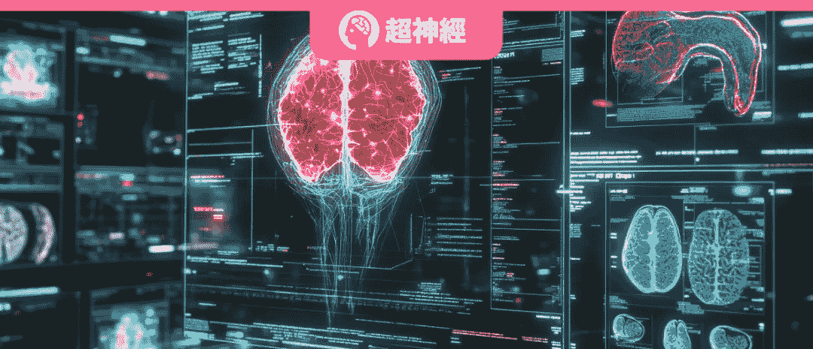

> 作者：哇塞      [ 阅读原文](https://hyper.ai/news/34720)

外行看热闹，内行看门道，这句话在医学影像领域可谓是绝对真理。不仅如此，即便身为内行人，要想在复杂的 X 光片、CT 光片或 MRI 等医学影像上准确看出些「门道」来，也并非易事。而医学图像分割则是通过将复杂的医学图像中某些具有特殊含义的部分分割出来，并提取相关特征，从而可以辅助医生为患者提供更为准确的诊疗方案，也可以为科研人员进行病理学研究提供更为可靠的依据。

**近**年来，受惠于计算机及深度学习技术的发展，医学图像分割的方法正在逐步由手动分割向着自动化分割的方向加速迈进，经过训练的 AI 系统已经成为医生和科研人员的重要辅助。然而，由于医学图像本身的复杂性和专业性，导致系统训练中仍有大量工作依赖于有经验的专家进行手动分割创建训练数据，其过程耗时耗力。同时，现有基于深度学习的分割方法在实践中也遇到了诸多挑战，如适用性问题、灵活的交互需求等。

为了解**决现有交互式分割系统在实际应用中存在的局限性，美国麻省理工学院计算机科学与人工智能实验室 (MIT CSAIL)** 团队联合麻省总医院 (Massachusetts General Hospital) 和哈佛医学院 (Harvard Medical School) 的研究人员，提出了一种用于交互式生物医学图像分割的通用模型 ScribblePrompt，这是一种基于神经网络的分割工具，支持注释人员使用涂鸦、点击和边界框等不同的注释方式，灵活地进行生物医学图像的分割任务，甚至是对于未经训练的标签和图像类型。

该研究以「ScribblePrompt: Fast and Flexible Interactive Segmentation for Any Biomedical Image」为题，目前已收录于国际知名学术平台 arXiv，并被国际顶级学术会议 ECCV 2024 接收。

+   **研究亮点：**
快速准确地完成任何生物医学图像分割任务，具备相比现有最先进模型更优的能力，特别是对于未经训练的标签和图像类型

+   提供了灵活多样的注释样式，包括涂鸦、点击以及边界框

+   计算效率更高，即使在单个 CPU 上也能实现快速推理

+   在与相关领域专家的用户研究中，该工具与 SAM 相比将注释时间缩短了 28%

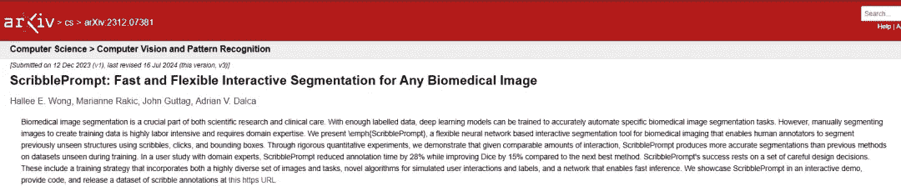

**论文地址：**

https://arxiv.org/pdf/2312.07381

关注公众号，后台回复「 图像分割通用模型 」获取完整 PDF

MedScribble 数据集下载地址：

https://go.hyper.ai/mLjNW

**「**ScribblePrompt 医学图像分割工具」已上线至 HyperAI超神经教程版块，一键克隆即可启动，教程地址：

https://go.hyper.ai/nCq9M

## 大体量数据集，全面覆盖模型训练与性能评估

**该研**究以 MegaMedical 等大型数据集收集工作为基础，汇编了 77 个开放获取的生物医学成像数据集，用于训练和评估，涵盖了 54,000 张扫描图像，16 种图像类型和 711 个标签。

这些数据集图像涵盖各种生物医学领域，包括眼睛、胸腔、脊柱、细胞、皮肤、腹部肌肉、颈部、大脑、骨骼、牙齿以及病变的扫描；图像类型包括了显微镜、CT、X 光片、 MRI、超声波以及照片等。

在训练和评估方面的划分上，**研究团队将 77 个数据集分为了 6**5 个训练数据集和 12 个评估数据集。其中，在 12 个评估数据集中，9 个评估数据集的数据用于模型开发以及进行模型选择和最终评估，另外 3 个评估数据集的数据仅用于最终评估。

每个数据集按 6:2:2 的比例划分为训练集、验证集和测试集，如下图所示。

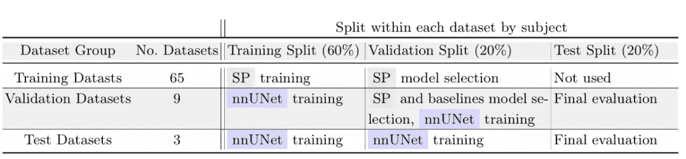

以下两张图分别为「验证和测试数据集」和「训练数据集」，其中，「验证和测试数据集」在 ScribblePrompt 模型训练期间为不可见状态。

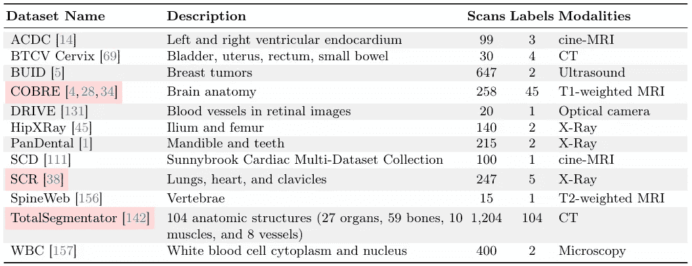

验证和测试数据集，所标注的3个数据集为完全测试所用的数据集

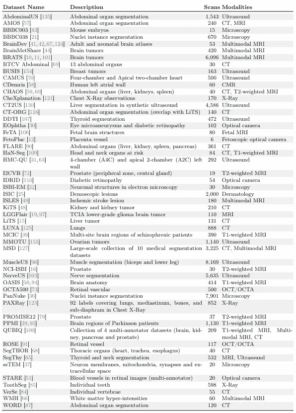

训练数据集

对于数据集的相对大小，研究团队保证每个数据集具有唯一扫描次数。

## 快速推理的高效架构，构建实用型分割工具

**研究团队提出的是一种灵活的交互式分割方法，具有很强的实际可用性，可以推广**至新的生物医学成像领域和感兴趣区域 (regions of interest)。

研究团队展示了训练中模拟交互分割的连续步骤，如下图所示。其中输入为给定一个图像分割对 (xᵗ,yᵗ)。团队首先模拟一组初始交互 u₁，其中可能包括边界框、点击或涂鸦，之后进入预测第一步，设置初始值为 0。在第二步中，团队在错误区域中模拟先前预测，并通过模拟矫正后添加到初始交互集合中，获得 u₂。由此重复产生一系列预测。

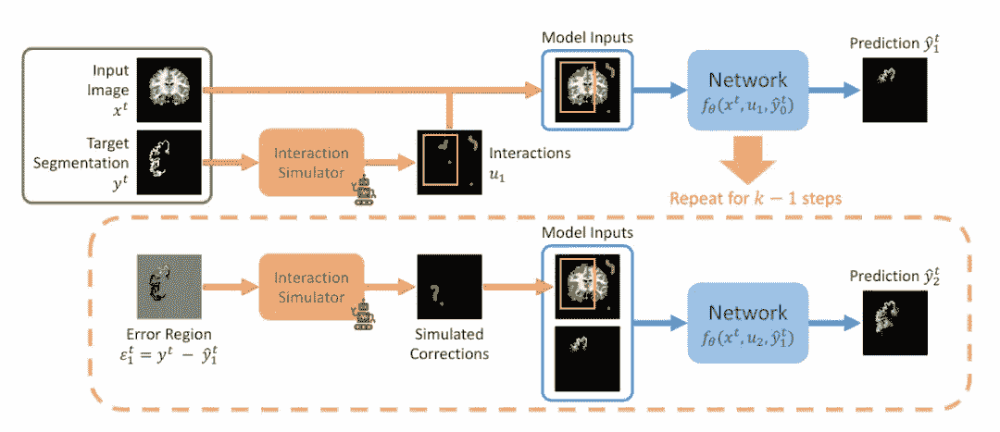

训练过程中，团队模拟交互分割的连续步骤

为了保障模型的实用性和易用性，**研究团队还在训练期间使用算法模拟了实用场景下如何在医学**图像的不同区域上涂鸦、点击和边界框输入。

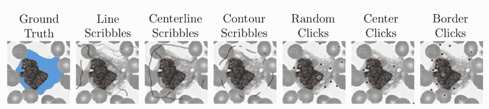

模拟涂鸦和点击

除了常见的标记区域之外，该团队引入了一种生成合成标签的机制。通过应用超像素算法来生成潜在合成标签的映射，然后对一个标签进行采样，从而生成图中所示的「Ysynth」，最后再应用随机数据增强来获得最后结果。这种方法通过找到具有相似值的图像部分来然后识别医学研究人员可能感兴趣的新区域，并训练 ScribblePromt 对其进行分割。如下图所示。

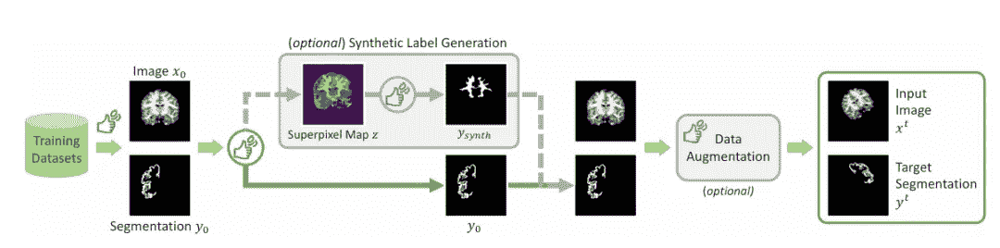

任务采样和增强

**本次**研究展示主要采用了两种网络架构来演示，一种是使用类似于 UNet 的高效全卷积架构来演示 ScribblePrompt，另一种是演示了使用视觉转换器架构的 ScribblePrompt。

其中，ScribblePrompt-UNet 使用了 8 层 CNN，遵循类似于流行的 UNet 架构的解码器结构，没有批次规范 (Batch Norm)。每个卷积层有 192 个特征，并使用 PReLu 激活。需要解释的是，之所以没有规范化层，是因为在初步实验中，团队发现与不使用规范化层相比，包括规范化并没有改善验证数据的平均骰子，如下图所示。

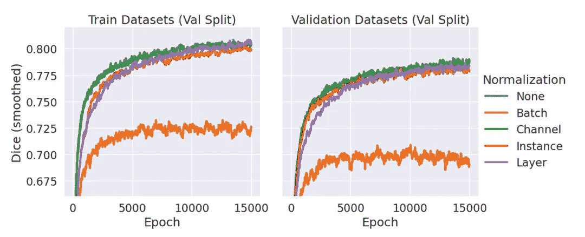

不同规范层下训练 ScribblePrompt-UNet

ScribblePrompt-SAM 采用了最小的 SAM 模型 ViT-b，并对其解码器进行微调。SAM 架构可以在单掩码模式或多掩码模式下进行预测，在单掩码模式下，解码器在给定输入图像和用户交互的情况下输出单个预测分割。在多掩码模式下，解码器预测 3 个可能的分割，然后通过 MLP 输出预测 IoU 最高的分割。为了最大限度提高架构的表达能力，研究在多掩码模式下进行训练和评估 ScribblePrompt-SAM。

## ScribblePrompt 展现出超越现有方法的优越性

**本次研**究中，研究团队通过手动涂鸦实验、模拟交互以及和有经验注释的用户研究，将 ScribblePrompt-UNet 和 ScribblePrompt-SAM 与现有最先进的方法进行了比较，包括 SAM、SAM-Med2D、MedSAM 以及 MIDeepSeg。

**在手动涂鸦实验中，**结果显示 ScribblePrompt-UNet 和 ScribblePrompt-SAM 在实验的手动涂鸦数据集和 ACDC 涂鸦数据集的单步手动涂鸦中产生最准确的分割，如下表所示。

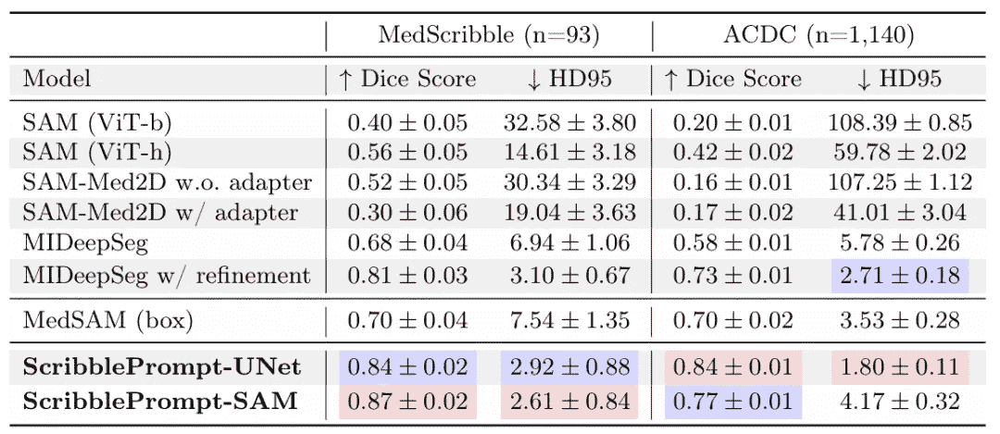

手动涂鸦实验对比

SAM 和 SAM-Med 2D 因为没有接受过相关训练，因此无法顺利地推广到涂鸦输入。MedSAM 相比其他使用 SAM 架构的 SAM 基线有更好的预测，但它不能利用负涂鸦，因此经常错过有洞的分割，如下图所示。另外，来自 MIDeepSeg 网络的初始预测较差，但在应用细化过程后有所改善。

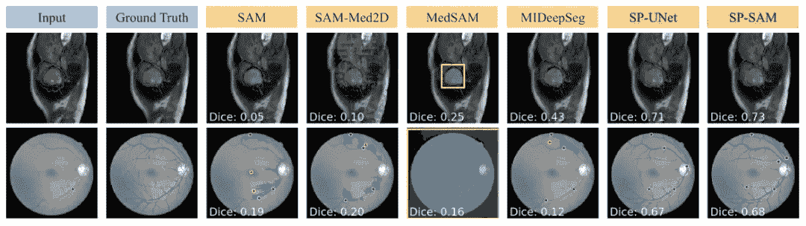

预测示例，顶部为手动涂鸦一步后的预测，底部为模拟交互五步后的预测

**在模拟交互实验中，**结果显示对于所有交互次数的所有模拟交互过程，ScribblePrompt 的两个版本都显示出优于基线方法。如下图所示。

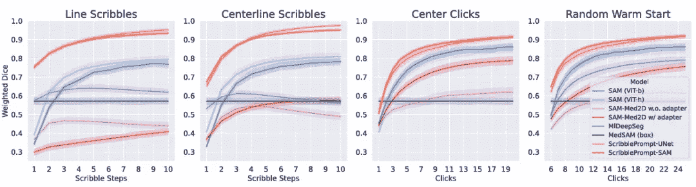

模拟点击和涂鸦，实验按照3种涂鸦协议和3种点击协议模拟交互

为了进一步评估 ScribblePrompt 的实际效用，团队与有经验的注释者进行了一项用户研究。本轮对比为 ScribblePrompt-UNet 和在上述点击实验中获得最高骰子分数的 SAM (Vit-b)。结果显示，参与者在使用 ScribblePrompt-UNet 时产生出更准确的分割，如下表所示。同时，使用 ScribblePrompt-UNet 平均每次分割花费约 1.5 分钟，相比之下，使用 SAM 的每次分割时间则超过了 2 分钟。

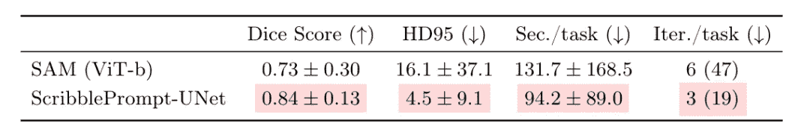

用户研究实验对比

16 名参与者的实验报告显示，与 SAM 相比，使用 ScribblePrompt 更容易实现目标分割，其中 15 名表示他们更喜欢使用 ScribblePrompt，剩下一位参与者没有偏好。另外，与 SAM 基线相比，93.8% 的参与者更喜欢 ScribblePrompt，因为它可以改善对涂鸦纠正的相应片段，同样有 87.5% 的参与者更喜欢使用 ScribblePrompt 进行基于点击的编辑。

以上结果再次证明了参与者对于 ScribblePrompt 偏好的最常见原因 —— 自我纠正和丰富的交互功能。这是其他方法所无法实现的，比如在视网膜静脉分割中，SAM 即使进行多次更正也很难做到准确的预测。

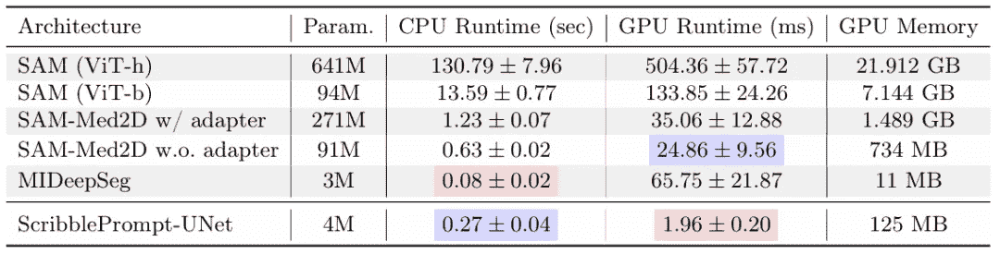

性能对比

除此之外，ScribblePrompt 同样展示出低成本和易部署的一面。研究发现，在单个 CPU 上，ScribblePrompt-UNet 每次预测仅需 0.27 秒，误差在 0.04 秒以内。如上图所示，其中 GPU 为 Nvidia Quatro RTX8000 GPU。而 SAM (Vit-h) 在 CPU 上每次预测需要超过 2 分钟，SAM (Vit-b) 每次预测用时为 14 秒左右。这无疑是展示了该模型在极低资源环境下的适用能力。

## 让医护及科研人员从耗时耗力的工作中解脱出来

人工智能在图像分析和处理其他高维数据方面早已经显示出巨大的潜力，而医学图像分割作为生物医学图像分析和处理中最常见的任务，自然也早成为了人工智能赋能的重要试验田之一。

除本文研究之外，[如](https://mp.weixin.qq.com/s?__biz=MzU3NTQ2NDIyOQ==&mid=2247512626&idx=1&sn=5178d540f0f2e83c93ae1037ec57e115&scene=21#wechat_redirect)文中所提到的 SAM，同样是近年最受相关科研团队关注的主要工具之一。此前 HyperAI超神经曾就相关研究进行跟进，比如在「SAM 2 最新应用落地！牛津大学团队发布 Medical SAM 2，刷新医学图像分割 SOTA 榜」中，分享了牛津大学团队对 SAM 在医学图像分割方面潜力的发掘。

该研究展示了牛津大学团队所开发的一款名为Medical SAM 2 的医学图像分割模型，基于 SAM 2 框架设计，通过将医学图像视作视频，不仅在 3D 医学图像分割任务上表现卓越，同时还解锁了一种新的单次提示分割的能力。用户只需为一种新的特定对象提供一个提示，后续图像中同类对象的分割就可以由模型自动完成，而无需进一步输入。

当然，**除了 SAM 之外，其他基于深度**学习的医学图像分割的方法研究也不在少数。比如一篇收录于国际知名期刊和杂志 IEEE Transactions on Medical Imaging 中，题为「Scribformer: Transformer Makes CNN Work Better for Scribble-based Medical Image Segmentation」的研究。

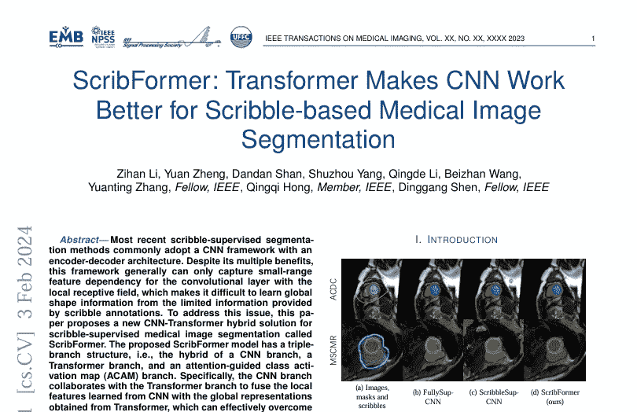

该**研**究由包括厦门大学、北京大学、香港中文大学、上海科技大学以及英国赫尔大学在内的多所院校的研究人员组成的团队发布。研究提出了一种新的 CNN-Transformer 混合解决方案，用于涂鸦监督医学图像分割，称为 ScribFormer。

总而言之，无论是 MIT 所研究的成果，还是基于 SAM 的创新，亦或者是其他新的方法，从目的上都是相同的。正所谓条条大路通罗马，人工智能在医学领域的应用无不是为了造福医学，造福社会。

也正如上述关于 ScribblePrompt 论文的主要作者，麻省理工学院博士生 Hallee E Wong 所说，「我们希望通过一个交互式系统来增强而不是取代医务工作者的努力。」

**参考资料：**

1.https://news.mit.edu/2024/scribbleprompt-helping-doctors-annotate-medical-scans-0909

2.https://arxiv.org/pdf/2312.07381