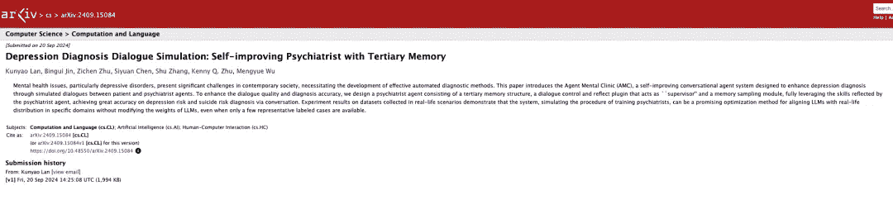
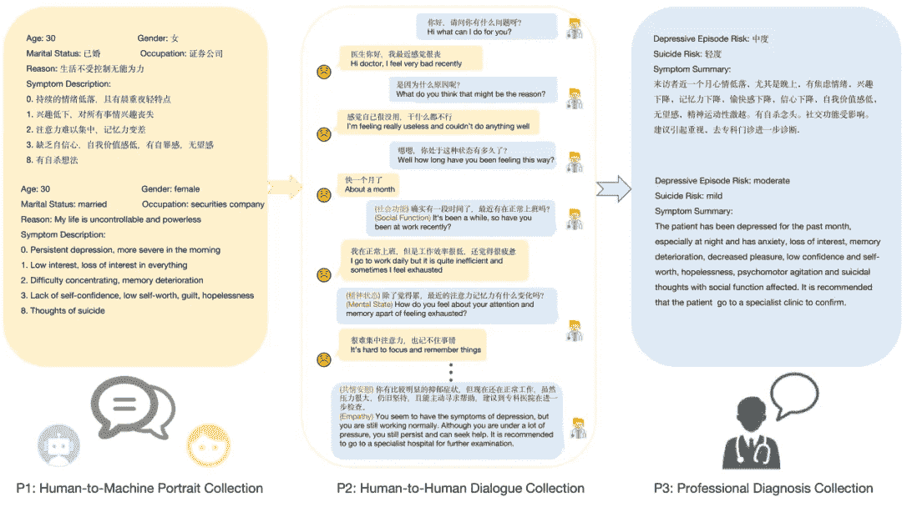
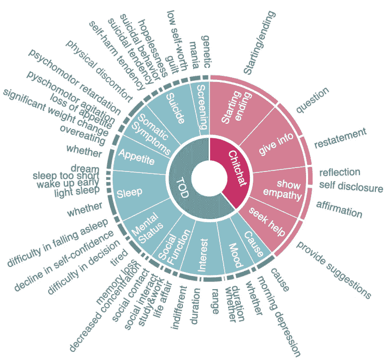
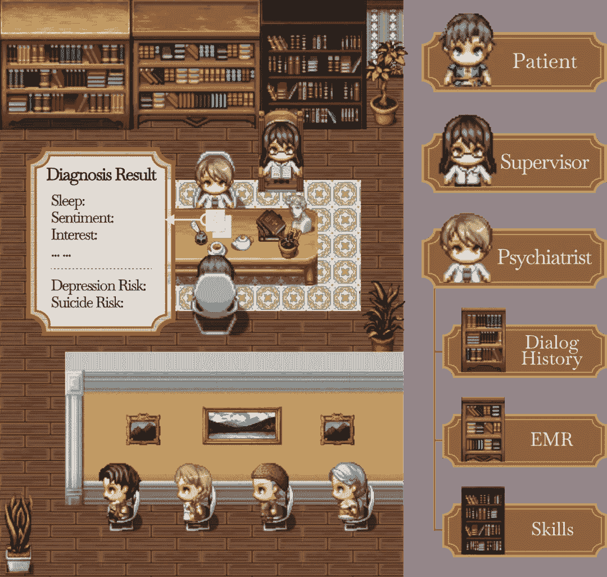
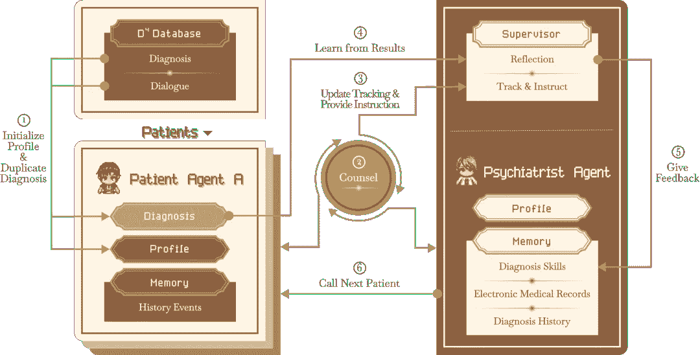
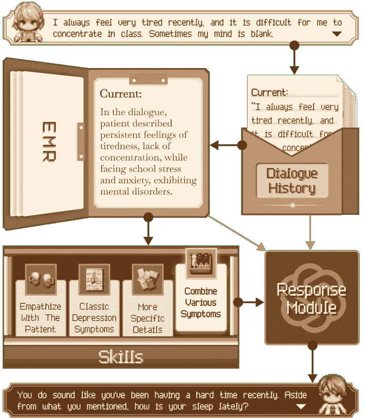
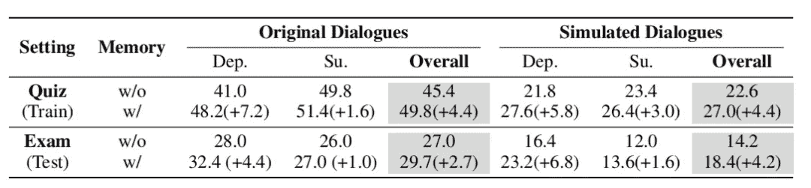
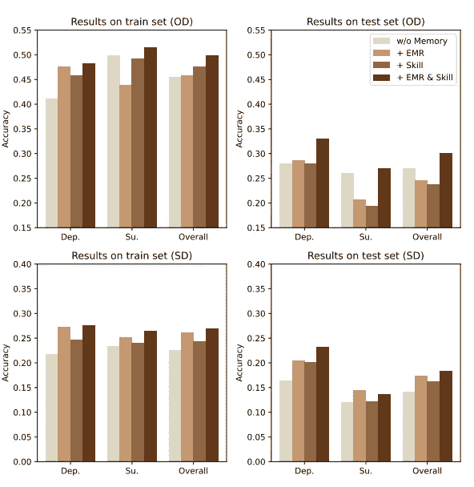
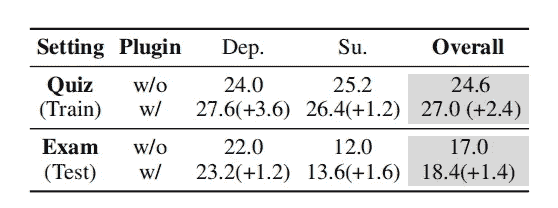
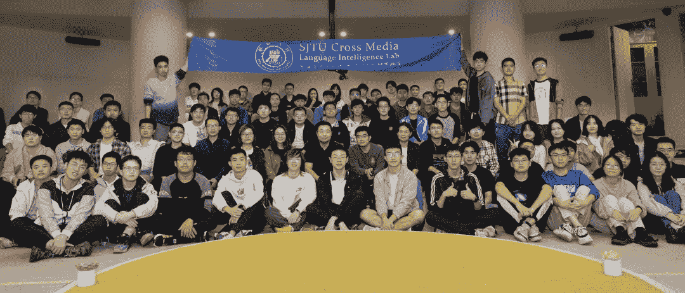

# Agent心理诊所上线！基于1.3K抑郁症问诊对话，上海交大团队搭建大模型对话Agent，可初诊抑郁症

> 来源：[https://agijuejin.feishu.cn/docx/VQOGdsmbHoZ7QExNNeucdnZunEg](https://agijuejin.feishu.cn/docx/VQOGdsmbHoZ7QExNNeucdnZunEg)

> 作者：兰焜耀      [ 阅读原文](https://hyper.ai/news/34845)

心理健康问题是当今社会最大的挑战之一，根据 WHO 的世界心理健康报告，约有 2 亿 4,600 万人患有抑郁障碍，平均每 10 万人中就有 3,153 个案例，可以说，这是最常见的精神障碍之一。

然而，如今在心理健康方面的医疗资源仍然不足，尤其是在低收入**和中等收入国家。此外，在所有国家和地**区，专业的心理健康医疗资源主要集中在城市和大型机构，造成了医院资源分配的不平衡，使得饱受抑郁障碍等精神障碍折磨的患者，难以及时获取相应的医疗辅助。

为了更好地分配医疗资源，缓解资源紧张的困境，高效且准确的自动化抑郁症诊断方法重要且关键。在多种自动化的诊断方法中，对话智能体 (Conversational Agents) 因其成本效益、节省时间和维护用户匿名性而被认为十分有效。值得注意的是，当诊断对话不断深入，Agent 的对话策略需要随患者的精神状态以及医患关系的进展而变化，这无疑为对话 Agent 的搭建提出了严峻挑战。

针对上述问题，**上海交**通大学 X-LANCE 实验室吴梦玥老师团队与德克萨斯大学阿灵顿分校 UTA、天桥脑科学研究院 (TCCI) 和 ThetaAI 公司一同合作，搭建了一种自动化大模型对话 Agent 模拟系统——智能体心理诊所 AMC (Agent Mental Clinic)，用于抑郁症的初步诊断。这一系统可以同时模拟精神科医生和潜在抑郁症患者，并模拟抑郁症问诊对话。此外，为了优化对话流程，指导精神科医生，AMC 还设计了一个指导员的角色，为精神科医生提供下一轮对话的指导，系统中的所有角色，都是既可以由真人扮演或由大模型实现。

为了更好地适应诊断环境的需求，AMC 利用流行的大模型 Agent 构建的思路，同时还提出了三层记忆存储结构和全新的记忆检索机制，以实现更高效准确的抑郁症问诊和初筛。这一对话系统不仅可以用于对潜在抑郁症的患者进行初步筛查，还可以用于对实习精神科医生或者学生进行培训，在正式进入科室实习前提供一些辅导和帮助。而可由专业精神科医生扮演的指导员角色，也为基于大模型的精神科医生 Agent 提供了可行的优化思路。

相关研究以「Depression Diagnosis Dialogue Simulation: Self-improving Psychiatrist with Tertiary Memory」为题，已发表预印本。

**研究亮点：**

+   搭建了一个新型的对话 Agent 模拟系统，模拟患者 Agent 和精神科医生 Agent 之间的诊断会话，为培训实习精神科医生和初步筛查潜在抑郁症患者提供了有效的新方法。* 提出创新的三层式记忆结构和记忆检索模块，增强 Agent 在诊断阶段总结技能，为未来在抑郁症诊断和对话模拟的优化提供全新的方向。

+   AMC 系统在抑郁症诊断和自杀预测方面都有提升，且该框架可应用于其他特定领域，适合有限标注案例的训练。

**论文地址：**

https://arxiv.org/abs/2409.15084

关注👸号，后台回复「智能体心理诊所」获取论文原文

**开源项目「awesome-ai4s」汇集了百余篇 AI**4S 论文解读，并提供海量数据集与工具：

https://github.com/hyperai/awesome-ai4s

## D(4 )数据集，经专业医生核验

D(4) 数据集是由吴梦玥老师团队采集并经过专业医生质量核验的。对话数据集的收集有 3 个阶段：

+   在社交媒体等平台发放问卷，搜集并建构真实潜在抑郁症患者的个人画像。* 招募并培训模拟患者和模拟医生，为模拟患者提供采集到的抑郁症患者画像，然后让模拟医生和模拟患者进行抑郁症问诊对话。* 将采集到的模拟对话交由专业的精神科医生，对问诊对话的质量进行核验，并对质量合格的对话进行抑郁症严重程度的诊断和症状总结。

收集 D(4 )数据集的 3 个阶段

经过采集和核验后，吴梦玥老师团队一共搜集了 1,339 段满足质量的对话用于组建抑郁症问诊数据集 D(4)，抑郁症程度分为无（430 段对话），轻度（342 段对话），中度（368 段对话），和重度（199 段对话）四个大类，平均对话轮数为 21.6 轮。之后，吴梦玥老师团队提出 SEO 抑郁症症状诊断标注框架对 D(4) 数据集进行了标注。

## 创新的三层式记忆结构和记忆检索模块

研究人员提出了一种三层的记忆存储结构和全新的记忆检索机制的自动化大模型对话 Agent 模拟系统，包括 3 个模块：

+   患者 (Patient) Agent：利用基于 D(4) 用户画像和抑郁症问诊对话提取出的用户信息，对患者 Agent 进行初始化的操作。AMC 从 D(4) 中选取了 100 个经典案例作为训练集，利用 GPT-4 提取问诊对话中的事件信息作为患者初始的记忆节点。精神科医生 (Psychiatrist) Agent：利用了 ICD-11 中对于抑郁障碍的描述和诊断依据进行初始化，并随着诊断的进行积累患者的电子病历和总结出的诊断技能。

+   指导员 (Supervisor) 插件：用于比较精神科医生 Agent 对患者 Agent 诊断的结果，并总结经验交由精神科医生 Agent 存储。

AMC 系统概览

整个 AMC 系统的运作流程如图所示，一共有 6 个步骤：

1.  利用基于 D(4) 采集到的由 GPT-4 生成的患者画像初始化一批患者 Agent。其中抑郁障碍的诊断结果在患者的问诊的过程中不会提供给患者 Agent。2. 患者 Agent 和精神科医生 Agent 进行抑郁症问诊聊天。

1.  在第二步的过程中，指导员插件会根据对话的进行追踪患者提及的症状并提供下一步的对话建议给精神科医生 Agent。

1.  在问诊对话结束后，指导员插件比较精神科医生 Agent 最后对患者的诊断结果和 D(4 )中存储的真实医生的诊断结果。5. 指导员插件将根据诊断结果的比较，总结出提供给精神科医生 Agent 的指导意见，并将其提供给精神科医生 Agent。

1.  结束一次问诊流程后，精神科医生呼唤下一个患者 Agent 来进行诊断，重复这一流程。

AMC 系统运作流程

**为了更好的检索适应的记忆来处理对话和**诊断，研究人员建构了三层的 Agent 记忆架构：对话历史，电子病历，和总结技能。其中：

+   对话历史 (Diagnosis History) 是当前对话的历史纪录；

+   电子病历 (Electronic Medical Records) 是在每个患者问诊结束后由精神科医生 Agent 总结的对话摘要，包括患者的主诉、症状和一些其他事件类信息；

+   总结技能 (Diagnosis Skills) 是由指导员插件总结并存储进精神科医生 Agent 记忆中的指导意见，为后续优化对话流程，诊断准确性都有帮助。

AMC 的三层记忆架构

## 实验结论：提升抑郁症与自杀倾向诊断准确率

**为评估 AMC 的有效性，研究人员在** D(4 )的测试集上做了 2 组实验。

其一是利用 D(4 )的原始对话作为精神科医生 Agent 和患者 Agent 的问诊对话进行诊断，用于检验模型的诊断能力。其二是通过精神科医生 Agent 和患者 Agent 之间的对话进行诊断，综合考察 Agent 的角色扮演能力和诊断能力。

研究**人员分别统计了在抑郁障碍和自杀倾向上的诊断准确率（类别均为**无，轻度，中度，和重度）。通过比较加入层次结构的记忆和没有记忆的 AMC 系统，结果证明在测试集上模型的整体表现都有提升，验证了 AMC 在利用层次化记忆架构上的有效性，无论是单纯的诊断还是对话+诊断，都能有一定的提升。

抑郁症诊断的实验结果

为了进一步验证三层记忆结构的有效性，研究人员进行了消融实验，同时增加电子病历和总结技能的记忆，能对模型的准确率带来稳定的提升，证明了三层记忆结构的有效性。

三层记忆结构的消融实验结果

**为了验证指导员插件的有效性，**研究人员也进行了插件的消融实验。实验表明，指导员插件也对 AMC 系统的架构起到了一定的提升效果。

指导员插件的消融实验结果

## **探索声音的奥秘**

近年来，AI 在多种疾病的诊疗中展现出强大能力，例如基于语音实现呼吸疾病、肠胃疾病的检测。而精神疾病诊疗则是由于缺乏高质量的相关数据，而进展缓慢。究其原因，精神疾病患者大多数仍存在病耻感，加之相关诊疗记录涉及患者隐私，所以难以形成规模化的数据集供 AI 模型训练所用。

**而吴梦玥课题组的主要研究方向便是**计算精神病学与音频理解中的病理语音研究，上述研究所采用的 D(4) 数据集是她带领团队构建的全球第一个符合临床标准的开源抑郁症问诊对话数据集，为相关研究提供了扎实的基础。

值得一提的是，吴梦玥老师的个人经历也非常丰富，拥有心理声学研究[**背景，致力于将AI与心理健康研究相结合**](http://mp.weixin.qq.com/s?__biz=MzU3NTQ2NDIyOQ==&mid=2247506726&idx=1&sn=c032eb2d3ef488bbe49a1f5150f1f638&chksm=fd202d6cca57a47ae6b609f7a86d3b72152d1fa75d5c0ab3d17abe6226207e9f536075c53c55&scene=21#wechat_redirect)。HyperAI超神经曾与吴梦玥老师进行深度访谈，点击查看完整报道：上海交大吴梦玥：用言语智能技术，为精神疾病开出第一张诊疗单。

**本研究论文的第一作者是上海交通大学电**子信息与电气工程学院计算机系博士兰焜耀，他本科毕业于上海交通大学信息安全专业，主要研究方向为精神疾病诊疗对话系统，曾获 2023 数学医学技术及应用创新大赛二等奖，第十三届全国大学生信息安全竞赛一等奖。

上海交通大学电子信息与电气工程学院计算机系博士兰焜耀

**其课题组所属的上海交大 X - LANCE 实验室**全称为上海交通大学跨媒体语言智能实验室，成立于 2012 年，前身是智能语音实验室 (SpeechLab)，经过多年发展，成为了涵盖视听文语言信息处理核心各研究领域的「跨模态语言智能实验室」。

实验室 12 周年合影

目前，跨媒体语言智能实验室的教师组有 1 位教授、4 位副教授和 1 位科研助理，拥有超 20 名博士研究生，超 30 名硕士研究生，还包括 ACM 班、AI 班、IEEE 班、电院 CS 等专业、巴黎卓越工程师学院、密西根学院等的超 30 名本科生。

实验室获得了包括国家重点研发计划、自然科学基金委优秀青年科学基金在内的诸多国家和企业项目支持。实验室与思必驰科技股份有限公司深度合作，成立了「上海交通大学思必驰智能人机交互联合实验室」。实验室可调动丰富的数据资源以及多达数百块 H800、A800、A10 等 GPU 卡的丰富计算资源，是国际上极少数可以进行产业级大尺度数据分析和研究的人工智能实验室之一。

欢迎心理学背景以及对计算心理健康感兴趣的同学加入研究~

**

实验室主页**：

https://x-lance.github.io/zh/