# 国家海洋环境预报中心李本霞：全国首个海浪智能预报系统已投入业务化运行，AI助力海浪预报多项突破

> 来源：[https://agijuejin.feishu.cn/docx/KbozdzCPFo3410xegdNcV7tMnFd](https://agijuejin.feishu.cn/docx/KbozdzCPFo3410xegdNcV7tMnFd)

> 作者：李本霞      [阅读原文](https://hyper.ai/news/34904)

近**日，在第 20 届 CCF HPC China **2024 大会中，第六届海洋数值预报与高性能计算论坛圆满举办。在本次大会上，国家海洋环境预报中心海浪预报室主任李本霞以「人工智能在海浪预报中的应用」为主题展开演讲，HyperAI超神经在不违原意的前提下，整理了该演讲的核心内容，以下为演讲实录。

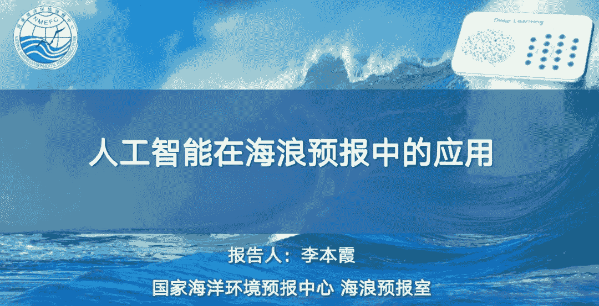

## AI 助力，海浪智能预报已成行业发展趋势之一

**我**国是全球海浪灾害较为严重的国家之一，海浪预报在维护海上活动安全、促进经济发展和保护海洋环境方面发挥着不可或缺的作用。例如，在海上安全方面，海浪预报能够帮助渔民规避恶劣海况，确保海上作业的安全；对滨海旅游而言，海浪预报能够提前警示游客，避免在危险海域发生事故；在海洋能源开发领域，其为海上风电和潮汐能设施的设计和维护提供了重要参考。

中国的海浪预报始于 1965 年，最初主要依赖于经验统计预报。而后，随着海外数值预报模式的引进和我国自主模式的开发，我们逐步建立了覆盖中国近海及西太平洋、浴场海浪业务化数值预报系统。进一步地，人机交互平台和海洋智能网格预报技术也日益成熟。

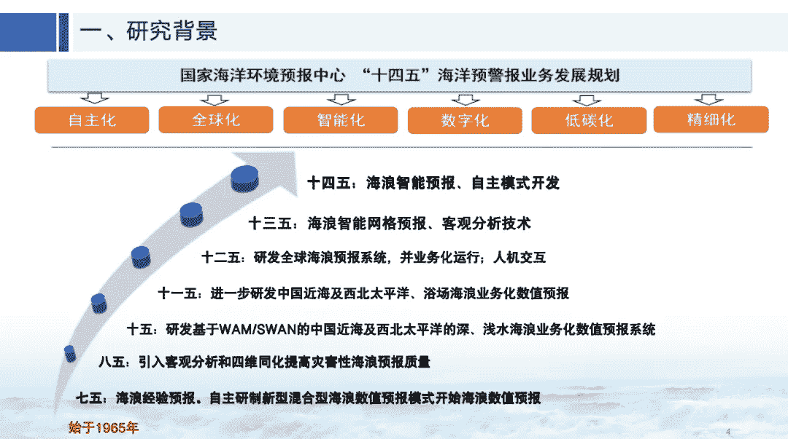

从预报技术的发展来看，目前海浪的数值预报模式仍然是主流。然而，面对沿海地区的台风灾害时，由于台风路径的不确定性，台风路径和强度预报需要快速更新，这要求海浪预报能够迅速响应这些变化。但海浪数值预报模式需要经过人工经验订正、人机平台交互、产品发布等流程，无法快速响应需求。此外，其高计算成本也是一大约束。

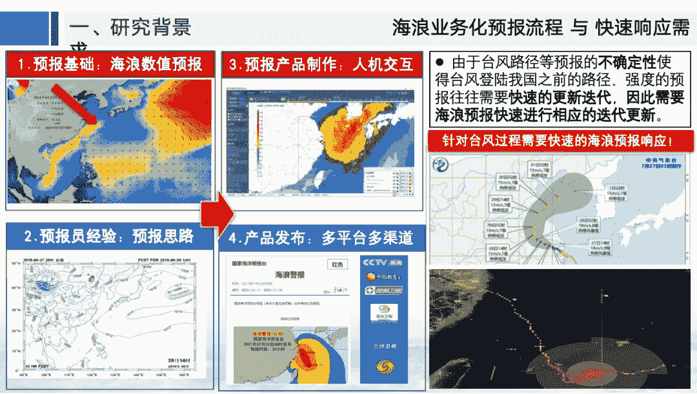

近年来，随着人工智能和算力技术的不断进步，智能预报日益成熟，此外，过去**的海浪数值预报积累了大量的训练数据**，也为海浪智能预报的发展提供了重要的基础支撑。在这种情况下，海浪智能预报以其用时短、简单便捷、预测精度高的特点脱颖而出。

## 海浪智能预报实践，1 分钟即可完成 72-96 小时的预报

智能预报技术主要利用深度学习方法来模拟数值和人工经验预报过程，进而建立海浪要素智能预报模型，并结合云计算与边缘计算技术，构建轻量化快速预报系统。

海浪智能预报可以序列化并行输出海浪各时次预报结果。与传统物理模型相同，可以直接利用 T(0-m) 至 T(0+n )时刻的风场序列，来预测 T(1 )至 T(0+n )时刻的浪场序列。

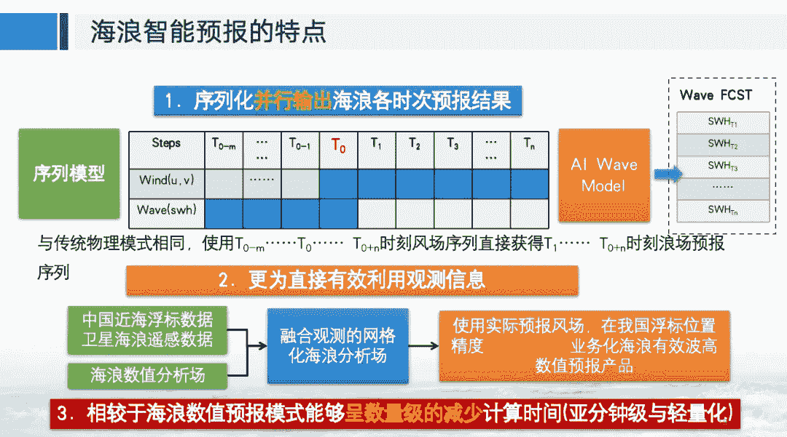

其次，海浪智能预报能够更直接有效地利用观测信息，比如，将中国近海浮标数据、卫星海浪遥感数据等观测数据融合到海浪数值分析场中，这种订正技术可以提高用于训练的分析场精度，进而提高预报结果。

**最**后，相较于海浪数值预报模式，海浪智能预报能够显著减少计算时间，仅需 1 分钟即可完成 72-96 小时的预报。

## **订正训练数据，提升海浪预报精度**

**在**构建海浪智能预报产品方面，李本霞提到，其团队曾开发了一套中国近海及西北太平洋海浪智能预报产品。所用训练数据如下图所示，主要使用了欧洲中期天气预报中心 (ECMWF) 发布的第五代大气再分析数据 ERA5、美国国家环境预测中心 (NCEP) 发布的全球气候再分析数据 ，以及欧洲中期天气预报中心的 (ECMWF) 海浪分析场数据、国家海洋环境预报中心 (NMEFC) 自主研制的海浪分析场数据等。

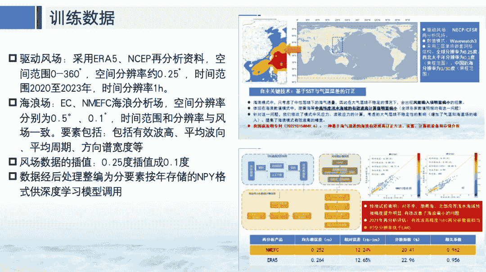

值**得**注意的是，在海浪训练数据研制过程中，该团队特别关注了在大气层结不稳定的情况下，风能输入项可能会出现明显偏小的现象，自主发展了一种基于海气温差的海浪有效波高订正方法，可以显著提升海浪模拟精度，改善浅水海域海浪预报偏小的问题。

具体而言，研究人员沿中国近海从北向南选择了数十个近海业务化海浪观测浮标，并融合北印度洋区域的卫星数据进行订正，将观测数据通过最优插值融合进入海浪数值分析场中。

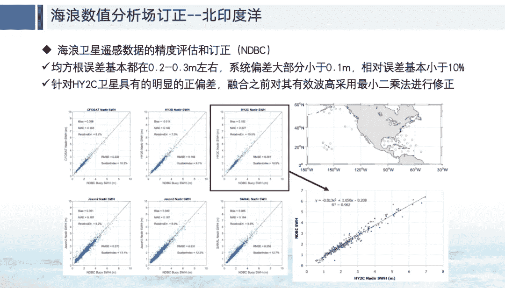

在具体应用中，研究人员还对海洋二号 C 星等有明显系**统偏差的数据进行了融合场订正。结果显示，融合场在系统偏差、均方根误**差、相对误差以及 Scatter Index 方面，都在全波高内有了明显的改善，具有较高实时性，可提升数值模式场的精度。

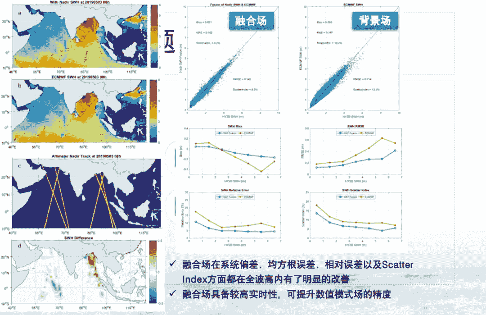

## 首个业务化运行的海浪智能预报系统问世，已通过专家评审

基**于上述数据，李本霞团队用深度学习方法 Visi**on Transformer 等开发了一套中国近海及西北太平洋海浪智能预报系统。这是我国首个投入业务化运行的海浪智能预报系统，已于 2022 年 6 月通过专家评审。

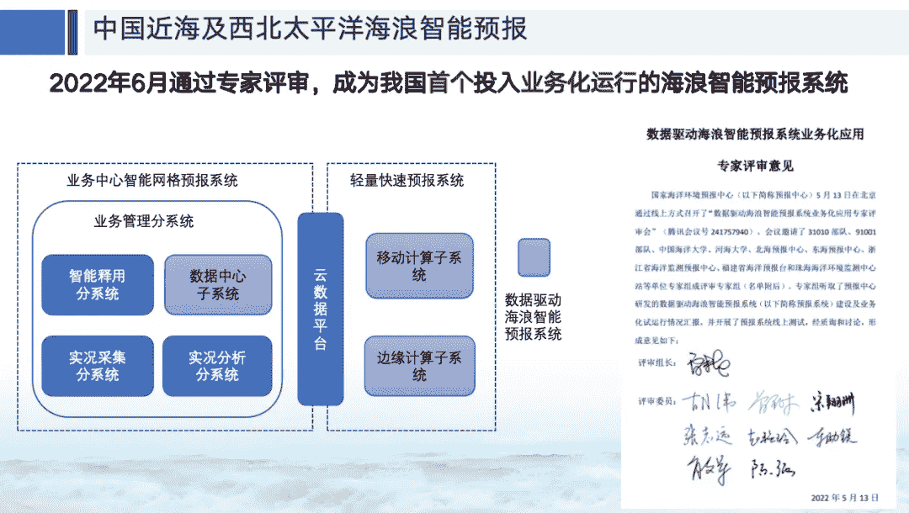

值得一**提的是，Vision **Transformer 是一种专门处理序列数据的神经网络架构，作为当前领先的深度学习架构之一，可以捕捉长距离的依赖关系，解决传统 RNN 在处理长序列时的难题。它还可以同时处理序列中的所有元素，从而支持高度并行化的计算，模型训练速度显著加快。

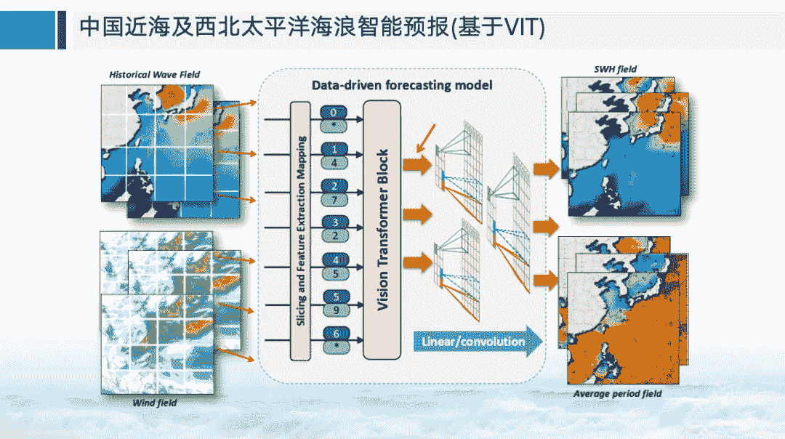

**如下图所示，在海浪平均周期预报中，从**空间分布特征来看，这套海浪 AI 智能预报与欧洲 ECMWF 业务化海浪数值预报结果非常一致。

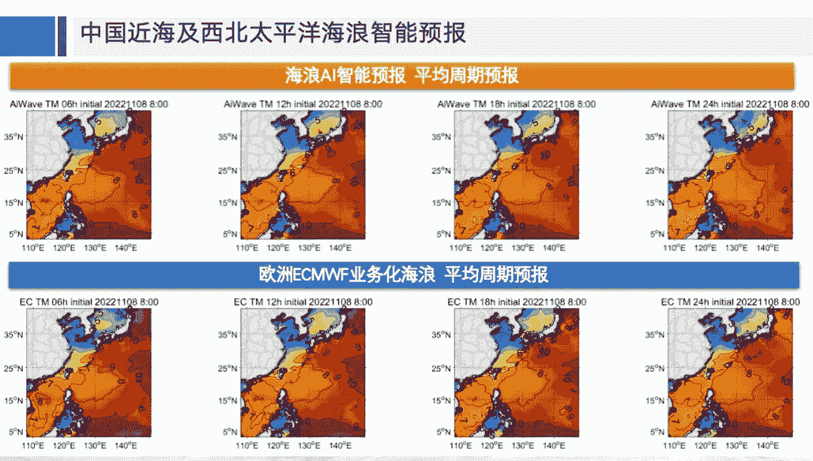

在误差随预报时效变化方面，海浪 AI 智能预报与 ECMWF 业务化海浪数值预报精度相当。如下图所示，将观测数据进行融合来订正训练数据，海浪预测的效果更好（黄线），这说明对观测数据进行融合订正在海浪预测中是必要的。

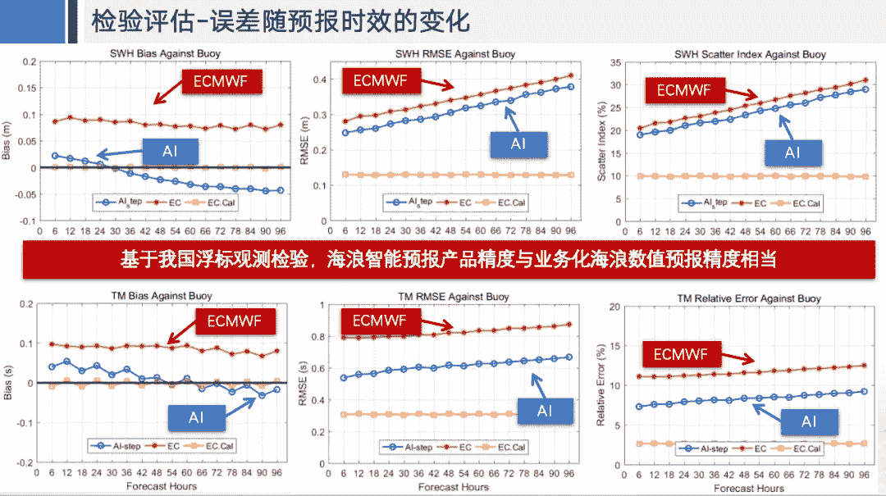

此外，在误差随波高变化方面，海浪 AI 智能预报在有效波高 4m 以上的预报结果明显偏小。

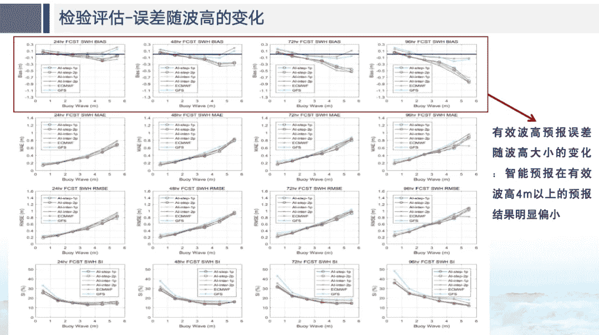

为了改善台风等导致的强海况过程预报偏小的问题，研究团队精心挑选了 2**0**21 至 2023 年中国近海台风过程的风场、浪场构建学习样本。研究结果表明，增加台风过程的学习样本可以提高智能模型对大浪过程的预报精度，台风浪越大，提高的精度越多，且对台风中心附近大浪区的预报更平滑。

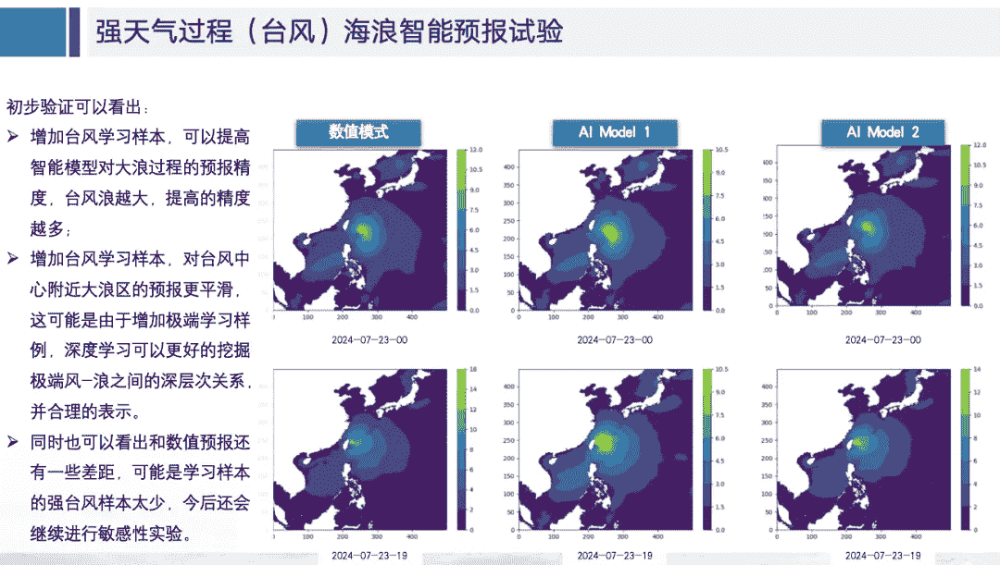

## 硕果累累，海浪智能预报迎来崭新时代

**此**外，研究团队针对印度洋南部和北部浪场分别由风浪和涌浪主导的特点，研制了一种基于状态强迫耦合网络 (StateForce Coupled Network, SFCN) 的海浪智能预报模型。

该模型采用双分支结构，通过不同分支处理风场和浪场，通过网络高层语义实现风场和浪场的松弛耦合，避免了虚假风浪耦合，同时解决了传统卷积长短期记忆网络对风浪关系较弱区域预报能力不理想的问题。采用 HY-2B 卫星沿轨有效波高进行检验，结果发现，SFCN 计算效率大幅提升，预报结果与数值预报高度接近。

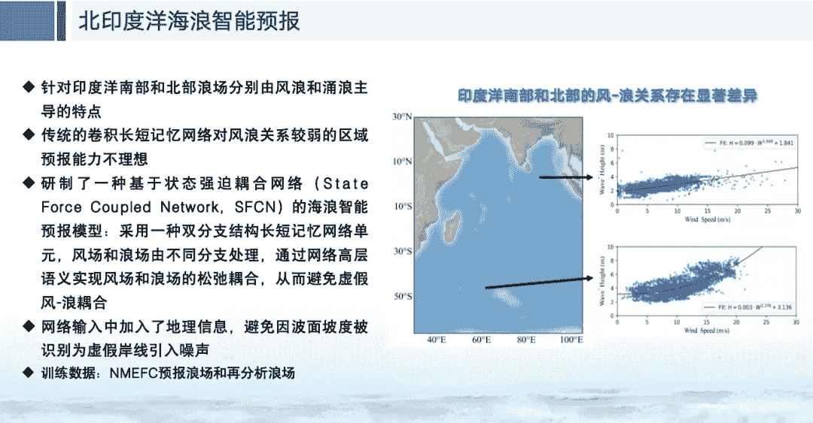

值得注意的是，基于这套模型建立的船载轻量化预报系统已经应用于 2023 年蛟龙号西北太平洋科学考察，以及中国第 13 次北极科学考察的随船预报保障中，实现了业务化推广应用。

目前，研究团队正在基于超分模型进行全球海浪智能预报系统的探索。训练数据量和算力随着精度的增加呈指数级增长，但受显卡显存及训练时间的限制，直接训练全球高分辨率模型较为困难。因此，研究团队计划分两步进行：首先，利用 Swin Transformer 建立一个粗分辨率的全球模型，进行粗分辨率的特征挖掘；其次，建立一个超分模型，补充细节信息，实现高分辨率的全球海浪预报模型。预报检验结果如下图所示：

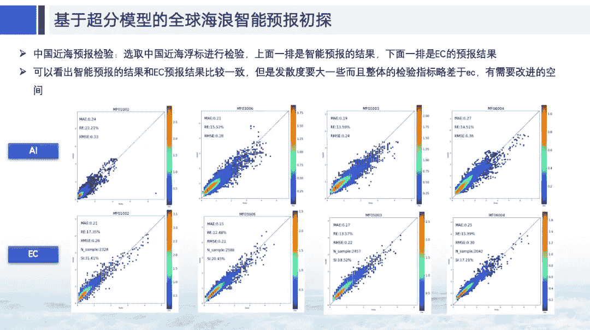

**最后，李本霞重点介绍了团队研发的**基于机器学习的海浪数值预报滚动订正技术。该技术通过引入真值观测序列，使神经网络能够获取到已经发生的预报数值与真实海浪观测的差异信息，随着时间的推进，神经网络能够自适应地调整未来预报的数值，利用变化的观测序列完成海浪滚动预报订正，特别适用于现场有实时观测工程点（如海上风电场）的高精度海浪预报。

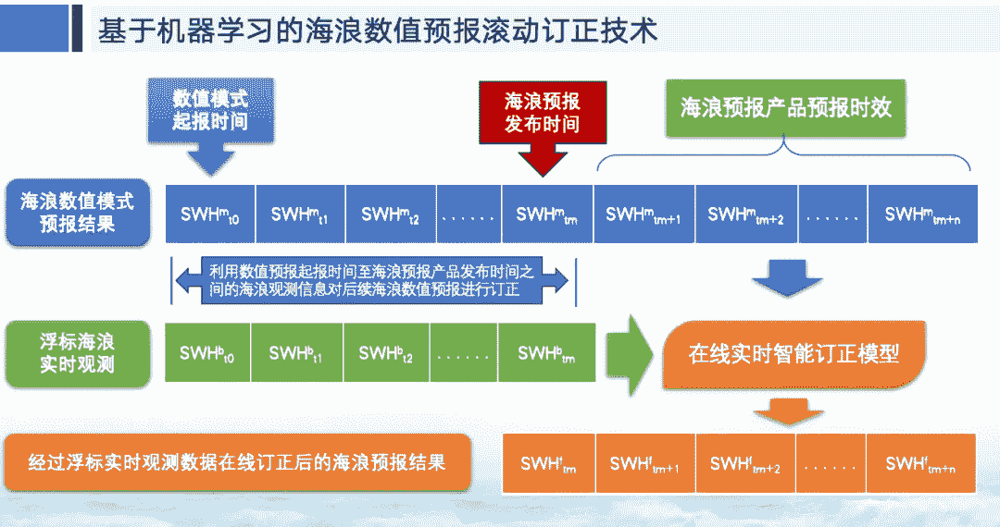

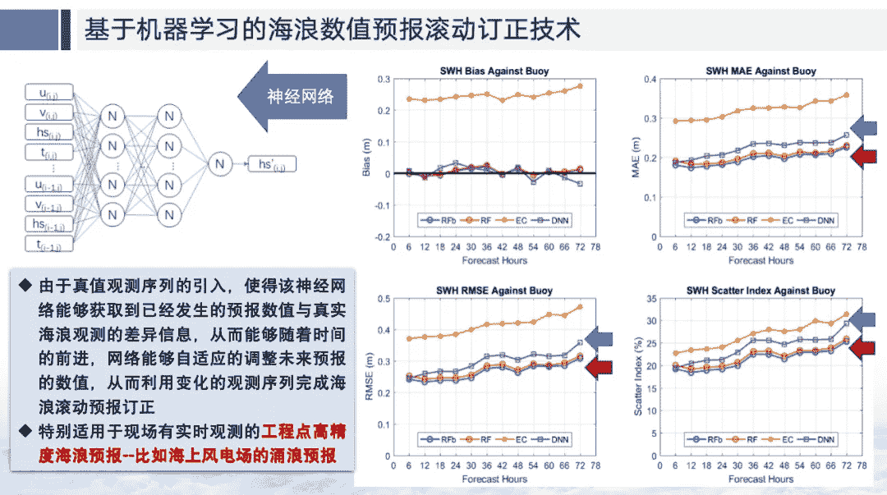

人工智能海洋学作为一个新兴的交叉学科，结合了海洋科学、人工智能、大气科学和计算机科学等领域的知识和技术，拥有广阔的发展**前景。虽然目前作为数据驱动的 AI 模**型还离不开传统数值模式，模型的训练和预测都需要基于数值模式以及数值模式结果的精度，但在未来，AI 预报和传统数值预报的有机结合将会是预报技术取得突破的有效途径。

## **关于李本霞**

李本霞博士现任国家海洋环境预报中心海浪预报室主任，担任中文核心期刊《海洋预报》和《海洋科学前沿》编委，同时也是中国海洋大学兼职硕士导师，国家自然科学基金委员会评审专家，教育部学位论文评审专家，以及全国海洋灾害风险普查专家。

**她**的研究方向是海浪智能预报、海浪数值模拟及预警报技术、海洋灾害风险评估与区划、气候变化应对等方面的业务及研究工作。

值得关注的是，李本霞曾任公共安全科学技术学会预测预警专业工作委员会副主任委员，主持完成国家重点研发计划课题、海洋公益性行业科研专项、全球变化与海气相互作用专项等国家和省部级科研项目 10 余项。作为主要负责人完成国家重大工程「港珠澳大桥岛隧工程施工海洋环境预报保障」、「深中通道预报保障」、「南海可燃冰试开采海洋环境预报保障」等多个任务的预报保障工作。主编发布国家标准 3 个，行业标准 3 个，发明专利 3 项，译著 1 部，在国内外核心期刊上发表学术论文 20 余篇。