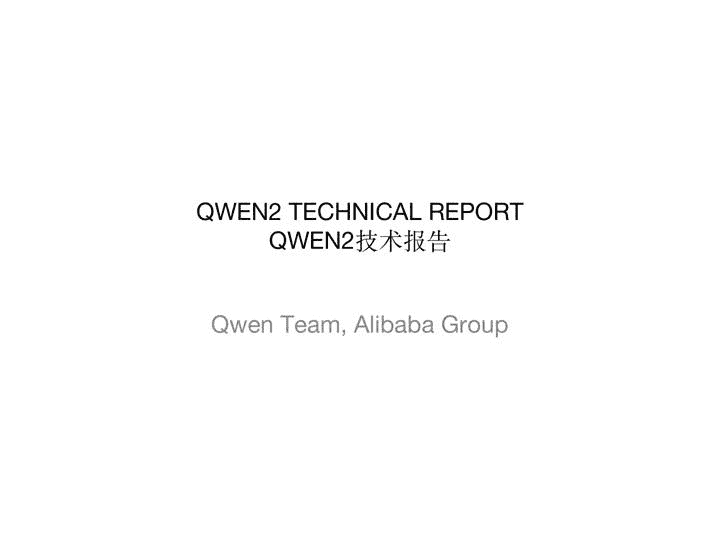

# AI读论文之-国内LLMQwen系列qwen2

> 来源：[https://agijuejin.feishu.cn/docx/C0Hpd2RPBoDMi5xH7r7cIFU6n3d](https://agijuejin.feishu.cn/docx/C0Hpd2RPBoDMi5xH7r7cIFU6n3d)

# 👀快看👀

> **作者：**[**bibilizheng**](https://space.bilibili.com/355575530)

> **原文链接：**AI读论文之-国内LLMQwen系列qwen2

---

# ⚡️摘要·作者有话说⚡️

> 主要介绍了国内 ALI 巴巴团队开发的大型语言和多模态模型套件 Qwen2 系列的技术报告，详细阐述了该系列模型的架构、训练过程、性能评估以及在多语言处理和社区创新方面的应用潜力。

---

# 🤖分集🤖

# AI读论文之-国内LLMQwen系列qwen1

介绍了阿里巴巴 KN 团队开发的 Qwen2 系列模型。包括基础和指令调优模型，核心算法有独特架构及训练过程。数据实验展示优越性能，性能评估体现优势，也指出安全性局限，尤其处理色情内容有挑战及未来改进方向。

[AI读论文之-国内LLMQwen系列qwen2.mp4](https://internal-api-drive-stream.feishu.cn/space/api/box/stream/download/all/IxjRbCfnbobqiAx8PUUcciM2nsf)

---

# ✏️课代表✏️

+   大型语言模型的重要性：随着 LMS 的兴起，Qwen2系列应运而生，旨在提供更强大的语言理解和生成能力。

>

+   多语言和多模态能力的提升：Qwen2系列模型展现了在多语言处理和社区创新方面的潜力，尤其是在语言理解和生成基准测试中的表现。

>

+   核心算法的创新：通过密集模型和专家混合模型的设计，以及分组查询注意力和双快注意力机制的应用，提升了模型的处理能力和推理吞吐量。

>

+   预训练数据的关键作用：Qwen2模型使用了高质量的大规模多语言数据集，支持约 30 种语言，优化了数据分布，使模型学习到类似人类的学习分布。

>

+   人类反馈的重要性：通过监督微调和基于人类反馈的强化学习，确保模型生成的内容符合人类价值观，提升了指令跟随能力。

>

+   性能评估的全面性：Qwen2系列在多个基准测试中进行了全面评估，包括语言理解、编码和数学等领域的评估。

>

+   模型的局限性和未来方向：尽管 Qwen2 系列在安全评估中表现优于竞争对手，但仍存在改进空间，特别是在处理色情内容方面，未来的研究应集中在提高模型对复杂内容的识别能力。