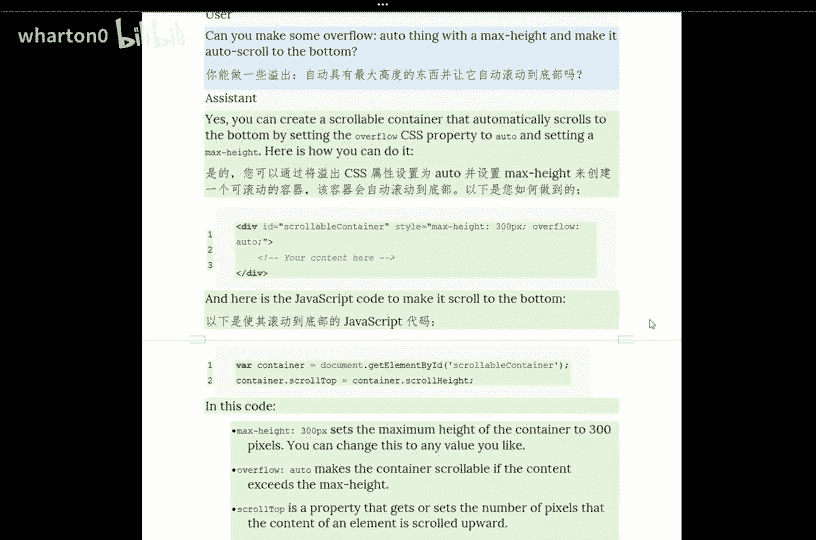

# 我怎么使用AI（三）

> 来源：[https://agijuejin.feishu.cn/docx/RyDRdqn5UoSNBmxMAricOkKCnZb](https://agijuejin.feishu.cn/docx/RyDRdqn5UoSNBmxMAricOkKCnZb)

# 👀快看👀

> **作者：**[**wharton0**](https://space.bilibili.com/35891473)

> **原文链接：**[**我怎么使用AI（三）**](https://www.bilibili.com/video/BV19VWseCELr/?spm_id_from=333.999.0.0&vd_source=5a54577a6bc7d876f6e5df88640c8e9f)

---

# ⚡️摘要⚡️

> 如何使用AI来创建一个可以自动滚动的容器，并详细讲解了相关的CSS和Javascript代码。视频还提到了如何使用伪元素和number pi来优化代码，以及如何使用skin learn来计算对数损失并进行优化。此外，视频还介绍了如何使用自定义编码器来格式化浮点数输出，并提到了一些注意事项和问题解决方法。整个视频内容详细、全面，适合初学者学习。

---

# 🤖分集🤖

# 我怎么使用AI（三）

介绍使用 AI 创建自动滚动容器，讲解相关 CSS 和 Javascript 代码，提及用伪元素、number pi 优化，利用 skin learn 计算对数损失，还介绍自定义编码器格式化浮点数输出及注意事项，内容详细全面适合初学者。

[我怎么使用AI（三）.mp4](https://internal-api-drive-stream.feishu.cn/space/api/box/stream/download/all/KYnMb8uxuoExVgxb3uQcFgbZnag)

---

# ✏️课代表✏️

> 一、创建滚动容器及效果实现

> 视频作者介绍使用 AI 设置 CSS 属性如 padding、overflow 等创建可滚动容器，通过 JavaScript 让其内容滚动到底部，提供具体代码，用伪元素设置边框及实现特定效果。

>

> 二、代码优化与处理特定情况

> 讨论用 skin learn 计算对数损失，处理用户未完成问题，计算损失向量，用 number pi 优化，调整速度，用自定义 JSON 编码器控制浮点数精度。

>

> 三、AI 的作用与新技术学习

> 作者分享用 AI 编写程序经历，强调其可助解决难题提高效率，以 AI 为导师学习新框架工具如 Docker，通过实例展示 Docker 创建隔离开发环境。

>

> 四、使用 Docker 及镜像选择

> 详细介绍用 Docker 运行测试程序步骤，对比 Alpine 和 Ubuntu 镜像特点，总结选择合适镜像构建 Python 开发环境方法。