# 哈佛、MIT 团队提出「精度感知 Scaling Laws」｜大模型论文周报（11.11-11.15）

> 来源：[https://agijuejin.feishu.cn/docx/HUi3dQLcNozPIYxmBBlcXcRMnib](https://agijuejin.feishu.cn/docx/HUi3dQLcNozPIYxmBBlcXcRMnib)

### 11.15

MagicQuill：智能交互式图像编辑系统

图像编辑涉及各种复杂的任务，需要高效、精确的操作技术。在这项工作中，来自香港科技大学和蚂蚁集团的研究团队提出了 MagicQuill，这是一个能够快速实现创意想法的集成图像编辑系统。该系统拥有精简但功能强大的界面，只需极少的输入就能进行清晰的编辑操作（如插入元素、擦除对象、更改颜色）。这些交互由多模态大语言模型（MLLM）监控，实时预测编辑意图，从而避免了明确的提示输入。最后，他们应用了强大的扩散先验，并通过精心学习的双分支插件模块进行增强，以精确控制的方式处理编辑请求。实验结果证明了 MagicQuill 在实现高质量图像编辑方面的有效性。

论文链接：

https://arxiv.org/abs/2411.09703

项目地址：

https://magicquill.art/demo/

[magicquill.mp4](https://internal-api-drive-stream.feishu.cn/space/api/box/stream/download/all/N9SHbigNeob1uyxbY31cg1cXn0c)

> 想要第一时间获取每日最新大模型热门论文？

> 扫描下方二维码申请入群，请务必备注「姓名+职业+公司/学校」，否则不予通过。

> ps：我们会持续分享日报、周报、月报，敬请期待～

人工智能驱动的材料逆向设计：过去、现在和未来

材料的结构及其相应的性能本质上是晶格、电荷、自旋、对称性和拓扑等多个自由度复杂相互作用的结果。这给材料的逆向设计方法带来了巨大挑战。长期以来，人类通过大量实验探索新材料，并提出相应的理论体系来预测新材料的性能和结构。随着计算能力的提高，研究人员逐渐发展出各种电子结构计算方法，尤其是基于密度泛函理论的电子结构计算方法，以及高通量计算方法。

近年来，计算机科学领域人工智能技术的飞速发展使人们能够有效地表征材料性能与结构之间的隐含关联，从而为功能材料的逆向设计开辟了有效的范式。基于生成模型和判别模型的材料逆向设计取得了重大进展，引起了研究人员的广泛关注。

考虑到这一快速的技术进步，中国人民大学团队在本调查中通过介绍背景、主要发现和主流技术发展路线，回顾了人工智能驱动的材料逆向设计的最新进展。此外，他们还总结了未来发展方向的遗留问题。本调查报告提供了人工智能驱动的材料逆向设计的最新概况，可作为研究人员的有用资源。

论文链接：

https://arxiv.org/abs/2411.09429

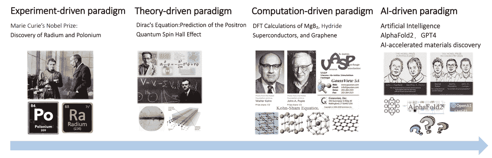

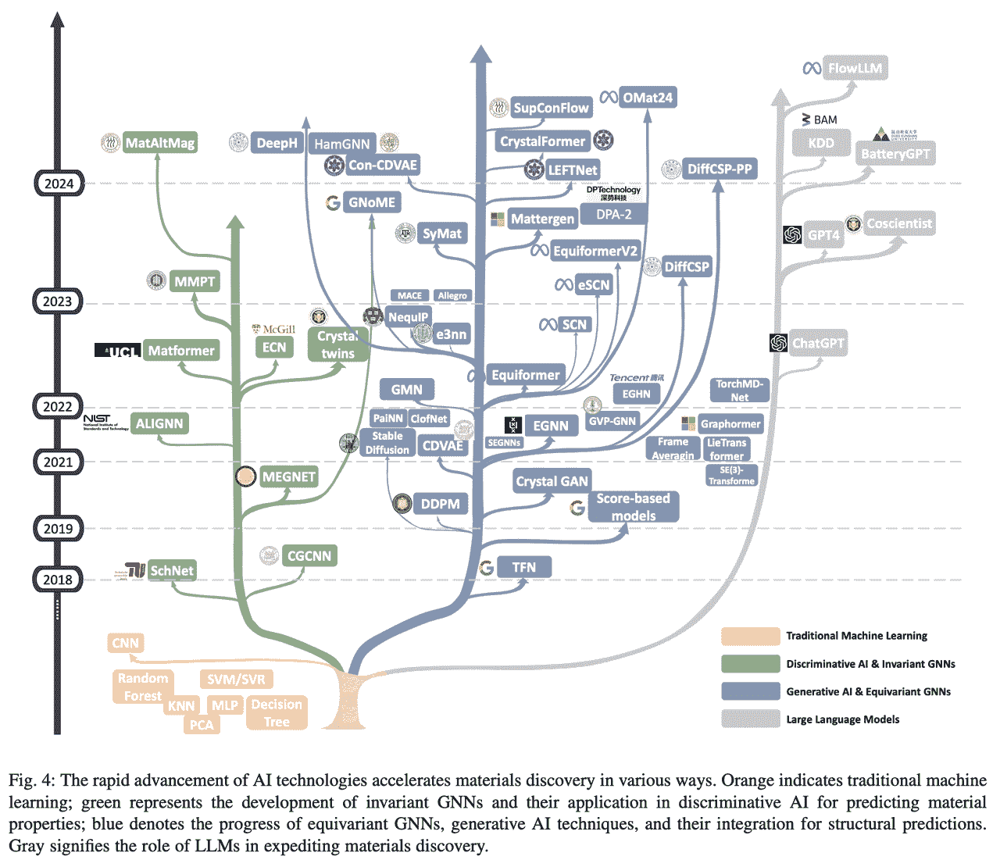

FinVision：用于股市预测的多智能体框架

金融交易一直是一项具有挑战性的任务，因为它需要整合来自各种模态的海量数据。传统的深度学习和强化学习方法需要大量的训练数据，通常需要将各种数据类型编码成数字格式供模型输入，这限制了模型行为的可解释性。最近，基于 LLM 的智能体在处理多模态数据方面取得了显著进步，使它们能够执行复杂的多步骤决策任务，同时还能深入了解它们的思维过程。

在这项工作中，来自伊利诺伊大学芝加哥分校的研究团队提出了一种专为金融交易任务设计的多模态多智能体系统。他们的框架采用了一个基于 LLM 的专业智能体团队，每个智能体都擅长处理和解释各种形式的金融数据，如文本新闻报道、蜡烛图（K 线图）和交易信号图。该方法的一个主要特点是集成了反思模块，对历史交易信号及其结果进行分析。这一反思过程有助于增强系统对未来交易情景的决策能力。此外，消融研究表明，视觉反射模块在增强该框架的决策能力方面发挥着至关重要的作用。

论文链接：

https://arxiv.org/abs/2411.08899

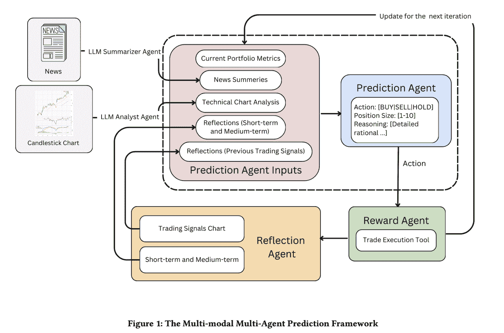

综述：基于 LLM 的智能体的安全、隐私和道德威胁

随着大语言模型（LLMs）的不断发展，基于 transformer 的模型在众多自然语言处理（NLP）任务中取得了突破性进展，从而出现了一系列使用 LLMs 作为控制中枢的智能体。虽然 LLM 在各种任务中取得了成功，但它们也面临着许多安全和隐私威胁，而这些威胁在智能体场景中变得更加严重。为了提高基于 LLM 的应用的可靠性，出现了一系列从不同角度评估和减轻这些风险的研究。

为了帮助研究人员全面了解各种风险，来自浙江大学的研究团队及其合作者收集并分析了这些智能体所面临的不同威胁。为了应对以往分类法在处理跨模块和跨阶段威胁方面的挑战，他们提出了一种基于来源和影响的新型分类框架。此外，他们还确定了基于 LLM 的智能体的六个关键特征，并在此基础上总结了当前的研究进展，分析了其局限性。 随后，他们选择了四个具有代表性的智能体作为案例，分析它们在实际使用中可能面临的风险。最后，基于上述分析，他们分别从数据、方法和政策的角度提出了未来的研究方向。

论文链接：

https://arxiv.org/abs/2411.09523

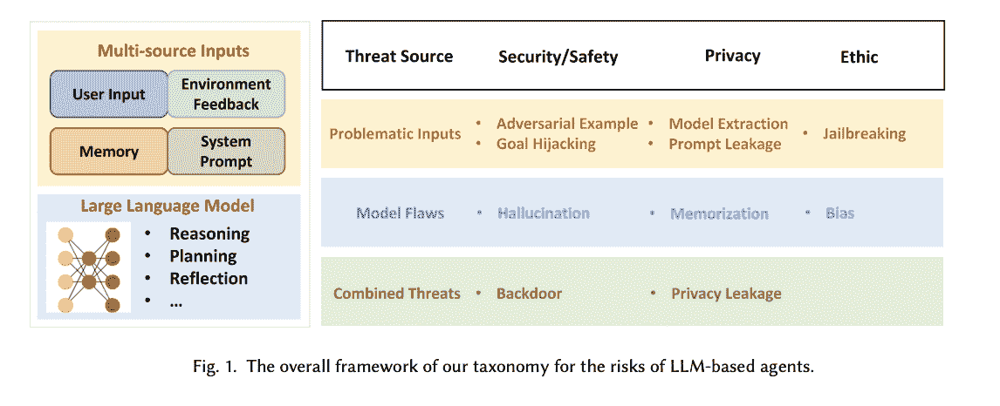

苹果提出切分交叉熵 CCE：减少大词汇量语言模型的损失

随着语言模型越来越大，其词汇量也越来越大。这使得大语言模型（LLM）在训练过程中的内存占用不成比例地转移到了单层上：损失计算中的交叉熵。交叉熵会建立一个对数矩阵，其中包含每一对输入 token 和词汇项的条目，对于小模型而言，其消耗的内存比 LLM 其他部分的总和还要多出一个数量级。

在这项工作中，苹果团队提出的切分交叉熵（CCE）是一种计算交叉熵损失的方法，无需将所有 token 的对数具体化到全局内存中。相反，CCE 只计算正确 token 的对数，并对所有对数的 log-sum-exp 进行快速评估。他们实施了一个自定义内核，在闪存中对词汇进行矩阵乘法和 log-sum-exp 缩减，使得交叉熵计算的全局内存消耗可以忽略不计。这将产生显著效果。

以 Gemma 2 (2B) 模型为例，CCE 将损失计算的内存占用从 24 GB 减少到 1 MB，分类器头的总训练时间内存消耗从 28 GB 减少到 1 GB。为了提高 CCE 的吞吐量，他们利用 softmax 固有的稀疏性，建议跳过梯度计算中对梯度贡献微不足道（即低于数值精度）的元素。实验证明，在不牺牲训练速度或收敛性的情况下，可以显著减少内存消耗。

论文标题：

https://arxiv.org/abs/2411.09009

GitHub 地址：

https://github.com/apple/ml-cross-entropy

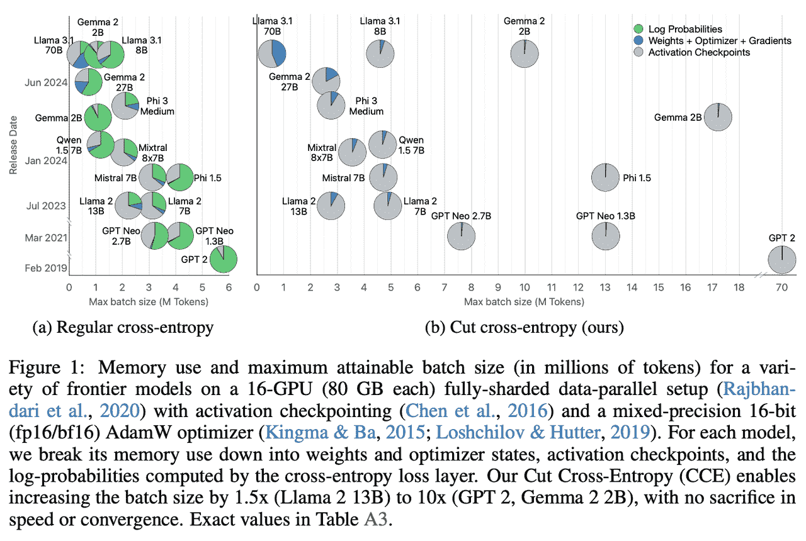

### 11.14

FPO：使用稀疏特征级约束进行直接偏好优化

大语言模型（LLM）与人类偏好的对齐仍然是一项关键挑战。虽然像从基于人类反馈的强化学习（RLHF）和直接偏好优化（DPO）这样的后训练技术已经取得了显著的成功，但它们往往会带来计算效率低下和训练不稳定的问题。

在这项工作中，来自西湖大学和香港理工大学的研究团队及其合作者提出了特征约束偏好优化（FPO），旨在简化对齐过程，同时确保稳定性。FPO 利用预先训练好的稀疏自动编码器（SAE），并提出特征约束，从而实现高效的稀疏强化对齐。

他们的方法通过使用在训练有素的稀疏自动编码器中激活的稀疏特征来提高效率，并通过使用特征离线参考来提高顺序 KL 发散的质量。在基准数据集上的实验结果表明，与 SOTA 的基线方法相比，FPO 的绝对胜率提高了 5.08%，而计算成本却大大降低，这使它成为高效、可控的 LLM 对齐的理想解决方案。

论文链接：

https://arxiv.org/abs/2411.07618

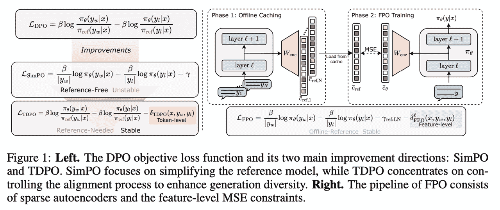

Sealong：大语言模型可在长上下文推理中自我提高

大语言模型（LLM）在处理长上下文方面取得了长足的进步，但在长上下文推理方面仍很困难。现有的方法通常涉及用合成数据对 LLM 进行微调，这依赖于人类专家或 GPT-4 等高级模型的注释，从而限制了进一步的发展。

为了解决这个问题，来自香港中文大学的研究团队及其合作者研究了 LLM 在长上下文推理中自我提高的潜力，并提出了一种专门为此设计的方法——Sealong。这种方法简单明了：他们对每个问题的多个输出进行采样，用最小贝叶斯风险（Minimum Bayes Risk）对它们进行评分，然后根据这些输出应用有监督的微调或偏好优化。

在几个领先的 LLM 上进行的广泛实验证明了 Sealong 的有效性，Llama-3.1-8B-Instruct 的绝对值提高了4.2分。此外，与之前依赖于人类专家或高级模型生成的数据的方法相比，Sealong 实现了更优越的性能。

论文链接：

https://arxiv.org/abs/2411.08147

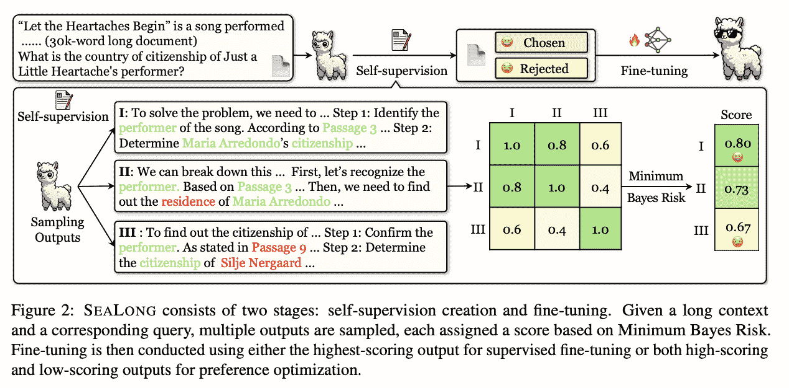

国防科技大学推出 AI 材料科学家 MatPilot

人工智能（AI）尤其是大语言模型（LLM）的快速发展为材料科学研究带来了前所未有的机遇。国防科技大学研究团队提出并开发了名为 MatPilot 的人工智能材料科学家，它在发现新材料方面表现出了令人鼓舞的能力。MatPilot 的核心优势在于其自然语言交互式人机协作，通过多智能体系统增强人类科学家团队的研究能力。

MatPilot 将人类独特的认知能力、丰富的经验积累和持续的好奇心与 AI 智能体的高级抽象、复杂知识存储和高维信息处理能力融为一体。它可以生成科学假设和实验方案，并采用预测模型和优化算法来驱动自动实验平台进行实验。

论文链接：

https://arxiv.org/abs/2411.08063

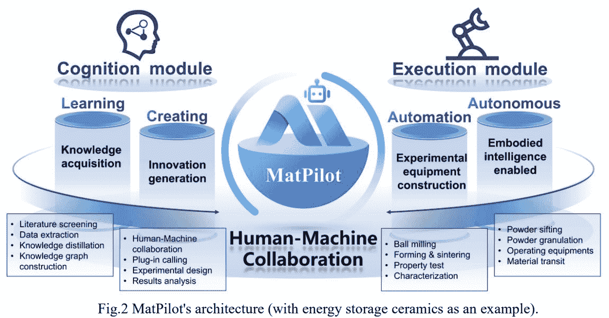

从安全性视角分析世界模型

随着大语言模型（LLM）的普及，世界模型（WM）的概念最近在人工智能（AI）研究界引起了广泛关注，尤其是在 AI 智能体方面。可以说，LLM 正逐渐成为构建 AI 智能体系统的重要基础。世界模型旨在帮助智能体预测环境状态的未来演变，或帮助智能体填补缺失的信息，以便其规划行动并安全行事。世界模型的安全特性对其在关键应用中的有效使用起着关键作用。

在这项工作中，来自 RAMS Lab 的研究团队及其合作者基于全面的调查和设想的应用领域，从可信性和安全性的角度回顾和分析了当前 SOTA 世界模型的影响。他们对 SOTA 世界模型进行了深入分析，并推导出技术研究挑战及其影响，从而呼吁研究界合作提高世界模型的安全性和可信度。

论文链接：

https://arxiv.org/abs/2411.07690

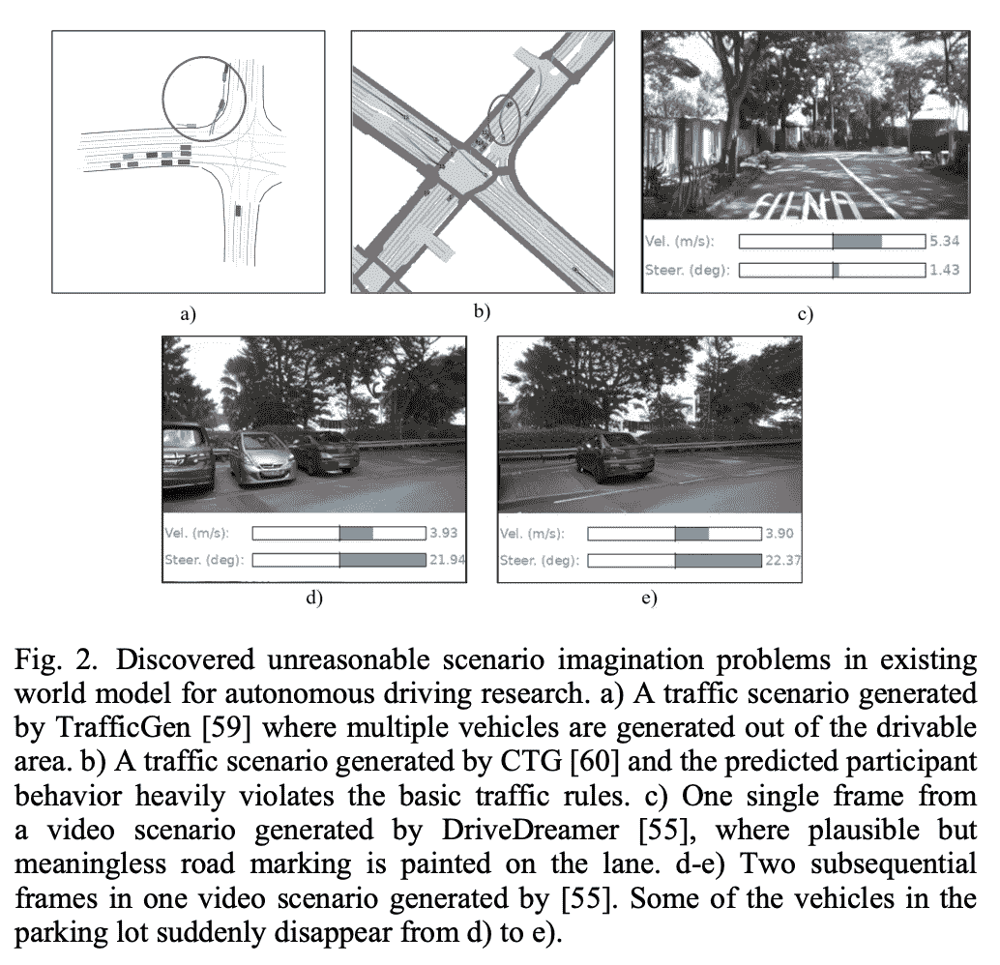

为 RAG 实现最佳搜索和检索

检索增强生成（RAG）是一种很有前途的方法，可以解决与大语言模型（LLM）相关的一些记忆相关挑战。两个独立的系统构成了 RAG 管道，即检索器和阅读器，而这两个系统对下游任务性能的影响还不十分清楚。

在此，来自科罗拉多大学博尔德分校和英特尔实验室的研究团队致力于了解检索器如何为常见任务（如 QA）的 RAG 管道进行优化。他们的实验重点是 QA 和归因 QA 的检索和 RAG 性能之间的关系，并揭示了一些对开发高性能 RAG 管道的从业人员有用的见解。例如，降低搜索精度对 RAG 性能影响不大，但却有可能提高检索速度和内存效率。

论文链接：

https://arxiv.org/abs/2411.07396

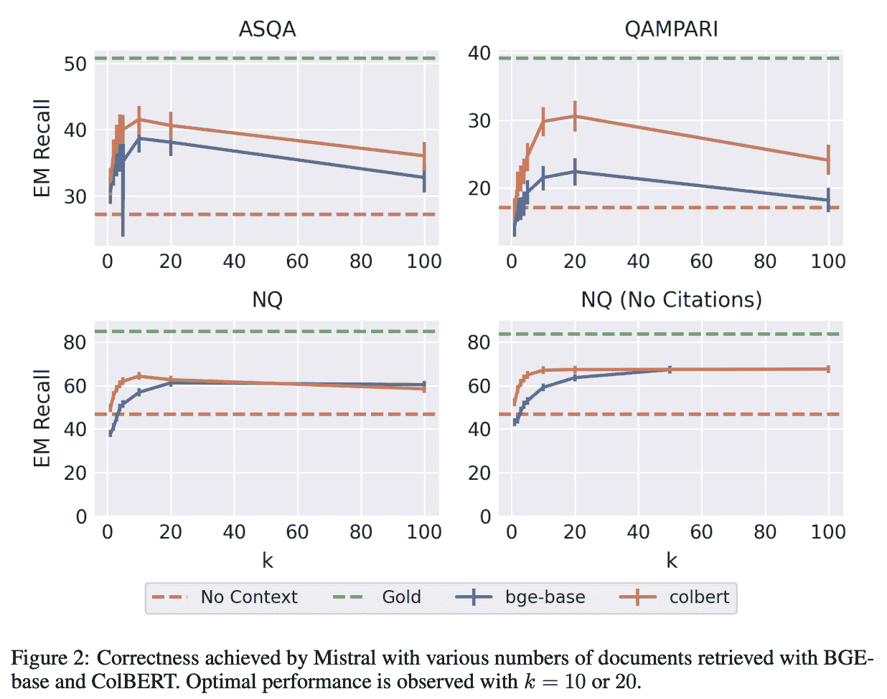

Anthropic 提出 LLM 越狱缓解新方法

随着大语言模型（LLM）越来越强大，确保其安全以防滥用变得至关重要。虽然研究人员一直专注于开发强大的防御功能，但还没有一种方法能完全抵御攻击。

来自 Anthropic 的研究团队及其合作者提出了另一种方法：他们不追求完美的对抗鲁棒性，而是开发快速响应技术，以便在观察到少量攻击后阻止整类越狱。为了研究这种情况，他们提出了 RapidResponseBench（快速响应基准），它是一种基准，用于衡量防御系统在适应少量观察到的示例后对各种越狱策略的鲁棒性。他们评估了五种快速反应方法，所有这些方法都使用了越狱扩散，即自动生成与观察到的示例类似的额外越狱。

他们最强大的方法对输入分类器进行了微调，以阻止增殖越狱，在仅观察到一个越狱策略实例的情况下，对分布内越狱集的攻击成功率降低了 240 倍以上，对分布外越狱集的攻击成功率降低了 15 倍以上。此外，进一步的研究表明，扩散模型的质量和扩散示例的数量对这种防御的有效性起着关键作用。

论文链接：

https://arxiv.org/abs/2411.07494

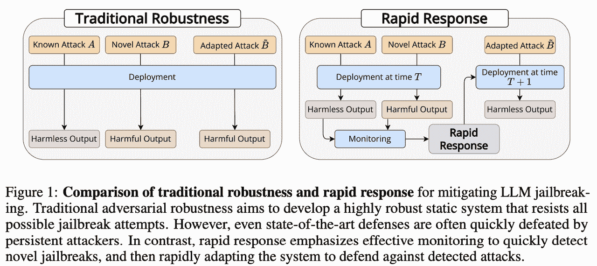

### 11.13

哈佛、MIT 团队提出「精度感知」Scaling Laws；首个金融 LLM 综合双语基准 Golden Touchstone｜大模型日报

哈佛、MIT 团队提出「精度感知 Scaling Laws」

低精度训练和推理会影响语言模型的质量和成本，但目前的 Scaling Laws 并未考虑到这一点。

在这项工作中，来自哈佛大学和麻省理工学院的研究团队及其合作者为训练和推理设计了“精度感知”scaling laws。他们提出，以较低精度进行训练可减少模型的“有效参数数”，从而使他们能够预测低精度训练和训练后量化带来的额外损失。在推理方面，他们发现随着模型在更多数据上进行训练，训练后量化带来的劣化也会增加，最终使额外的预训练数据变得有害。

对于训练，他们的 scaling laws 允许他们预测模型在不同精度下的损失，并表明在较低精度下训练较大的模型可能是计算最优的。他们统一了训练后量化和训练前量化的缩放规律，从而得出了一个单一的函数形式，可以预测在不同精度下训练和推理的损失。他们在超过 465 次预训练运行中进行了拟合，并在多达 26B 个 token 上训练出的高达 1.7B 参数模型规模上验证了我们的预测。

论文链接：

https://arxiv.org/abs/2411.04330

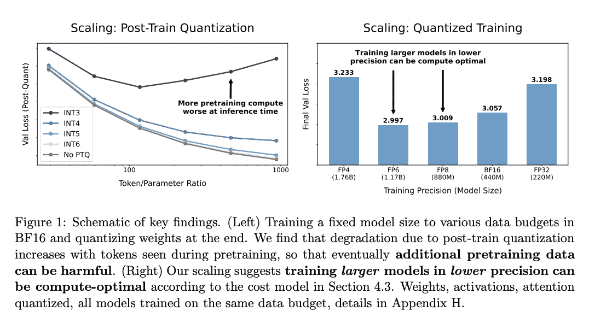

DeepSeek-AI 提出 JanusFlow：将图像理解和生成统一到一个模型中

来自 DeepSeek-AI 的研究团队及其合作者提出了 JanusFlow 框架，可将图像理解和生成统一到一个模型中。JanusFlow 引入了一种极简主义架构，将自回归语言模型与修正流（一种 SOTA 的生成建模方法）相结合。

他们的主要发现表明，修正流可以在大语言模型框架内直接进行训练，无需进行复杂的架构修改。为了进一步提高统一模型的性能，他们采用了两种关键策略：将理解和生成编码器解耦，以及在统一训练期间对齐它们的表现。大量实验表明，JanusFlow 在各自的领域中实现了与专门模型相当或更优异的性能，同时在标准基准测试中明显优于现有的统一方法。

论文链接：

https://arxiv.org/abs/2411.07975

GitHub 地址：

https://github.com/deepseek-ai/Janus

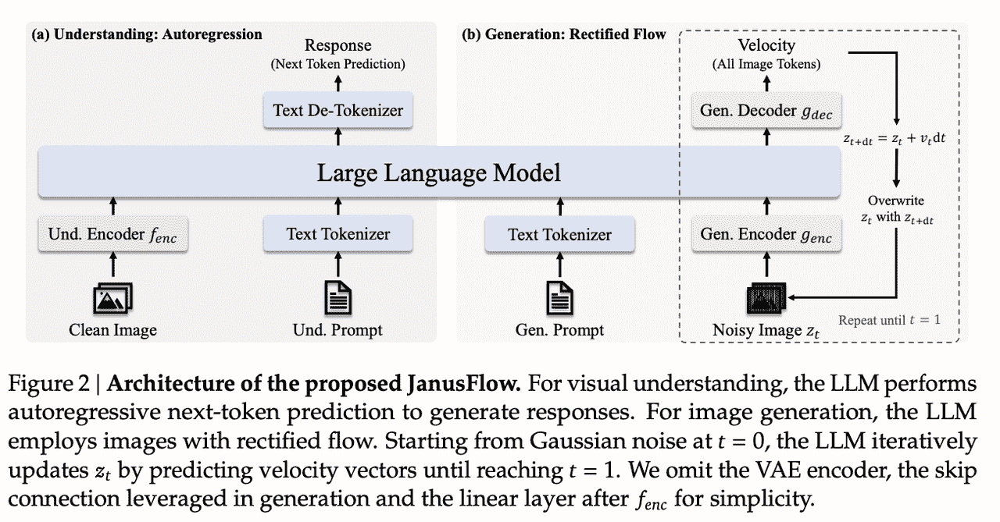

综述：视觉中的自回归模型

自回归模型在自然语言处理（NLP）领域取得了巨大成功。最近，自回归模型又成为计算机视觉领域的一个重要关注点，它们在制作高质量的视觉内容方面表现出色。NLP 中的自回归模型通常在子词 token 上运行。然而，计算机视觉中的表示策略可以在不同层次上变化，如像素级、token 级或尺度级，这反映了与语言的序列结构相比，视觉数据的多样性和层次性。

本综述全面考察了应用于视觉的自回归模型的研究。为了提高来自不同研究背景的研究人员的可读性，来自香港大学和清华大学的研究团队及其合作者首先介绍了视觉中的初步序列表示和建模。接下来，他们根据表示策略将视觉自回归模型的基本框架分为三个一般子类，包括基于像素的模型、基于 token 的模型和基于尺度的模型。然后，他们探讨了自回归模型与其他生成模型之间的相互联系。

此外，他们还对计算机视觉中的自回归模型进行了多方面的分类，包括图像生成、视频生成、三维生成和多模态生成。他们还阐述了自回归模型在不同领域的应用，包括具身人工智能和三维医疗人工智能等新兴领域，并提供了约 250 篇相关参考文献。最后，他们强调了自回归模型目前在视觉领域面临的挑战，并就潜在的研究方向提出了建议。

论文链接：

https://arxiv.org/abs/2411.05902

GitHub 地址：

https://github.com/ChaofanTao/Autoregressive-Models-in-Vision-Survey

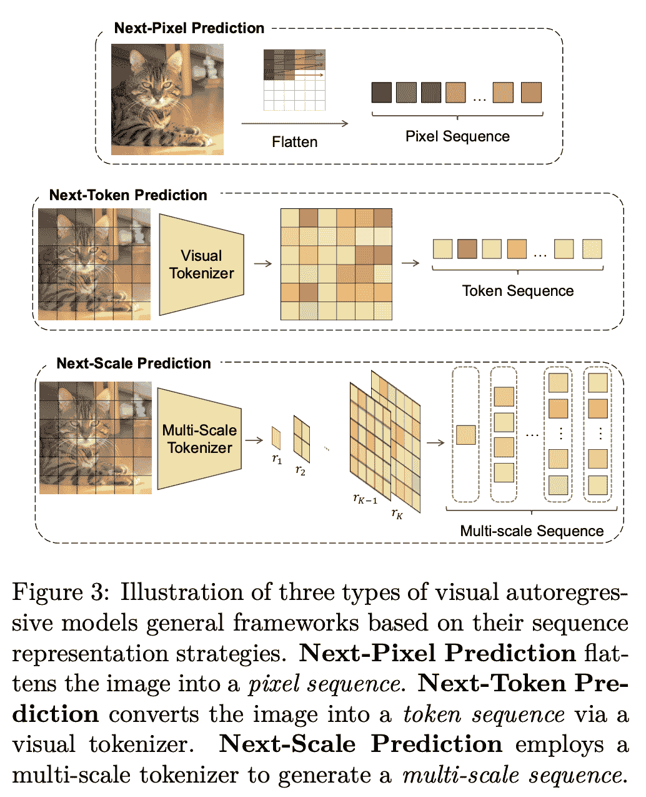

博弈论 LLM：谈判博弈的智能体工作流程

来自罗格斯大学的研究团队及其合作者特别在博弈论的框架内研究了战略决策背景下大语言模型（LLM）的合理性。他们在一系列完全信息博弈和不完全信息博弈中评估了几种 SOTA 的 LLM。他们的研究结果表明，LLM 经常偏离理性策略，尤其是当博弈的复杂性随着支付矩阵的增大或顺序树的加深而增加时。

为了解决这些局限性，他们设计了多个博弈论工作流，以指导 LLM 的推理和决策过程。这些工作流程旨在提高模型计算纳什均衡点和做出理性选择的能力，即使在不确定和信息不完全的条件下也是如此。实验结果表明，采用这些工作流程能显著提高 LLM 在博弈论任务中的合理性和稳健性。具体来说，采用工作流程后，LLM 在确定最优策略、在谈判场景中实现接近最优的分配以及降低谈判过程中被利用的可能性等方面都有明显改善。此外，他们还探讨了智能体采用这种工作流程是否合理的元战略考量，认识到使用或放弃工作流程的决策本身就构成了一个博弈论问题。

他们的研究有助于加深对 LLM 在战略环境中的决策能力的理解，并为通过结构化工作流程提高其合理性提供了见解。

论文链接：

https://arxiv.org/abs/2411.05990

GitHub 地址：

https://github.com/Wenyueh/game_theory

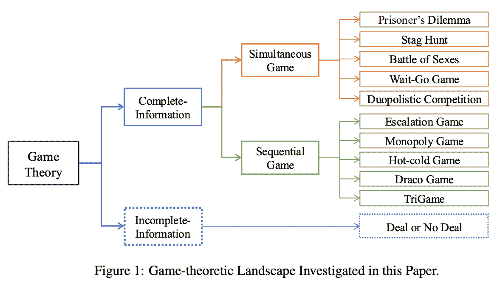

### 11.11-12

语言模型是隐藏推理器：通过自我奖励释放潜在推理能力

大语言模型（LLM）已经显示出令人印象深刻的能力，但在需要多个步骤的复杂推理任务中仍然存在困难。虽然基于提示的方法（如思维链 CoT）可以改善 LLM 的推理能力，但在训练过程中优化推理能力仍然是一项挑战。

Salesforce AI Research 的研究团队提出了 LaTent 推理优化（LaTRO），这是一个原则性框架，它将推理表述为从潜在分布中采样，并通过变异方法对其进行优化。LaTRO 可使 LLM 同时改进其推理过程和评估推理质量的能力，而无需外部反馈或奖励模型。

他们使用多种模型架构在 GSM8K 和 ARC-Challenge 数据集上进行实验，验证了 LaTRO。在 GSM8K 数据集上，与基础模型相比，LaTRO 平均提高了 12.5%，与 Phi-3.5-mini、Mistral-7B 和 Llama-3.1-8B 的监督微调相比，提高了 9.6%。他们的研究结果表明，预训练的 LLM 具有潜在的推理能力，可以通过他们提出的优化方法以自改进的方式释放和增强这些能力。

论文链接：

https://arxiv.org/abs/2411.04282

GitHub 地址：

https://github.com/SalesforceAIResearch/LaTRO

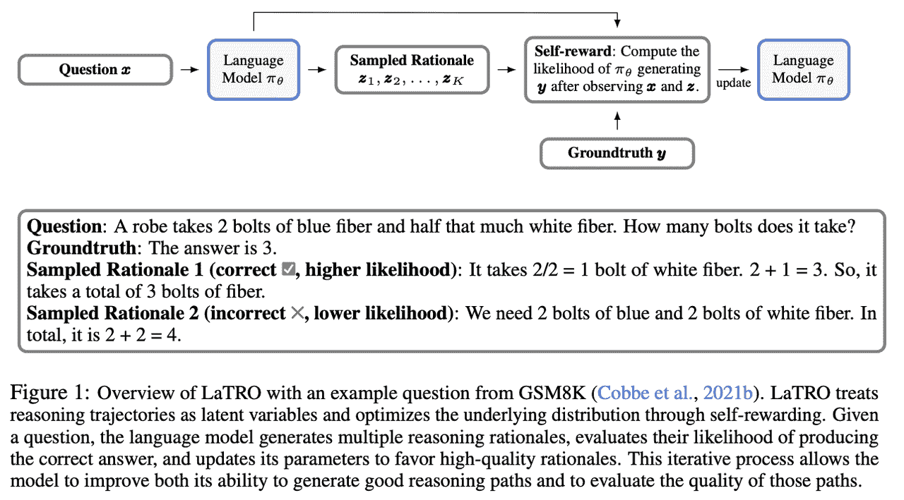

DELIFT：数据高效语言模型指令微调

微调大语言模型（LLM）对于提高其在特定任务上的性能至关重要，但由于数据冗余或无信息，通常会占用大量资源。

为了解决这种低效率问题，来自伊利诺伊大学香槟分校和 IBM 研究院的研究团队提出了 DELIFT（数据高效语言模型指令微调），这是一种新颖的算法，可以在微调的三个关键阶段系统地优化数据选择：（1）指令微调，（2）特定任务的微调（例如推理、问答），以及（3）持续微调（例如合并新的数据版本）。与专注于单阶段优化或依赖计算密集型梯度计算的现有方法不同，DELIFT 在所有阶段都高效运行。

他们方法的核心是成对效用指标，它量化数据样本对于改善模型对其他样本的响应的益处，有效地测量相对于模型当前能力的信息价值。通过利用应用于该指标的不同子模函数，DELIFT 选择在微调的所有阶段都有用的多样化且最佳的子集。跨各种任务和模型规模的实验表明，DELIFT 可以在不影响性能的情况下将微调数据大小减少高达 70%，从而显着节省计算量，并在效率和功效方面优于现有方法。

论文链接：

https://arxiv.org/abs/2411.04425

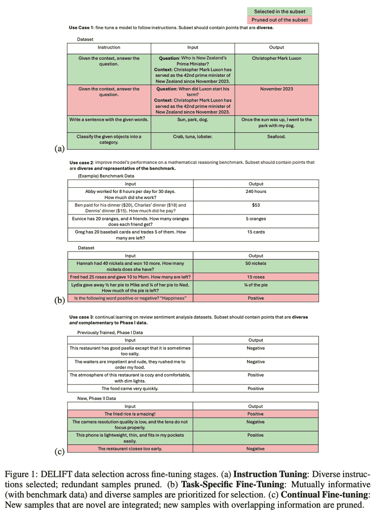

斯坦福团队提出 RaVL：发现并减轻微调视觉语言模型中的虚假相关性

微调的视觉语言模型 (VLM) 通常会捕获图像特征和文本属性之间的虚假相关性，从而导致测试时的零样本性能下降。用于解决虚假相关性的现有方法（i）主要在全局图像级别操作，而不是直接干预细粒度图像特征，并且（ii）主要针对单峰设置而设计。

在这项工作中，斯坦福大学的研究团队提出了 RaVL，它通过使用局部图像特征而不是在全局图像级别上操作来发现和减轻虚假相关性，从而对 VLM 鲁棒性进行了细粒度的视角。给定微调的 VLM，RaVL 首先利用区域级聚类方法来识别导致零样本分类错误的精确图像特征，从而发现虚假相关性。然后，RaVL 通过新颖的区域感知损失函数减轻已识别的虚假相关性，该函数使 VLM 能够专注于相关区域并在微调期间忽略虚假关系。

他们在 654 个 VLM 上评估 RaVL，具有各种模型架构、数据域和学习的虚假相关性。结果表明，RaVL 准确地发现了（比最接近的基线提高了 191%）并减轻了（对最差组图像分类准确度提高了 8.2%）虚假相关性。

论文链接：

https://arxiv.org/abs/2411.04097

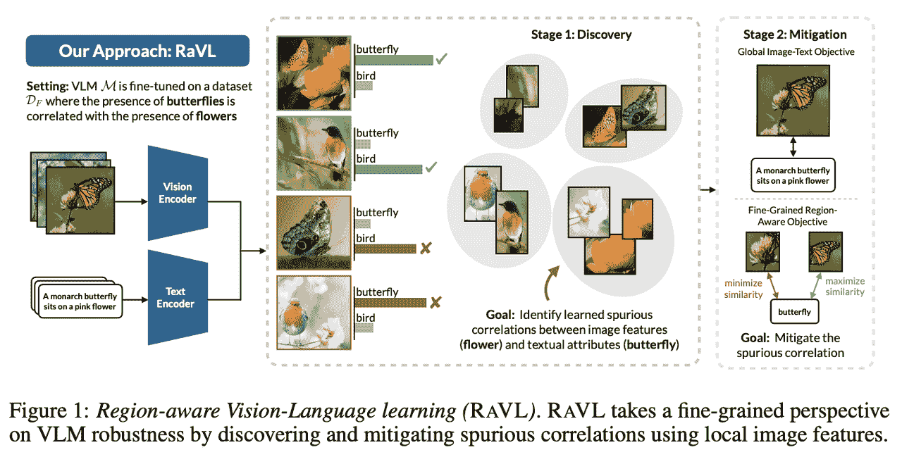

首个多模态 CAD 模型生成系统 CAD-MLLM

这项工作旨在设计一种统一的计算机辅助设计（CAD）生成系统，该系统可根据用户输入的文本描述、图像、点云甚至它们的组合形式轻松生成 CAD 模型。

**为**了实现这一目标，来自上海科技大学和 Transcengram 的研究团队及其合作者推出了 CAD-MLLM，这是第首个能够根据多模态输入生成参数化 CAD 模型的系统。具体来说，在 CAD-MLLM 框架内，他们利用 CAD 模型的命令序列，然后采用先进的大语言模型 (LLM) 来调整这些多样化多模态数据和 CAD 模型矢量化表示的特征空间。

为了便于模型训练，他们设计了一个全面的数据构建和标注管道，为每个 CAD 模型配备相应的多模态数据。他们的数据集被命名为 Omni-CAD，它是首个多模态 CAD 数据集，包含每个 CAD 模型的文本描述、多视图图像、点和指令序列。该数据集包含约 450K 个实例及其 CAD 结构序列。为了全面评估他们生成的 CAD 模型的质量，他们超越了当前侧重于重建质量的评估指标，引入了评估拓扑质量和曲面包围程度的附加指标。广泛的实验结果表明，CAD-MLLM 的性能明显优于现有的条件生成方法，并且对噪声和缺失点具有很强的鲁棒性。

论文链接：

https://arxiv.org/abs/2411.04954

项目地址：

https://cad-mllm.github.io/

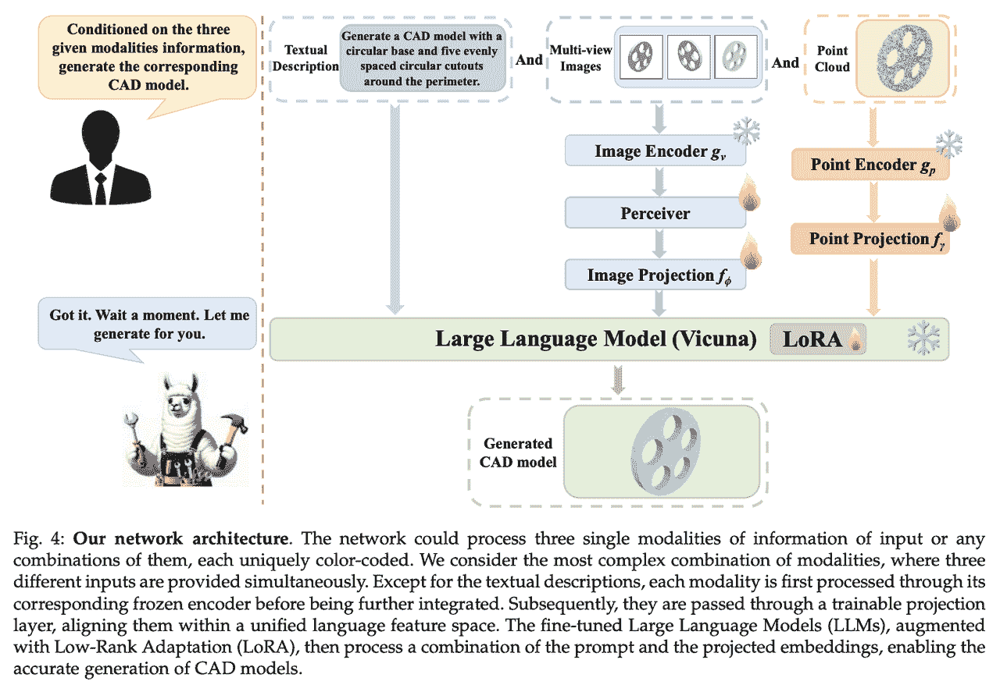

OmniEdit：通过专家监督建立图像编辑通用模型

通过在自动合成或手动标注的图像编辑对上训练扩散模型，指导性图像编辑方法已经展示出巨大的潜力。然而，这些方法离现实生活中的实际应用还很遥远。

来自滑铁卢大学和威斯康辛大学麦迪逊分校的研究团队及其合作者发现，造成这一差距的主要挑战有三个。首先，由于合成过程存在偏差，现有模型的编辑技能有限。其次，这些方法都是通过含有大量噪音和人工痕迹的数据集进行训练的。这是由于应用了简单的过滤方法，如 CLIP-score。第三，所有这些数据集都局限于单一的低分辨率和固定的长宽比，限制了处理实际应用案例的通用性。

在这项工作中，他们推出了一种全能编辑器，它可以无缝处理七种不同长宽比的图像编辑任务。他们的贡献体现在四个方面：（1）通过利用七个不同专家模型的监督对 omniedit 进行训练，以确保任务覆盖面。(2) 要们利用基于多模态大模型（如 GPT-4o）提供的分数的重要性采样，而不是 CLIP-score，来提高数据质量。(3) 他们提出了一种名为 EditNet 的新编辑架构，大大提高了编辑成功率。(4) 他们提供了不同长宽比的图像，确保他们的模型可以处理任何野生图像。他们策划了一个测试集，其中包含不同长宽比的图像，并附有不同的指令，以涵盖不同的任务。自动评估和人工评估都表明，omniedit 的性能明显优于所有现有模型。

论文链接：

https://arxiv.org/abs/2411.07199

项目地址：

https://tiger-ai-lab.github.io/OmniEdit/

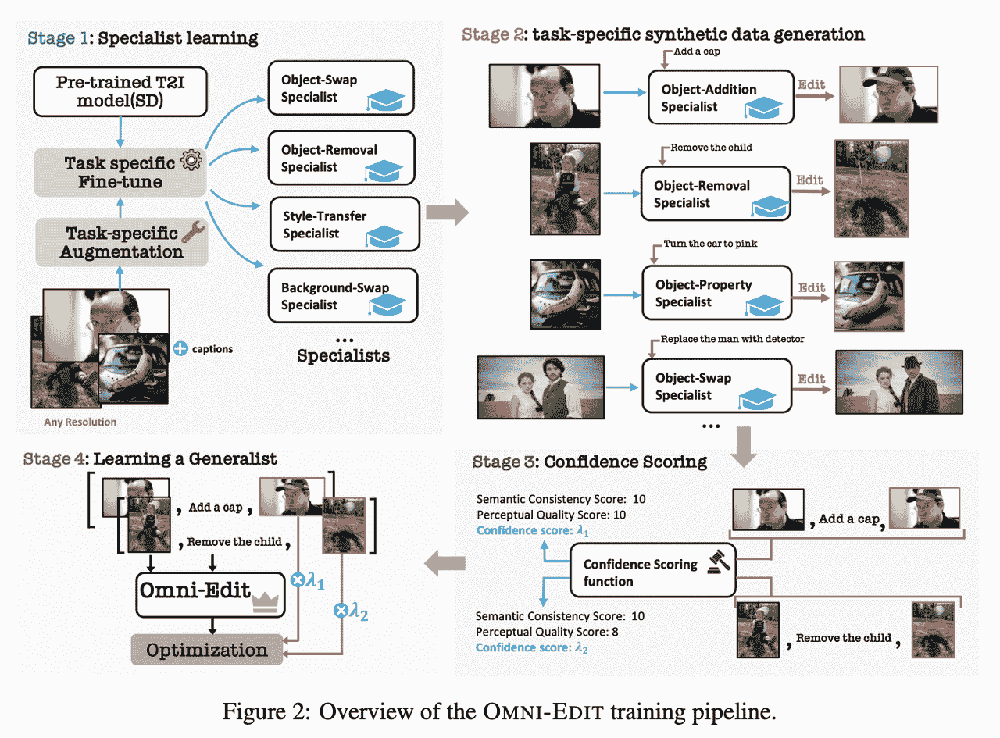

首个金融 LLM 综合双语基准 Golden Touchstone

随着大语言模型（LLM）在金融领域的日益普及，迫切需要一种标准化的方法来全面评估它们的性能。然而，现有的金融基准往往存在语言和任务覆盖范围有限、数据集质量不高以及对 LLM 评估的适应性不足等问题。

为了解决这些局限性，来自 IDEA Research 和香港科技大学（广州）的研究团队及其合作者提出了 Golden Touchstone——首个金融 LLM 综合双语基准，其中包含了八个核心金融 NLP 任务的中英文代表性数据集。该基准从广泛的开源数据收集和特定行业需求出发，包含各种金融任务，旨在全面评估模型的语言理解和生成能力。通过对基准中的主要模型（如 GPT-4o Llama3、FinGPT 和 FinMA）进行比较分析，他们揭示了它们在处理复杂金融信息方面的优势和局限。

此外，他们还开源了 Touchstone-GPT，这是一种通过持续的预训练和金融指令微调训练出来的金融 LLM，它在双语基准上表现出了很强的性能，但在具体的研究中仍然存在局限性。

论文链接：

https://arxiv.org/abs/2411.06272

GitHub 地址：

https://github.com/IDEA-FinAI/Golden-Touchstone

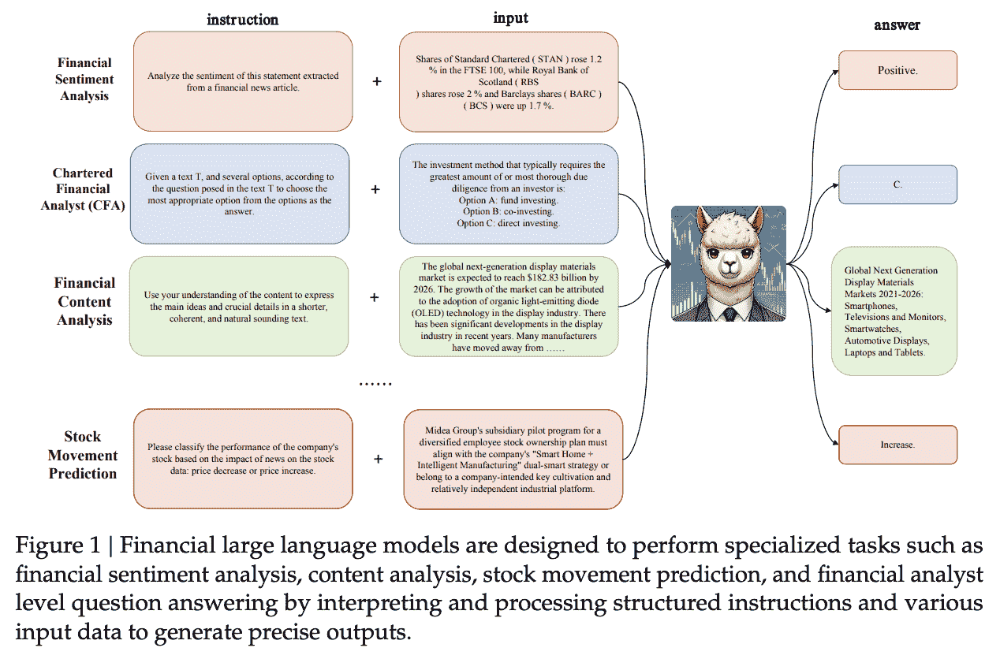