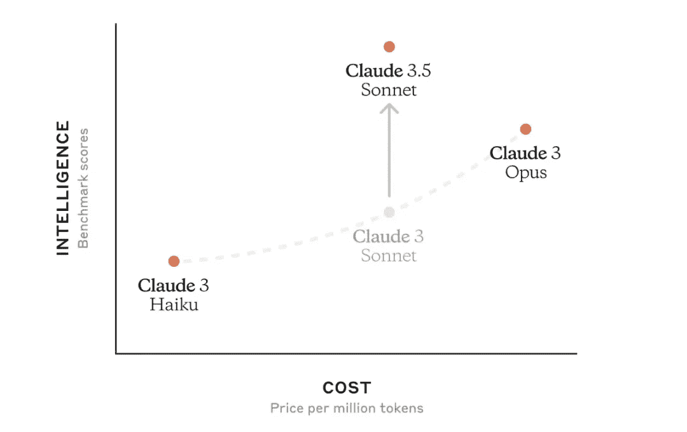
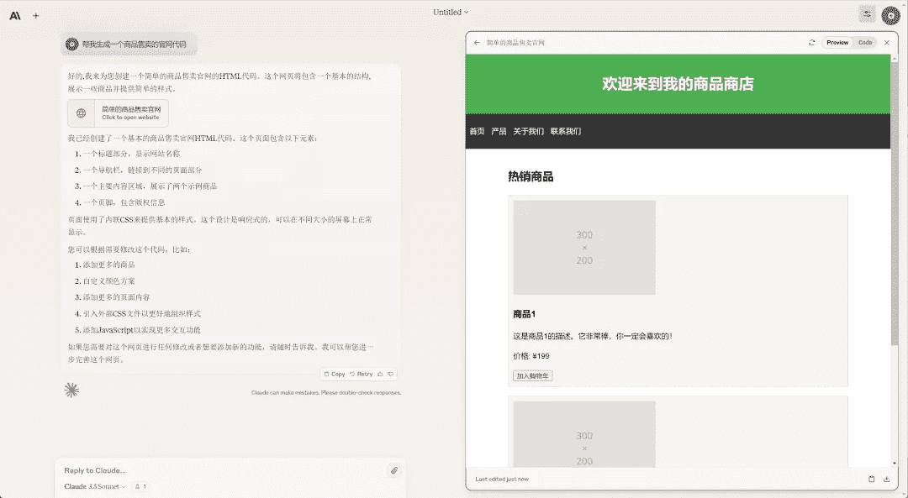
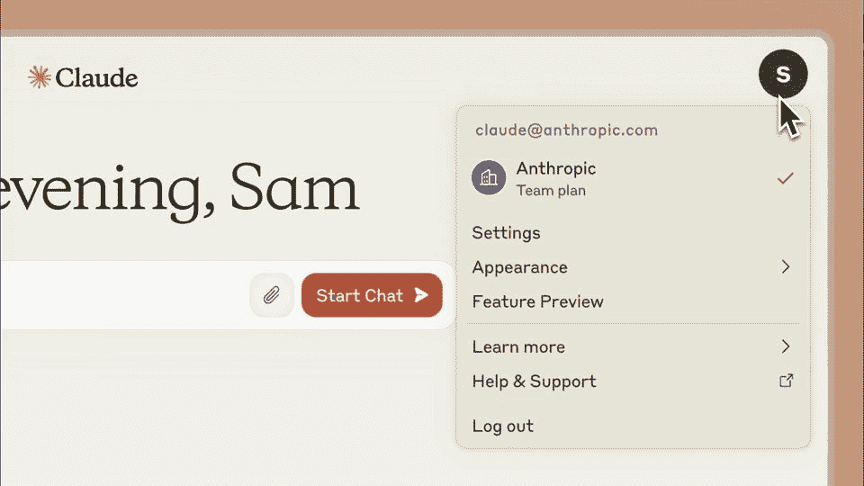
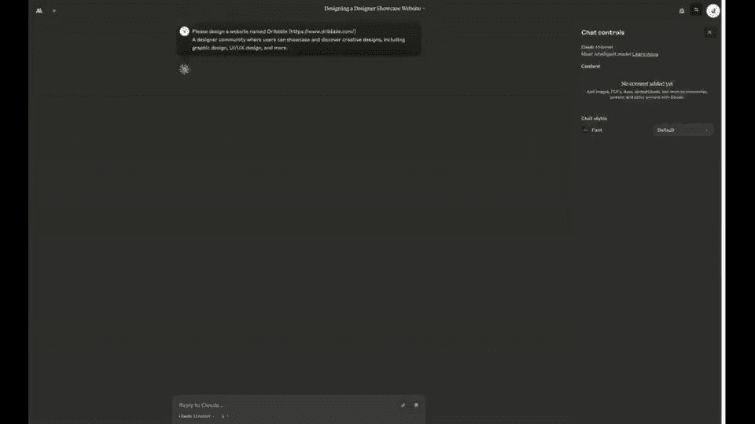
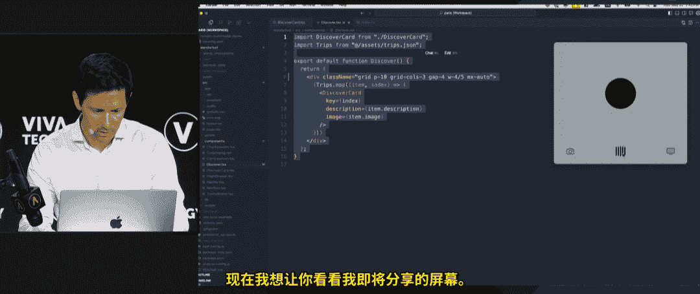
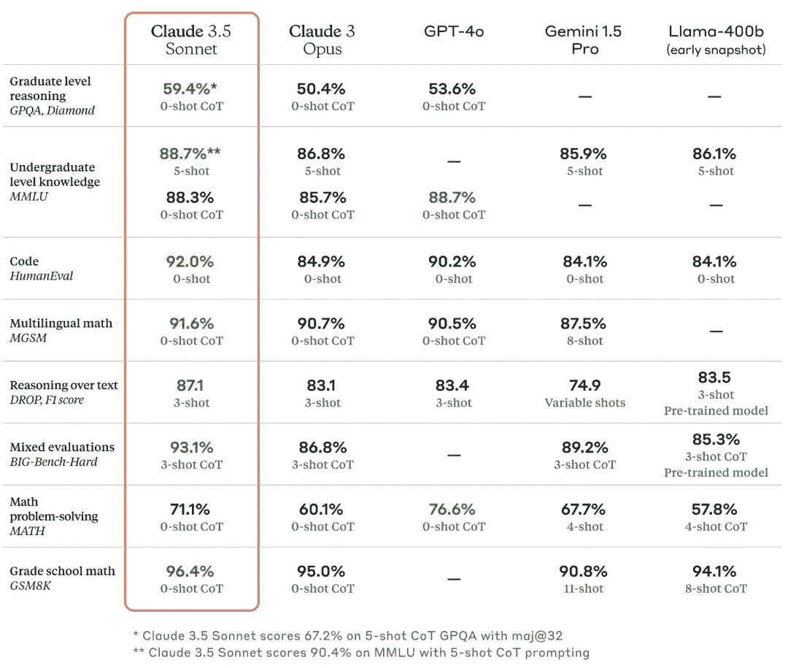
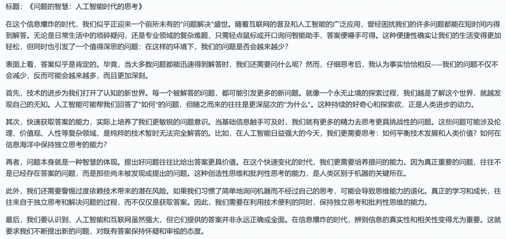
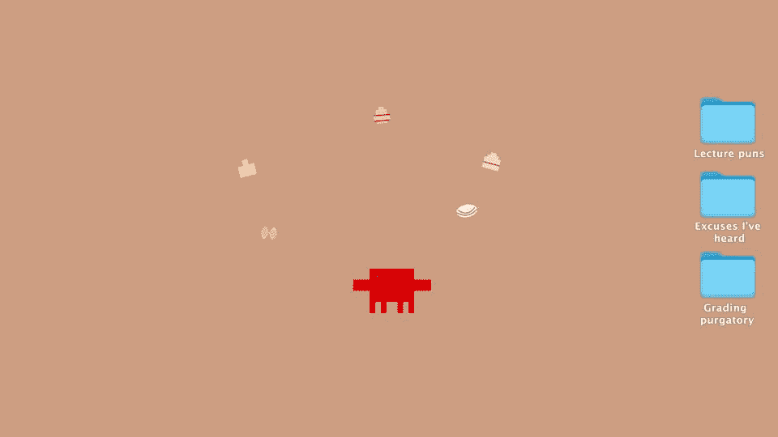
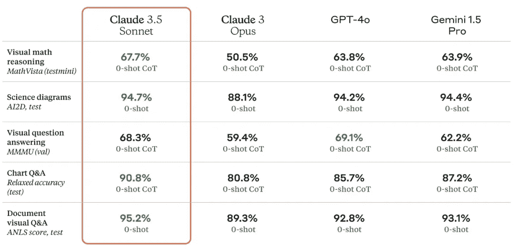

# Claude 3.5 把 OpenAI 藏藏掖掖的 GPT-4o 功能免费公开了出来，瞬间写完整个网页！

> 来源：[https://agijuejin.feishu.cn/docx/DRl9dEsrtoXfSCxP7fMcTDPRnfh](https://agijuejin.feishu.cn/docx/DRl9dEsrtoXfSCxP7fMcTDPRnfh)

> AI科技大本营｜[阅读原文](https://mp.weixin.qq.com/s/3XPpO211fWY8Mtgj0tuYUQ)

> 转载请联系原作者取得授权

文 | 王启隆

出品丨 AI 科技大本营（ID：rgznai100）

四十天过去了，OpenAI 还是没把 GPT-4o 演示中的那一系列功能发布出来。

这四十天，OpenAI 经历了 Ilya 的离职风波（并且 Ilya 都已经再创业了），经历了“寡姐”斯嘉丽的声音纠纷，期间 OpenAI 还特意在欧洲大会上演示了最新的 GPT-4o 功能，但用户手中的永远是 5 月 13 日的那个版本，Sam Altman 就是迟迟未上线完整版的 GPT-4o。

于是乎，OpenAI 的“一生之敌” Anthropic 再次站了出来，这家生而为打击 OpenAI 安全问题的公司，昨晚正式发布了 Claude 3.5 的“大杯”模型 —— Claude 3.5 Sonnet！

Claude 3 系列模型的命名向来遵循了一种富有诗意的规则，反映了模型的性能层次和用途，同时也借用了文学形式的名称来赋予每种型号独特的含义，比如 Haiku 代表着日本俳句，短小精悍；这次发布的 Sonnet 代表意大利的“十四行诗”，结构复杂，在智能水平、功能多样性和处理能力上都有所提升，能够应对更复杂的认知任务，提供更高质量的输出；“超大杯”的 Opus 则是指意大利语的“作品”，最为全面，可以用一个“强”字来形容。

Claude 3.5 Sonnet 作为 Claude 3.5 系列的首个模型版本，在行业智能水平上取得了显著提升。它不仅超越了竞争对手的性能，还超越了自家的上一代“超大杯” Claude 3 Opus，同时保持了与中端模型 Claude 3 Sonnet 相同的速度和成本优势。

3.5 对比 3，相当的等级森严。

性能涨了，但价格方面还是之前 Sonnet 的“大杯”水平

和藏藏掖掖的 GPT-4o 完整版不同，海外用户现在就可以在 claude.ai 官网和 Claude iOS 应用上使用 Claude 3.5 Sonnet，目前开放了 5 天免费试用 —— 这点相当值得一提，因为 Claude 3 发布的时候 Anthropic 还没开发完 iOS 应用，而这一次则是直接同步上线了，苹果用户狂喜。

此外，订阅了 Claude Pro 和 Team 计划的用户还可以在更高的速率限制下访问。Claude 3.5 Sonnet 还通过 Anthropic API、Amazon Bedrock 和 Google Cloud 的 Vertex AI 提供，其成本为每百万输入 tokens / 3 美元和每百万输出 tokens / 15 美元，并支持 200K tokens 的上下文窗口。

## “我把前端和程序员一起塞到了这款 AI 里面”

首先，直接进入标题的重点。Claude.ai 这次最劲爆的发布当属全新的 Artifacts 功能，它扩展了用户与 Claude 互动的方式。

记得手动开启

当用户请求 Claude 生成代码片段、文本文档或网站设计等内容时，这些 Artifacts 会出现在对话旁的专用窗口中。

Source：Twitter user @op7418

这相当于创建了一个动态工作空间，用户可以实时查看、编辑和构建 Claude 的创作过程，将 AI 生成的内容无缝集成到他们的项目和工作流程中。

官方演示视频：

[0bc3pyaa4aaadqap7zluzvtfa7wdbz7aadqa.f10002.mp4](https://internal-api-drive-stream.feishu.cn/space/api/box/stream/download/all/Ok6vbglipoNrMrxDRcVcGgcznKe)

这个预览功能标志着 Claude 从「对话式 AI」向「协作工作环境」的转变。这只是 Claude.ai 更广阔愿景的开始，很快将扩展到支持团队协作。未来，整个团队甚至整个组织都能在一个共享空间中安全地集中他们的知识、文档和正在进行的工作，而 Claude 也将成为一个按需的团队成员。

如果你还没看过瘾，以下还有更直观的视频，体现了 Claude 瞬间写完网页的速度：

[0bc3suaa4aaadiap6gluyrtfbfodb2kqadqa.f10002.mp4](https://internal-api-drive-stream.feishu.cn/space/api/box/stream/download/all/YMZRbabToolQzaxioOvcWwNlnce)

Source：Twitter user @genie0309

从敲代码到渲染网页只需要 30 秒，我们人类只需要看着就行了。

另外不得不提的是，这个功能其实也是 OpenAI 曾在巴黎大会的时候演示过的，详情可以看我们先前整理的《GPT-4o 巴黎行首秀：改完代码亲自审前端，人类的活都被干完了！》。现在，Anthropic 的 Artifacts 实现了同样的效果，并且免费可用。

OpenAI 的 Romain Huet 在演示中只用一张嘴指挥 4o 写完代码

## OpenAI 不敢放的多模态能力，我来放！

下面来了解一下 Claude 3.5 Sonnet 的一些基础能力。Sonnet 在研究生级推理（GPQA）、本科级知识（MMLU）和编程能力（HumanEval）方面都设立了全新的行业标准。它在理解细微差别、幽默和复杂指令方面有显著提高，并能以自然、易于理解的语调撰写高质量内容。其运行速度是 Claude 3 Opus 的两倍，性能提升与成本效益相结合，使 Claude 3.5 Sonnet 成为复杂任务的理想选择，例如上下文敏感的客户支持和多步骤工作流程的管理。

既然 Sonnet 没能赶上中国高考，我们不妨给它补测一下：

一共 933 字，符合要求，你打几分？

在内部的编程评估中，Claude 3.5 Sonnet 解决了 64% 的问题，优于 Claude 3 Opus 的 38%。评估测试了模型在给定自然语言描述的情况下修复错误或添加功能到开源代码库的能力。提供相关工具和指令时，Claude 3.5 Sonnet 能独立编写、编辑和执行代码，具有复杂的推理和故障排除能力，能轻松处理代码翻译，使其在更新遗留应用程序和迁移代码库方面特别有效。

再来看看 GPT-4o 最让人印象深刻的点，同时也是 Claude 3.5 系列的重头戏——多模态。Claude 3.5 Sonnet 号称 Claude 系列目前最强大的视觉模型，在标准视觉基准测试中超越了 Claude 3 Opus。

官方视频如下：

[0bc3huaa6aaaiiap54tuzrtfapodb46qadya.f10002.mp4](https://internal-api-drive-stream.feishu.cn/space/api/box/stream/download/all/DotHbhWI5oWmJJxsSaZctBRNn7c)

这一代显著的改进在需要视觉推理的任务中尤为明显，例如解释图表和图形。Claude 3.5 Sonnet 还能准确地从不完美的图像中转录文本，这在零售、物流和金融服务领域尤为重要，因为 AI 能从图像、图表或插图中获取比单纯文本更多的见解。

Claude 团队还在开发新的功能和模式，以支持更多商业用例，包括与企业应用的集成。团队还在探索记忆功能，这将使 Claude 能够记住用户的偏好和互动历史，从而使体验更加个性化和高效。

为了不断改善智能、速度和成本之间的权衡，Claude 3.5 系列的最后两款模型 Claude 3.5 Haiku 和 Claude 3.5 Opus 将在今年晚些时候发布。