# AI 搜索新产品 Genspark 实测，融资 6000 万美金，实际效果如何？

> 来源：[https://agijuejin.feishu.cn/docx/RWcGdmx9Mo1XaWxTsTocZZhKnuh](https://agijuejin.feishu.cn/docx/RWcGdmx9Mo1XaWxTsTocZZhKnuh)

> 橘子汽水铺｜[阅读原文](https://mp.weixin.qq.com/s/J3z2YNPNsixnL8h53KlZ3w)

> 转载请联系原作者取得授权

## 引言

昨天，Genspark 融资 6000 万美金的消息传遍🛰️群。一个新晋的 AI 搜索产品，竟然能拿到这么高的融资，而且这个消息经过线人确认，准确性很高。

这个融资背后的原因一定是非常有趣的，相信也是大家很关心的，不过这背后的故事且让子弹飞一会儿，我们先看下这款产品当下的效果究竟如何吧。

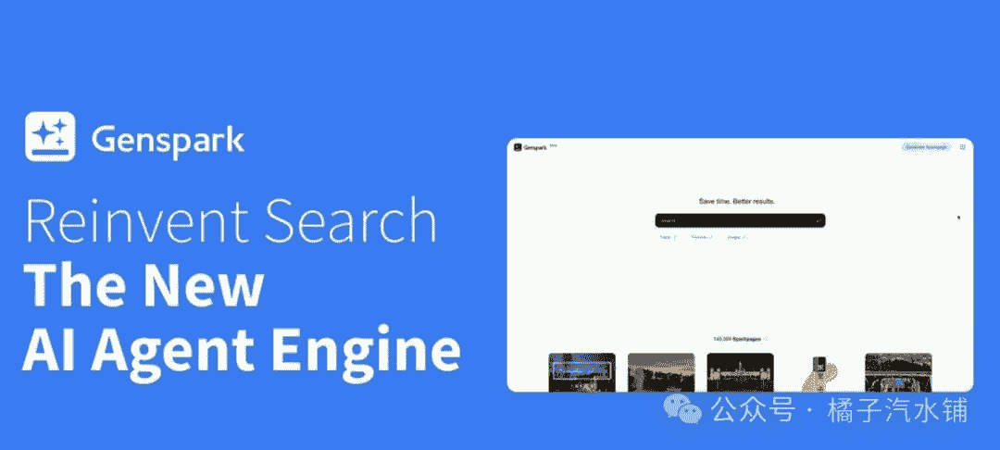

## Genspark 是什么

Genspark 是一个由百度前高管创立的人工智能搜索引擎。创始人经验丰富，对搜索的理解深刻，也不拘泥于做搜索的增强，而是要从内容和商业化角度重构搜索。

Genspark 最大的特点是通过 AI Agent 生成网页，称为 Sparkpages，这些网页整合了关于一个主题的所有相关内容，包括文字、图片、视频等，提供丰富的信息。这些内容的呈现形式，就是我们熟悉的瀑布流。

好的搜索离不开内容的构建，对于百度来说，内容构建是通过百度知道、百度百科等产品来提供的，这些内部产品占据了百度搜索 30%以上的流量。对于📕来说，内容构建是通过 UGC 提供的，📕的搜索渗透在 50%以上，内容平台和搜索做到最后一定是竞争对手。

总之，简单粗暴地理解

Genspark=AI 搜索+AI 📕。

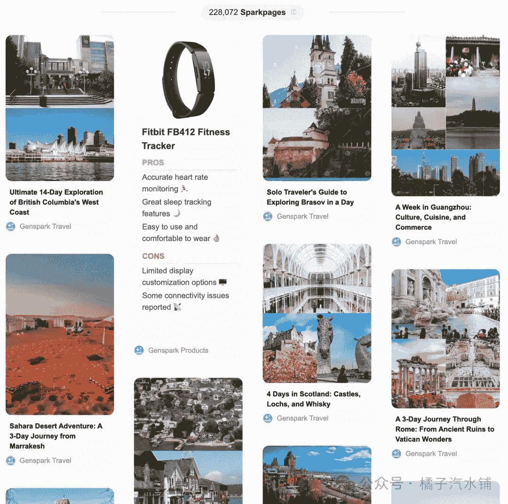

## Genspark 的技术可能遇到的问题

通过 AI 来生成内容，这件事收益显著，不再需要人工来创建页面、也不再需要运营一个生态来驱动 UGC。

但可能的问题也随之而来，包括内容的准确性、实时性，我们真的可以相信 AI 创建的网页吗？

从竞品的一些思路来看，这件事非常值得谨慎，前有豆包生成海量网页污染搜索引擎并下线，后有 Perplexity 的 Pages 非常缓慢地灰度，其考虑的点就是让人类能对 AI 生成的内容进行 review 后再发布以保障质量。

## 基本搜索测试

Genspark 的主要功能可以分为基本搜索、旅行搜索、商品搜索、图片搜索。

首先来看一下基本搜索能力，这里主要对标在之前的测试中表现都很好的 Perplexity。

基本搜索测试 1：deepseek 新发布的模型是什么

这个 query 的难点在于，deepseek 新发布的 coder 模型，和上个月发布的 v2 模型之间的间隔非常短，并且两个模型一个文科生一个理科生，都是最新模型。

从结果可以看出，pplx 的理解完全正确，genspark 则没有得到 coder 模型的任何信息。

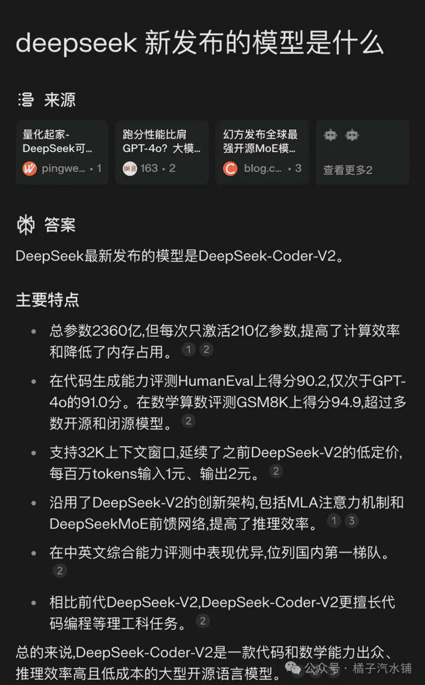

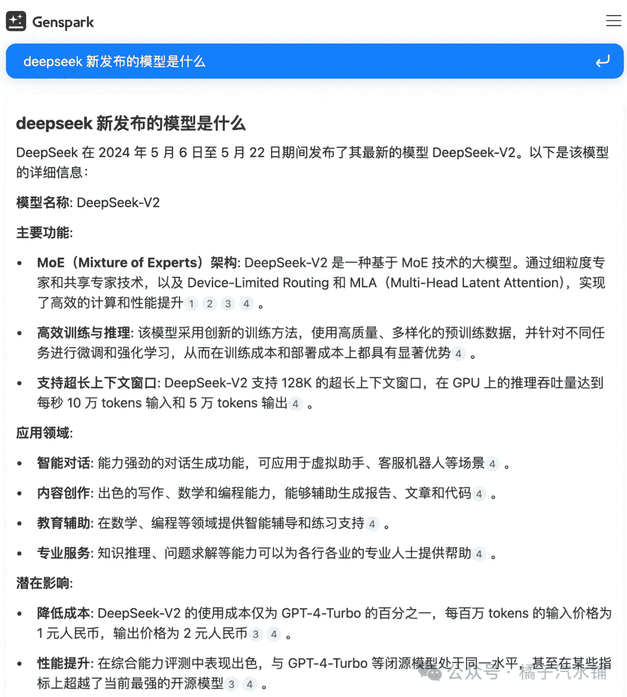

**基本搜索测试 2: genspark 和** perplexity 的估值分别是多少

这个 query 的难点在于，genspark 的估值信息非常的新，是 2 天内的实时内容，而 pplx 的估值信息是几个月前的内容，要同时拿到两个信息进行对比，非常考验 AI 搜索的能力。

从结果可以看出，pplx 这里直接识别错了关键词，把 genspark 当成了 Glean。

Genspark 对关键词的识别正确，但是只找到了 genspark 的估值。两者都有提升空间。

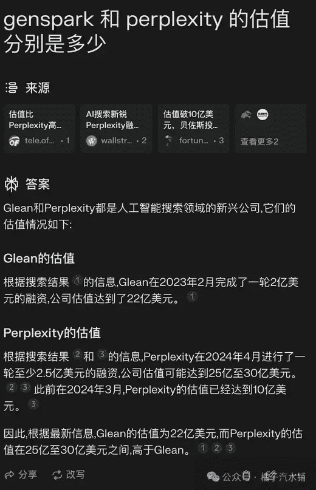

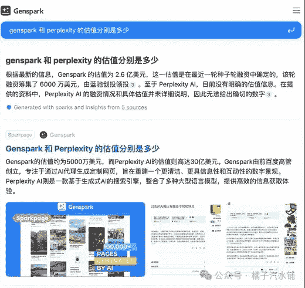

不过上面两个题其实还是有些难度的，大部分日常搜索没这么难，在实际测试几轮后，发现 Genspark 和 Perplexity 的搜索结果都还不错，可用性都较高。

不过基本搜索完全无法体现出 Sparkpages 的优势，让我们快速进入后面的新形态测试

## 旅行搜索测试

旅行方面的攻略内容，最好的地方就在📕，所以本轮用 Genspark 对比📕，看看从哪里可以更快更好地获取信息。

旅行搜索测试 1:武汉 2 日游

📕的搜索结果我们比较熟悉，上面是输入框，下面是 UGC 瀑布流。

Genspark 的搜索形式比较独特，上层是一个 AI Chat，下面是 Sparkpages 瀑布流。

但是问题来了，AI Chat 里的内容确实是武汉，但 Sparkpages 里却是重庆、成都、东北，完全不符合预期。

难道是因为武汉太冷门？

除了这个大的问题，还有就是 AI Chat 这个结果也问题很多，黄鹤楼和户部巷玩 2 小时就结束了，后面直接快进到东湖散步，这一天的行程是不是有些过于松弛了。而且📕应该不会给你推荐户部巷。

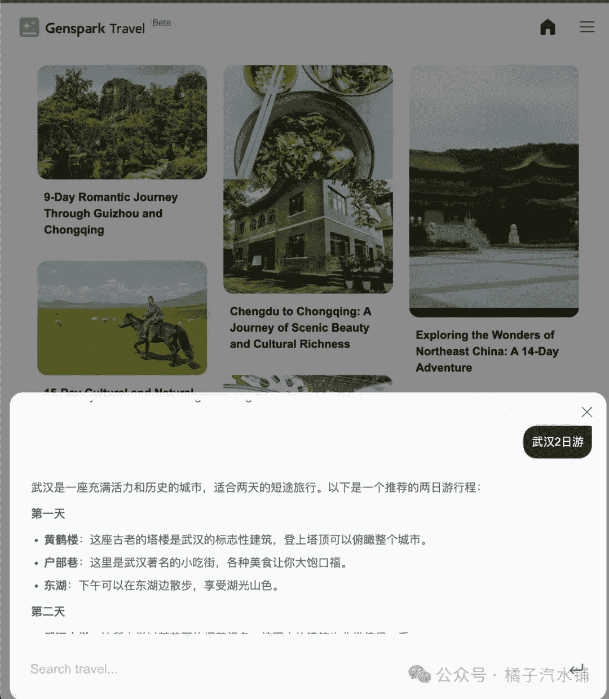

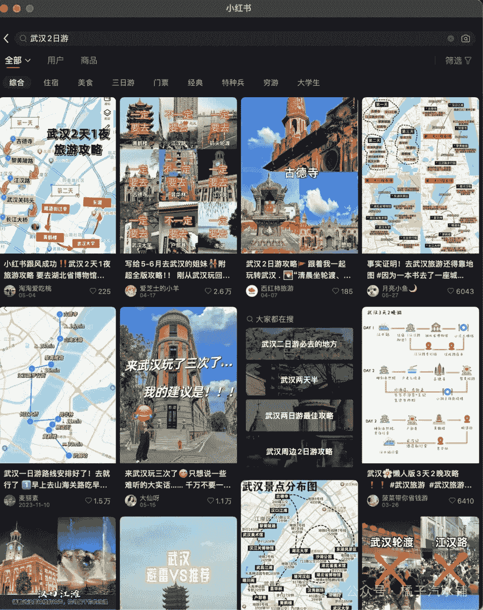

旅行搜索测试 2:伦敦 5 日游

用这个结果测试，发现 Genspark 的问题依旧，AI Chat 里是伦敦，Sparkpages 里是张家界、草原、青岛。这似乎是还有严重的 bug 需要修改的样子。而 AI Chat 里的结果也是非常没有参考性。

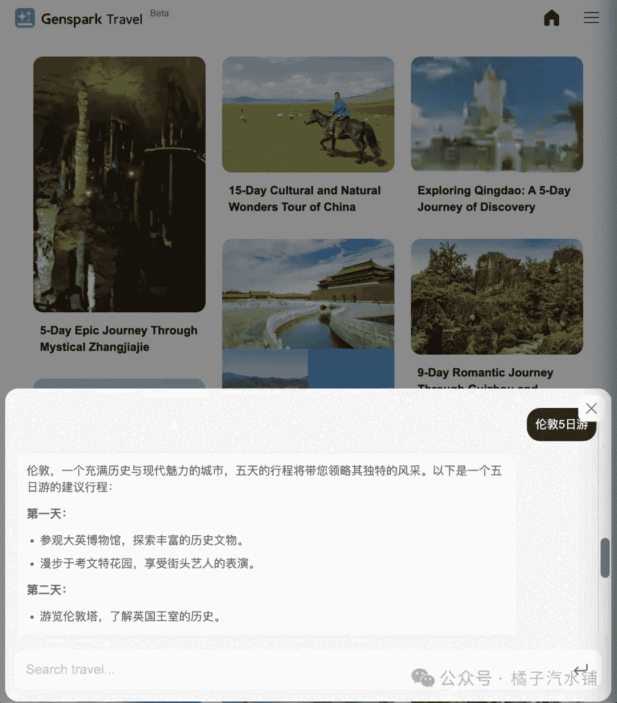

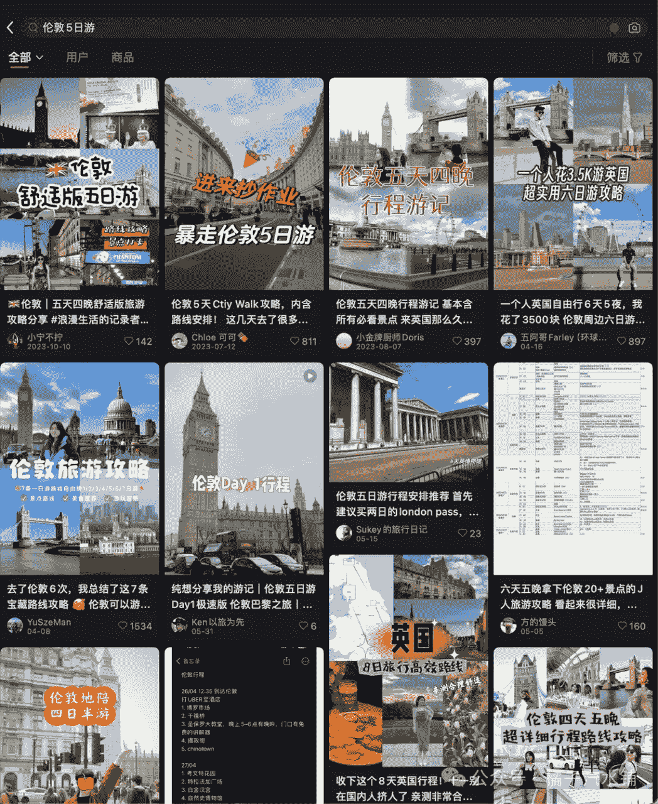

旅行搜索真是让人一言难尽，让我们快进到有趣的商品搜索。

## 商品搜索测试

商品搜索的测试，以 amazon 作为对比，看看传统的电商网站和 AI 商品搜索哪个更好用。

商品搜索测试 1: 不入耳耳机 openair earbuds

不入耳耳机是现在最流行的耳机品类，个人也购买了不下三款，在这个测试里，先用了一些很难的 query，比如音质最好的不入耳，发现两个网站都搜不太到，于是改为简单的 query 进行测试。

从测试结果看，Amazon 给的结果页符合预期，推荐的几款产品都是不入耳的热门产品，对于普通用户来说，购买踩坑率很低。

而 Genspark 的结果页，直接放了入耳耳机在里面，可以说误导性非常强了。另外这个 Pros/Cons 的对比方式，似乎参考意义也并不是很大，只是个非常表面的形式。

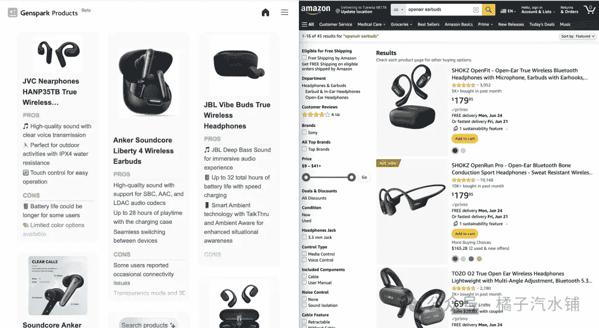

商品搜索测试 2:圣诞节礼物 gift for xmas

圣诞节礼物推荐，这个应该是 AI 搜索更擅长的领域了，没想到结果是大跌眼镜，genspark 推荐里一堆咖啡机，圣诞节的唯一选择？

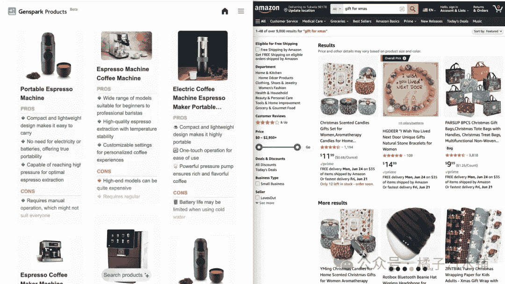

商品搜索测试 3:JellyCat Timmy

这个 query 需要先科普下，JellyCat 是个女孩和小孩都非常喜欢的毛绒玩具品牌，每个 JellyCat 的玩具都有它的名字，比如四款乌龟，分别有不同的名字。所以这个 query 其实是难度很高的，50%的人类都答不出来。

从结果看，Genspark 完全理解了 timmy，并且给出了相应的商品图片，回答正确。

amazon 则很奇怪，完全没有 timmy，但是给出了热门的 ricky 和另一个比较容易混淆的乌龟 tommy。一个原因怀疑可能是没库存了。。。

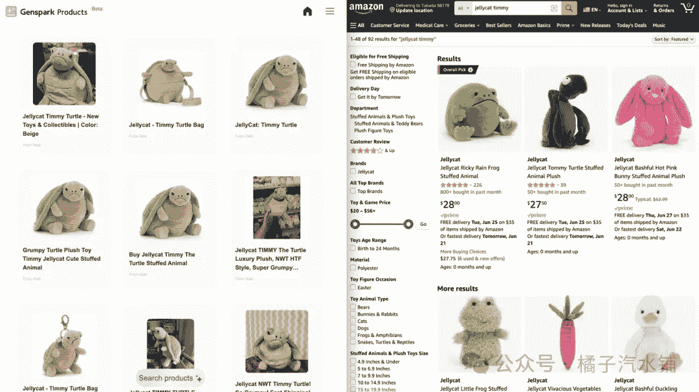

由于这个 query 非常有趣，让我们也 callback 一下之前其他的 AI 搜索，可以看到只有 pplx 和豆包答对了。

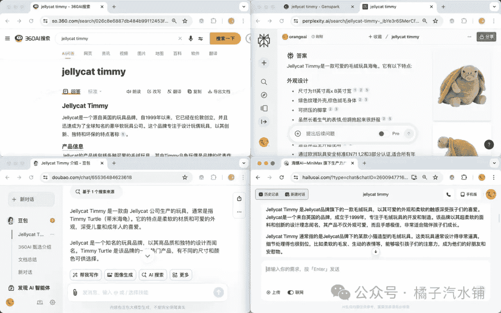

## 图片搜索测试

对不起，我测了一下，没有看到这款产品任何值得测试的点，真的就是个图片瀑布流。。。

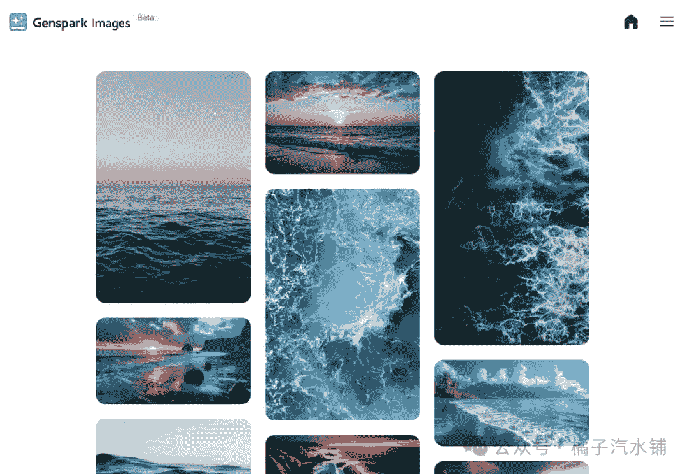

## 总结：

基本搜索：可用性还不错，和 pplx 比各有千秋。genspark 对中国用户特别友好，速度飞快，不会每次让你每天验证一遍自己是真人，不会每天推荐你下载安卓客户端。

旅行搜索：产品 bug 很多，完全无法和📕想媲美。

商品搜索：可以当成一个聚合电商搜索来用，但是如果你固定用一个电商，比如淘宝的话，也完全没必要用 genspark。

图片搜索：当壁纸很好看。

好的，Genspark 的测试就写到这里，毕竟刚融资 6000 万美金，后面一定会更好，让我们拭目以待。