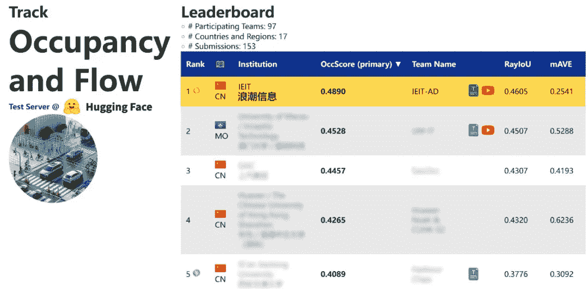
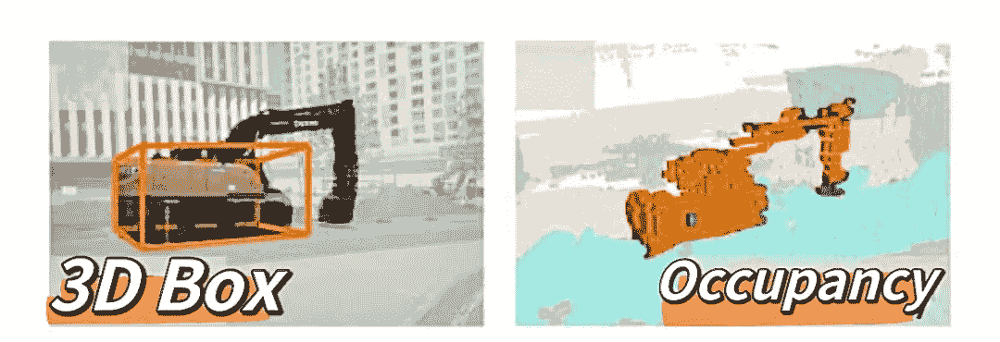
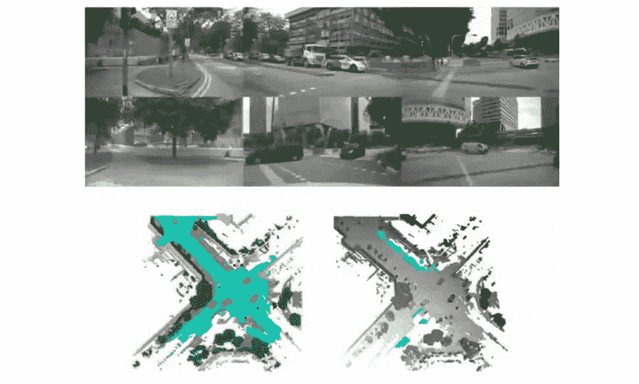
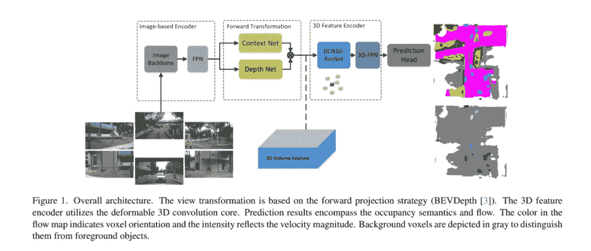

# 浪潮信息 AI 团队获 CVPR2024 自动驾驶国际挑战赛“Occupancy & Flow”赛道冠军

> 来源：[https://agijuejin.feishu.cn/docx/HJu8dTkAIocEu6xo8f8cObO2nBe](https://agijuejin.feishu.cn/docx/HJu8dTkAIocEu6xo8f8cObO2nBe)

> 浪潮AIHPC｜[阅读原文](https://mp.weixin.qq.com/s/BFgjI9c-QlV-dJvV1QN2pw)

> 转载请联系原作者取得授权

近日，**在全球**权威的 CVPR 2024 自动驾驶国际挑战赛(Autonomous Grand Challenge)中，浪潮信息 AI 团队所提交的“F-OCC”算法模型以 48.9%的出色成绩斩获占据栅格和运动估计(Occupancy & Flow)赛道第一名。继 22、23 年在纯视觉和多模态等自动驾驶感知方向，多次登顶 nuSences 3D 目标检测榜单后，该 AI 团队面向 Occupancy 技术再一次实现突破，实现了对高度动态及不规则的驾驶场景更精准的 3D 感知及运动预测。

浪潮信息 AI 团队斩获占据栅格和运动估计赛道第一名

CVPR 2024 自动驾驶国际挑战赛是国际计算机视觉与模式识别会议(IEEE/CVF Conference on Computer Vision and Pattern Recognition)的一个重要组成部分，专注于自动驾驶领域的技术创新和应用研究。2024 年 CVPR 自动驾驶国际挑战赛，包含感知、预测、规划三大方向七个赛道，旨在深入探索自动驾驶领域的前沿课题。

三**维感知和预测是自动驾驶领域的新兴任务，要求对车辆行驶场景进行细粒度建模，对于提升自动驾驶的环境感知能力有着重要**意义。此次浪潮信息 AI 团队所登顶的占据栅格和运动估计(Occupancy & Flow)赛道，是 CVPR 2024 自动驾驶国际挑战赛最受关注的赛道，聚焦感知任务，吸引了全球 17 个国家和地区，90 余支顶尖 AI 团队参与挑战。比赛提供了基于 nuScenes 数据集的大规模占用栅格数据与评测标准, 要求参赛队伍利用相机图像信息对栅格化三维空间的占据情况(Occupancy)和运动(Flow)进行预测，以此来评估感知系统对高度动态及不规则驾驶场景的表示能力。

## 占据栅格 Occupancy：挑战更精细的环境感知与预测

道路布局的复杂性、交通工具的多样性以及行人流量的密集性，是当前城市道路交通的现状，也是自动驾驶领域面临的现实挑战。为了应对这一挑战，有效的障碍物识别和避障策略，以及对三维环境的感知和理解就变得至关重要。传统的三维物体检测方法通常使用边界框来表示物体的位置和大小，但对于几何形状复杂的物体，这种方法往往无法准确描述其形状特征，同时也会忽略对背景元素的感知。因此，基于三维边界框的传统感知方法已经无法满足复杂道路环境下的精准感知和预测需求。

图解：针对挖车中的力臂，3D 目标检测算法只能给出挖车整体的轮廓框（左），但占据栅格网络却可以更精准地描述挖车具体的几何形状这类细节信息（右）

Occupancy Networks（占据栅格网络） 作为一种全新的自动驾驶感知算法，通过获取立体的栅格占据信息，使系统能够在三维空间中确定物体的位置和形状，进而有效识别和处理那些未被明确标注或形状复杂的障碍物，如异形车、路上的石头、散落的纸箱等。这种占据栅格网络使得自动驾驶系统能够更准确地理解周围的环境，不仅能识别物体，还能区分静态和动态物体。并以较高的分辨率和精度表示三维环境，对提升自动驾驶系统在复杂场景下的安全性、精度和可靠性至关重要。

## 全面提升！48.9%的绝佳性能表现，创本赛道最高成绩

在占据栅格和运动估计(Occupancy & Flow)赛道中，该 AI 团队所提交的“F-OCC”算法模型，凭借先进的模型结构设计、数据处理能力和算子优化能力，实现了该赛道最强模型性能，在 RayIoU（基于投射光线的方式评估栅格的占用情况）及 mAVE（平均速度误差）两个评测指标中均获得最高成绩。

[0bc3lyaacaaa7yadtfd2yvtfaxwdafpaaaia.f10002.mp4](https://internal-api-drive-stream.feishu.cn/space/api/box/stream/download/all/W4uybAiD9oLQ0QxHHmcclSXUnfW)

正上方：输入的环形相机图像；左下：Occupancy 预测真值；右下：Flow 预测真值

### ■ 更简洁高效的模型架构，实现运算效率与检测性能双突破

首先，模型整体选择基于前向投影的感知架构，并采用高效且性能良好的 FlashInternImage 模型。同时，通过对整体流程进行超参调优、算子加速等优化，在占据栅格(Occupancy)和运动估计(Flow)均获得最高分的同时，提升了模型的运算效率，加快了模型迭代与推理速度。在实际应用场景中，这种改进使得模型能够更快速、高效地处理大规模 3D 体素数据，使得自动驾驶车辆能更好地理解环境，进而提升决策的准确度和实时性。

F-OCC 算法模型架构图

### ■ 更强大完善的数据处理，全面提升模型检测能力

在数据处理方面，比赛提供的体素(Voxel)标签包含了大量在图像中无法观测到的点，例如被物体遮挡的体素和物体内部不可见的体素，这些标签在训练过程中会对基于图像数据的预测网络训练产生干扰。在训练数据中，该 AI 团队通过模拟 LiDAR 光束的方法，生成可视化掩码，提升了模型的预测精度；另一方面，通过引入感知范围边缘的体素点参与训练，有效解决出现在感知边缘区域的误检问题，将模型的整体检测性能提升 11%。

### ■ 更精细的 3D 体素编码，模型占据预测能力提升超 5%

在 3D 体素特征编码模块中，该 AI 团队将具有较大感知范围和编码能力的可形变卷积操作应用于 3D 体素数据，以提升 3D 特征的表示能力。通过使用 CUDA 对可形变 3D 卷积(DCN3D)进行实现与优化，大幅提升了模型的运算速度，并有效降低了显存消耗。通过 DCN3D 替代传统 3D 卷积，模型整体占据预测能力提升超 5%。

**基**于 OCC 3D 空间感知算法的创新， “F-OCC”算法模型成功登顶占据栅格和运动估计任务(Occupancy & Flow)榜单，以 48.9%的出色成绩创造了本赛道的最高成绩，为探索更高级别的自动驾驶技术提供了有力的支撑与经验。未来，浪潮信息 AI 团队将践行多角度切入，发挥算法、算力融合的 AI 全栈优化能力，推动自动驾驶领域的技术创新发展。

> 文内所涉术语解释如下

> **Occupancy**：在自动驾驶领域，通常称为“占据栅格”或“占用栅格”，其是一种 3D 语义占用感知方法，通过生成车辆周围环境的三维占用网格，为自动驾驶车辆提供障碍物检测、路径规划和车辆控制等关键功能；

> **RayIoU**：是指通过光线投射的方式评估占据网格的占用情况(Ray-based Intersection over Union)，RayIoU 可以用来衡量预测的占据网格与实际占据网格之间的重叠程度。RayIoU 越高意味着预测准确度越高，模型性能越好；

> **mAVE**: 是指平均速度误差(Mean Absolute Velocity Error)，其用于评估预测速度与真实速度之间的平均误差。mAVE 值越低意味着预测结果与真值越接近；

> **体素(Voxel)**：体积元素(Volume Pixel)的简称体积元素(Volume Pixel)的简称，其类似于二维图像中的像素，是构成三维图像的基本单元。