# AI 搜索与多模态通用助手终有一战-谷歌份额降至 86.99%！

> 来源：[https://agijuejin.feishu.cn/docx/J5XGdYmTQoruNgxaRcpcEREFn8d](https://agijuejin.feishu.cn/docx/J5XGdYmTQoruNgxaRcpcEREFn8d)

> 有新Newin｜[阅读原文](https://mp.weixin.qq.com/s/Sdvuinve7AmY5plYareStg)

> 转载请联系原作者取得授权

**搜索**对于消费者和企业来说都是一个引人注目的用例，作为一个价值超过 2000 亿美元的市场，十多年来，用户体验或行业动态并未发生重大变化或中断，生成式 AI 的加入使得搜索市场迎来新的变革，如同当年互联网搜索对于传统碎片化信息检索需求的整合。

## ▍AI 搜索逐步蚕食传统搜索

**根据** GS Statcounter 数据，截至 2024 年 4 月，谷歌的搜索引擎市场份额似乎已降至 86.99%，是自 2009 年以来的最低点，很大程度上谷歌的份额正在被通用 AI 助手和新的 AI 搜索玩家所蚕食。

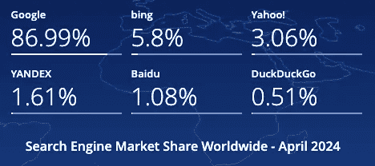

最早定义 “AI 搜索” 这个赛道的产品当属 Perplexity 了，在不到 50 人团队的努力下，用户规模已增长至数千万，今年以来已处理 7500 万次用户查询，ARR 超 2000 万美元，4 月份最新估值高达 30 亿美元。

**国内市场，抛开传统搜索以及垂直社区类的搜索玩家，聚焦“AI+搜索”定位的产品当属去年 8 月昆仑万维发布的天工 AI 搜**索，此后各家纷纷上线 AI 搜索功能；就时间点而言，天工 AI 搜索功能上线距离 Perplexity 推出仅相差数月。

昆仑万维对 AIGC 布局最早可追溯至 2019 年，去年 4 月昆仑万维自研大模型天工 Skywork 上线，同期发布的另外三家国产大模型厂商包括文心一言、通义千问以及讯飞星火。

**时隔一年多，天工 AI 已经日活百万，成为中国 AIGC 应用榜探花，从目**前产品形态来看，天工 AI 更像是一款以 AI 搜索为主的多模态全能 AI 助手，除了大模型基础功能 —— 文本处理之外，还同时支持文生图、图像处理、视频转绘、动漫以及音乐生成等多元应用，对多模态应用的布局处于国内领先。

## ▍ 国内顶尖 AI 搜索处于什么水平？

随着谷歌 Gemini 的搜索 demo 出炉，天工 AI 上线已久的高度重合功能也被广泛关注，比如，多步骤推理，搜索增强模式下，天工 AI 能够针对用户 Query 进行拆解、细化、进一步追问、信息理解与补全，使其在自然语义理解方面性能更强，面对不确定性知识时表现更好，能够更精准、高效地满足用户需求。

我们紧跟热点试着输入“高考报志愿”、“高校排行榜”等，不仅能够自动推理，还能进一步输入定制化需求，而且可以呈现实时信息调取的特定卡片，完美解决了实效性问题。

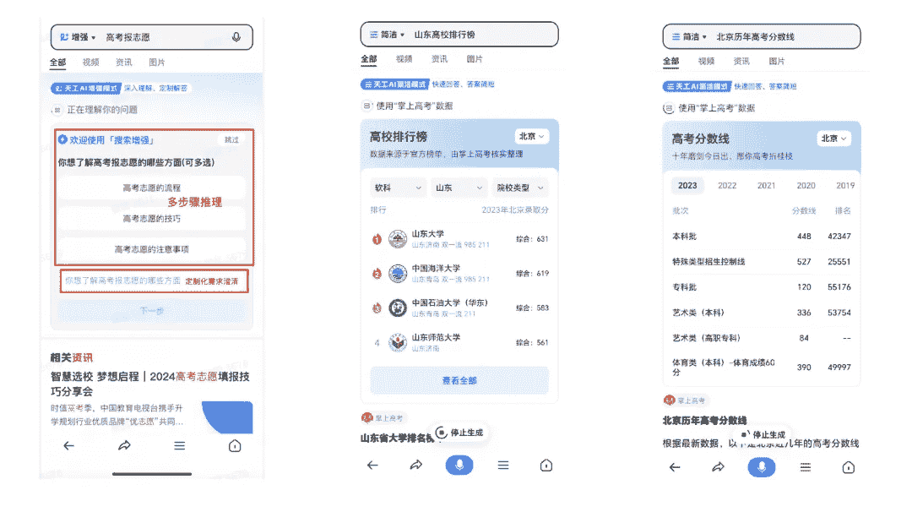

同时，图文并茂的多模态搜索体验也是天工 AI 的独特能力之一，除了文本上能够实现图文并茂，在生成多个产品横向对比的表格也极为出色。

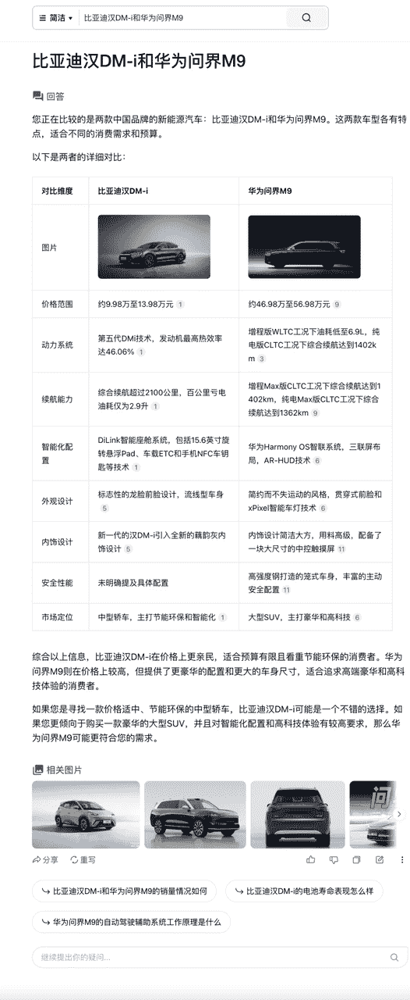

比如近期，比亚迪官宣了第五代 DM 技术，据说综合续航里程达到 2100 公里，于是用天工 AI 搜了一下，直接得到了一篇图文并茂的讲解文章：

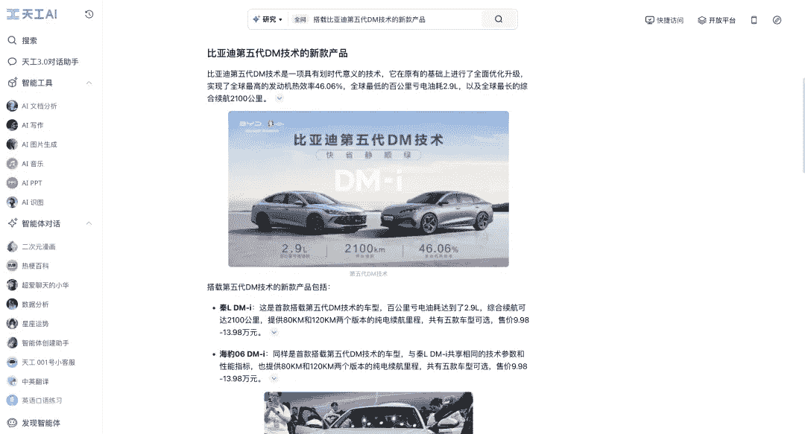

天工 AI 给到的答案有提到搭载比亚迪最新技术的两款车型—— 秦 L DM-i 以及海豹 06 DM-i，为了对这两款车型有更准确的感知，于是用天工 AI 搜了“比亚迪第五代 DM 技术两款车型”，天工 AI 在全网搜寻了 15 个信源，得出了以下结果。还能自动生成大纲和大脑， 帮我理清要点思路。

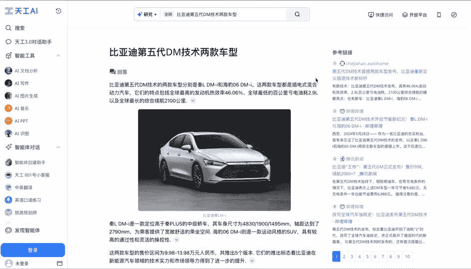

[0bc3ueaa2aaagiahbn3sxftfbiodbwqqadia.f10002.mp4](https://internal-api-drive-stream.feishu.cn/space/api/box/stream/download/all/Ivzib5BKYopQBzxy3ZeciGfpn9e)

除了给到搜索结果，天工 AI 还自动推理出了延伸的问题，比如“秦 L DM-i 与海豹 06 DM-i 在性能上有何不同”：

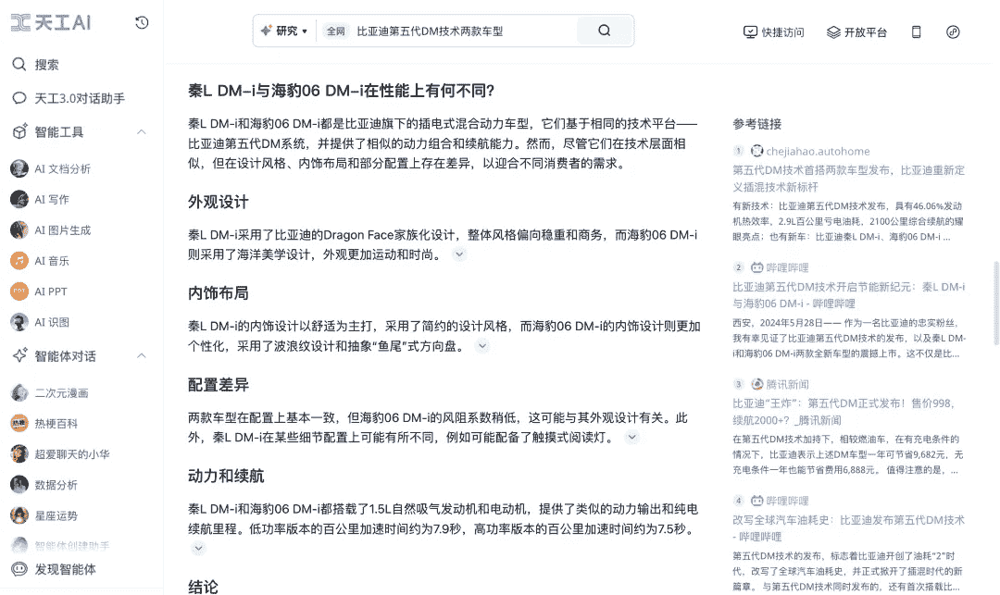

时效性一直是大模型的能力的薄弱点，而天工 AI 很好的解决了这个问题，能够实时搜索股票、油价、彩票、金价、快递、天气、日落时间、星座运势、解梦等这些高实时性要求的信息。

输入“比亚迪近期股价变化”便能获得股价实时数据的卡片式结果，还附带了一段 AI 整理的股价变化描述，清晰明了。

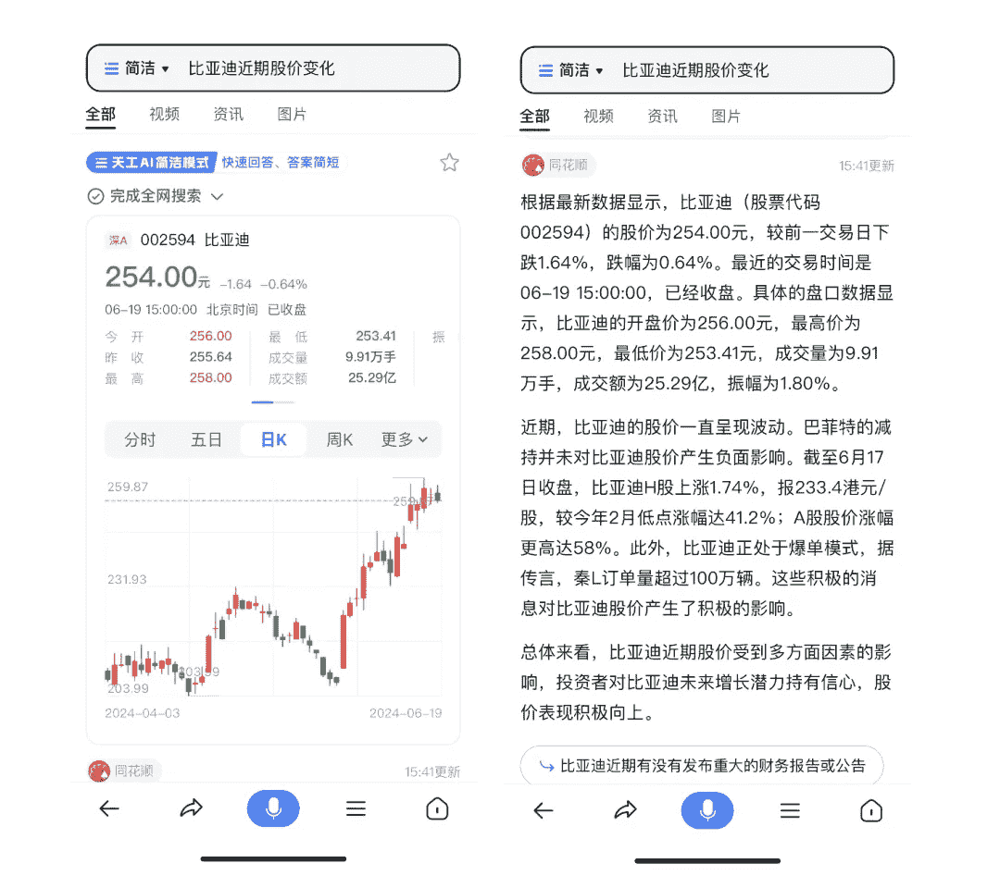

对于身边的行业研究与分析师朋友来说，每天跟踪海内外科技行业资讯，然后还要从这些海量信息中整理成高质量的文档，不管是 Word、PPT 还是 Excel，涉及不同工具与工作流转换，本身就是一件很费精力的事。

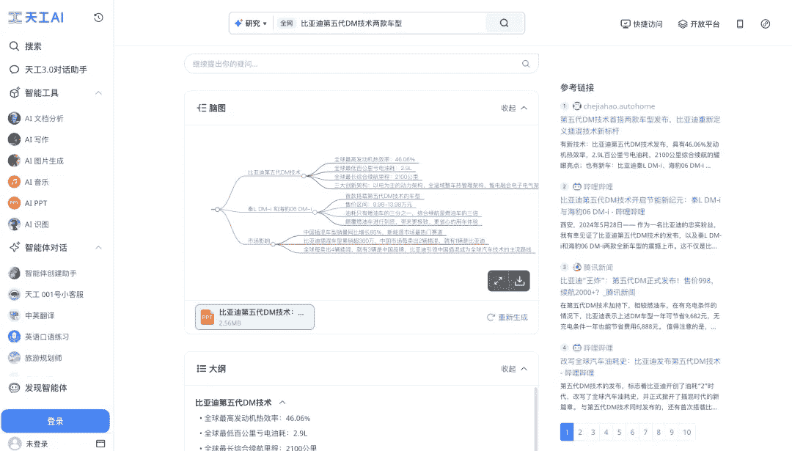

这就**不得不表扬一下天工 AI 的办公套件，除了**脑图、大纲、excel 数据分析、文档解析，还能根据搜索结果一键生成 PPT、Word 和 PDF，而且可以免费下载到本地，方便后续修改、留存和分享。对于需要进行市场调研、学术研究、撰写研报和白皮书任务的用户来说节约了很多时间与精力：

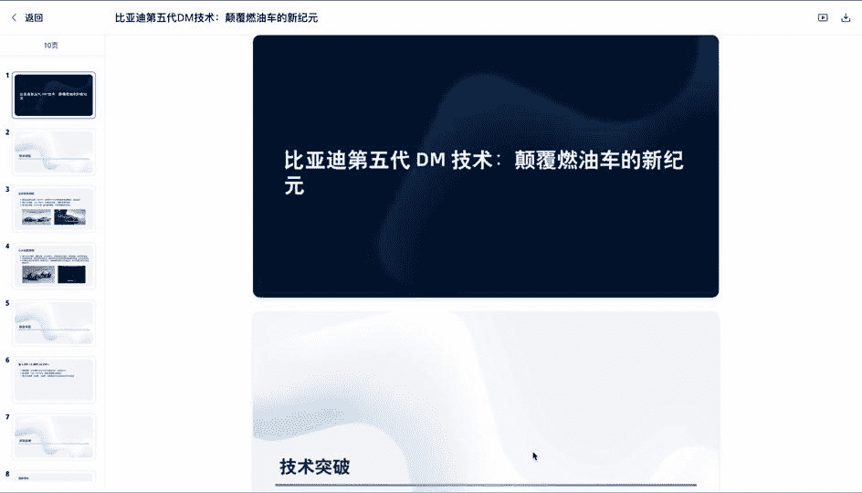

[0bc33aaa2aaameahb7dsyrtfbwgdbxmaadia.f10002.mp4](https://internal-api-drive-stream.feishu.cn/space/api/box/stream/download/all/WH6Pbl637ogzI1xbLLaclFNcnre)

**目前**来看，像天工 AI 这样同时支持文本、图片、音频、脑图等多形态答案与一体的 AI 产品寥寥无几，给用户更加直观的答案体感，而非其他 AI 工具每个形态独立输出，尚不具备多模态整合生成能力。

## ▍AI 搜索终局或是多模态通用助手

天工 AI 不仅具备强大的多模态搜索能力，基于基座大模型天工 3.0 和 MoE 大模型的能力加持，同时集成了 AI 写作、AI 长文本阅读、AI 对话、AI 语音合成、AI 图片生成、AI 漫画创作、AI 图片识别、AI 音乐生成、AI 视频转绘、AI 代码写作、AI 表格生成等多项能力。

天工 AI 在文档处理方面效果是非常不错**的。以英伟达上月发布的第一季度财报为例，点击左侧栏“AI** 文档分析”，上传英伟达最新季度的英文财报，很快就整理出一份中文的概述，一目了然：

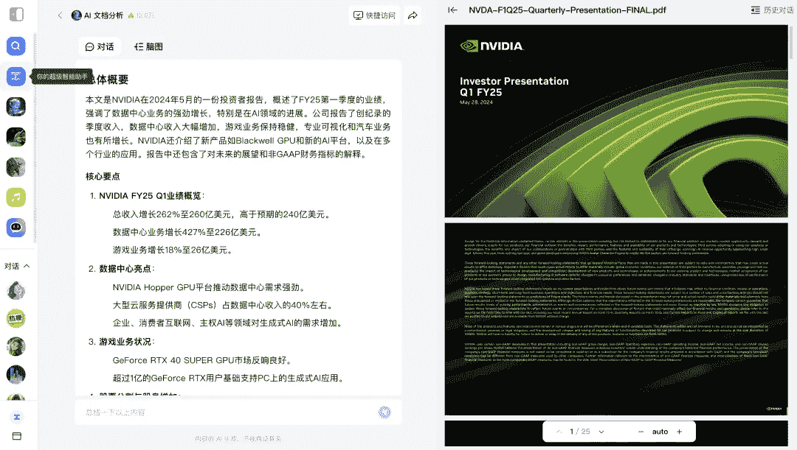

同时，你也可以继续在对话框中要求天工 AI 根据这份 PDF 财报中的英文财务信息，整理一份阅读性更高的中文数据表：

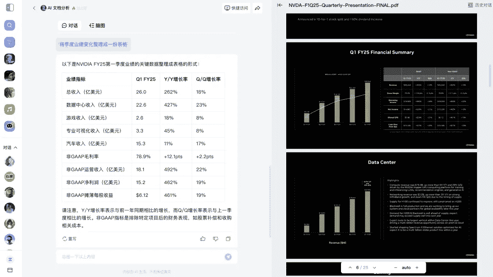

另外，通过天工 AI 的“AI 图片生成”功能设计一份具备科幻感的海报：

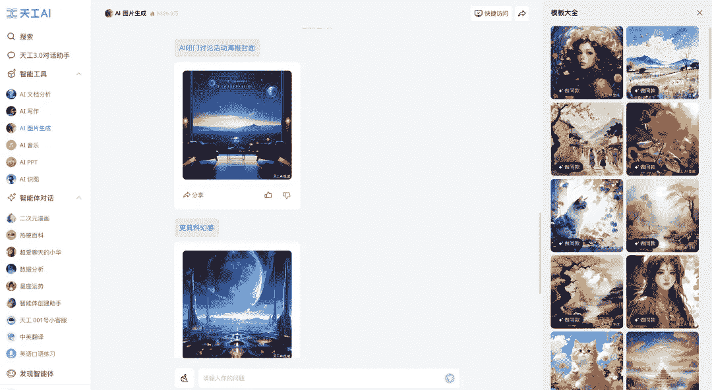

甚至在天工 AI 手机端新上线的「AI 视频转绘」功能制作创意视频，拍摄或者上传 10s 内的小视频，就能转绘成二次元风格，制作动漫表情包或者卡通 MV 都不在话下：

以下节选了 HBO 影视剧《硅谷》主人公参加 TechCrunch Disrupt 活动的一个几秒钟片段，选择“迪士尼风格”后的效果：

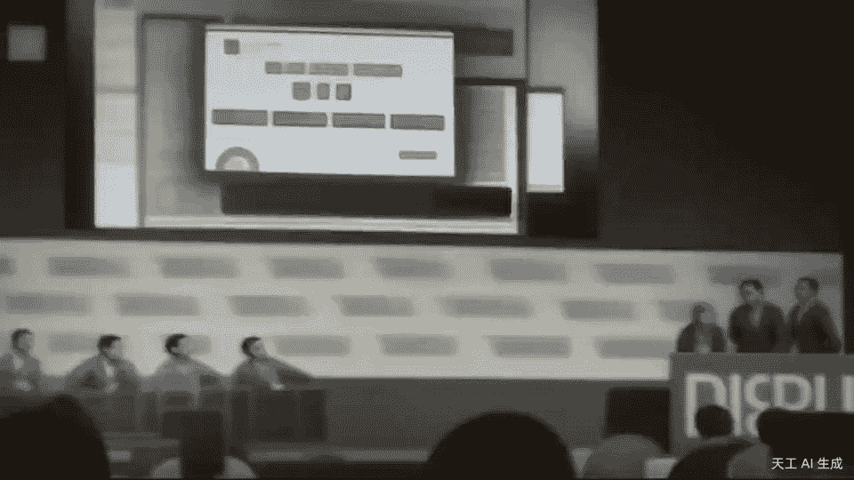

[0bc3qaaaqaaakiahk2tshntfbagdbcaaacaa.f10002.mp4](https://internal-api-drive-stream.feishu.cn/space/api/box/stream/download/all/YGjQbC4naozfEixAAElchcdRnqe)

此外，你也能通过天工 AI 的“AI 识图”来分析一些信息图，例如英伟达 CEO 黄仁勋在最新 COMPUTEX2024 上演示的 PPT 截图：

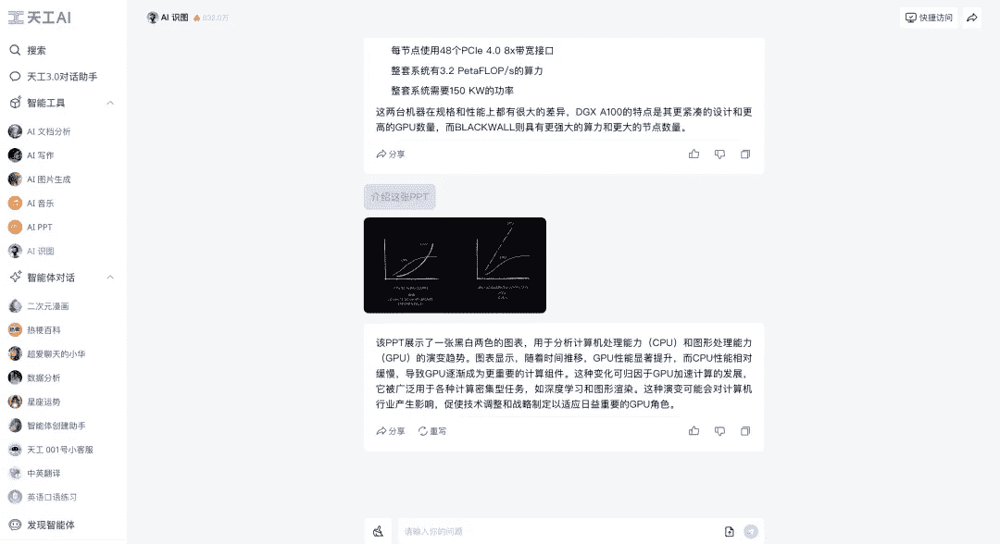

还能通过智能问答的形式完成各类工作学习、生活等场景的需求，满足文案撰写、图片生成、百科知识解答、代码编程、自媒体创作、小说写作、旅游攻略、食谱餐谱、健身计划、论文作业等等，一站式解决全场景刚需问题。

例如，上一秒还在问天工 AI 关于英伟达的最新动态，不仅概括了上个月的财报，也包括了近期 CEO 黄仁勋在 COMPUTEX 2024 上提到的最新服务，下一秒就用天工 AI 询问了近期的假期安排，并且制定了一份非常完整的旅游攻略，即使是作为一份参考，也节省了不少时间：

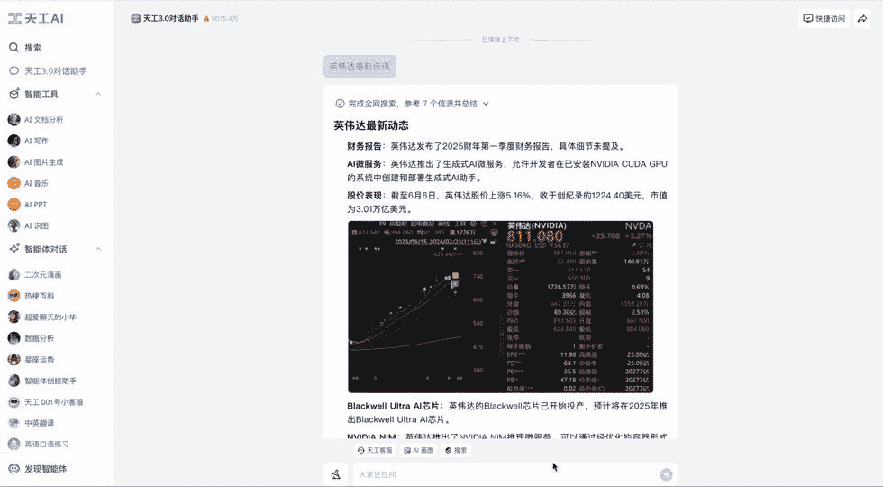

[0b2eciabiaaa4qagtw3s2ztfaewdcqjaafaa.f10002.mp4](https://internal-api-drive-stream.feishu.cn/space/api/box/stream/download/all/YktobPyhooJ7zXxiGwnca56pnsc)

**根据 **FirstPageSage 数据，截至 2024 年 3 月，ChatGPT 以 61.3% 的市场份额占据美国 AI 搜索市场第一的宝座，然后是 Microsoft Copilot 以及 Google Gemini，分别以 15.6% 和 13.3% 的市场份额位列第二和第三，Top3 都是通用 AI 助手。

接下来的排名是专注于特定领域的 AI 搜索引擎，分别是 Perplexity、Claude 以及 Brave，其他参与者还包括 Komo、Andi 和 You.com 等，Phind 则以 20% 的季度增速成为目前增长最快的 AI 搜索引擎。

**从这点看，国内同时布局 AI 搜索以及通用助手**的天工 AI 可以说具备很强的先发优势。

## ▍AI 搜索带来的直观感受

**不管是 Perplexity 还是天工 AI，AI 搜索相比传统搜索**自动过滤了很多付费页面、无效内容以及广告，效率提升非常大，整体搜索体验清爽许多。

天工 AI 作为国内 AI 搜索市场的领先者，背靠昆仑万维强大实力与前瞻布局，凭借独特技术实力与先发优势，在各大互联网巨头竞争激烈的大模型赛道展现出了强劲的竞争力，尤其是在对多模态能力的整合与具体应用上。

目前，天工 AI 除了上线网页版（www.tiangong.cn）之外，也支持在手机应用商店搜索“天工” App 下载或🛰️小程序【天工 AI 智能助手】直接体验。