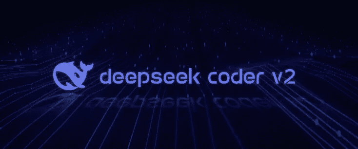
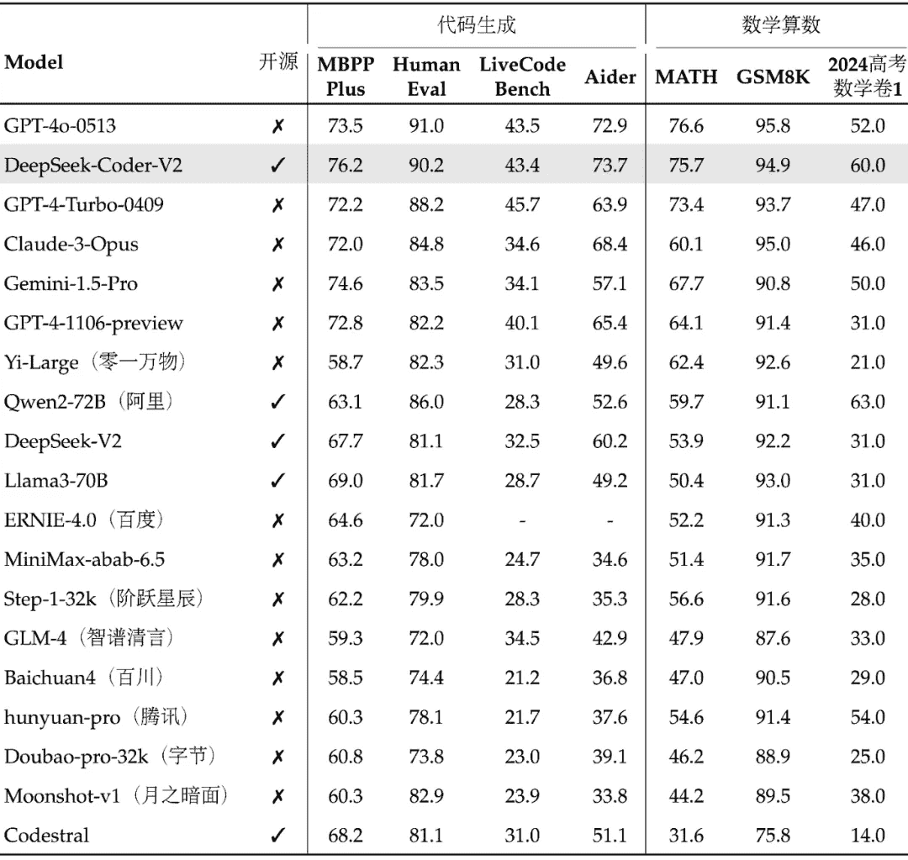
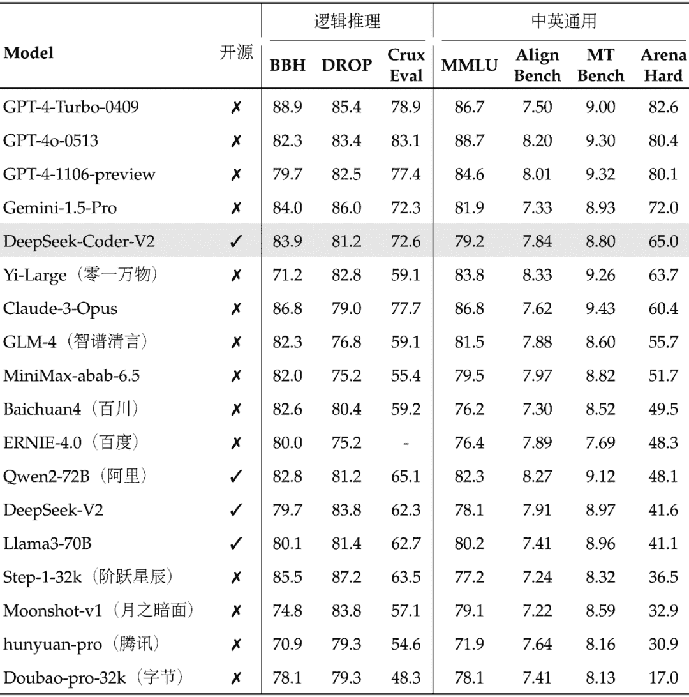
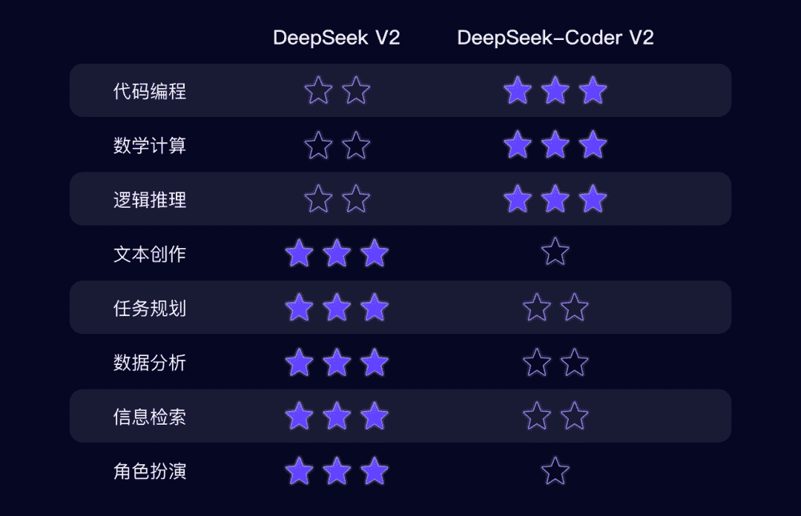
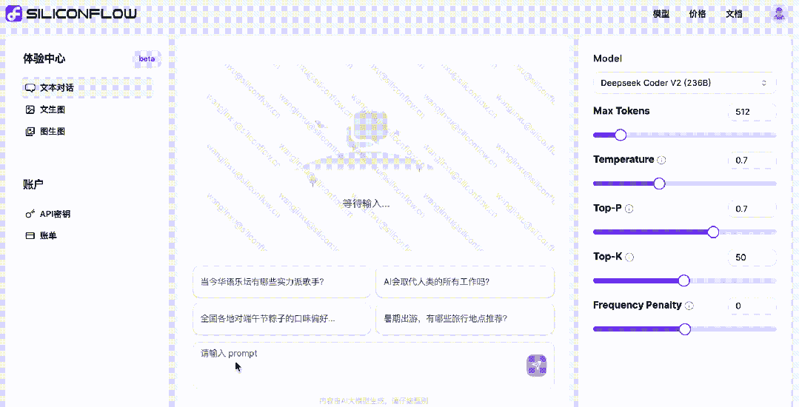
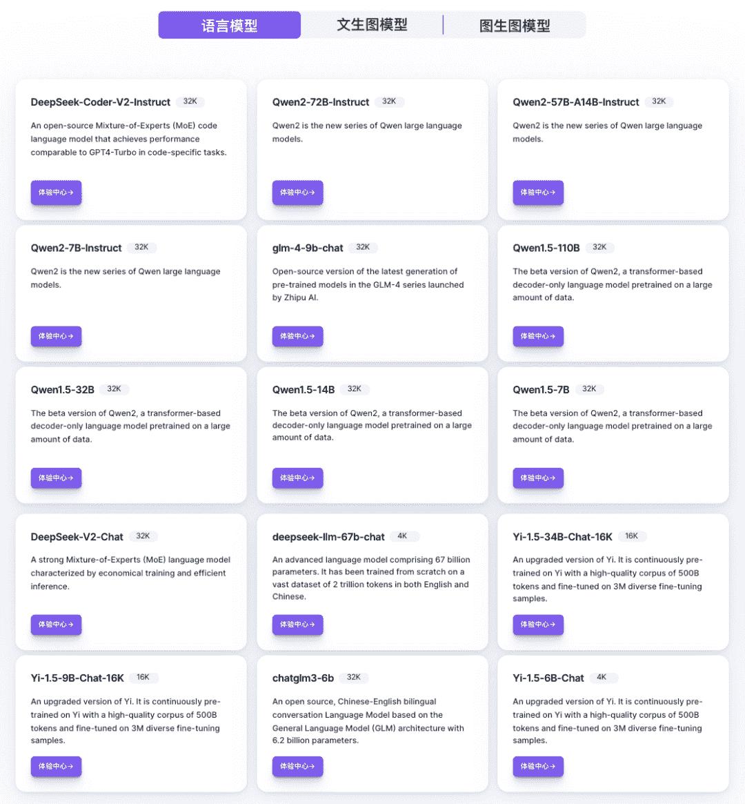

# 击败 GPT4-Turbo，最强开源代码模型 DeepSeek-Coder-V2 问世

> 来源：[https://agijuejin.feishu.cn/docx/K1XUdMteyop0RkxFcZEcr55BnRb](https://agijuejin.feishu.cn/docx/K1XUdMteyop0RkxFcZEcr55BnRb)

> OneFlow｜[阅读原文](https://mp.weixin.qq.com/s/-nss_q01MMMmjlMyugDFNQ)

> 转载请联系原作者取得授权

6月17日，深度求索正式开源了DeepSeek-Coder-V2模型。

根据相关评测榜单，这是全球首个在代码、数学能力上超越GPT-4-Turbo、Claude3-Opus、Gemini-1.5Pro等的开源代码大模型。DeepSeek-Coder-V2包含236B与16B两种参数规模，对编程语言的支持从86种扩展到338种。

据官方博客介绍，DeepSeek-Coder-V2沿用DeepSeek-V2的MoE模型结构，总参数236B，激活参数21B，在代码、数学的多个榜单上位居全球第二，介于最强闭源模型 GPT-4o和GPT-4-Turbo之间。

在拥有世界前列的代码、数学能力的同时，DeepSeek-Coder-V2还具有良好的通用性能，在中英通用能力上位列国内第一梯队。

虽然DeepSeek-Coder-V2相比DeepSeek-V2在评测中综合得分更高，但在实际应用中，两个模型各有所长。DeepSeek-V2是精通文本创作、角色扮演等能力的“文科生”，DeepSeek-Coder-V2是精通代码生成、数学计算等能力的“理科生”。

一如既往，继**D**eepSeek V2之后，硅基流动团队第一时间在云服务平台SiliconCloud上线了DeepSeek-Coder-V2（236B）开源模型。

欢迎来玩儿：https://cloud.siliconflow.cn/models/text/chat/17885302528

目前，SiliconCloud已上架包括D[**eepSee**](http://mp.weixin.qq.com/s?__biz=Mzk0NzYzNTMyMA==&mid=2247483892&idx=1&sn=aba7848a156dc9d1be2b081d811d3d4e&chksm=c37294e3f4051df528b4a403de0c7e015beb653ac3012434457ea5c7e2f587034dccb1329f77&scene=21#wechat_redirect)k-[**Coder-V2、 Stab**](http://mp.weixin.qq.com/s?__biz=Mzk0NzYzNTMyMA==&mid=2247483835&idx=1&sn=855c07c1e6157b82e4842f6c08606212&chksm=c37294acf4051dba3c3b5f553564fbb1a93621abf7f20a60db0d383c706d08e8c4cac4467e0b&scene=21#wechat_redirect)le Diffusion 3 Medium 、 Qwen2 、 GLM-4-9B-Chat 、DeepSeek V2、SDXL、InstantID在内的多种开源大语言模型、图片生成模型，支持用户自由切换符合不同应用场景的模型。同时，SiliconCloud提供开箱即用的大模型推理加速服务，为生成式AI应用带来更高效的用户体验。

**真正在乎大**模型**推理性能和成本的开发者，绝不会错过S**iliconCloud。

更何况， 从现在起， 新用户还送1亿token。

快试试吧 ： www.siliconflow.cn/zh-cn/siliconcloud

扫码加入SiliconCloud用户交流群

