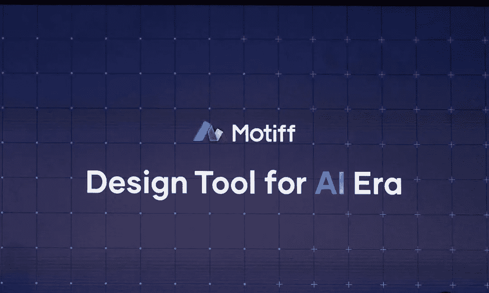
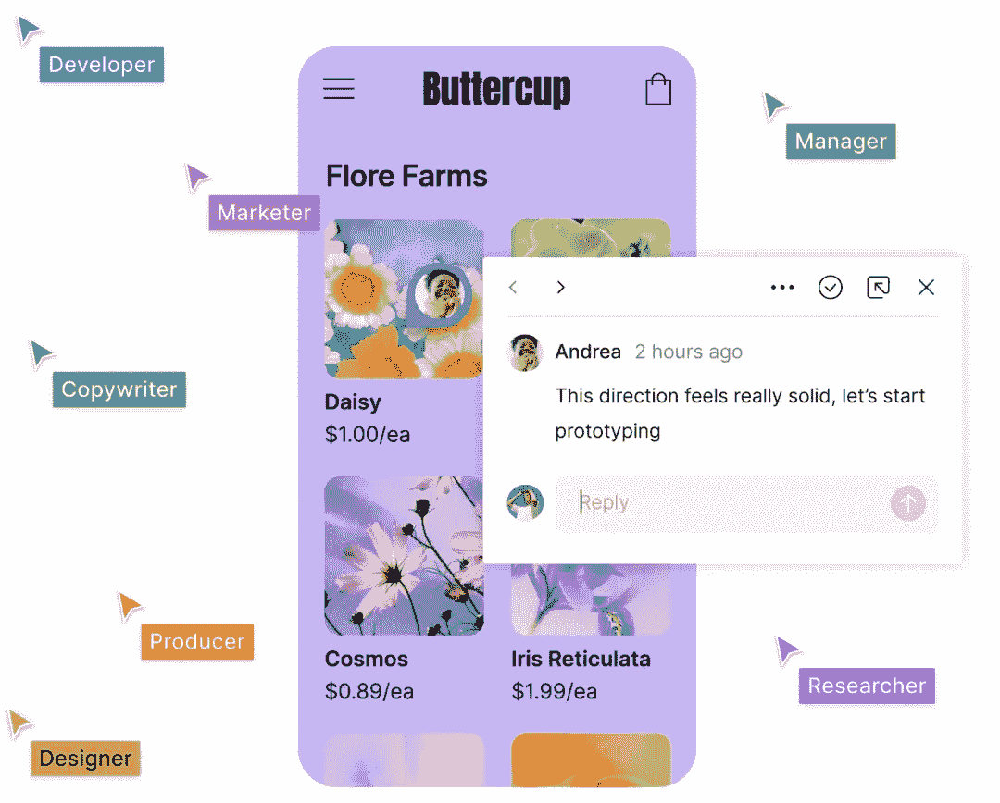
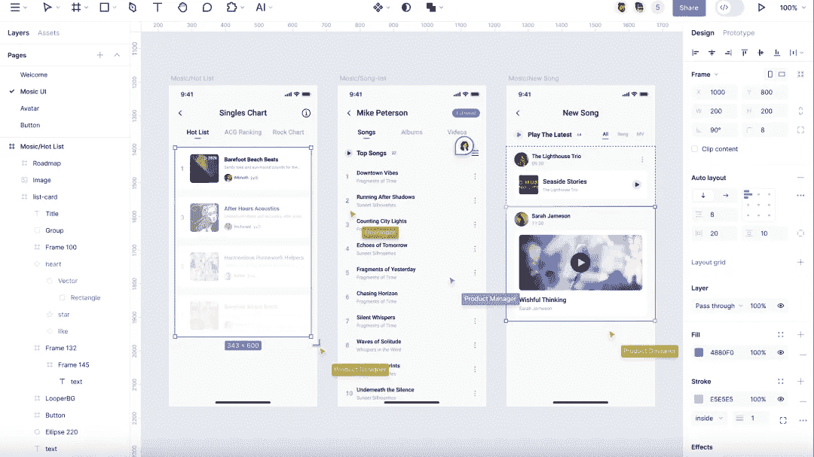
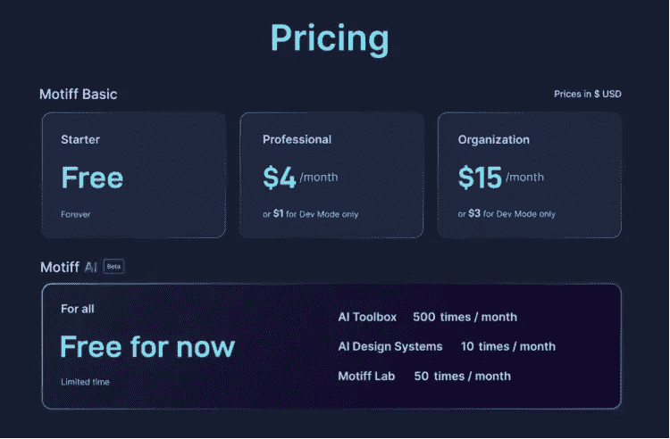
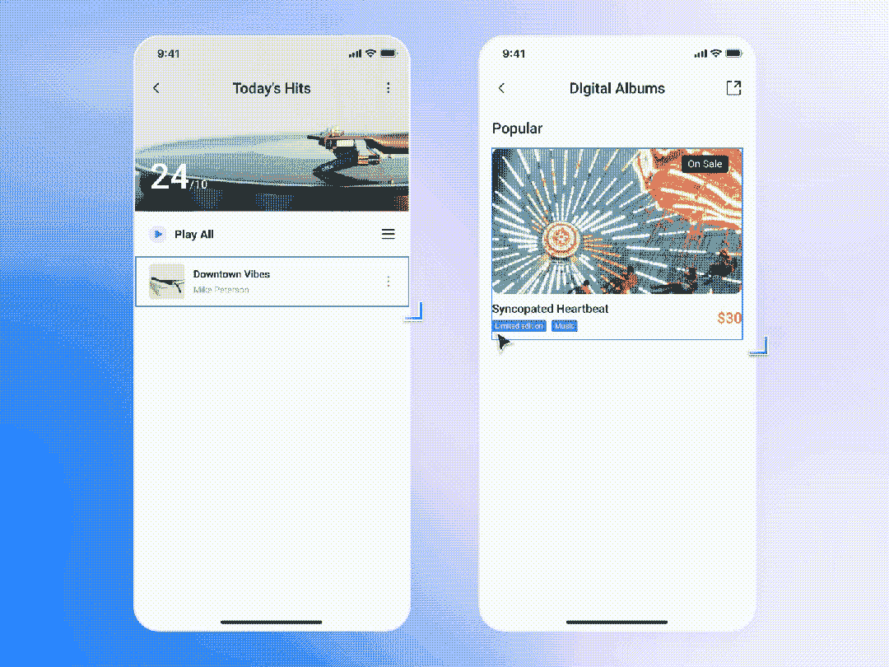

# 猿辅导孵化的一支创业团队，想用 AI 颠覆设计巨头 Figma

> 来源：[https://agijuejin.feishu.cn/docx/P3gAdJ8cfoKxHXx1RD4cL07Cnkf](https://agijuejin.feishu.cn/docx/P3gAdJ8cfoKxHXx1RD4cL07Cnkf)

> 极客公园｜[阅读原文](https://mp.weixin.qq.com/s/6advUIDIil0T6o7rMKGrCw)

> 转载请联系原作者取得授权

最近，UI 界面设计软件赛道出现了一款新的产品。这挺让人意外的，因为看起来这个赛道的市场竞争已经饱和了。国外巨头 Figma 成立 12 年，拿下了这一市场 70% 的份额；国内科技企业蓝湖成立 5 年，对 Figma 紧追不舍。

然而，这个新玩家不仅要同时做国外、国内市场，还称 Figma 是自己唯一的对手、要跟它一较高下，并不畏惧这是一家价值 200 亿美金（一年半前 Adobe 的收购价）的公司。

这个新产品孵化自猿辅导，一家教育背景的公司。三年前，一场教育宏观政策的调整后，猿辅导内部尝试了羽绒服、月子中心、咖啡等多项业务，这款产品也是其中之一。

当时 ChatGPT 引发的 AI 热潮还未发生，但团队在考察完 UI 界面设计赛道后，就判断 AI 会是自己逆袭 Figma 的机会。之后，AI 大模型席卷全球，甚至间接「搅黄」了 Adobe 对 Figma 的收购案——除监管原因外，行业内普遍认为 AI 展现出了对传统 UI 界面设计的颠覆实力、让 Adobe 开始重估 Figma 的价值。

为什么这支团队会提前判断 AI 能颠覆 UI 界面设计行业？一支教育背景的团队又如何跨越行业壁垒做成这件事？AI 真的能给新入场者带来挑战巨头的机会吗？他们到底做得怎么样？6 月 5 日，在经过两年半的筹备后，团队在新加坡全球首发了这款名为 Motiff 妙多（以下简称 Motiff）的产品。

极客公园第一时间体验了这款产品、并和幕后的创始团队进行了交流。这些疑问有机会得到回答。

# 01 为什么是界面设计赛道？

回到故事的起点。2021 年底，猿力科技 CTO、Motiff 联合创始人杨元祖带队投入软件应用方向。契机很简单：当时团队在用 AI 代码助手 Github Copilot，尽管当时 AI 还没有今天这么热，但所有人都在用它写代码。这让团队意识到，如果能用 AI 结合效率工具，可能会带来巨大的生产力变革。他们开始设想，能不能用 AI 来变革 UI 界面设计这个场景——团队很多人从 2018 年起就开始使用 Figma、也调研过国内的相关产品，但都感觉「可以做得更好」。

UI 界面设计应个人电脑而生，只要有屏幕的地方就有 UI 界面设计，比如淘宝、美团、滴滴等 App 的每一个细节都是 UI 设计。而设计师的工作，对上要承接产品经理对业务的理解意图，对下要呈现一版直接面向用户的可交互界面。

追溯 UI 界面设计领域的历史，它大概经历了从像素时代、矢量时代再到协同时代的切换。Photoshop 曾是网页设计师人手必备的像素时代设计工具；后来，Sketch 结合矢量设计，打造了一个专为 UI 设计师使用的编辑器；而 Figma 则打造了一个云端设计编辑器，让设计师及其上下游能实时协作，避免了过去来回传输文件协作的低效，因此拿下了 UI 界面设计 70% 以上的市场份额。

Figma 解决了 UI 界面设计的云端协同问题｜图片来源：Figma 官网

而当时的 Motiff 团队则看到还有很多低效的部分有待解决。据极客公园了解，UI 设计的工作流一般分为三个环节：设计师先根据产品经理的需求设计相应的界面风格、确定后需要延续该风格以保持用户体验的一致性、不断调整用户界面以确保能实现最初的设计意图。随着分工的精细化，这个工作流中有大量重复性的、枯燥的工作。

团队判断，可以用 AI 来解决这个问题——AI 最擅长的从相同中学习规律，从而实现自动化、提高人的生产力。

「我们从第一天就想得比较明白，AI 是我们唯一把握的机会。」Motiff 运营副总裁张昊然对极客公园表示。在加入 Motiff 之前，他在猿辅导的斑马负责产品和运营。

这个 Idea 看起来跟集团其他方向有所不同，更偏科技属性的创业。「但其实没有什么不同，都是集团基于一套判断选择出来的方向。」张昊然说。

**他所说的这一套统一的判断，是猿辅导母公司基于过去**优势的梳理，总结出的三条适合自己的方向：

1.  重产品和研发，过去猿辅导开发了斑马、猿辅导等优秀产品，且 2014 年的时候就成立了 AI LAB，这是其优势之一；

1.  重品牌，过去公司打造了猿辅导等成功的教育品牌；

1.  重规模化的业务，过去教育实际上是一个规模化的业务，团队也在过程中锻炼出了规模化服务能力。

可以理解羽绒服、月子中心、消费品等方向符合这三点，但为什么界面设计方向符合？

在张昊然看来，界面设计软件本质上考验的是产品能力，因为设计师们用起来的体验是很直观的；其次，它也重品牌，比如 Figma 就锁定了设计师们的心智；再次，这是一个规模化的、可以长久做下去的大赛道。

团队算过一笔账，Figma 一年大概向一位设计师收 4000 元左右，软件付费还不及人力成本的 1%。团队判断，屏幕界面设计的数字化仍有增长空间。Figma 一年收入在上亿美金，这个市场规模只会更大。

那么一个不得不问的问题是，作为一个新团队怎么能有实力挑战 Figma？拿下 70% 以上市占的 Figma，几乎没有真正的对手。

张昊然说，这正是「反直觉」的部分。过去，Figma 的市场竞争是不饱和的，因为没有团队拥有足够的人才密度、基础设施、并施以足够的注意力。但在 2021 年那个背景下，猿辅导这家估值近 200 亿美元、手握数十亿美元融资额、拥有教育大战中卓越战绩和诸多资源积累的公司，盯上了这个赛道。他们试图跟 Figma 掰一掰手腕。

「AI 的出现让这个行业不再是 Figma winner takes all（赢家通吃）。」张昊然说。

# 02 AI、决心和投入，或许是追赶的关键变量

想在界面设计赛道跟 Figma 争一争高低，核心就看能不能拿出比它性能更优的产品。做出 AI 功能之外，还需要做出一个媲美 Figma 的具备云端协同能力的专业设计编辑器。这意味着，要追上 Figma 积累近十年的顶尖界面设计技术，对产研考验巨大。

这个目标看起来非常艰难，甚至不太能实现。但 AI 带来了改变的可能性。

在 AI 方面，团队过往是有技术积累的。2014 年，猿辅导就成立了专注 AI 技术前沿探索与应用的 AI Lab。当时，这个实验室研发了用于预测学生能力值的心理学 IRT（项目反应理论）模型，该模型的第一行代码就是由杨元祖写下。

在 AI 技术积累之外，与团队一起回顾过去两年半的研发历程，斗志和决心也是其追赶 Figma 的两大关键因素。

这似乎是一支基于某种共同「信念」聚集起来的产品研发团队。在过去多年的教育行业大战中，猿辅导通过高薪吸引了许多优秀的产品研发人才。他们有更远大的志向，希望做些不一样的事情，不论是为自己还是为公司。

有什么目标能比「挑战 Figma」更吸引人呢？Motiff 正式立项后，猿辅导内部顶尖的工程师开始向其聚集。张昊然列举了猿辅导过去的核心项目，如斑马、猿辅导等，其负责人都已加入其中。有的从管理数百人转为管理数十人，这表明团队的战斗力变得更为精悍。

薪水侧面体现了这群人才的实力。据了解，Motiff 工程师的薪水比同期大厂高不少。张昊然认为，这样一支有战斗力且优秀的产研团队，是 Motiff 最重要的竞争力。

本质上，这家公司大概相信这样一件事情：召集一帮最优秀的人才，给他们一个清晰、远大的目标，他们就会投入决心和斗志，让不可能变成可能。也许正因如此，他们觉得一支教育背景的团队，跨越行业壁垒去做 UI 界面设计这件事，也并非不可实现。

比如如何快速了解界面设计行业、懂用户痛点？答案是努力学。张昊然的方法是几个月内密集见了近 70 位各互联网公司的设计负责人，最后对设计师的痛点如数家珍。比如团队成员是这样了解用户痛点的：他们要将设计师们日常的工作录屏，然后反复观看；他们还要用自家软件临摹出某 App 的 UI 界面。

又比如 Figma 沉淀了近十年的技术壁垒，要怎么追上？答案还是努力学。Figma 的核心独家技术是云端设计协作，这对性能——即编辑器的流畅性、鲁棒性（稳定性）等考验极大。而国内相关研究屈指可数，「很多都是奥赛级别的难题。」张昊然说。而团队的方法是，从行业公开的技术报告里一点点学、并不断尝试和「交学费」。

为了解决性能问题，他们甚至把底层技术架构推倒重来。很多研发同事会在分享会上说，这是他们职业生涯做过最难、最强的项目。

张昊然说，之前团队预期用一年把这事做成，结果发现工程难度实在太大。而解决办法也是一样的——就是投入更多的决心和资源。2022 年，在研发近一年后，团队又在集团内部号召了第二波产研人才。内部做好了投入至少 3-5 年的决心。

「你无法逃避，就是需要破釜沉舟的决心。」张昊然说。他认为在极度专注之后，很多看起来很难的事情，其实没有那么难。

经过两年半这件事终于做完了。6 月 5 日，团队向全球发布了 Motiff 产品。团队介绍，这是继 Figma 之后全球第二家、也是国内首家自研 Web 端图形渲染引擎的产品，在多个性能方面逼近甚至超过 Figma。

Motiff 产品界面｜图片来源：Motiff

以流畅度为例，Motiff 的 FPS（画面每秒帧数）保持在 50 以上优秀区间、Figma 为 40 左右。在鲁棒性方面，Motiff 在超过 100 万图层元素的单画布中依然可以顺畅编辑，而同样环境下 Figma 在达到 80 万图层时部分功能会受限。

同时，其价格比 Figma 更低。Motiff 面向全球市场统一定价，其中基础版免费；专业版基础功能价格为 24 元/月（国际版 4 美元/月），研发模式 6 元/月（国际版 1 美元/月）；企业版基础功能价格为 90 元/月（国际版 15 美元/月），研发模式 18 元/月（国际版 3 美元/月）。以此计算，企业采购的综合价格相比 Figma 低 80% 以上。

之所以定价更低——在张昊然看来，Motiff 定位在于 AI 设计，那么基础的设计协作功能应该作为「标配」、最终收费的核心要靠 AI 功能。目前 Motiff 的 AI 功能限时免费。

Motiff 各版本定价｜图片来源：Motiff

# 03 没有业务历史包袱，AI 设计跑得更快

如果说追赶 Figma 已有的性能是起跑线，那么用 AI 技术改造界面设计软件这件事，才是团队真正重要的工作。

Motiff 很接近今天我们常说的「AI Native」（AI 原生）企业。也就是说，它是一个生来就带着用户痛点、希望用 AI 来解决的企业，而不是已经有成熟业务、希望用 AI 来改造的企业。这是它和 Figma 的根本区别。

但张昊然认为更准确的说法应该是「AI Driven」（AI 驱动）。跟那些先有 AI 技术、再寻找应用场景的企业相比，Motiff 是先找到了应用场景、再用 AI 解决问题。

如果说在 Figma 主攻的云端协同方向，更像是前者已经交了一份 100 分的答卷，团队要努力琢磨怎么追平分数；而在团队率先做的 AI 设计方向，这则更像是一道开放试卷，怎么解题其实没有标准答案。

这带来的优势是，在没有过去业务历史包袱的情况下，团队对外既不用担心加功能会影响用户体验、对内也不用担心会面临的组织沟通等掣肘。就像在一张空白的纸上作画，轻松、容易施展开。

通过观察设计师日常工作行为，团队发现了其中高频的、高重复性的部分，这就是率先可以用 AI 来解决的。

比如团队发现，设计师们日常工作中有 50% 以上的动作是「重复」，即不断复制、粘贴、修改；他们还要不断调整页面布局、拖拽移动、对齐，以保证整个页面的有序；搭建一套统一风格的设计系统是很重要的，但很多企业没有实力搭建、或者维护的成本过高……这些工作耗费了设计师们大量的时间、精力，也耗费了企业大量的成本。

一个夸张的例子是，某大厂为了调整产品系列里两个卡片的间距，总共 2000 多个界面的修改——花 10 个设计师两周的时间。

在 2021 年底，Motiff 试图用 AI 来改造这件事的时候，大模型还没有席卷全球，团队更多是基于传统的深度学习在做：即通过大量的数据训练，让 AI 能在这些重复的设计、行为中学到规律，最终实现自动化生产、达到设计工作的降本增效。

6 月 5 日，Motiff 展现了核心的五大 AI 功能：「AI 复制」、「AI 布局」、「AI 设计系统」、「AI 生成 UI」和「AI 魔法框」。

其中，「AI 复制」是把设计师日常工作中大量重复的「复制-粘贴-逐一修改」，一键用 AI 来完成，省去了繁琐的调整步骤。「AI 布局」则让 AI 帮助设计师布局，让他们能兼得自由设计和结构化设计的优势。张昊然介绍，经过团队测试，在诸多场景下，使用这些 AI 工具可降低设计师 50% 以上的重复操作。

Motiff 的 AI 复制功能｜图片来源：Motiff

Motiff 的「AI 设计系统」则既可以让设计师在创建和维护「设计系统」时，一键找出需要的组件和样式；也可一键对「设计系统」进行一致性检查。它把过去需要设计师花费至少几周才能完成的工作，缩减到只要几分钟。

而 2022 年底爆火的大模型技术，则主要影响了这项「AI 生成 UI」功能。

很多人都看到过 GPT-4 的惊艳展示：仅仅在纸上画下 UI 界面的草图，ChatGPT 就能直接生成 UI 界面。外界讨论甚多的是，大模型是否就此让 UI 设计从 GUI（图形交互界面）转向 LUI（语言交互界面），从而颠覆整个 UI 行业。甚至从这个角度来说，具备这项能力的大模型公司也可能会颠覆 UI 设计软件公司。

张昊然说，在最开始看到 GPT4.0 的演示时，团队内部也感到震撼、甚至害怕。「你会觉得自己过去的（AI）尝试没有意义了。」然而，在慢慢意识到技术的边界后，这种恐惧感在慢慢减退。「其实做出一个看似可用的东西和实际可用的东西之间，有着巨大的 gap。」他说。

但这的确是 UI 行业最重要的变量，gap 弥合的拐点不知何时到来，团队必须现在先跟上——因此团队也抓紧推出了「AI 生成 UI」这一功能。用户只需要文字输入一段话，Motiff 就能呈现一版设计图稿。

Motiff 的 AI 生成 UI 功能｜图片来源：Motiff

张昊然介绍，Motiff 的所有 AI 功能都比 Figma 做得更快。而之所以能更快，没有业务历史包袱是一个很重要的原因。在他看来，传统玩家对已有工具做迭代是痛苦的，这是所有的老产品在遇到新技术时都会陷入的陷阱，很难克服。

他认为，抓住先发优势、并且积累出品牌价值，将会变成 Motiff 的竞争优势。目前，团队依然对这位强大的对手保持密切关注。

不过衡量产品有没有价值，核心是看有没有人买。一个让团队振奋的案例是，就在产品发布之前，某家大型企业在 Figma 订阅到期之际，在试用 Motiff 之后，决定从 Figma 迁移到 Motiff。这给了他们很大的信心。「我们就是要在比较下胜出。这种胜出一旦出现 4-5 个，PMF（产品符合市场需求）或许就出现了。」他说。

他们的目标比 Figma 更大。在张昊然看来，Figma 主打协同，本质解决的是效率问题（降低沟通成本）。而 Motiff 主打 AI，本质解决的是生产力问题，「这个价值远大于协同。」

在一年半的全球 AI 热潮下，新 AI 产品层出不穷，Motiff 的故事算是很有代表性、又极为独特的那一类。这是一个有明确市场需求、并极早投入 AI 技术的企业，一个在外力推动下诞生的企业，一个巨头的零基础追赶者。它身上展现出了这样一种可能性：一家企业如果清晰地知道自己擅长什么、并能把握明确的市场机会，再投入罕见的决心和意志，或许就能打穿不同赛道壁垒、持续拿到赢的机会。而 AI，也可能成为很多新入场者重构行业旧秩序的那道缝隙。

大模型为这个过程按下了加速键。张昊然说，两年半前创业时，团队提 AI 生产力工具还没有人信。而今天再提，听起来像是在蹭热度。不过他不觉得这是坏事。

「你非常怕的一件事是，你所期望的那个未来，做了十年都没有达成。你需要一个外界变化的机会拐点。」他认为，现在这个机会拐点已经来了。

*头图来源：Motiff