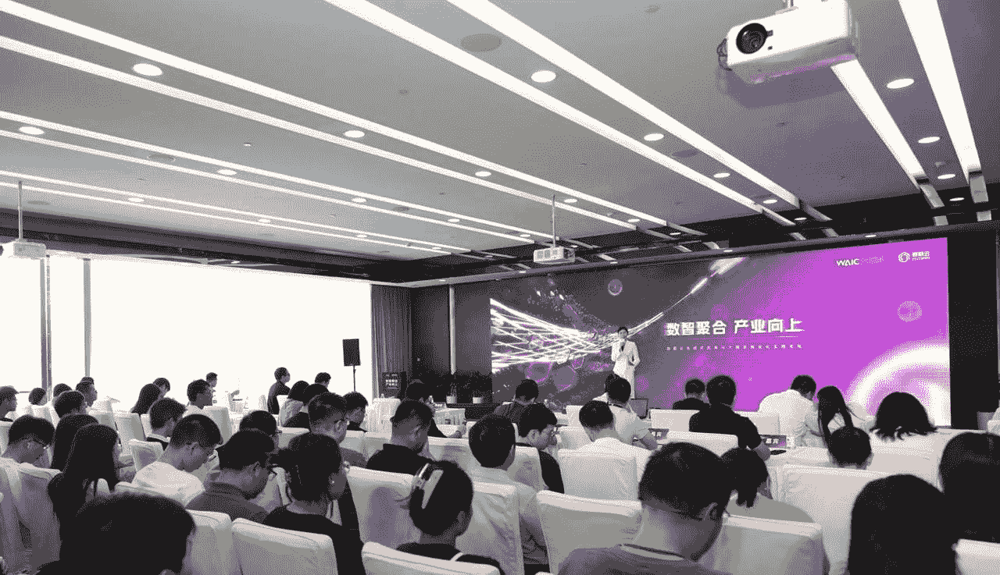
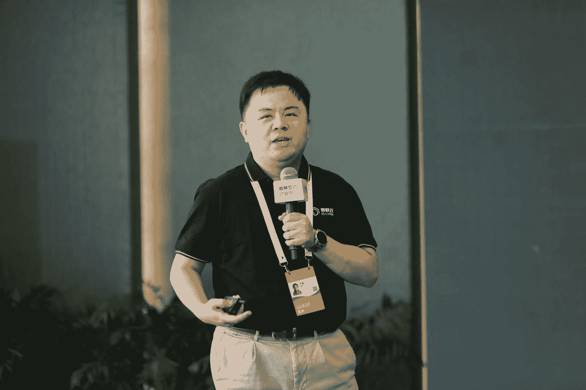
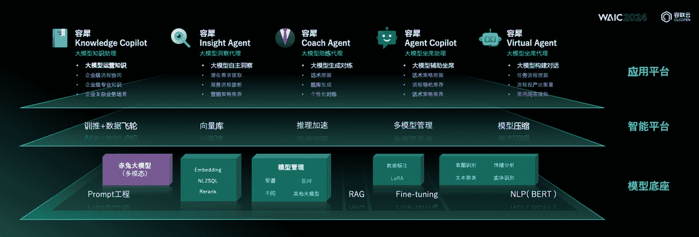
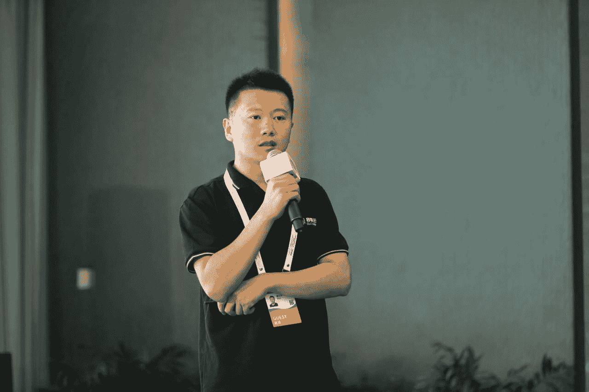
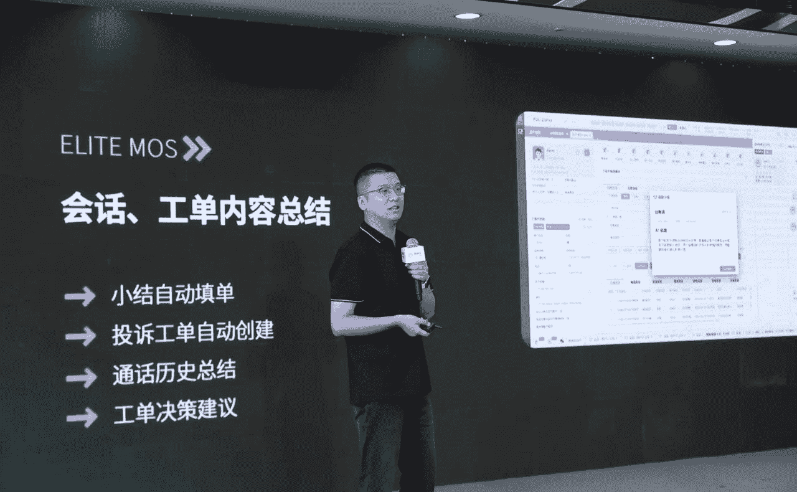
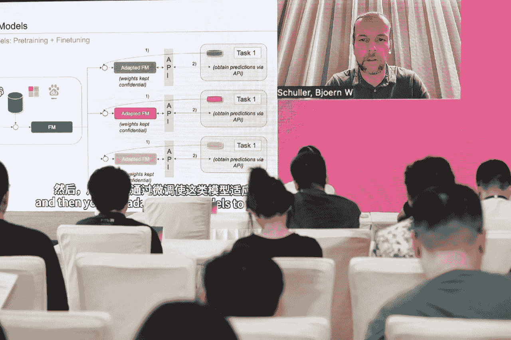
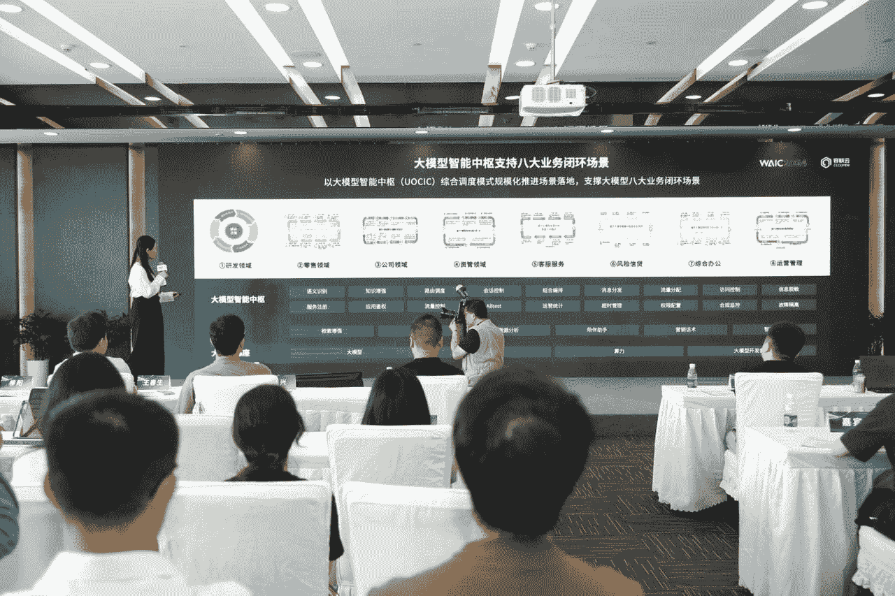

# 容联云发布容犀大模型，推动产业数智化升级

> 来源：[https://agijuejin.feishu.cn/docx/S7ALdQlaVoMfbQxgcJtcoFG1n0c](https://agijuejin.feishu.cn/docx/S7ALdQlaVoMfbQxgcJtcoFG1n0c)

> 机器之心 新闻助手｜[阅读原文](https://www.jiqizhixin.com/articles/2024-07-08)

> 转载请联系原作者取得授权

7月6日，在2024世界人工智能大会上，容联云成功举办主题为“数智聚合 产业向上”的生成式应用与大模型商业化实践论坛。

论坛上，容联云发布了容犀智能大模型应用升级，该系列应用包括容犀Agent Copilot、容犀Knowledge Copilot、容犀Coach Agent、容犀Insight Agent和容犀Virtual Agent等，覆盖了从营销、销售、服务到企业内部管理的核心场景，为企业打造全面、高效的营销服智能化生态系统。同时，现场还发布了大模型赋能下的以客户为中心的运营中台ELITE MOS，为企业提供更精准的决策支持与营销策略支持。

## 容犀智能大模型应用升级，重塑企业营销服场景

容联云产业数字云VP兼诸葛智能创始人孔淼

本次论坛上，容联云产业数字云VP兼诸葛智能创始人孔淼发表了《企业营销服场景重塑》主题演讲，并现场发布容犀智能大模型应用升级。自2023年发布自研赤兔大模型和生成式应用后，容联云持续探索大模型在千行百业中的应用实践，本次容犀智能大模型在应用层面的深度优化与升级，进一步强化了其在复杂业务场景中的适应性和效能。升级后的容犀智能包括大模型知识助理（Knowledge Copilot）、大模型洞察代理（Insight Agent）大模型陪练代理（Coach Agent）、大模型坐席助理（Agent Copilot）、大模型坐席代理（Virtual Agent）等板块。

该五大应用矩阵，为企业提供了从构建知识库到多模态交互能力、企业级流程协同、智能知识管理、个性化学习与陪练、会话洞察与营销策略推荐、智能坐席代理等核心环节的智能化闭环，企业能够实现更高效的客户沟通、更精准的客户洞察和更优化的服务流程，从而在激烈的市场竞争中占据优势，在根本上促进了企业营销效率、运营效率、服务质量的多重飞跃。

容联云大模型产品负责人唐兴才介绍了容犀智能大模型应用在多个行业的商业化实践，以及其是如何成为真正懂行业的企业级AI领航员的。

容联云大模型产品负责人唐兴才

保险行业常面临大量会话数据、价值难利用等痛点，容犀智能大模型不仅可以让会话数据发挥决策依据，还能通过会话数据洞察帮助保险公司发现咨询热点、产品投诉点；制造业如上门维修行业，常常遇到工单内容不标准难分类、风险预警不及时等问题，容犀智能大模型可以基于语义上下文提取工单故障，帮助企业避免批量客诉；寿险自动化率低、成本增长快，容犀智能大模型可洞察服务记录提取服务流程，构建智能化服务助理，并通过保单服务助手实现个性化服务；银行柜台综合服务则需要面对多种业务、多种政策，导致及时处理服务困难，容犀智能大模型知识问答助理可以帮助其提升办理贷款业务效率。

现场，容联云数字智能云事业群解决方案总经理师增辉宣布ELITE MOS全面升级，成为大模型赋能以客户为中心的运营中台。针对客户服务场景，ELITE MOS可通过智能化客服为企业提供高效决策；针对电话销售场景，ELITE MOS可通过精准营销来提升转化率，并借助全旅程监控优化客户体验。

容联云数字智能云事业群解决方案总经理师增辉

## 聚合技术创新与全景应用，共建产业生态

本次论坛特别强调了生态建设的重要性，并通过“趋势聚合、创新聚合、热点聚合、洞察聚合、能力聚合”诠释“数智聚合，产业向上”的价值，旨在联合生态伙伴共同推动大模型在多行业、多场景下的深度应用，促进技术与业务的无缝对接，形成共生共赢的产业生态。

基于全球视野，本次论坛邀请帝国理工学院计算机系终身教授 Björn Schuller分享了机器学习和深度学习在不同行业的多维多场景应用，鼓励学术界与产业界携手共探大模型在更多场景的应用潜力，推动产业向更加智能化、高效化转型。

帝国理工学院计算机系终身教授Björn Schuller

中电云计算金融事业部技术负责人孙鑫深入剖析了可信智算如何成为驱动金融行业数字化转型的新动力。邮储银行大模型技术负责人李培分享了邮储银行在大模型技术探索与应用方面的最新实践与成就。

中电云计算金融事业部技术负责人孙鑫

邮储银行大模型技术负责人李培

此外，论坛还邀请了集微咨询资深分析师孙硕、亿欧联合创始人兼总裁王彬以及上海复通软件CTO柳阳等重量级嘉宾共同讨论企业应用大模型的“落脚点”。

此次论坛不仅是容联云及合作伙伴大模型应用成果的一次集中展示，更是对未来智能产业生态共建的深刻思考与展望。容联云将持续探索大模型的无限潜能，携手行业伙伴，共同生成产业的新未来。