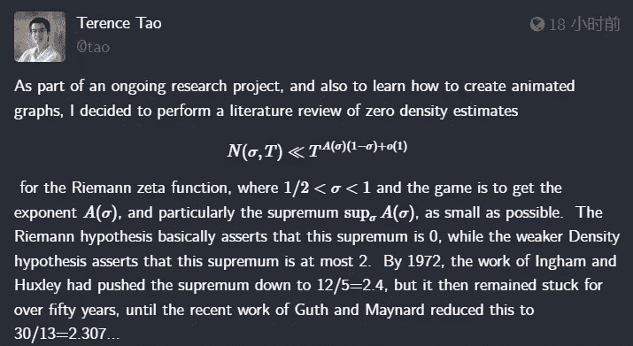
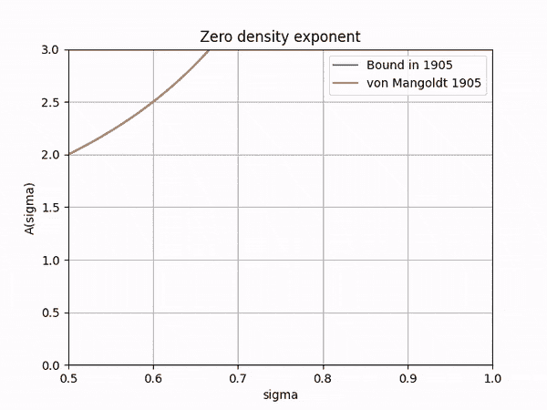
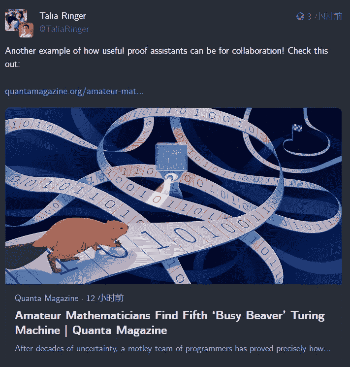
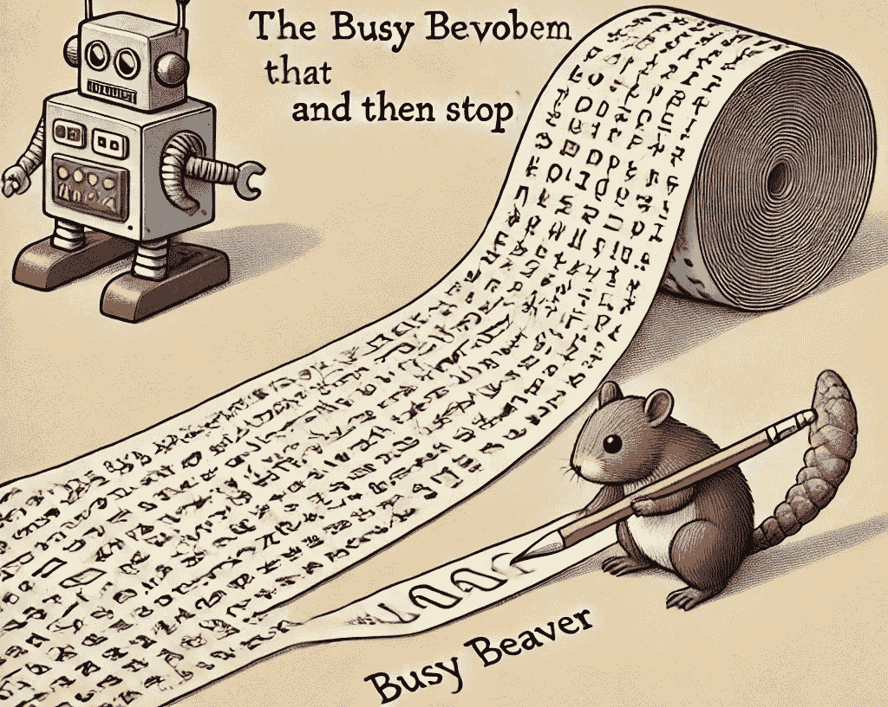
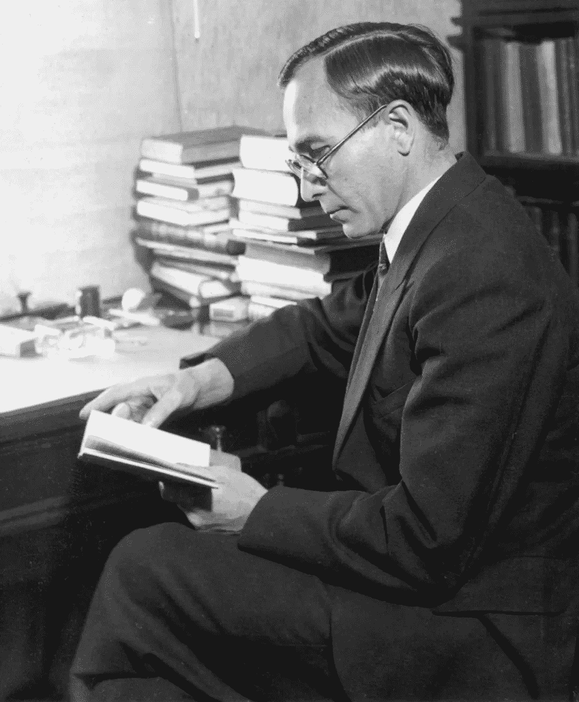
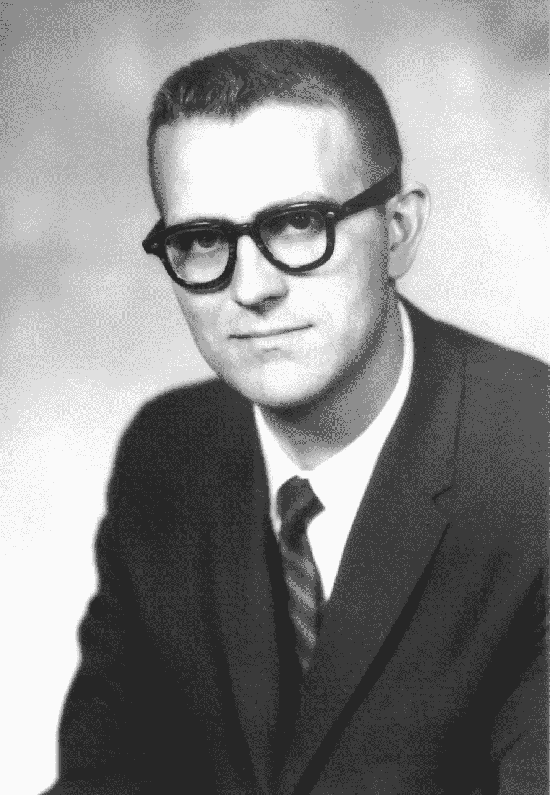
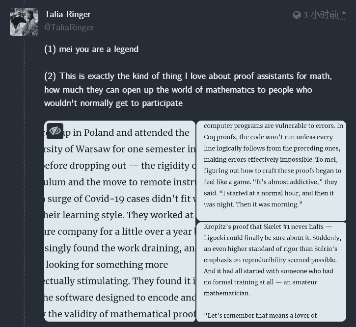

# AI助力解决数学难题，陶哲轩分享

> 来源：[https://agijuejin.feishu.cn/docx/U04pdtMFpoOEWsxT3KFcIMZWn9e](https://agijuejin.feishu.cn/docx/U04pdtMFpoOEWsxT3KFcIMZWn9e)

> 机器之心｜[阅读原文](https://www.jiqizhixin.com/articles/2024-07-04-10)

> 转载请联系原作者取得授权

> 在 AI 的帮助下，越来越多的数学问题得到了解决。

AI在数学领域的应用对大家来说并不陌生了。数学家陶哲轩作为倡导者，一直走在使用AI辅助证明的前沿。他倡导使用像Lean和Coq这样的证明助手工具。这些工具可以形式化和验证复杂的数学证明，减少人为错误的可能性。也有不少数学家在他的启发下有了新成果，例如利用AI形式化费马大定理的证明。他参与了由Talia Ringer发起的AI在数学中资源列表的推广和编辑工作。这个资源列表专注于 AI for Math，为那些希望进入数学 AI 领域的人提供帮助。

陶哲轩在推进项目研究进展的同时，还试着学习如何创建动画图表，他决定对零密度估计进行文献回顾 。他讲到，自己一直很好奇为什么没有一份全面的综述来涵盖这些年来建立的所有零密度定理，现在他清楚了，是因为文献太过复杂，尤其在3/4≤σ＜1的这个范围， 使用了多种方法。界限通常是逐段的，主要是因为这些方法依赖于控制整数矩而不是分数矩。然而，这些界限虽然以人类可读形式陈述时显得杂乱，但对计算机来说却很容易处理。

陶哲轩将所有的界限汇总到一个Python文件中，并用它创建了附带的动画。

在这一博客的评论中，陶哲轩补充道：

> 不得不说，我确实使用了一些AI辅助来帮助编写代码。在某种程度上，我将AI辅助视为一种心理支持——当我知道除了传统的调试和搜索方法外，还有AI工具可以提供初始代码并自动完成部分代码时，更容易说服自己花时间编程。不过，我发现这些工具在调试方面并不是特别有用。不过，GPT能够快速创建一个简单的动画测试函数，并且在第一次尝试时就成功编译了。尽管如此，我仍花了大部分时间来调整和调试，才得到了我想要的动画。

显然，这次尝试的结果还不错。后续陶哲轩还转发了一篇文章，生动地展示了数学智能助手如何帮助一群「菜鸟数学家」解决了数学界最难解的问题。

原文链接：https://www.quantamagazine.org/amateur-mathematicians-find-fifth-busy-beaver-turing-machine-20240702/

程序员通常希望最大程度减少代码运行所需要的时间，忙碌海狸函数（BB(n））这个计算机科学中的经典问题却在探寻，一个简单的计算机程序在终止之前可以运行多长时间，即 图灵机 在特定状态和符号数量限制下所能达到的最大运行步数。

最近的研究表明，寻找长时间运行的计算机程序可以揭示数学知识的现状，甚至告诉我们哪些是可知的。忙碌海狸游戏为评估某些问题的难度提供了一个具体的 基准 ，例如未解决的哥德巴赫猜想和黎曼假设。它甚至提供了一个探索数学 逻辑 计算极限的视角。

那要怎么理解忙碌海狸函数呢？想象一个小机器人( 图灵机 )，它有一套指令(对应 图灵机 的状态)，可以在一条无限长的纸带上移动和写字。纸带最开始是空白的。这个机器人的目标是尽可能多地在纸带上写字，然后停下来。忙碌海狸问题就是要找到这样的机器人，在给定状态数量下可以写最多字的情况。

由ChatGPT-4o生成

这个问题由匈牙利裔数学家蒂博尔·拉多（Tibor Radó）在1962年提出，由于其复杂性和递增的计算需求，忙碌海狸函数（BB(n)）的值在n较小时可以确定，但随着n的增加，问题变得极其困难，目前只有前几个BB(n)值被确定。

1962年，蒂博尔·拉多重新描述了关于 图灵机 行为的著名不可解问题，提出了忙碌海狸挑战。

单规则的情况很简单，因为实际上只有两种可能性。如果规则规定 图灵机 在看到 0 时停止计算，它将在第一步停止。有了两条规则，就有超过 6,000 个不同的 图灵机 需要考虑；有了三条规则，这个数字就会膨胀到数百万，有了四条规则，这个数字就会膨胀到数十亿。手工计算所有这些情况是不可能的。

这意味着这个问题只能借助计算机来解决。一个简单的程序可以算出 BB(2) = 6。但 BB(3) 已经很难找到了。而更棘手的是无限循环问题。有的时候 图灵机 并没有真正停机，而是陷入了无限循环。研究人员需要找到一种判断 图灵机 是否真正停机的判断方法。

陷入无限循环的 图灵机

拉多推出忙碌海狸挑战后不久，一些研究人员就开始了搜寻。从1964年到1974年， Allen Brady花了十年，证出了BB(4) 的数值。研究启动时，他还是俄勒冈州立大学数学系研究生，发表时，他已然成为内华达大学雷诺分校的计算机科学教授。

Allen Brady在整个 20 世纪 60 年代开发了「忙碌海狸」算法，并于 1974 年确定了第四个忙碌海狸函数的值。

此后40年，研究者们前赴后继，但始终无法捕获第五个忙碌海狸函数的身影。如果 图灵机 需要遵守五条规则，潜在符合可能的 图灵机 数量接近 17 万亿台——即使以每毫秒一台的速度列出所有 图灵机 ，也需要 500 多年的时间。狩猎「海狸」的猎手们，将 图灵机 的范围不断缩小。1989年，德国程序员Heiner Marxen 发现了一个在47,176,870 步后停止的 图灵机 ，但是他还需证明所有剩余的机器在此时仍未停机，要算出进一步的结果，还需要30年。

21世纪初，痴迷于研究BB(5) 的保加利亚计算机科学家Georgi Ivanov Geogiev，将17亿万台 图灵机 的名单精简到了只剩43个。在一封电子邮件中，Geogiev表示，研究忙碌海狸函数问题让他疲惫不堪。对于「忙碌海狸」的「猎手」们，这是常见的结果。几十年来，他们独自或结对工作，却没有得到学术界的广泛认可。需要集体努力才能完成这项工作。

2015年，一位名叫Code Golf Addict的匿名GitHub用户发布了一个27规则 图灵机 的代码，该机器只有在哥德巴赫猜想为假时才会停止。其工作原理是通过所有大于4的偶数进行计数；对于每一个偶数，它会遍历所有可能的两数之和，检查这对数是否为素数。当找到合适的一对素数时，它会移动到下一个偶数并重复这一过程。如果找到一个不能由一对素数之和组成的偶数，它就会停止。

运行这种无脑机器并不是解决猜想的实际方法，因为我们无法知道它是否会停止。但是，忙碌海狸游戏可以对这一问题提供一些见解。如果能够计算出BB(27)，就可以确定自动解决哥德巴赫猜想所需的最长时间。这是因为BB(27)对应的是这台27规则 图灵机 为了停止所需执行的最大步数。如果我们知道这个数，我们可以运行这台 图灵机 恰好那么多步。如果它在这期间停止了，我们就知道哥德巴赫猜想是假的。但如果它在这么多步内没有停止，我们就能确定它永远不会停止，从而证明猜想为真。

问题在于，BB(27)是一个无法理解的大数，甚至将其写下来都不可能，更不用说让哥德巴赫反例机运行这么多步了。

2016年，类似的结果得出了，这次是 Aaronson等人做出的成果。他们发现了一台744规则的 图灵机 ，只有在黎曼假设为假的情况下才会停止。黎曼假设涉及素数的分布问题，是Clay数学研究所的「千禧年问题」之一，奖金为100万美元。Aaronson的 图灵机 将在BB(744)步内自动得出解答。

当然，BB(744)是一个比BB(27)更难以企及的大数。Aaronson表示，致力于确定更简单的数值，比如BB(5)，可能会发现一些新的、有趣的数论问题。最近，Aaronson使用忙碌海狸衍生的尺度来衡量他称之为「不可知阈值」的数学系统整体。

受Aaronson论文的启发，来自Tristan Stérin在Discord上发起了「忙碌的海狸挑战」。随着时间推移，在线社区逐渐壮大，来自世界各地的20多名参与者因为验证BB(5)的真实值相聚。

一位名为Maja Kądziołka波兰程序员在日常的编程工作中经常用到Coq智能证明助手。Coq是一款强大的工具，用于帮助数学家和程序员进行形式化的数学证明和验证。它通过Gallina编程语言，让用户定义数学对象、陈述定理，并一步步构建证明。用户可以与Coq进行交互，逐步验证每一步的正确性。Coq还提供了多种自动化工具，帮助简化证明过程。广泛应用于数学研究、程序验证和软件开发，Coq提高了证明和代码的准确性和可靠性。

在学习了Coq之后，Maja开始寻找一个开放性的问题，就在这时，她刷到了「忙碌的海狸挑战」，并开始将社区内的几个证明用Coq来解决。和「忙碌的海狸挑战」使用的其他计算机程序不同，在 Coq 证明中，除非每一行都符合 逻辑 ，否则代码将无法运行，因此几乎不可能出错。因此，社区里的成员渐渐对使用Coq「上瘾」了。于是，在接下来的几个月里，Coq接手了社区内未完成的对BB(5)的证明。

2024年5月10日，「忙碌的海狸挑战」社区中一位神秘的成员发了一条消息，称「BB(5) 的 Coq 证明已完成。」结果证明，30多年前，德国程序员Heiner Marxen和他的搭档Buntrock发现的那台 图灵机 在走了 4700 万步之后就停了下来，这其实就是第五只忙碌的海狸——BB(5)的真实值。

伊利诺伊大学厄巴纳-香槟分校计算机科学系的助理教授Talia在看完用Coq解决BB(5)的真实值的故事后表示，她喜欢这些数学证明助手的原因之一，是它们能让更多的人参与到数学研究当中。

AI正如陶哲轩所说的那样，帮助数学家们处理更多问题，让数学之谜逐渐解开。

> 参考链接：

> https://mathstodon.xyz/@TaliaRinger/112719444060361451

> https://mathstodon.xyz/@tao

> https://www.quantamagazine.org/how-the-slowest-computer-programs-illuminate-maths-fundamental-limits-20201210/