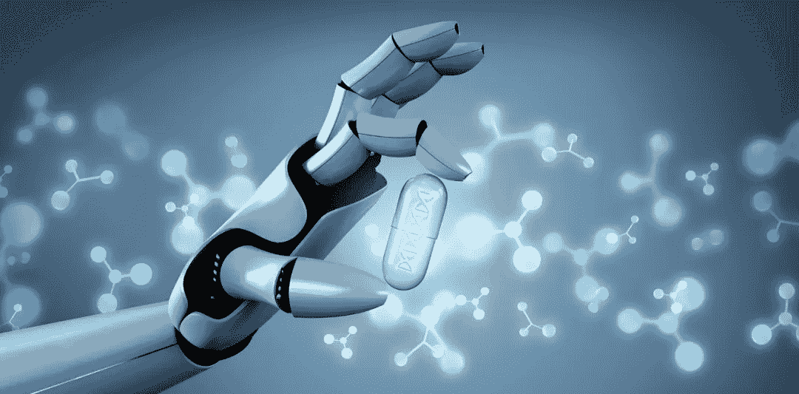
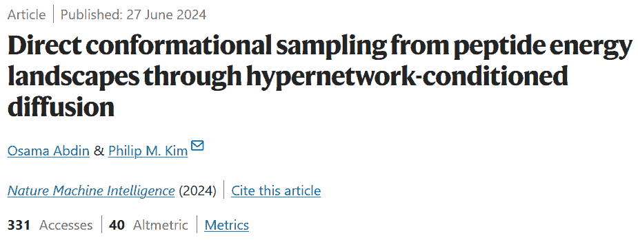
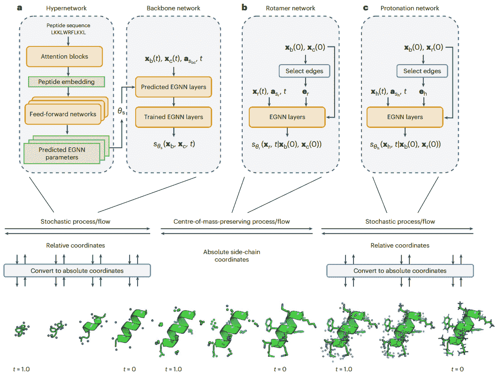
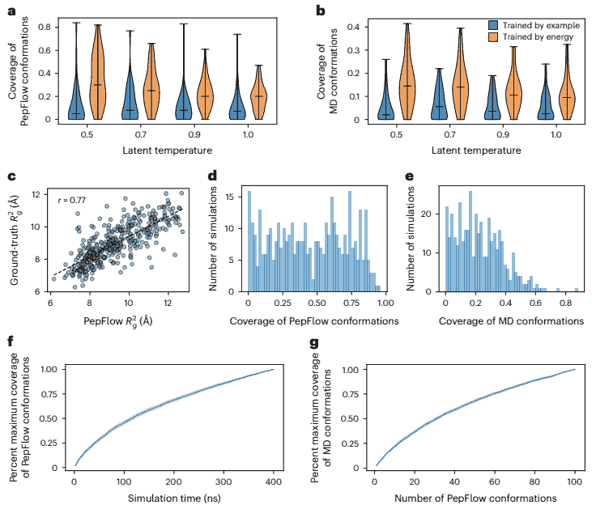

# Nature子刊，优于AlphaFold，全原子采样，一种预测肽结构的AI方法

> 来源：[https://agijuejin.feishu.cn/docx/JplPd5c4doYA3pxd6qWckeshnId](https://agijuejin.feishu.cn/docx/JplPd5c4doYA3pxd6qWckeshnId)

> 机器之心 ScienceAI｜[阅读原文](https://mp.weixin.qq.com/s?__biz=MzI3MjM3ODk0NQ==&mid=2247501756&idx=1&sn=3d2ded919fcab1805d4097730ee66ae9&scene=21#wechat_redirect)

> 转载请联系原作者取得授权

编辑 | 萝卜皮

深度学习方法推动了生物分子结构单态预测的重大进展。然而，生物分子的功能取决于它们可以呈现的构象范围。对于肽来说尤其如此，肽是一类高度灵活的分子，参与多种生物过程，作为治疗手段备受关注。

多伦多大学的 Philip M. Kim 和 Osama A**b**din 开发了 PepFlow，这是 一种可转移生成模型，它能够从输入肽的允许构象空间中直接进行全原子采样。研究人员在扩散框架中训练模型，然后使用等效流进行构象采样。

为了克服广义全原子建模的成本过高，他们模块化了生成过程并集成了超网络来预测序列特定的网络参数。PepFlow 可准确预测肽结构，并有效重现实验肽集合，所需运行时间仅为传统方法的一小部分。PepFlow 还可用于对满足大环化等约束的构象进行采样。

「到目前为止，我们还无法模拟肽的全部构象。」这项研究的第一作者 Osama Abdin 说道，「PepFlow 利用深度学习在几分钟内捕捉到肽的精确构象。该模型有可能通过设计作为粘合剂的肽来指导药物开发。」

该研究以「 Direct conformational sampling from peptide energy landscapes through hypernetwork-conditioned diffusion 」为题，于 2024 年 6 月 27 日发布在《 Nature Machine Intelligence 》。

蛋白质-肽相互作用在分子通路中普遍存在，是许多细胞功能不可或缺的一部分。据估计，高达 40% 的蛋白质-蛋白质相互作用是由肽结合介导的。这些相互作用涉及球状蛋白质与通常位于无序区域的短片段的结合。短肽还具有多种特性，使其适合于治疗开发。

与小分子相比，肽往往更具特异性，毒性风险较低。与大型生物制剂相比，肽的生产成本更低，且免疫原性更低。肽疗法在医药市场中占有相当大的份额。目前，需要计算工具来加快肽的建模和工程设计。

「肽是 PepFlow 模型的重点，因为它们是非常重要的生物分子，而且它们自然非常活跃，所以我们需要模拟它们的不同构象来了解它们的功能。」多伦多大学教授 Philip M. Kim 表示，「它们在治疗方面也发挥着重要作用，从用于治疗糖尿病和肥胖症的 GLP1 类似物（如 Ozempic）就可以看出这一点。」

Philip M. Kim 和 Osama Abdin 提出了一种可用于肽构象直接全原子采样的方法。即使对于短肽，进行准确而高效的全原子采样也是一项巨大的挑战。

图示：PepFlow 架构示意图。（来源：论文）

为了解决这个问题，他们开发了 PepFlow，这是一个模块化、超网络条件的生成模型，可以预测任何输入肽序列的全原子构象。PepFlow 是在已知分子构象上进行训练的连续时间扩散模型。相应的概率流 ODE 则用于能量采样和训练。

PepFlow 具有强大的预测单态肽结构和短线性基序集合 (SLiM) 的能力，并且可以通过潜在空间构象搜索在诸如大环化等约束条件下对肽结构进行建模。

该模型扩展了领先的 Google Deepmind AI 系统 AlphaFold 预测蛋白质结构的能力。PepFlow 可以生成给定肽的一系列构象，从而优于 AlphaFold2；当然 AlphaFold2 的设计初衷并不是解决这一问题。

PepFlow 的与众不同之处在于其背后的技术创新。例如，它是一种广义模型，其灵感来自玻尔兹曼生成器，这是一种非常先进的基于物理的机器学习模型。

「使用 PepFlow 建模可以深入了解肽的真实能量状况。」Abdin 说，「开发 PepFlow 花了两年半的时间，训练它只花了一个月的时间，但值得迈向下一个前沿，超越仅预测肽的一种结构的模型。」

整体而言，准确高效地对肽构象进行采样的能力有可能改善肽对接和设计。肽对接方法通常从与目标蛋白对接的肽构象库开始。更精确的肽集合生成也许能改善这一过程。

PepFlow 还可用于评估不同序列在目标蛋白质 - 蛋白质界面上呈现构象的倾向，进而可用于设计抑制肽。

图示：PepFlow 生成的集合与分子动力学模拟的比较。（来源：论文）

虽然 PepFlow 在 AlphaFold2 的基础上有所改进，但它本身也有局限性，因为这只是模型的第一个版本。

PepFlow 有一个显著缺点，与玻尔兹曼生成器不同，PepFlow 缺乏对生成的样本重新加权以达到精确的玻尔兹曼分布的能力。

虽然 PepFlow 能够对生成的样本进行似然计算，但可处理的计算需要使用随机估计器，这会给计算值添加噪声。此外，PepFlow 偶尔会生成高能样本，但无法捕获分子动力学模拟中观察到的全部能量景观。

改进 PepFlow 的一个潜在方法是将开发的模型转移到其他采样框架。在条件设置中使用了标准化流，并使用了不同的采样方法，以促进从玻尔兹曼分布中进行采样。

最近学界开发的流匹配范式，进一步作为以无模拟方式训练连续规范化流模型的替代方法。流动匹配已被有效用于不同分子（包括小分子和蛋白质）的结构采样，并可潜在地用于扩展 PepFlow 框架的有效性。

总之，PepFlow 的设计目标是易于扩展，以考虑其他因素、新信息和潜在用途。

即使只是第一个版本，PepFlow 也是一个全面而有效的模型，具有进一步开发依赖肽结合来激活或抑制生物过程的治疗方法的潜力。

> 论文链接： https://www.nature.com/articles/s42256-024-00860-4

> 相关报道： https://phys.org/news/2024-06-deep-outperforms-google-ai-peptide.html