# 谢赛宁团队突破高斯泼溅内存瓶颈，并行方案实现多显卡训练

> 来源：[https://agijuejin.feishu.cn/docx/WjJtdUbomocNKfxt2yKcriECnpb](https://agijuejin.feishu.cn/docx/WjJtdUbomocNKfxt2yKcriECnpb)

> 量子位｜[阅读原文](https://mp.weixin.qq.com/s/XIGhXBCGl48v6fG3QfZgVA)

> 转载请联系原作者取得授权

高斯泼溅模型训练的内存瓶颈，终于被谢赛宁团队和NYU系统实验室打破！

通过设计并行策略，团队推出了 **高斯泼溅模型的多卡训练方案 **，不必再受限于单张卡的内存了。

**用这种方法在4张卡**上训练，可以 加速3.5倍以上 ；如果增加到32卡，又能有额外6.8倍的加速。

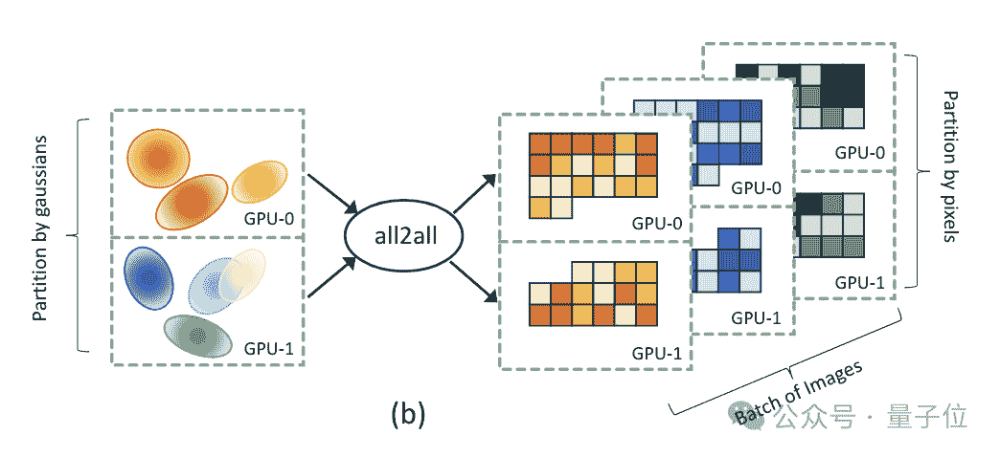

该团队提出的是一种名为 **Grendel **的分布式训练系统，第一作者是清华姚班校友赵和旭。

通过多卡训练，不仅速度更快了，研究团队还突破了大场景、高分辨率环境下的内存局限，生成了更多高斯，3D结果质量也更高了。

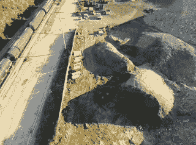

为了体现这个成果是多么的鹅妹子嘤，谢赛宁本人发了这样一个表情包：

> （大哭）：不！你不能扩大3D高斯泼溅的规模，不管是场景、分辨率还是批大小，这消耗的算力和内存实在太高了

> GPU：我就笑笑不说话

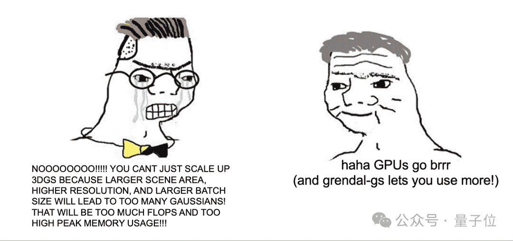

还有网友调侃说，看来老黄的股票又要涨了。

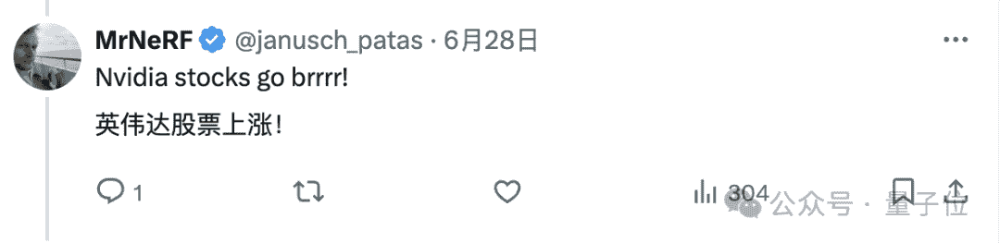

## **又快又好的3D生成**

多卡并行的方式， **突破了单卡的算力和内存的限制 **，让Grendel可以处理极具挑战性的大场景 （更多高斯粒子数量） 渲染任务。

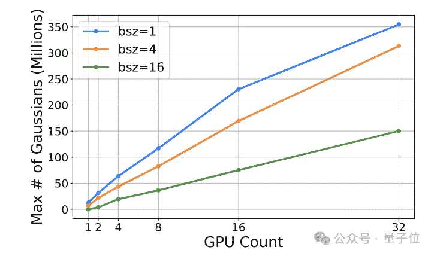

如在Rubble （4K分辨率） 和MatrixCity （1080p分辨率） 这两个大型复杂场景中，Grendel使用多达4000万和2400万个高斯粒子，生成了高保真的渲染结果。

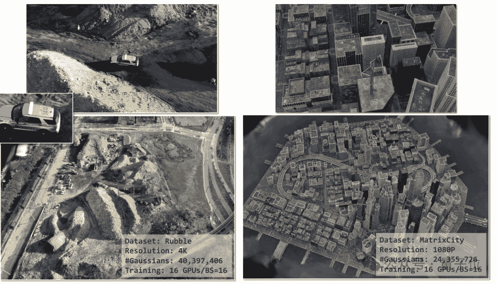

在镜头不断拉近的动态过程当中，也能看出Grendel生成结果的细致性和连贯性。

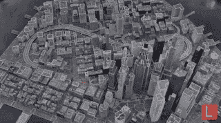

从数据上看，在Mip360和TT&DB数据集上，4卡批量训练后的渲染质量 （PSNR） 与单卡相比也几乎没有损失，进一步验证了Grendel的多卡并行在不同场景上的有效性。

**在保证质量的基础上，**Grendel还在这两个数据集上实现了 3-4倍的速度提升 。

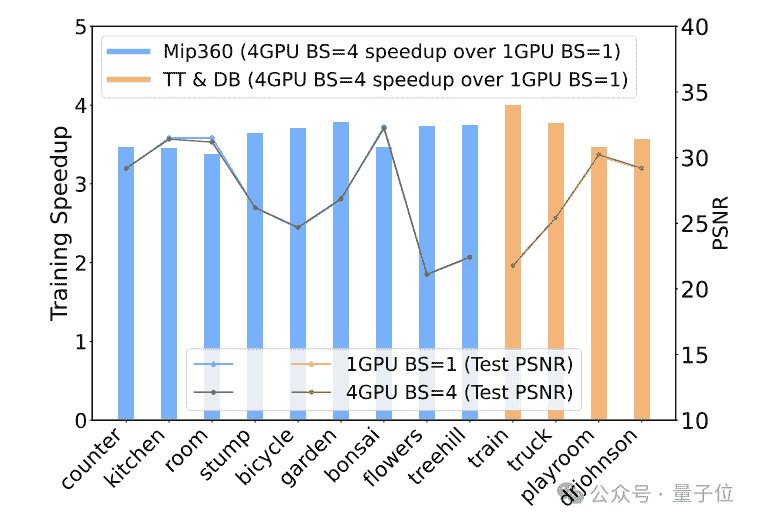

特别是在 **4K场景 **中，单卡训练不仅速度慢，还容易出现内存不足，所以使用Grendel在多卡上进行并行训练不仅带来量的改变，也带来了质的突破。

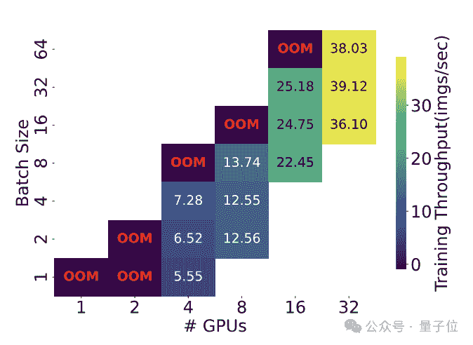

###### **△ **OOM：Out of memory，内存不足

另外，通过支持更大的批量 （batch size） 和动态负载均衡，Grendel可以更充分地利用多GPU资源，避免计算力的浪费。

例如在Mip-NeRF360数据集上，Grendel通过增加批量和动态均衡负载，可以将4卡并行的加速比从2倍提高到近4倍。

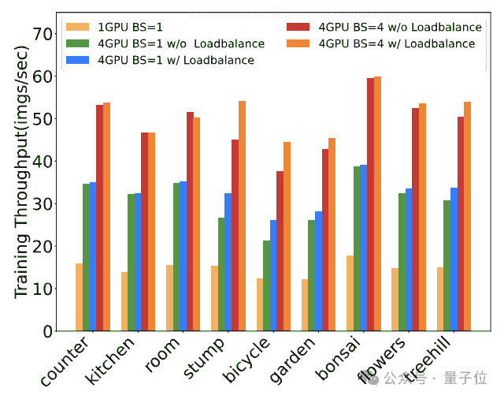

那么， Grendel究竟是如何实现的呢？

## **将高斯泼溅过程拆解**

在开始介绍Grendel的原理之前，先来解答这样一个问题：

单张卡不够用，用多卡似乎是很容易想到的思路，为什么以前没见到有多卡方案呢？

**这就涉及到了高斯泼溅模型**独特的计算方式——高斯泼溅分为多个不同阶段， 每个阶段的并行粒度不同 ，需要进行切换。

这与大多数神经网络模型的单一粒度并行方式大相径庭，甚至高斯泼溅根本没用到任何神经网络。

这就导致了现有的针对神经网络训练的多卡并行方案 （如数据并行、模型并行等） ，难以直接应用于3D高斯泼溅。

另外，在高斯泼溅模型的训练过程中，不同粒度的过程之间需要进行大量的数据通信，加大了并行方案的难度。

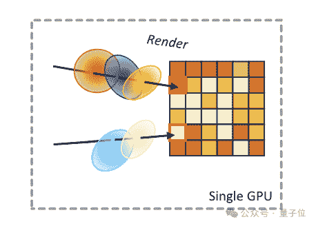

这也正是Grendel的设计当中需要解决的问题。

首先，Grendel将3D高斯泼溅的训练过程划分为三个主要阶段——高斯变换 （Gaussian transformation） 、渲染 （rendering） 和损失计算 （loss computation） 。

针对这三个阶段Grendel采用混合粒度的并行策略，在不同的训练阶段使用不同的并行粒度。

+   **高斯变换 **阶段采用高斯粒子级 （Gaussian-wise） 并行，将高斯粒子均匀分布到各个GPU节点；

+   **渲染和损失计算 **阶段采用像素级 （pixel-wise） 并行，将图像分割成连续的像素块，分配到各个GPU节点。

在高斯变换和渲染阶段中间，Grendel通过稀疏的全对全通信，将每个GPU节点上的高斯粒子传输到需要它们进行渲染的GPU节点。

由于每个像素块只依赖于其覆盖范围内的高斯粒子子集，Grendel利用空间局部性，只传输相关的粒子，从而减少了通信量。

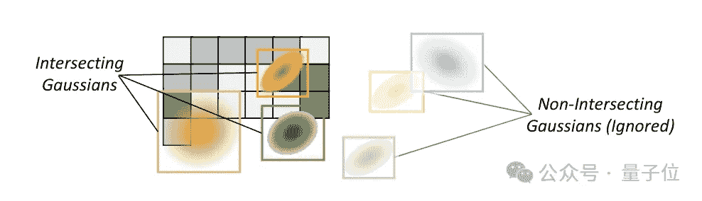

完成损失计算后，在每个GPU节点上，系统会根据损失函数计算渲染管线各个参数的梯度，并通过反向传播回传给高斯粒子的各个属性参数。

之后，系统将各GPU计算出的梯度进行聚合，得到批量数据的总梯度，并据此更新高斯粒子的属性参数。

接着就是重复从高斯变换到参数更新的步骤，直到模型收敛或达到预设的训练轮数。

**另外，为了处理**渲染阶段的负载不均衡问题，Grendel引入了 动态负载均衡 机制：

在训练过程中，Grendel会记录每个像素块的渲染时间，用于预测当前迭代的负载分布，然后动态调整像素块到GPU节点的分配，尽量使各个节点的渲染时间接近。

为了进一步提高GPU利用率和训练吞吐量，Grendel支持批量训练,即在每个训练迭代中并行处理多个输入图像，并根据批量大小动态调整学习率，以保证训练的稳定性和收敛性。

## **作者简介**

Grendel的第一作者，是纽约大学计算机博士生、清华姚班19级校友赵和旭，主要研究方向是分布式机器学习。

在清华期间，赵和旭曾在清华NLP实验室孙茂松团队参与研究，接受刘知远副教授的指导。

他还曾经在Eric Xing组访问，优化了一个分布式机器学习中的通讯问题，论文被MLsys2023接收。

另外三名华人作者，Weng Haoyang （翁颢洋） 也来自姚班；Daohan Lu来自纽约大学，是谢赛宁的博士生；还有Ang Li博士，是一名浙大校友，现在美国PNNL实验室从事研究。

赵和旭在纽约大学的两位导师Jinyang Li教授和Aurojit Panda助理教授，以及纽大知名学者、ResNeXt一作、DiT （Sora核心架构） 共同作者谢赛宁助理教授，都参与指导了这一项目。

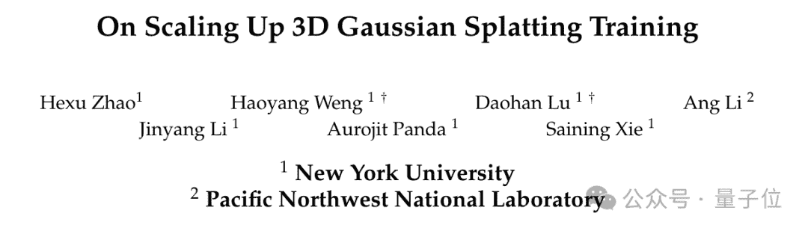

> 论文地址：https://arxiv.org/abs/2406.18533

> 项目主页：https://daohanlu.github.io/scaling-up-3dgs/

> GitHub： https://github.com/nyu-systems/Grendel-GS