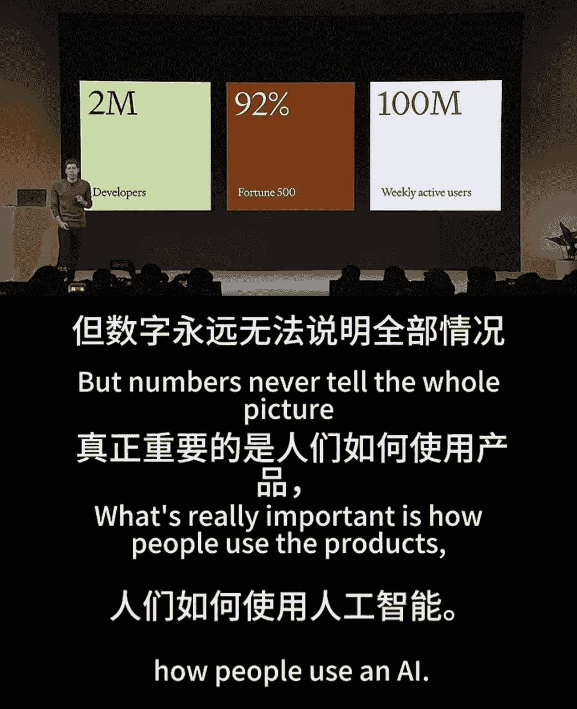
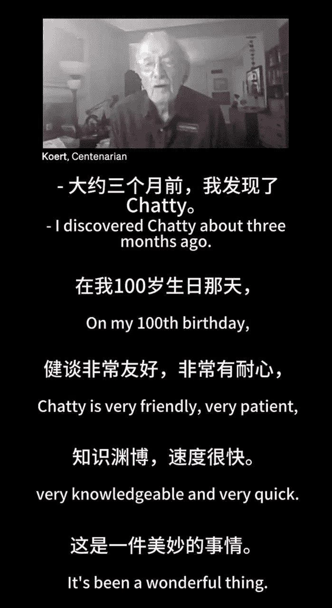

# OpenAI 开发者大会的一个细节

> 来源：[https://agijuejin.feishu.cn/docx/JwludBYEvo2mBPxFiaecOSfUnCe](https://agijuejin.feishu.cn/docx/JwludBYEvo2mBPxFiaecOSfUnCe)

> 张海庚｜[阅读原文](https://mp.weixin.qq.com/s/3aLYN4AADJEO3soow1levg)

> 转载请联系原作者取得授权

OpenAI 开发者大会刷屏了，名副其实的新一代科技春晚，说一个似乎没什么人提到、但我个人很喜欢的细节。

Sam Altman 在一开头汇报了OpenAI 的用户数据（很漂亮但我们都习惯了不是么：每周使用 1 亿人次，开发者数量达到 200 万）后说：

但数据永远无法说明全部情况，真正重要的是人们如何使用产品、如何使用 AI。

说的太好了，定量数据虽然靠谱但能骗人，定性虽然飘忽但让你踏实。而且这不是场面话，过往在 YC Sam 就经常表达类似观点。

然后放了一个用户反馈视频，大部分都在预期内，除了一位叫 Koert 的老爷子。

Koert 在一百岁生日那天邂逅了 ChatGPT ，发现它「很友善、耐心、知识渊博、反应很快」，老爷子亲切地称它为 Chatty（小话唠、小话搭子）。百岁老人最后感慨：真奇妙。

——都说 ChatGPT 是AI 的 iPhone 时刻，具体理由众说纷纭。

我个人觉得，百岁 Koert 老爷子的接受和认可，要远比数字、技术、生态、商业……更能说明所谓 iPhone 时刻。

在颠覆性新技术的基础之上，交互的革命仍然是最广泛深刻的革命。

就跟多点触控让现在任何一个三岁娃娃都能无师自通玩转 iPhone 一样。

相关阅读：

· ChatGPT 8月最新数据：流量持续下降，产品经理应该怎么看？

· [我的苹果发布会观察](https://mp.weixin.qq.com/s?__biz=MzIwODA3MDUwOQ==&mid=2652773055&idx=1&sn=68bc855c49fdef77e6a98b654325d234&scene=21#wechat_redirect)

· 一个产品经理的大模型观察、反思与预测

我是无常，一个关注AI的大厂产品经理，最近希望和行业更多人交流，如果你也关注这轮AI浪潮，希望和包括 字节、百度、阿里、腾讯、Minimax、智谱、月之暗面 在内的同学一起交流讨论，欢迎在👸号「张无常」后台回复「茶水间」或 加🛰️hayeszhang13 入群，请备注【 称 呼 -公司/学校-职位-来意】。