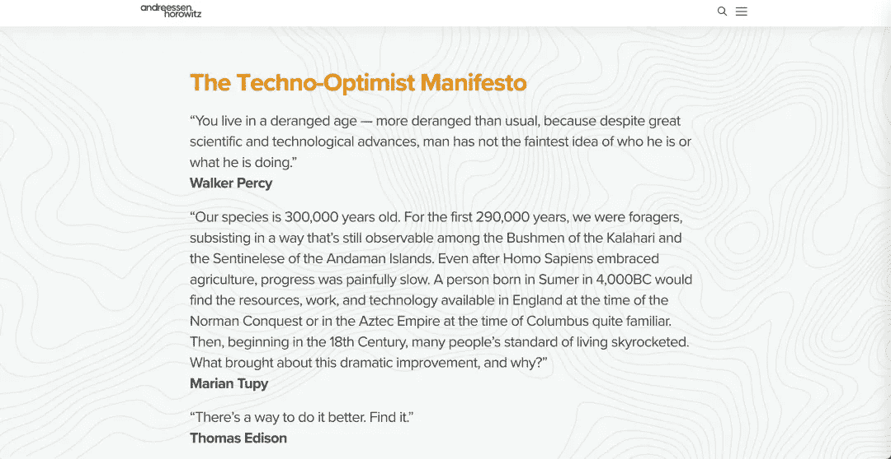

# a16z 的技术乐观主义宣言

> 来源：[https://agijuejin.feishu.cn/docx/BR5zdf42KoWDwkxB5I0cXEHWnfb](https://agijuejin.feishu.cn/docx/BR5zdf42KoWDwkxB5I0cXEHWnfb)

> 张海庚｜[阅读原文](https://mp.weixin.qq.com/s/HAtMRngqwXNg4xhxgPr8Pw)

> 转载请联系原作者取得授权

最近，推特上关于 AI 风险的辩论很热闹，包括 Geoffrey Hinton、 Yoshua Bengio、 Andrew Ng 和 Yann LeCun 在内的多位大佬下场激辩。 G eof frey Hint on 和 Yoshua Bengio 是悲观派，呼吁加强监管、确保安全， Y ann LeC u n 和 A ndrew Ng 则很乐观，认为现在是杞人忧天，过度监管会阻碍技术创新。大家这几天应该也被刷屏、甚至「看麻了」。

和 A ndrew Ng、 Y ann LeC u n一样， 大 部分VC也都是技术乐观主义者，但像 a16z 这样坚定乐观的大概也不多。

最近，著名硅谷风险投资机构 a16z 联合创始人 Marc Andreessen 发了一篇万字长文《技术乐观主义者宣言》（The Techno-Optimist Manifesto），用了大量风格强烈的词、短句、排比，字体也很大，极具诗意和煽动性。

正如其标题所写，这是一篇技术乐观宣言，或者更准确来讲，一篇AI檄文。

这篇风格强烈的技术乐观主义者宣言也引来很多批评，比如电影《降临》原著小说作者、刚刚被时代杂志评为AI领域最有影响力的100位人物之一的科幻作家泰德·张就认为，《宣言》「大部分是胡说八道」，Andreessen历史上也支持过加密货币和元宇宙，应该审慎对待他的建议。

乔治华盛顿大学网络政治学教授Dave Karpf也提出了批评：安德森及其同行在过去的三十年中一直备受赞扬，但技术的发展并未实现他们所承诺的一切。

你当然可以说这是a16z为自己的AI投资造势，确实，对VC的乐观，大部分人应该淡定点——也许创业者除外。

不过我个人觉得这篇宣言里的大量断言和引用，值得单独拉出来读一读，无论对错，至少有不少是我第一次读到、觉得值得琢磨的——简直像一篇技术乐观主义的小型文献综述，也提到了我很喜欢的一本书《有限与无限的游戏》，于是摘录分享之，兼听则明：

---

1、增长的源泉只有三个： **人口增长、自然资源利用和技术 **。唯一永恒的增长源泉只有技术。

2、自由市场是组织技术经济的最有效方式，市场经济是一台发现机器，一种智能形式——一个探索性、进化性、适应性的系统。

3、大卫·弗里德曼指出， 人们只出于三个原因为他人做事——爱、金钱或力量 。爱没有规模，所以经济只能靠金钱或武力运行。武力实验已经进行，但发现效果不佳。让我们坚持用钱。

4、经济学家威廉·诺德豪斯 (Wi**l**liam Nordhaus) 表明， 技术创造者只能获得该技术创造的经济价值的 2% 左右 。另外98%以经济学家所谓的社会剩余的形式流入社会 。市场体系中的技术创新本质上是慈善性的，比例为50:1。谁从新技术中获得更多价值，是制造该技术的单一公司，还是使用该技术来改善生活的数百万或数十亿人？

**5、我们相信大卫·李嘉图的比较优势概念——与竞争优势**不同， 比较优势认为，即使是世界上最擅长做每件事的人，也会因为机会成本而从其他人那里购买大部分东西。

6、我们相信米尔顿·弗里德曼的观察，即人类的欲望和需求是无限的。技术变革非但没有**减少对人类工作的需求，反而通过扩大人**类高效工作的范围而增加了对人类工作的需求。 由于人类的欲望和需求是无限的，经济需求也是无限的，就业增长可以永远持续下去 。我们相信市场是创造性的，而不是剥削性的；正和，而不是零和。市场参与者以彼此的工作和产出为基础。

7、James Carse 描述了有限游戏和无限游戏——有限游戏有一个结局，一个人**赢了，另一个人输了；无**限游戏永远不会结束，因为玩家们会合作发现游戏中的可能性。 市场是终极的无限游戏。

8、人类的欲望和需求是无穷无尽的，企业家不断创造新的商品和服务来满足这些欲望和需求，**并**在此过程中部署无限数量的人员和机器。这种螺旋式上升已经持续了数百年。事实上， 截至 2019 年，在新冠疫情暂时中断之前，其结果是创造了地球历史上数量最多、工资最高、物质生活水平最高的就业机会。

9、雷·库兹韦尔 (Ray Kurzweil) 定义了他的加速回报定律：技术进步往往会自我滋养，从而提高进一步进步的速度。

10、我们相信人工智能是我们的炼金术，我们的点金石——我们实际上是在让沙子思考。

11、我们相信安迪·沃霍尔是对的，他说：这个国家的伟大之处在于美国开创了最富有的消费者与最贫穷的消费者购买基本相同的东西的传统。

**12、正如理查德·费曼所说**，我们相信，“ 科学是对专家无知的信念。 ”

---

虽然我们常说「悲观者正确，乐观者成功」之类马后炮的话，但也许在这次大模型引发的AI浪潮前，一切都可能改变，连最聪明的大脑们都没达成一致，我们也只能保持学习了。

最后说两点最近经常琢磨的想法：

内容比形式更重要，信息比情绪更重要——虽然形式很重要，虽然情绪很重要。

读书思考，观其大略，不求甚解，偶有所得，何妨挂一漏万。