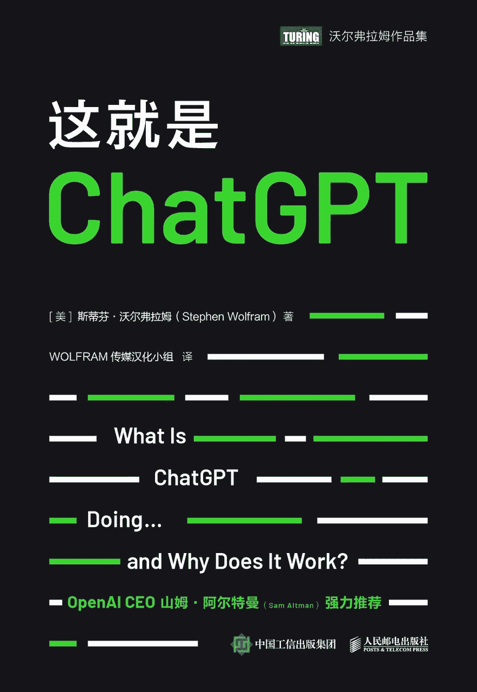
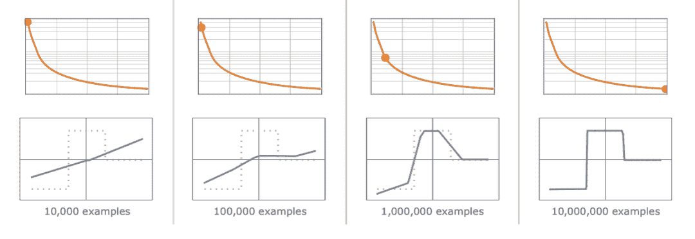

# Sam Altman：这是我见过的对ChatGPT原理的最佳解释

> 来源：[https://agijuejin.feishu.cn/docx/GiQhdmCo7oP9SPxM1WwcSJAKn9d](https://agijuejin.feishu.cn/docx/GiQhdmCo7oP9SPxM1WwcSJAKn9d)

> 张海庚｜[阅读原文](https://mp.weixin.qq.com/s/cpLDPDbTjarU0_PpBK_RDQ)

> 转载请联系原作者取得授权

必须读《这就是ChatGPT》这本书的理由有很多，但如果只说一个，那就是OpenAI CEO、ChatGPT之父Sam Altman的评价：

“这是我见过的对ChatGPT原理的最佳解释。 ”

神奇的是，这本书还很薄，极宽松的排版下也才134页，区区几万字就把ChatGPT的原理解释透了，足见作者功力。实际上它的主体就是一篇长文，甚至你也许在几个月前读过这篇AI圈内口口相传的科普文章了：What Is ChatGPT Doing … and Why Does It Work?

作者Stephen Wolfram，被称为「在世的最聪明的人」，15岁发表高能物理论文，20岁获得加州理工大学理论物理博士，导师是大名鼎鼎的费曼。

和老师费曼一样，Wolfram擅长用大白话解释复杂理论，比如「 其中有很多复杂的技术细节，但神经网络的基本思想是…… 」「 抛开具体的工程细节不论，ChatGPT的基本概念相当简单 」，纲举目张，醍醐灌顶。

真正的高手，总能用大白话讲清楚高深的理论，背后是熟谙理论和技术细节，再经过无数次抽象升维，形成第一性原理，洞若观火。

推荐这本书的文章前阵子已经很多了，不再赘述，下面记录9个笔记老规矩，下文正文部分主要观点来自原书，我做了不修改原意的编辑，破折号（——）后的内容为我的笔记：

1、ChatGPT的核心是神经网络：神经网络是对理想化人脑的模拟

+   人类大脑有大约 1000 亿个神经元( 神经细胞 )，每个神经元都能够产生电脉冲，最高可达每秒约 1000 次。

+   这些神经元连接成复杂的网络，每个神经元都有树枝状的分支，从而能够向其他数干个神经元传递电信号。

+   粗略地说，任意一个神经元在某个时刻是否产生电脉冲，取决于它从其他神经元接收到的电脉冲，而且神经元不同的连接方式会有不同的“权重”贡献。

+   ChatGPT的核心是神经网络，就是对理想人脑的模拟。

+   ChatGPT虽然看起来很复杂，但实际上涉及的最终元素和原理非常简单，就是 一个由“人工神经元”构成的神经网络 ，每个神经元执行简单操作：  将一组数值输入与一定的权重相结合 。

+   ChatGPT的原始输入是一个由数组成的数组，当ChatGPT“运行”以产生新标记时，这些数就会“依次通过”神经网络的各层，而每个神经元都会“做好本职工作”并将结果传递给下一层的神经元。一切都是在网络中“向前馈送”的。

2、神经网络如何达到理想效果呢？

+   基本思想是提供大量的“输入→输出”样例以供“学习”（也就是训练），然后尝试找到能够复现这些样例的权重。

+   **应该如何调整权重呢？基本思想是， 在每**个阶段看一下我们离想要的效果“有多远”，然后朝更接近该函数的方向更新权重。

+   如何衡量离目标“有多远”？用“损失函数”表示。

+   学习的样本越多，损失就越少：离理想效果的差距就越小。

3、神经网络训练基本上是一门艺术

+   为什么这么说？大多数情况下，神经网络的学问不是通过第一性原理推导出来，而是通过“试错”、并不断添加想法和技巧发现的，其中还有大量至今也无法解释原因。

——你就是知道，结果上看，是有效。

这也部分说明了为什么神经网络在过去的几十年里一直被冷嘲热讽。

4、为什么ChatGPT生成一段长文本需要等待一定的时间？

+   因为 每生成一个新的token（词或者词的一部分），基本上都必须进行一次包含1750亿个权重的计算。

+   ChatGPT总共有1750亿个连接，因此有1750亿个权重。 需要认识到的一件事是，ChatGPT 每生成一个新的标记，都必须进行一次包括所有这些权重在内的计算。  在实现上，这些计算可以“按层”组织成高度并行的数组操作，方便地在GPU上完成。

+   但是 对于每个产生的标记，仍然需要进行1750亿次计算 （并在最后进行一些额外的计算）

+   因此，不难理解使用 ChatGPT 生成一段长文本需要一些时间。

5、为什么大语言模型的训练成本这么高、动辄上亿？

+   **当我们运行 ChatGPT来生**成文本时， 基本上每个权重都需要使用一次 。因此，如果有n个权重，就需要执行约n个计算步骤——尽管在实践中，许多计算步骤通常可以在GPU 中并行执行。

+   但是，如果需要约n个词的训练数据来设置这些权重，那么如上所述，我们可以得出结论： 需要约n*n个计算步骤来进行网络的训练 。

+   这就是为什么使用当前的方法最终需要耗费数十亿美元来进行训练。

6、大模型训练的数据会耗尽吗？很可能不会

+   神经网络的一个重要特征是，它们 说到底只是在处理数据 ——和计算机一样。

+   神经网络的一个特点是，“数据增强”的变化不一定要**很复杂才有用。 只需使用基本**的图像处理方法稍微修改图像，即可使其在神经网络训练中基本上“像新的一样好” 。比如当人们在训练自动驾驶汽车时用完了实际的视频等数据，可以继续 在模拟的游戏环境中获取数据 ，而不需要真实场景的所有细节。

——这是关于数据很有意思的点，因为有很多人讨论数据耗尽以后怎么办。

另外值得关注的点是：还可以将神经网络本身生成的数据用于训练神经网络，所谓用AI训练AI。

7、未来是否有更好的方法来训练神经网络呢？大概率是有的

+   未来，是否会有更好的方法来训练神经网络或者完成神经网络的任务呢？我认为答案几乎是肯定的。

+   **训练神经**网络很难，并且需要大量的计算工作。 实际上，绝大部分工作是在 处理数 的数组，这正是GPU擅长的——这也是为什么神经网络训练通常受限于可用的GPU 数量。

+   神经网络的基本思想是利用大量简单（本质上相同）的组件来创建一个灵活的“计算结构”，并使其能够逐步通过学习样例得到改进 。在当前的神经网络中，基本上是利用微积分的思想（应用于实数）来进行这种逐步的改进。但越来越清楚的是，重点并不是拥有高精度数值，即使使用当前的方法，8位或更少的数也可能已经足够了。

+   **神经网络（或许有点像大**脑）被设置具有一个 基本固定的神经元网络 ， 能改进的是它们之间连接的强度（“权重”） 。（或许在年轻的大脑中，还可以产生大量全新的连接。）虽然这对生物学来说可能是一种方便的设置，但并 不清楚它是否是实现我们所需功能的最佳方式 。涉及渐进式网络重写的东西，可能最终会做得更好。

+   即使仅在现有神经网络的框架内，也仍然存在一个关键限制， 神经网络的训练目前基本上是顺序进行的，每批样例的影响都会被反向传播以更新权重 。 事实上，就目前的计算机硬件而言，即使考虑到GPU， 神经网络的大部分在训练期间的大部分时间里也是“空闲”的 ，一次只有一个部分被更新。 从某种意义上说，这是因为当前的计算机往往具有独立于CPU（或GPU）的内存。

+   但大脑中的情况可能不同——每个“记忆元素”（即神经元）也是一个潜在的活跃的计算元素。 如果我们能够这样设置未来的计算机硬件，就可能会更高效地进行训练 。

——这也许为解决制约当前AI发展的最大瓶颈（算力）提供了可能的方向。

**8、ChatGPT的出现，与其说是计算机突然变得强大，**不如说是人类语言并没有我们想象中的那么难

+   ChatGPT的神奇，可能会带来一些潜在的困惑。过去，我们认为计算机完成很多任务（包括写文章）在“本质上太难了”。现在我们看到像 ChatGPT这样的系统能够完成这些任务， 会倾向于突然认为计算机一定变得更加强大了。

+   但这并不是正确的结论……我们应该得出的结论是，（像写文章这样）人类可以做到但认为计算机无法做到的任务， 在某种意义上计算起来实际上比我们想象的更容易。

9、ChatGPT 到底在做什么？它为什么能做到这些？

+   ChatGPT 的基本概念在某种程度上相当简单： 首先从互联网、书籍等获取人类创造的海量文本样本，然后训练一个神经网络来生成与之类似”的文本 。特别是，它能够从“提示”开始，继续生成与其训练数据相似的文本”。

+   ChatGPT 中的神经网络实际上由非常简单的元素组成，尽管有数十亿个。 神经网络的基本操作也非常简单，本质上是对于它生成的每个新词（或词的一部分)，都将根据目前生成的文本得到的输入依次传递“给其所有元素一次”。

+   值得注意和出乎意料的是，这个过程可以成功地产生与互联网、书籍等中的内容“相似”的文本。 ChatGPT 不仅能产生连贯的人类语言，而且能根据“阅读”过的内容来“循着提示说一些话”。

+   这表明了一些至少在科学上非常重要的东西： 人类语言及其背后的思维模式在结构上比我们想象的更简单、更“符合规律” 。

——这可能对于很多有意无意抱有人类中心主义的人来说，不是一件好接受的事情。

最近关于AI是否有意识、AI能否取代人的很多争论，经常让我 想起当年地心说、进化论出现时曾经有过的争论。

我们早已习惯在尘埃落定多年后谈论历史，由于早就被预置了正确的观念，所以很容易从事后诸葛亮的角度，批判当年地心说、进化论的反对者们，认为其荒谬至极、不值一驳。

但AI来了，当不再有任何预置的正确观念，突然直面「人的大脑就是一堆神经元」、「语言并不如我们想象得复杂和神秘」，甚至「人可能并不是世界上最聪明的生物」这类「大逆不道」的新观念， 我们还能保持多大程度的搁置立场、理性先行？

如果人类中心主义不过是整个物种的又一次天大的自恋，你做好打破它的准备了吗？

当然，这对技术乐观者来说，是天大的好消息。 Stephen Wolfram认为，ChatGPT的成功， 预示着 我们有可能通过计算语言或者其他表示方式，进一步大幅提升整体智能水平 ——就像数学语言、物理学语言曾经做到的一样。

相关阅读：

+   任何关心LLM的人都不容错过的演讲

+   【LLM必看演讲】2023年的大模型：OpenAI科学家最新分享

+   一个产品经理的大模型观察、反思与预测

+   如何成为初代 AGI 产品经理？