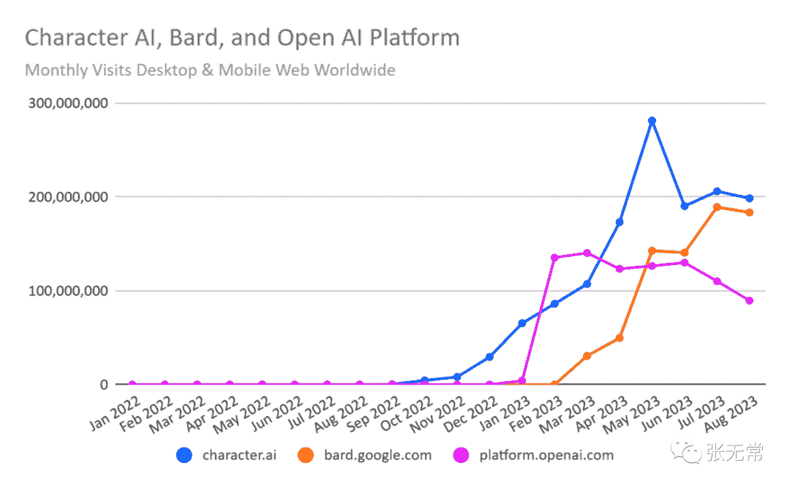
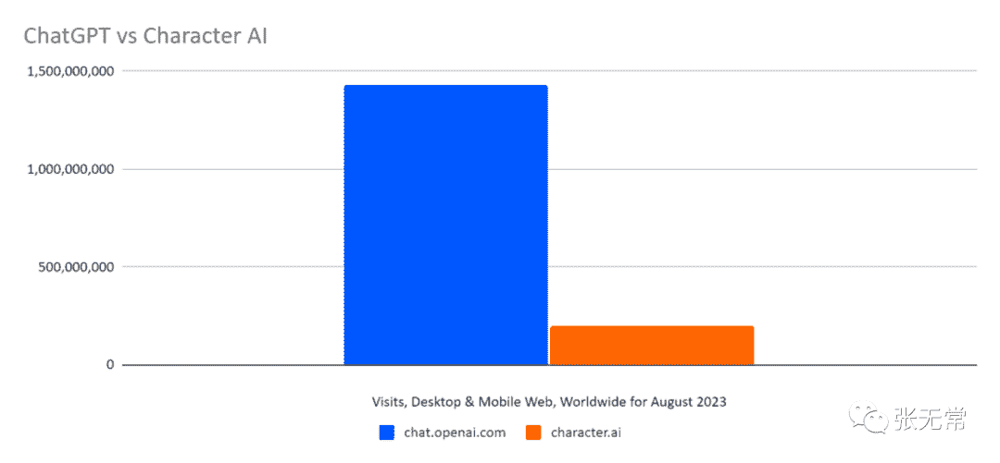
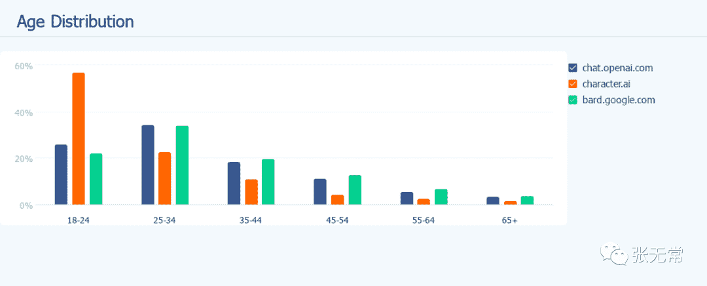

# ChatGPT 8月最新数据：流量持续下降，产品经理应该怎么看？

> 来源：[https://agijuejin.feishu.cn/docx/GO06dPDEIoY8VoxqzWFc9xSTnib](https://agijuejin.feishu.cn/docx/GO06dPDEIoY8VoxqzWFc9xSTnib)

> 张海庚｜[阅读原文](https://mp.weixin.qq.com/s/AS5otJzNiwK6odQ2pofx🐧)

> 转载请联系原作者取得授权

SimilarWeb公布了一份ChatGPT的流量报告，披露了生成式AI头部应用的流量数据及分析，值得一看：

1、ChatGPT仍然是全球访问量最大的网站之一， 8月份吸**引了14亿次全球访**问量 ，作为对比，微软的Bing搜索引擎则为12亿次。根据Similarweb，openai.com流量 全球排名第28位 。

chat.openai.com在11月底推出之前从零访问量开始，12月份达到了2.66亿访问量，接下来的一个月增长了131%，并在5月份达到了18亿次访问量。

2、不过， 5月份达到巅峰后，ChatGPT流量开始持续下降 ，直到8月份降速放缓，全球流量微降3%，美国流量上涨0.4%。

**SimilarWeb**认为主要是 因为美国学生放暑假 （ChatGPT的绝大部分流量来自美国），损失了大量的学生用户。这也解释了为什么 8 月的流量较为稳定，因为美国学生大部分在 8 月底返校，回血了。

3、**不仅ChatGPT， Cha**racter AI 、Goolge 的 Bard、OpenAI Platform 也出现了流量下滑，其中代表调用API使用量的OpenAI Platform流量下滑最为明显—— 开发者的热情开始下降了吗？ 虽然我觉得应该没有。

4、 Character AI弯道超车？

数据上：Chararter AI移动端表现出色

相比web端和ChatGPT的巨大差距，Character AI 在移动端的数据表现大有赶超之势

9月份，Character AI的iO**S和And****roid应**用的月活跃用户数为 420万 ，而ChatGPT的月活跃用户数约为 600万 。

用户年龄上： Character AI抓住了更年轻的用户

从年龄结构上看，Character AI用户中年轻人的比例（18-24岁）接近60%，远高于ChatGPT或Bard。

以上为数据，最后说一点关于「产品经理怎么看数据」的题外话：

产**品经理，细分有很多种，比如有**用户产品经理、数据产品经理、策略产品经理、增长产品经理等等，我个人还会分两派： 感性/直觉派、理性/逻辑派。

前者如张小龙、Alex，后者如俞军。

前者不开口，开口了也点到即止。用🛰️多年，我们才看到一本姗姗来迟的《🛰️背后的产品观》。

后者当然也少开口，做成贴吧退隐，滴滴复出不做束手高管，一线带人，言传身教，一页PPT讲1小时，所幸我们能看到弟子整理的《俞军产品方法论》。

为什么都不开口？他们暗示过： 产品经理没法「教」、没法「学」。

虽然还是看到有大家愿意出来讲，比如王慧文清华产品经理课，比如最近李想得到开讲产品实战——其实更多是CEO课了，也不会有人真听完就能干好产品。

大学到现在应该都没有产品经理专业——但有交互设计、项目管理方向。当然，市面上也有很多人人都是产品经理、产品经理速成课，我的观点是，它们不是没有价值，只是能教的不过基础的产品技能，比如了解用户需求、写PRD、和研发设计老板迂回大战（曰项目管理），而真正的产品力，没法教，甚至写的人大部分自己也不懂——很正常，产品本身就是个小概率成功事件，产品经理亦如是。

**产品经理没法「教」、没法「学」，只能靠**「手感」，靠「 言传身教」， 靠「悟」。

俞军耐心，言传身教，将理论大厦融入在具体的一次次产品讨论中；龙哥无意，说禅不过三，「感受用户潮流」，闭麦，只看做出来的Demo，一句「不真诚」打发。

2019🛰️公开课，张小龙说： 我也想借此机会感谢团队，因为平时还是以批评为主。并且，很多人也不一定理解我强行灌输的观点。

说回来，我有时候会觉得，数据像股价，一时的涨跌不说明什么问题，了解即可，不必过分在意。但有时候又觉得， 数据更重要的价值，不在于明面给你的感受，而在于水面之下的暗涌。

直觉派可以模仿张小龙当年做🛰️，通过刷🧣感受用户潮流，逻辑派大概也可以通过分析数据水下的暗涌、预判趋势？

相关阅读：

+   [成事：不要等，自己悟](http://mp.weixin.qq.com/s?__biz=MzIwODA3MDUwOQ==&mid=2652771190&idx=1&sn=72651c0e37445009d34646e2d04503ad&chksm=8ce20174bb9588626efb2b52499e3c720c5d3f886cb32e6954104c52542617fd72dd7ed6a357&scene=21#wechat_redirect)

+   [信息的角度，比信息更重要](http://mp.weixin.qq.com/s?__biz=MzIwODA3MDUwOQ==&mid=2652772806&idx=1&sn=d37fbc07c19b383b1df5940d5eb02eeb&chksm=8ce20bc4bb9582d29540b70e7dd3e717f8e86ed21a4abc4d3dc52920135b8442ddedba6ffb1c&scene=21#wechat_redirect)

+   [品无字书，听无声语](http://mp.weixin.qq.com/s?__biz=MzIwODA3MDUwOQ==&mid=2652772465&idx=1&sn=be9eb9d4e17973adff654d5c5268d99b&chksm=8ce20a73bb958365143296150887b6206037e3bfebb715dabeb81c4dc785d9e663c6987f9294&scene=21#wechat_redirect)

+   [能下马步，才能谈招数](http://mp.weixin.qq.com/s?__biz=MzIwODA3MDUwOQ==&mid=2652772562&idx=1&sn=7b50f85677a8f4fad56726762bb2bbb8&chksm=8ce20ad0bb9583c6015675ecd3a04813f55c368d0a36cf0cf419fba0da83e1fc861208e33b4d&scene=21#wechat_redirect)

+   除了ChatGPT，大模型杀手级应用还没有跑出来的原因是什么？

+   6000字解读：当前大语言模型LLM研究的10大挑战

我**是Hayes海庚，一个关**注AI的大厂产品经理，最近打算和更多人交流，如果你也关注这轮AI浪潮，希望和包括 字节、百度、阿里、腾讯 在内的大厂同学一起交流讨论，欢迎在👸号「张无常」后台回复「茶水间」或 加🛰️hayeszhang13 入群，麻烦备注【 称 呼 -公司/学校-职位-来意】。