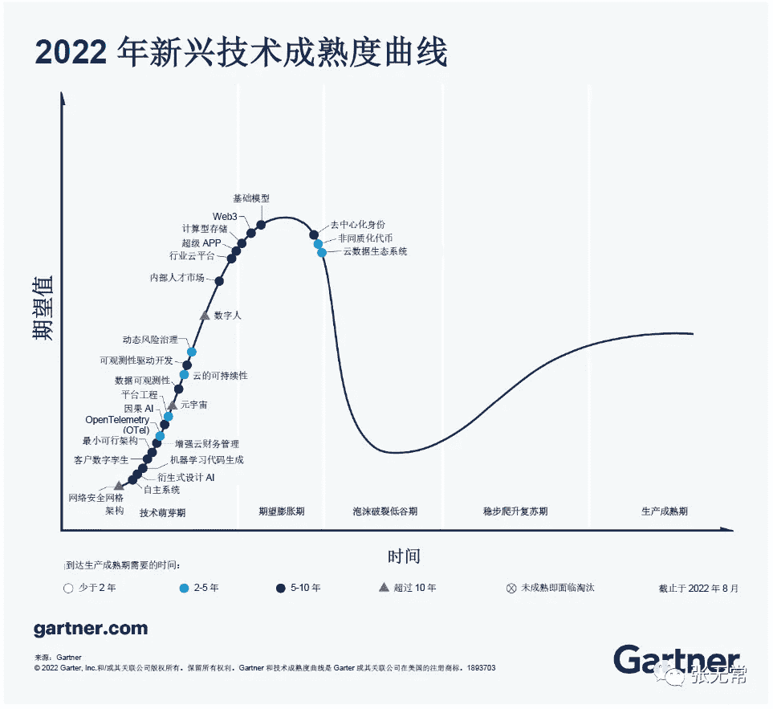
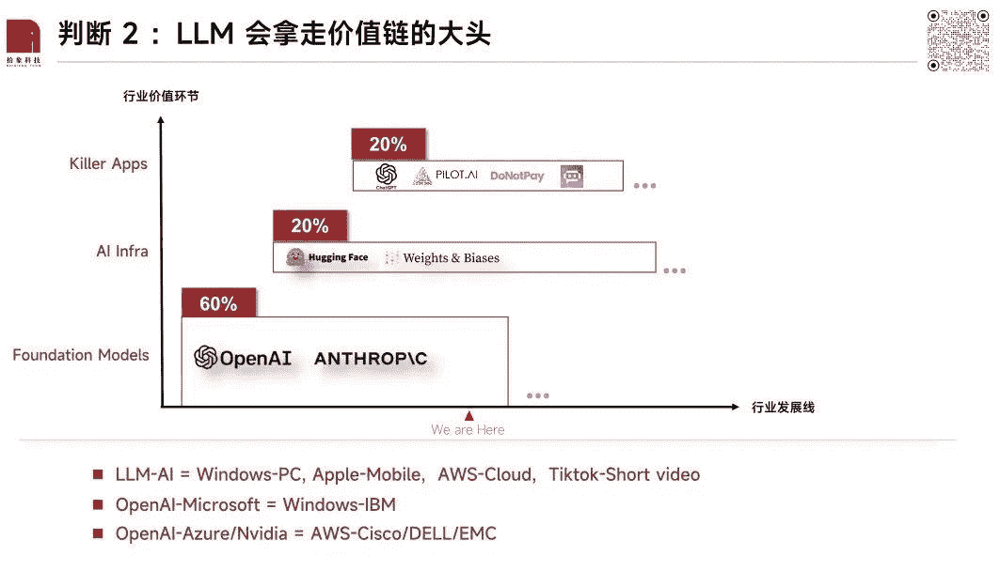
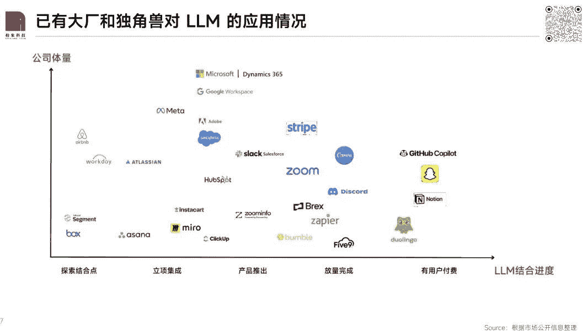
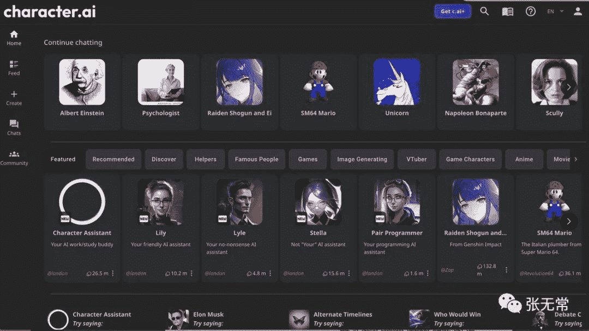
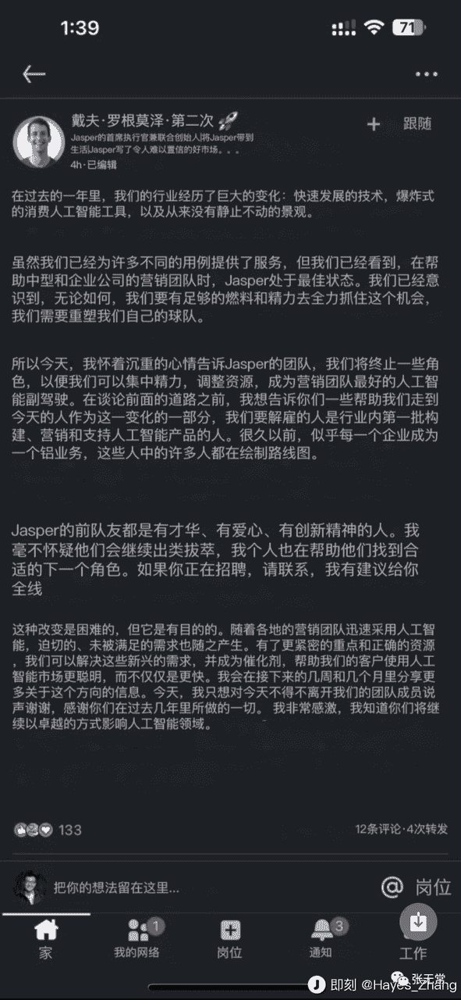
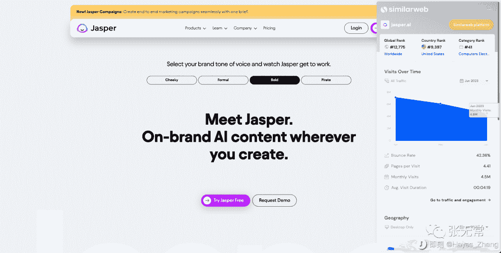
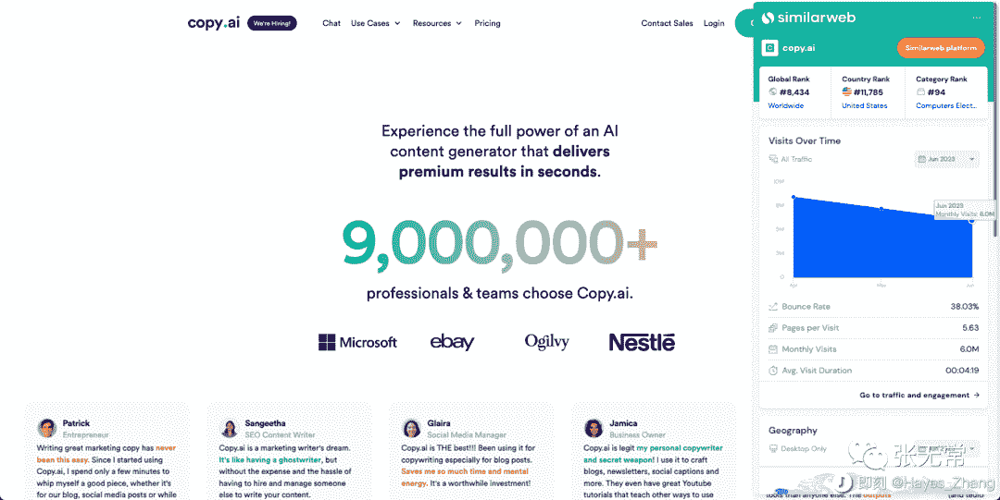

# 除了ChatGPT，大模型杀手级应用还没有跑出来的原因是什么？

> 来源：[https://agijuejin.feishu.cn/docx/JAHudGEEGoWjFVxh5qdc3lULnjh](https://agijuejin.feishu.cn/docx/JAHudGEEGoWjFVxh5qdc3lULnjh)

> 张海庚｜[阅读原文](https://mp.weixin.qq.com/s?__biz=MzIwODA3MDUwOQ==&mid=2652772361&idx=1&sn=e3ddac5f7bfbcebfc046a82e5e59ac13&chksm=8ce20a0bbb95831d6960370ff50c7cd02b180ef922dfcc071b247e710c38482d9334b1c496c3&scene=21#wechat_redirect)

> 转载请联系原作者取得授权

最近和大模型研发同学聊，提到一个很有价值的问题：

**你**觉得现在应用还没有人探索出来的原因是什么？是因为还没有一个DAU达到ChatGPT规模的产品？还是什么其他原因？

试着写了下我目前的理解，应该还会迭代：

---

一、从技术周期角度看，模型层中间层尚未成熟，应用层尚需时日

首先从技术周期上看，举个例子，Garner技术成熟度曲线，LLM远没有到比较成熟的生态繁荣期，现在底层模型技术还在疯狂演进，投资都集中在模型层和中间层，应用层普遍被认为还比较早（比如拾象就是这个观点，）——我个人也比较认可： 下半年甚至明年才是应用层冲出来 killer app 的时机 ， 比如某个AI Native的应用快速实现千万级别活跃用户。

2022年9月份 Garner 发布的新兴技术成熟度曲线，基础模型还在技术膨胀期，这是整个周期的愚昧之巅，马上就要进入泡沫破灭期，之后才是爬升复苏期——我理解那才是应用蓬勃发展的时期。

顺便说一句，也有研究者比如拾象会认为，这波AI虽然应用层声势浩大，但最终收益会是：模型层60%、中间层20%、应用层大概也就20%。

三月份的时候拾象对大厂和独角兽公司产品应用的盘点：

二、从开发者角度看——创业公司、新产品：

首先，应用层其实已经有一小部分跑出来了，比如 Notion.ai 去年底第一波接入 ChatGPT 实现AI智能写作，一个月内的ARR（Annual Recurring Revenue, 年度经常性收入）达到1000万美金。

另外 character.ai 是一个相对成熟的AI Native应用的例子——但几乎 肉眼可见这是个过渡态，而且随时可能被底层模型的能力进化而吃掉，比如 ChatGPT 刚出来的时候国内就有插件将 ChatGPT 的搜索结果放在google结果页右侧，肯定会有一波流量，但似乎很难商业化，等到 出了bing和webcopilot，这些套壳应用可能就要被吃掉了。

当然 character.ai 大概率不会，他们是自己做大模型的公司。

这类插件最有名的应该是国内开发者开发的 ChatGPT for Google，好像最近被另一个创业者收购并做成了更好用的插件Monica了，了解详情的同学麻烦留言告知下。

另外，这两天的最新消息，估值达到15亿美元的营销文案写作工具 Jasper 宣布裁员了，最近几个月的流量也一直在跌，另外，竞品Copy.ai也在跌，所以我猜大概率不是竞品抢流量，而是被底层模型ChatGPT们吃掉了。

——综上，这是我理解，从创业者和新产品的角度看，killer app没跑出来的原因， 因为壁垒不够强，边跑边被吃掉了。

三、再从开发者角度看——大厂和有成熟产品的公司

第一，需要配合监管，众所周知，不赘述。

第二，想做自己的模型，精力就牵扯住了，顾不上应用，应用反过来也得等自家大模型——比如钉钉得等通义前问（这还算快的），而wps就直接接了Minimax、智谱AI和文心一言三种大模型，产品很快出来。

第三，做了产品的，其实大家都 还没想明白基于LLM的应用应该怎么做才是够创新的 ，很多只是简单加了一个AI Feature，并没有多少AI native的能力。

我理解 背后其实反映的是大厂尤其是 产品经理缺少对AI的独到、深刻认知 ——以我的观察来看，绝大部分产品经理的认知并不比关注各种AI营销👸号的普通用户强多少——就算是在大厂。

这也是我最近深入研究AI以后最大的体会，大家就是焦虑，由于现有业务太忙等种种原因，并没有太多时间和心思深入思考。

用一位大厂某产品方向业务负责人向我描述的感受就是：

虽然没有专门研究，但通过各种渠道比如战略研究报告，该看的也差不多看了， 大概理解了LLM应用的可能性，将LLM当成一个黑盒来调用，发现除了效率提升方向，好像也没有太多可以挖掘的空间了。

我怀疑这可能是国内大部分产品经理的真实感受，因为他是非常优秀的产品经理。

从另一个角度看，我一直觉得，还没想好怎么做的大产品， 与其跟风瞎做，不如忍住不 做，想清楚再做 ，虽然这需要更强的定力。

为什么呢？

因为 1）做了新功能，维护成本很高； 2）更重要的：做了这个，不做那个的机会成本很高，AI变化太快了。没人知道一觉醒来世界会不会又被新模型颠覆。

另外，大厂还有一些大公司病的顽疾，此处省略数百字——不过，这倒是创业公司一直有机会的原因。

四、AI带来的信息爆炸，所有人都需要时间消化

昆仑万维CEO 方汉说， 他 和中国最顶尖的产品经理交流后发现，对方还处在很懵的状态 ，「 这一波大模型远超产品进展」。

猎豹CEO傅盛反驳了这一判断：产品经理并不懵，很多已经在行动。

但显而易见的是，至今还没有令人满意的杀手级产品出现。

我的感受是，整体上， 无论是大厂还是小厂、还是创业者，大家还在消化底层模型的能力 ，一边提升认知，一边想着怎么跟业务深度融合。也许半年或者一年后，会是应用集中爆发的时间，万一有一个 killer app 跑出来了，所有人的感受都会不一样，当然，这个角色也可能是旧世界的霸主微软Copilot。

因此，作为明显对 LLM 过分上头的人，我倒不担心最近很多人说 GPT 流量热度下降了，反而觉得 这是真正做事的人蓄力的时间和机会。

与其汲汲于AI怎么替代我、如何应用到业务上、信息太多看不过来， 更好的心态似乎是： 战略上不着急，战术上废寝忘食。 保持对底层技术和应用的理解和观察，努力形成独特的深刻认知，等风来。

The best is yet to come.

---

我是H**ayes海庚**，一个关注AI的大厂产品经理/战略，最近打算和更多人交流AI，如果你也关注这轮AI浪潮（不限于从业者，也可以是普通用户），希望学习、研究AI，欢迎在👸号「张无常」后台回复「茶水间」或添加🛰️hayezhang13 入群，和包括 字节、百度 在内的大厂同学一起交流讨论 。

更多阅读：

+   [别说自己不懂技术，记住你是用户](http://mp.weixin.qq.com/s?__biz=MzIwODA3MDUwOQ==&mid=2652772289&idx=1&sn=5a8ffd16a29fc95983a927aeef5f5ec4&chksm=8ce205c3bb958cd596dd51283c9995b0433e660d3aa2003baa0ccfb631123fd44e27513889b4&scene=21#wechat_redirect)

+   [LLM时代的产品设计革命：大模型带来的](http://mp.weixin.qq.com/s?__biz=MzIwODA3MDUwOQ==&mid=2652772337&idx=1&sn=9ca524775f409be27ea15a478f9b2436&chksm=8ce205f3bb958ce504e5eb86a798d4a7c03765be6c5c56b76478b7e54092e38f4216bbd97c12&scene=21#wechat_redirect)人机交互范式的转换是如何影响产品设计的？