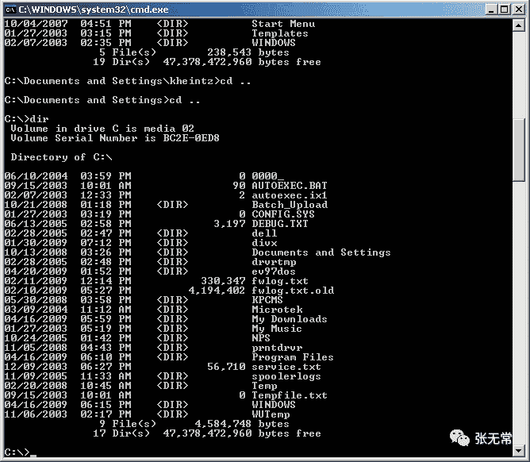
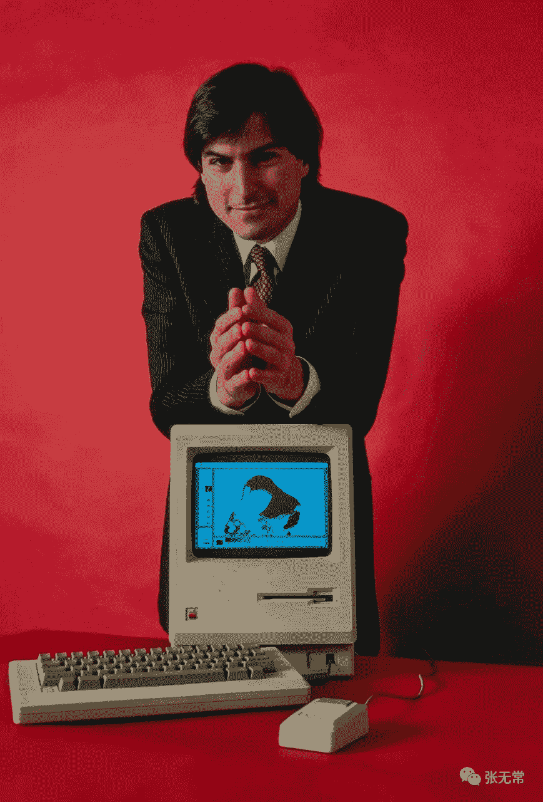
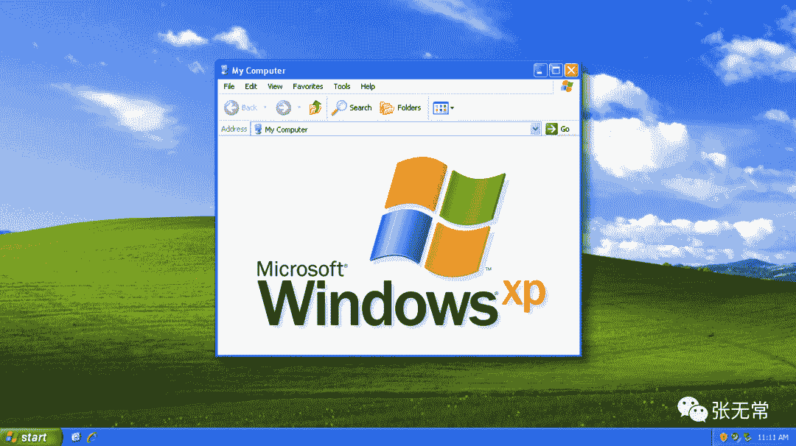
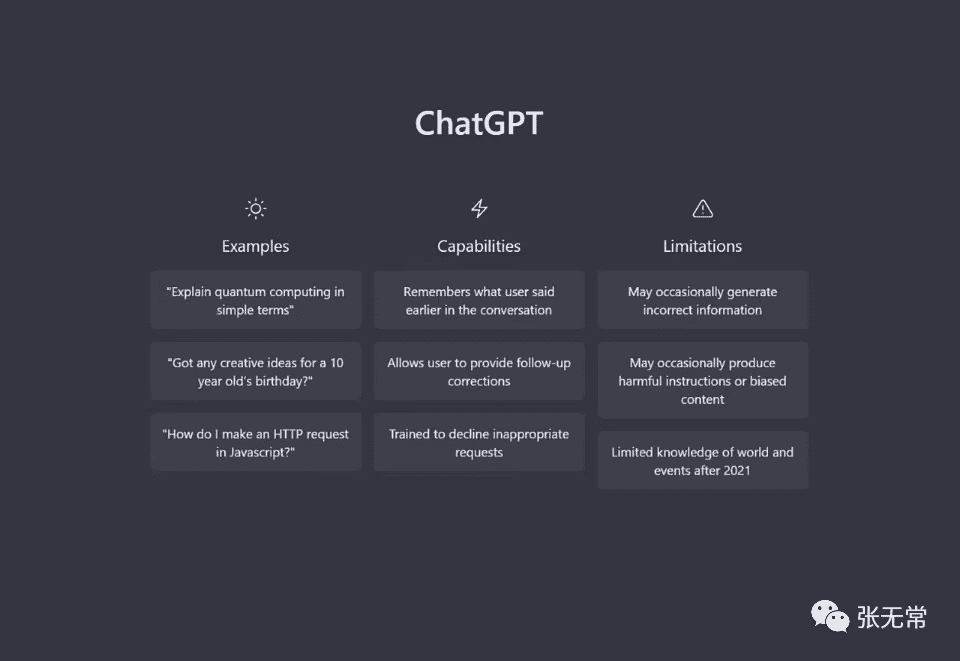
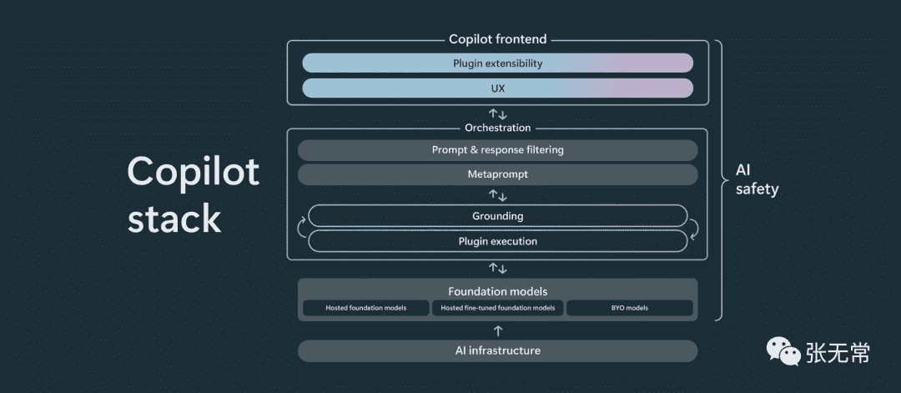

# LLM时代的产品设计革命：大模型带来的人机交互范式的转换是如何影响产品设计的？

> 来源：[https://agijuejin.feishu.cn/docx/O0l3d8zmtofVaLxkPuscZzCjnFg](https://agijuejin.feishu.cn/docx/O0l3d8zmtofVaLxkPuscZzCjnFg)

> 张海庚｜[阅读原文](https://mp.weixin.qq.com/s?__biz=MzIwODA3MDUwOQ==&mid=2652772337&idx=1&sn=9ca524775f409be27ea15a478f9b2436&chksm=8ce205f3bb958ce504e5eb86a798d4a7c03765be6c5c56b76478b7e54092e38f4216bbd97c12&scene=21#wechat_redirect)

> 转载请联系原作者取得授权

最近发了一篇讨论产品经理与LLM技术的文章《 别说自己不懂技术，记住你是用户 》 ，引发不少朋友阅读、讨论，也激起了我继续思考LLM产品的热情，再写一篇。

对AI和LLM感兴趣的朋友欢迎扫文章底部二维码进群一起讨论，或者加🛰️hayeszhang13交流~

---

先说结论： 大模型带来的 人机交互 范式 的转换将彻底改变产品设计思路。

——这是开发者尤其是产品经理和设计师应该重视、但似乎还没引起足够重视的问题。我也还在思考，先简单整理下我的思路，think out loud.

一、LLM改变人机交互： 从 图形用户界面 转向自然语言用户界面

首先， **大**模型本质上带来的是 人机交互 范式 的转变，我们将从 图形用户界面 ( GUI )转向自然语言用户界面( LUI )。

有几点补充说明：

1、图形用户界面，简称 GUI，是 Graphical User Interface 的简称，现在的主流人机交互方式，典型：Windows 、Mac、iPhone、安卓。

具体来说，GUI 是指采用图形方式显示的计算机操作用户界面，使用图标、菜单和鼠标（点击图标或下拉菜单）来管理与系统的交互。GUI 由施乐公司开发， 在20世纪80年代由乔布斯带队研发的苹果 Macintosh 普及 。当时的背景是微软的操作系统 MS-DOS 要求用户键入特定的命令——不过目前微软的 GUI Windows 是最主要的用户交互界面。这中间还有一段灵感与抄袭的恩怨历史，此处按下不表。

MS-DOS

乔布斯与Macintosh

Windows XP

2、自然语言用户界面，简称 LUI ( Language User Interface) ，又称 NLUI（Natural-language User Interface），与 GUI 不同的是，LUI 可以直接使用人类自然语言来进行人机交互。目前最有代表性的 LUI 产品是ChatGPT。

3、从图形用户界面( GUI )转向自然语言用户交互( LUI )**——这样**的表述是为了更简洁和直接，也是对新交互界面最核心特征的概括，但这实际上 还包含 着另一层意思：

大模型本质上带来的是人机交互范式的转变，我们将从图形用户界面转向 自然语言与图形相融合的用户界面 ，或许可以称为LGUI。

但这并不妨碍我们定义未来是 LUI 时代：图形用户界面系统中也包含着大量更早的命令行界面（比如编程界面），但人们也并不说这是图形与命令行相融合的用户界面，太拗口了。

二、为什么产品经理应该重视人机交互范式的改变？

这个范式的转变，无论对用户、还是对产品经理和开发者，冲击都是巨大的，尤其是产品经理/开发者，因为系统的改变会要求应用和产品体验的改变。而只有产品经理们设计思路的改变，才有用户体验的改变。

——最早转变过思路的产品经理和他们的产品将赢得巨大的先机。

但由于我们现在正处在这个范式转变的早期，很少有产品经理意识到这个转变意味着什么？

**三、那些变与不变**

当然， **最根本的东西是不变的：用户需求洞察**以及你对用户痛点的独特理解和创造性满足。

那变的是什么？结合陆奇、微软CTO和硅谷很多AI从业者的观点，我觉得这种范式转变意味着：

**设计产品的思路将永远改变了 **。**自从人类开始开发软件**以来（这不仅是移动互联网和互联网，而甚至最早可以追溯到乔布斯发明、盖茨推广PC图形交互界面以来），我们一直要求 人类去理解机器语言 ，我们需要学习机器的编程语言和交互界面。对于现在的产品经理和开发者来说，交互和界面的设计是实际开发过程中最费时间的。

插一句：这里将产品经理和开发者合在一起是因为我觉得，由于AI Coding的发展，未来编程的门槛会迅速下降，产品经理将需要越来越深入理解甚至掌握技术。

为什么交互界面这么重要？因为产品能力和用户需求之间有一条鸿沟，产品不知道用户的需求具体是什么，用户也不知道产品具体有什么能力。这道鸿沟需要通过交互界面去弥合，而产品经理和设计师反复拖拉拽做的交互界面调整， 本质上就是预测用户可能的需求，并通过用户可以理解的方式提供满足方案。

为什么有这道鸿沟？因为机器不理解人，只能人去理解机器。

而大模型的出现是破天荒的，它让计算机实际上能够用与人一样的自然语言与人交流，彻底改变了数字体验、人机交互——因为至少在可能的脑机接口出现以前， 自然语言就是人最自然的交互方式了 ，甚至比乔布斯破天荒的手指交互自然。

四、自然语言用户界面对产品经理的新挑战

因为大模型将人机交互模式从图形界面交互GUI转向自然语言界面交互LUI，所以倒逼着产品经理/开发者要用自然语言界面交互的逻辑去重新思考设计——这意味着，需要超越过往图形界面交互时代着重交互、界面（典型的就是页面、按钮调整等等）设计的思路，再往前进一步思考：

大 语言模型 已经这么强了，产品还需要做什么？我还需要做什么？

如果对这一点有所怀疑，那么一个因**为**太过明显、有力而容易被忽略的铁证是： 在传统图形界面交互的标准下、 产品体验明显存在优化空间的 ChatGPT ，已经成为史上增长最快的产品了 ——与此相对的是，只支持 API 调用（命令行用户界面）的 GPT-3，早在20年问世却几乎无人问津，抛开两大模型能力上用户不易感知的差异，这其中的关键就是 Chat，自然语言对话界面。

这也正是上述范式转变的最有力证据，更不用说图形用户界面的霸主 Windows 已经全面拥抱 LLM、进入 Copilot 时代了。

遗憾的是，也许因为我们还处在早期，如果我们看现在市面上的AI产品，就发现绝大**部分还停留在传统的图形交**互界面的思维桎梏里，也许是跳脱不出来——也许更糟糕的， 是压根没想过需要跳出来 。

以上就是本文的主要内容，但我跟很多人聊这个想法的时候，都会被问到：这到底有什么影响？应该怎么设计产品？于是再把一些不成熟的想法也写下。

五、LLM 时代应该如何设计产品？

大模型时代下的自然语言界面要求的产品设计思路是什么？ 我现在当然不知道——也许在 Killer App 出来之前，没人有底气说他知道。但我有一些模糊的原则：至少它不是什么、以及它可能是什么。

自然语言界面的产品设计至少不是这样的：

+   至少不是缝合怪，不是简单的现有产品 + AI Feature。 大量的ChatGPT套壳app、套壳插件，在 ChatGPT 能力升级以后都灰飞烟灭了，除了抢时间红利的价值外，没有足够深的护城河、也就没有真正的产品价值。

+   对成熟产品而言： **在没想好的情况下，跟风去做 AI Fe****ature 不****如不做，因**为成本巨大—— 甚至都不是上线前的开发成本，而是 1） 沉默 成 本 ，成熟产品需要长期维护这个 AI 功能； 2）更重要的： 机会成本 ，做了这个功能、还要长期维护，也就某种程度上失去了探索其他功能的时间和精力——在 AI 发展一日千里的时代，代价是巨大的。

+   至少不是和以往一样，给用户一堆文字、图片、视频等一堆信息，去猜用户要什么——陆奇说，你起步就得是自然语言，告诉用户你懂什么东西，可以怎么和你交互。

+   **用户需求的理解将变得空前容易 **，因为再复杂幽微的需求都可以通过语言表达并逐步澄清（比如「请抖音每天早上10点给我推荐10条男博主拍的如何把女朋友拍得最好看的1分钟以内的短视频」）

+   **与用户需求理解门槛下降对**应的，是 用户需求将变得空前膨胀 ，机会也将更多 ——不思进取的老产品和产品经理将不进则退。

自然语言界面的产品设计可能是这 样的（ 基于当下的LLM进展） ：

+   **更可用的AI **： 起码是合理的、自然的LLM入口。

+   **更实用的AI **： 更少挫败感、更易用（比如降低Prompt Engineer门槛），关注LLM不合逻辑的体验或限制LLM发挥的陷阱

+    **更强大的AI **： 挖掘LLM的潜能，让你的用户能更有效地运用LLM的内在力量。

很明显，干巴巴的设计哲学是不符合直觉的，需要未来有更多产品作为辅助说明。

**六、结语**

用微软CTO的观点说，大模型时代的开发者应该重新思考你的交互界面，因为基于大模型的开发流程——从底层到顶层——都已经被彻底重构了。

**也许所有产品经理/开发者都将被迫思考： 大模型已**经很强大了，还能新增哪些能力呢？用户还需要它新增哪些能力？这些能力要如何获得？ 通过插件、微调还是组合多个模型？——至少这些工作会远比原来调整交互、视觉的工作要重要得多。

**最后，我希望本文成为一种提醒**， 一种抽象的产品设计哲学思考 （而不是药方） ——因为激进思考产品哲学的产品经理们应该最有机会率先跑出 Killer App。

> 参考资料：

+   https://www.bilibili.com/video/BV1mM4y147qw/?spm_id_from=333.1007.tianma.1-2-2.click&vd_source=0a7349493c5d70149efefa88eac70de1

+   https://www.bilibili.com/video/BV1a24y1A7Hp/?spm_id_from=333.337.search-card.all.click&vd_source=0a7349493c5d70149efefa88eac70de1

---

我是Hayes，一个关注AI的产品经理/战略，最近打算和更多人交流AI，如果你也关注这轮AI浪潮（不限于从业者，也可以是普通用户），希望学习、研究AI，欢迎在👸号「张无常」后台回复「茶水间」或 加🛰️hayeszhang13 入群。

更多阅读：

[别说自己不懂技术，记住你是用户](https://km3dl0ffdl.feishu.cn/wiki/D5Fbwoq5hiPQ2LkV3gMciSkfnIg)