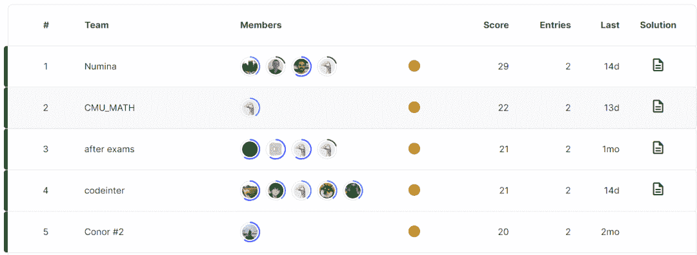
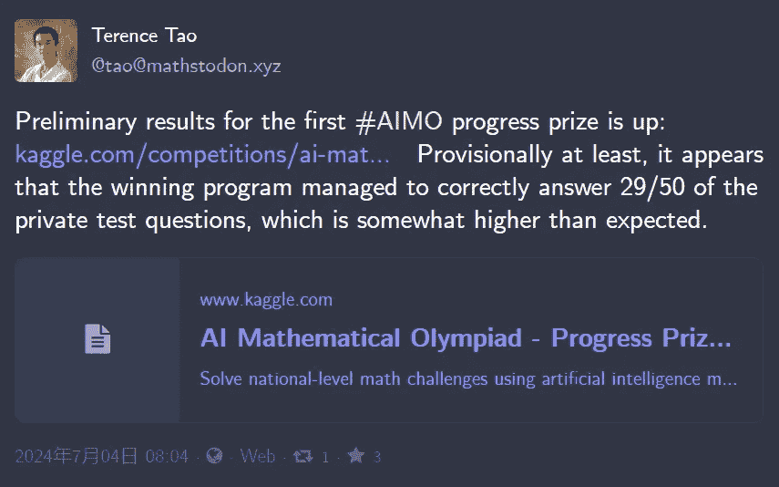
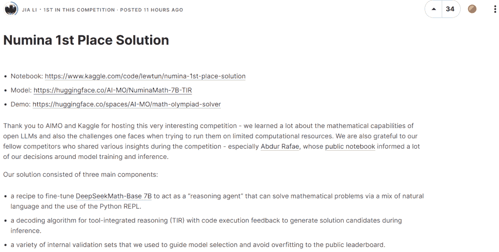
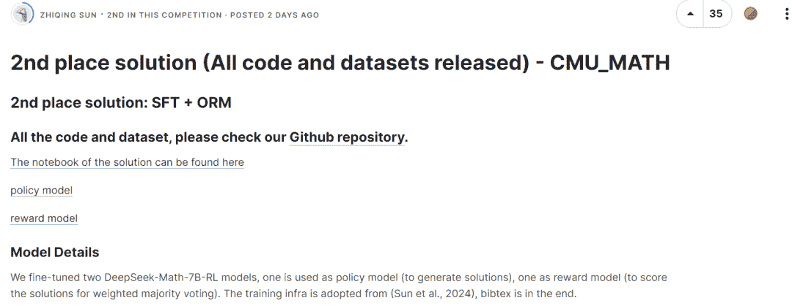
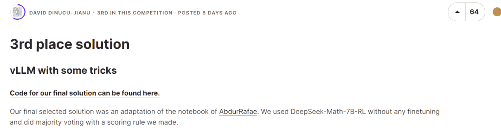
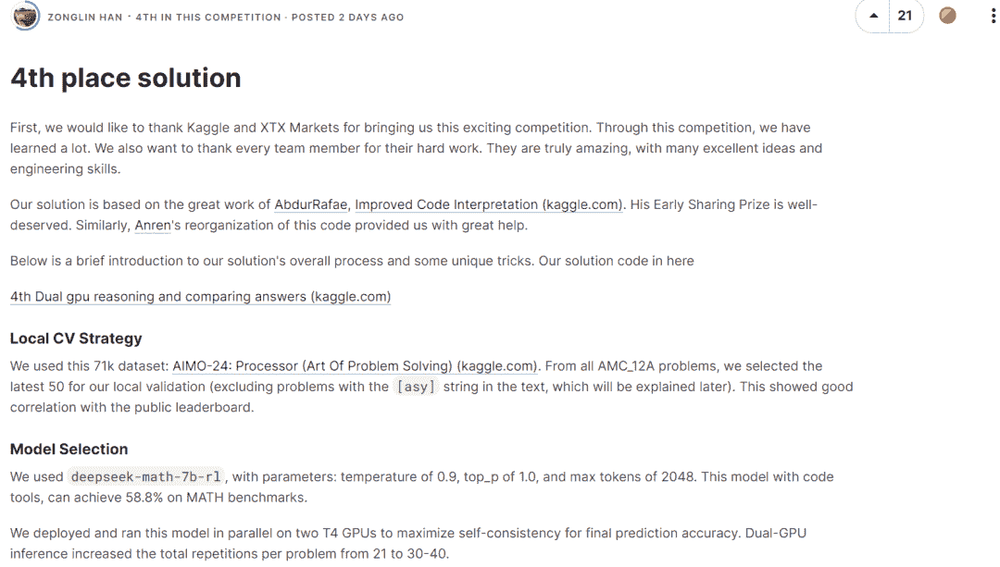
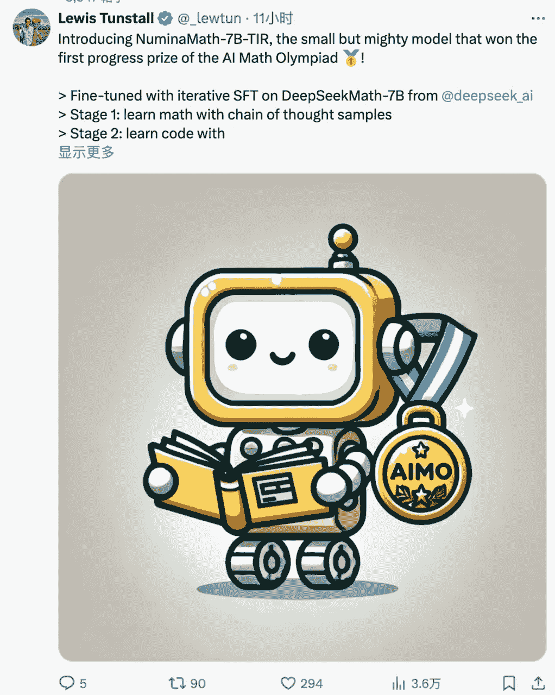
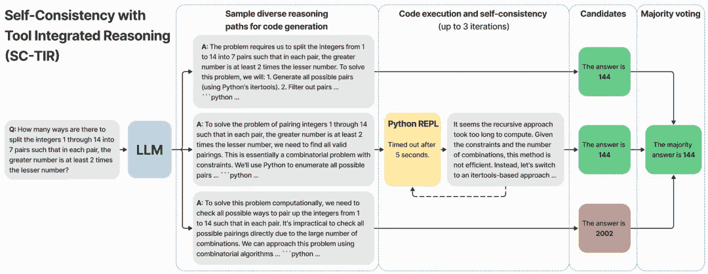
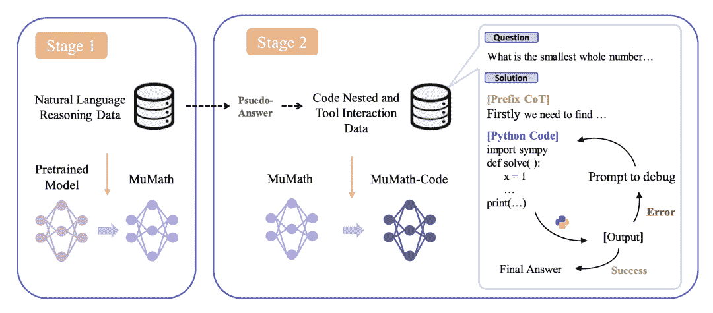
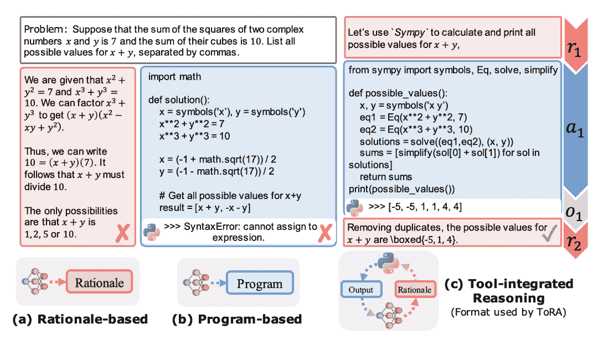

# 首届AI奥数竞赛方案公布：4支获奖队伍，竟都选择国产模型DeepSeekMath

> 来源：[https://agijuejin.feishu.cn/docx/Hb58dvuBdo6jEex3j5tcCSivnoe](https://agijuejin.feishu.cn/docx/Hb58dvuBdo6jEex3j5tcCSivnoe)

> 机器之心｜[阅读原文](https://mp.weixin.qq.com/s/R4eNNoRdfXnMQZiaYR59Jg)

> 转载请联系原作者取得授权

> 获胜的 AI 数学奥林匹克模型出炉！

几天前，随着榜单的公布，大家对全球首届 AI 数学奥林匹克竞赛（AIMO）进步奖 的讨论量居高不下。

这次比赛共有 5 个团队胜出，获得第一名的是 Numina 的团队，CMU_MATH 位列第二，after exams 暂居第三，codeinter、Conor #2 团队分别拿到第四、第五的成绩。

图源：https://www.kaggle.com/c/ai-mathematical-olympiad-prize/leaderboard

这一成绩，曾让陶哲轩感到惊讶。

当时官方只公布了获奖名单，并未透露背后模型的更多信息。大家都在好奇，获得冠军的队伍到底是用了哪种模型？

刚刚，AIMO 进步奖公布了前四名背后模型。

冠军团队用到的模型是 NuminaMath 7B TIR，该模型是 deepseek-math-7b-base 的微调版本。

获得第二名的队伍微调了两个 DeepSeek-Math-7B-RL 模型，一个用作策略模型（用于生成解决方案），一个用作奖励模型（用于对加权多数投票的解决方案进行评分）。

第三名同样使用了 DeepSeek-Math-7B-RL 模型，没有进行任何微调，并通过制定的评分规则使用多数投票的策略选择正确答案。

排名第四的队伍同样使用了 deepseek-math-7b-rl，参数设置 temperature 为 0.9、top_p 为 1.0、max tokens 为 2048。该模型搭配代码工具，在 MATH 基准测试中可达到 58.8%。

我们不难发现，排名前四的队伍都选择了 DeepSeekMath-7B 作为基础模型，并取得了较好的成绩。该模型数学推理能力逼近 GPT-4，在 MATH 基准榜单上超过一众 30B~70B 的开源模型。

冠军：NuminaMath 7B TIR 模型

接下来，就让我们详细看下这场比赛的冠军方案。

NuminaMath 是一系列语言模型，经过训练可以使用工具集成推理（TIR）解决数学问题。

NuminaMath 7B TIR 是 deepseek-math-7b-base 的微调版本，进行了两个阶段的监督微调：

+   第 1 阶段：在自然语言数学问题和解决方案的大型、多样化数据集上微调基本模型，其中每个解决方案都使用思维链 (CoT) 进行模板化以促进推理。

+   第 2 阶段：在工具集成推理（TIR）的合成数据集上微调第 1 阶段得到的模型，其中每个数学问题都分解为一系列基本原理、Python 程序及其输出。这里会 prompt GPT-4 生成带有代码执行反馈的 ToRA 格式（微软）解决方案。在这些数据上进行微调会产生一个推理智能体，它可以通过结合自然语言推理和使用 Python REPL 来计算中间结果，以解决数学问题。

值得注意的是，NuminaMath 7B TIR 是专门为了解决竞赛级别数学问题而创建的。因此，该模型不应用于一般聊天应用程序。通过贪婪解码（greedy decoding），冠军团队发现该模型能够解决 AMC 12 级别的问题，但通常很难为 AIME 和数学奥林匹克级困难问题生成有效的解决方案。该模型还难以解决几何问题，可能是因为其容量有限且缺乏视觉等模态。

