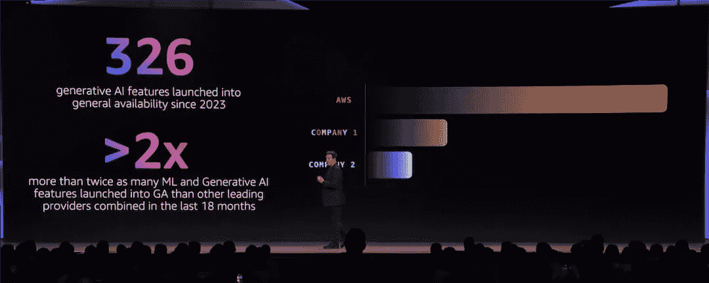
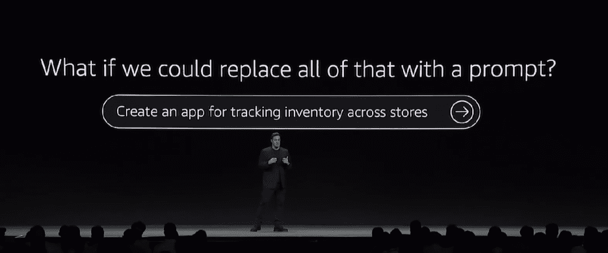
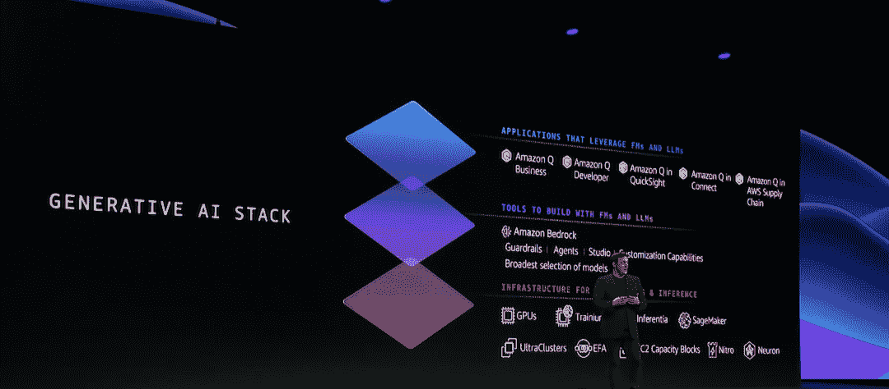
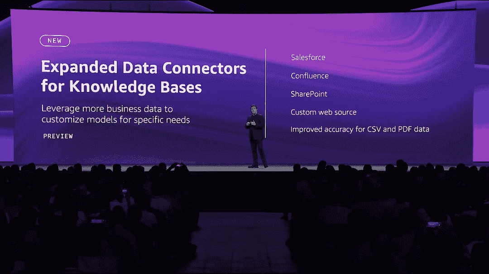
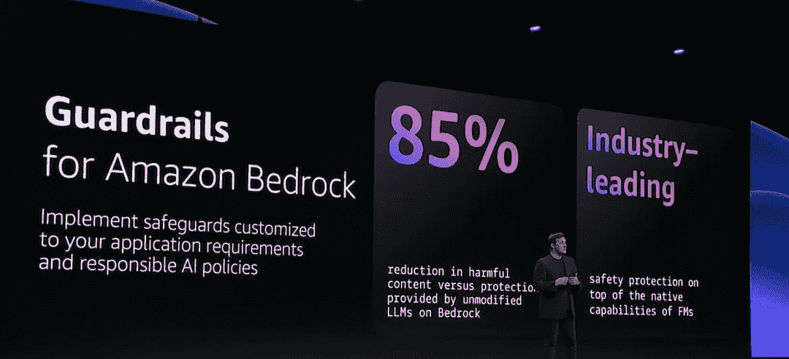
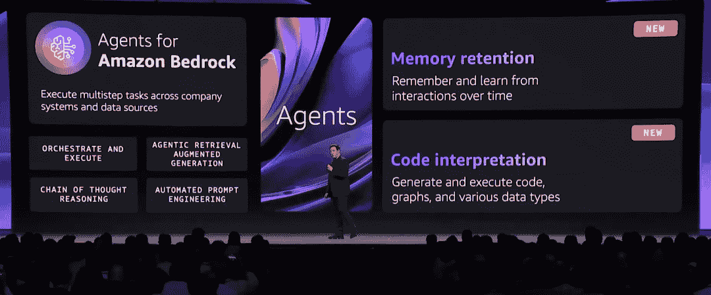
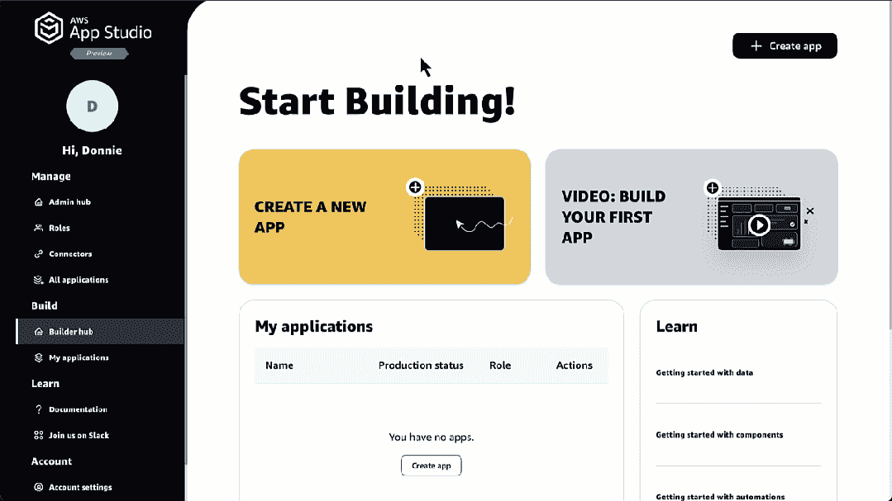
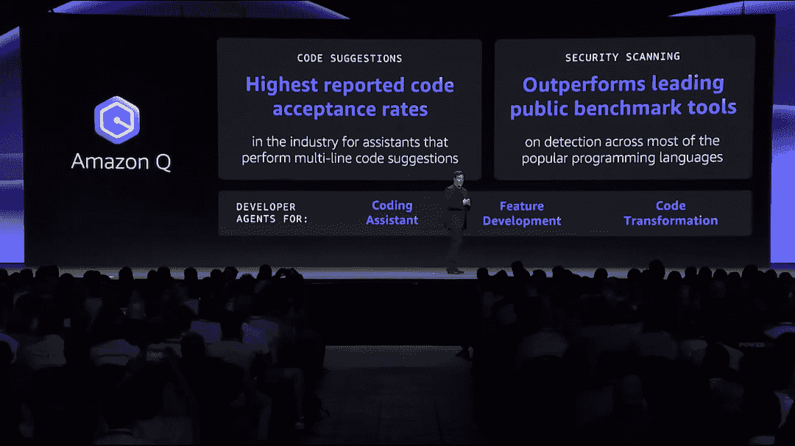

# 18个月326项能力，这家大厂猛猛上新生成式AI，如今纯靠`Prompt`就搞定企业级应用了

> 来源：[https://agijuejin.feishu.cn/docx/O73NdTfG2o4UUbxGipXcyQ6vnmd](https://agijuejin.feishu.cn/docx/O73NdTfG2o4UUbxGipXcyQ6vnmd)

> 机器之心｜[阅读原文](https://mp.weixin.qq.com/s?__biz=MzA3MzI4MjgzMw==&mid=2650925762&idx=1&sn=4a06d65dfc38ffb11f9a7512ddad5519&scene=21#wechat_redirect)

> 转载请联系原作者取得授权

> 构建生成式 AI 应用，现在只需要几分钟。

「生成式 AI 的半衰期只有六个月，」亚马逊云科技全球 AI 产品副总裁 Matt Wood 说道。

2024 开启下半年，人们发现，生成式技术和落地之间的距离，已经不能用「远」或「近」完全概括。

狂热的百模大战之后，即使生成式 AI 技术展现出了前所未有的能力，为何一部分企业还没有投身到新技术的变革之中？技术门槛和高昂的研发投入、应用成本是它们保持谨慎态度的主要影响因素。

今天凌晨，亚马逊云科技给全世界带来了解决方案。一系列生成式 AI 技术的重磅发布，将全球最先进的大模型技术与千万企业用户的需求巧妙连接了起来。

从 2023 年到现在，不到两年的时间里，亚马逊云科技已经发布了多达 326 个生成式 AI 功能。横向对比一下，过去十八个月，亚马逊云科技正式发布的机器学习和生成式 AI 功能的数量是其他主要供应商总和的两倍多，用一骑绝尘来形容也不为过。

在这其中，既有顶尖创业公司的基础模型，也有能给非技术人员带来大模型开发能力的实用工具。每款都是生成式 AI 落地应用中的神器。而且，这些模型和能力的数字还在不断增加。

现在，很多复杂的企业级工作，仅用一段 `Prompt`，AI 就能自己完成了

没错，这家长期以来为无数企业提供数字基础设施的公司，让生成式 AI 技术的应用门槛一降再降。企业用户需要花在「学习使用大模型」上的时间，也越来越少了。

在这场亚马逊云科技纽约峰会上，从基础设施层的 `GPU` 算力、基础模型的工具层再到应用层，亚马逊云科技的三层生成式 AI 技术栈迎来了一次焕新升级。

## 大模型微调实现深层定制

### Amazon Bedrock 全面升级

一直以来，为了实现基础模型与企业用户需求的「双向奔赴」，亚马逊云科技通过基础模型平台 `Amazon Bedrock` 不断地「做加法」，在模型能力、安全隐私、负责任的 AI 等方面向企业用户靠拢。

迄今，`Amazon Bedrock` 支持的基础模型数量已有 33 个，分别出自 `AI21 Labs`、`Anthropic`、`Cohere`、`Meta`、`Stability AI`、`Mistral AI` 等全球顶级大模型厂商以及亚马逊自己。鉴于 `Amazon Bedrock` 允许企业用户通过微调来定制模型，强大的基础模型有了自定义的加持，更能实现与企业用户需求的紧密结合。

在今天这场年度峰会上，亚马逊云科技宣布了最新成果：「`Claude 3 Haiku` 微调」发布了预览版。作为 `Claude 3` 系列模型中的「小杯」，`Claude 3 Haiku` 的速度最快、最紧凑，而 `Amazon Bedrock` 是第一个能让用户对 `Claude 3 Haiku` 模型进行微调的完全托管服务。

纵观当前的大模型赛道，`Claude` 系列是对 `OpenAI` 旗下大模型追得最紧的竞争对手。基于亚马逊云科技与 `Anthropic` 的深度合作关系，企业用户们可以期待在 `Amazon Bedrock` 上与更强大的 `Claude` 模型很快见面。

微调让大模型更加灵活，而检索增强生成（`RAG`）则能进一步使模型专业化和个性化。利用 `RAG`，企业用户能够使用未见过的数据对模型进行专业化和个性化设置，这些数据可以是机密信息、最新数据、模型训练后生成的信息以及天气等实时数据。

这时，提升将这些数据引入模型的能力变得至关重要。在这方面，亚马逊云科技的利器是 `Amazon Bedrock` 上的知识库（`Knowledge bases`）。

过去数月，亚马逊云科技持续向知识库加入嵌入模型、向量存储和基础模型。现在，知识库有了 `Expanded Data Connectors`（预览版）。除了 `Amazon S3` 对象存储服务之外，企业用户可以将自定义 web 域、`Confluence`、`SharePoint`、`Salesforce` 等作为数据源连接到 `RAG` 应用，从而可以提供更相关、更准确、更定制的响应。

大模型除了好用、个性化，另一个人们关注的热点话题是「安全」。`Amazon Bedrock` 平台上的「`Guardrails`」正是为解决这一需求而设的。亚马逊云科技全球 AI 产品副总裁 Matt Wood 表示，`Guardrails for Amazon Bedrock` 可以阻止高达 85% 的有害内容。

如今，`Guardrails for Amazon Bedrock` 又迎来了两项更新。

一个是「上下文基础检查」（`Contextual Grounding Checks`），它根据参考源和用户查询来检测模型响应中的幻觉，最高可以过滤掉 75% 的 `RAG` 幻觉响应和摘要工作负载。

另一个是「`Guardrails API`」，企业用户可以在任何基础模型中使用 `Guardrails`，即使是 `Amazon Bedrock` 不支持的模型。这也意味着企业用户还可以利用该 API 在生成式 AI 应用的不同阶段独立评估用户输入和模型响应，为应用开发提供更强的灵活性。

最后还有智能体，`Agents for Amazon Bedrock` 能力也是本场峰会的焦点，它是生成式 AI 应用跨不同系统和数据源运行多步骤任务的关键。

数月来，亚马逊云科技都在对 `Agent` 的创建和配置进行简化，`Agents for Amazon Bedrock` 预览版这次引入了两个全新的功能。

第一个新功能是「`Memory retention for Agents`」，可以在多次交互中保留记忆。有了该功能，`Agent` 现在可以保留与每个用户的对话摘要，并提供流畅、自适应的体验。以后，对于预定航班或处理保险索赔这类复杂的多步骤任务，可以自动化高效地处理了。

第二个新功能是「`Code interpretation for Agents`」，它允许 `Agent` 在安全的沙盒环境中动态生成并运行代码片段，高效地解决数据分析、数据可视化、文本处理、求解方程等复杂用例。同时为了使客户使用起来更轻松，现在还可以直接将文档上传给 `Agent` 了。

一番新功能看下来，`Amazon Bedrock` 已经构筑起了从基础模型、自定义、检索增强、智能体，到安全防护于一体的完整服务体系，为接下来更深入的应用落地打好了基础。

## 即刻起飞 —— 基于 `Amazon Bedrock` 构建生成式 AI 应用

### 大模型应用开发速度，进入分钟级

如果你有机会对比不同厂商的云服务，就会发现亚马逊云科技对企业应用场景的划分非常细致，且非常注重提供定制化解决方案。

在实践中，面对每个企业的需求之间并不存在通解，这意味着基础设施供应商需要面对实际情况提供个性化的服务。另一方面，开发出能够让用户简单快捷地应用新技术打造应用的产品，也是一条重要的路。

在企业的运营中，通常会有一些面向具体业务的定制应用程序。打造这些应用程序的初衷是提供方案帮助企业解决问题，但随之而来的是较高的开发及维护成本。在生成式 AI 时代到来之后，这项任务的成本有望大幅下降。

在这场峰会上，亚马逊云科技宣布推出 `Amazon App Studio` 公开预览版，一款精准 匹配 IT 项目经理、数据工程师和企业架构师等专业人员需求的生产力神器。

仅需要自然语言作为输入，`Amazon App Studio` 几分钟就能创建出一款企业级应用程序，省去了传统软件开发的绝大部分流程 —— 这在此前至少需要几天时间。某种意义上说，生成式 AI 技术让传统的「学习曲线」失效了，在真正的无代码工具面前，用户只需要提升自己的专业知识即可。

注：出于演示目的，`Demo` 进行了加速。

`Amazon App Studio` 会按照提供的命令运行，使用定向数据源，在几分钟内生成所需的应用程序之后，还会处理所有关键的编码相关工作，比如从测试和部署到操作和维护。从整体设计来看，`Amazon App Studio` 不仅优于传统开发工具，而且优于大多数低代码开发工具，毕竟后面两者无法生成符合企业隐私和安全政策的应用程序。

这正好回应了人们对于大模型技术的期望：让 `AI` 帮我们处理琐碎劳动，让人专注于专业内的事，才是正确的发展方向。

在亚马逊云科技的生成式 AI 技术栈中，`Amazon Q` 站在最顶层。从零技术经验、拥有技术专长到具备专业开发经验的企业用户，`Amazon Q` 都提供了根据其需求量身打造的生产力工具，消解了企业使用复杂 `AI` 工具的最后技术壁垒。

此外，对于亲自参与开发过程的技术人员，亚马逊云科技将此前推出的 `Amazon Q Developer` 的应用范围进一步拓展，现在它同样可以在 `SageMaker Studio` 中使用了。

用户可以借助聊天的方式，要求 `Amazon Q Developer` 推荐工具并建议用于构建机器学习模型的代码，避免了花费太多时间在寻找合适的工具、文档或方法上，让复杂的机器学习模型开发过程变得相对简化。

即使是没有一丁点开发能力的用户，也能通过 `Amazon Q Apps` 在几秒或几分钟内创建自己的应用程序。作为 `Amazon Q Business` 的一项功能，`Amazon Q Apps` 现在已正式可用。

与此前的预览版相比，亚马逊云科技又为 `Amazon Q Apps` 增加了「在卡片级别指定数据源」的功能。用户可以指定要从中生成输出的数据源，如果有需要，也可以不使用任何数据源，而是将文本输出卡配置为使用 `LLM` 知识。

### 生成式 `AI` 助手 `Amazon Q` 初体验

## 冲刺生成式 AI 落地赛道

### 还得看亚马逊云科技

不到两年时间，人工智能技术的进展颠覆了全世界的认知。

最近一段时间，大模型领域热度不减，不过人们谈论它的话题已经逐渐从模型技术，转向了解决方案。

这并不是一件比新技术突破更容易的事。要想实现新技术的大规模落地，人们面临着一系列新的挑战 —— 不仅需要大模型服务背后的 `AI` 算法能力必须优秀，而且还是一场从算力到数据，框架到模型，开发到部署的全流程技术体系的考验。

这份略显「沉重」的压力，最终还是被亚马逊云科技扛住了。

从 `AI` 基础设施的角度看，如果说生成式 `AI` 时代，英伟达是卖铲子公司里最火的，亚马逊云科技就是使用英伟达芯片的基础设施里面效率最高的，高效率的应用为更多企业引入新技术打开了大门。

从模型部署和应用开发的角度来看，能够让企业用户感觉「面面俱到」的选择其实并不多。亚马逊云科技提供的生成式 `AI` 体系因为拥有广泛的部署实践和成熟的生态，一直排名前列。有 `Amazon Bedrock` 的 30 多个顶尖大模型，企业用户能以极地的试错成本拓展业务赛道，有了 `Amazon Q` 这样的 `AI` 助手和 320 多项生成式 `AI` 能力的加持，企业的生产力提升显得「易如反掌」。

短短一年多时间，亚马逊云科技的三层技术栈已经「枝繁叶茂」。当然，这种从简单到复杂的迅速成长，与大模型在各行各业的落地经验反哺是分不开的。而在生成式 `AI` 技术栈持续迭代的基础上，先进 `AI` 技术的潜力会被充分挖掘，最终转化出的生产力，推动着各行各业向前走进价值增长的「快车道」。
