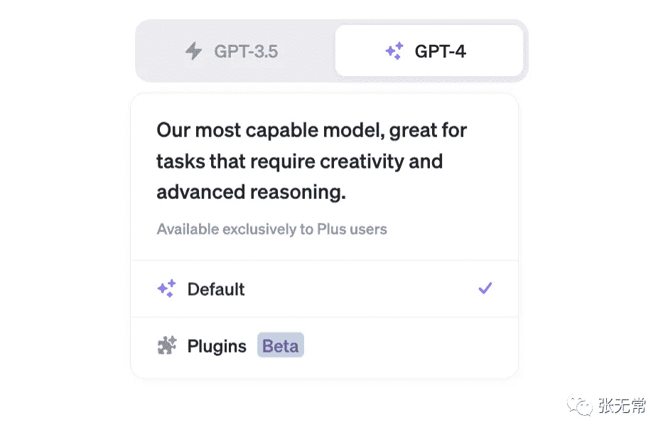
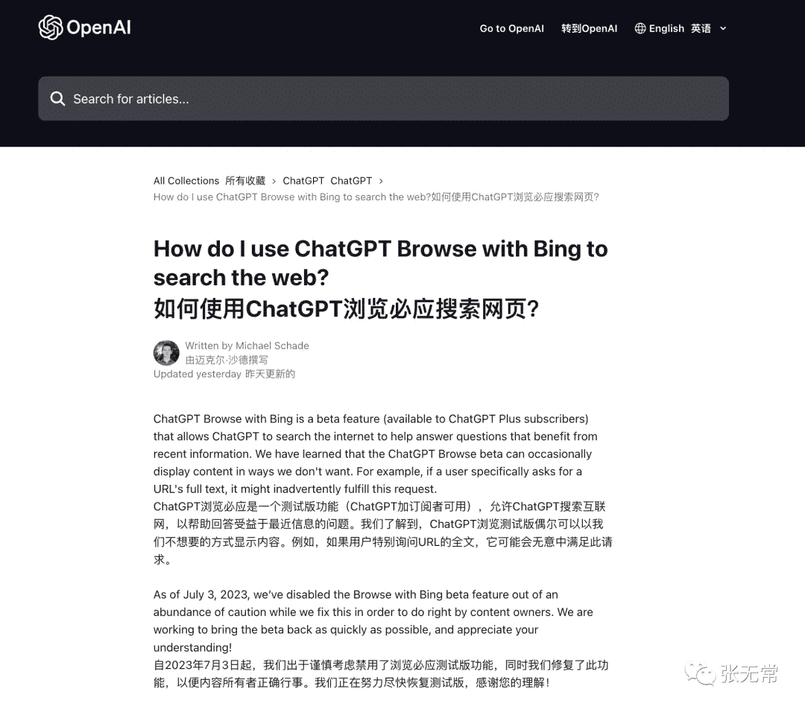
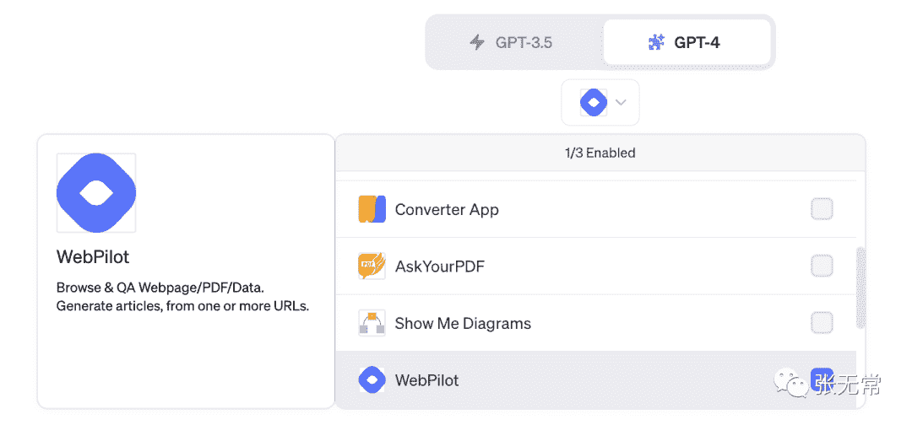
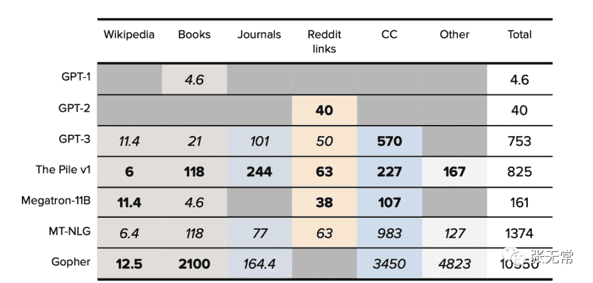

# ChatGPT暂时禁用Bing插件，聊聊这背后的大语言模型数据问题

> 来源：[https://agijuejin.feishu.cn/docx/CcNvd5IxFoRdbQxBxoVciYT7nhX](https://agijuejin.feishu.cn/docx/CcNvd5IxFoRdbQxBxoVciYT7nhX)

> 张海庚｜[阅读原文](https://mp.weixin.qq.com/s?__biz=MzIwODA3MDUwOQ==&mid=2652772268&idx=1&sn=7809ff293e5870806c533fb4bef74de2&chksm=8ce205aebb958cb86002b05159ba3c9b90e1e44eb349d9915007430630ff8116a3852ec7c02b&scene=21#wechat_redirect)

> 转载请联系原作者取得授权

昨天突然发现ChatGPT不能用Bing插件了……

原来OpenAI暂停了ChatGPT插件使用Bing的功能，因为在少量案例里，当用户要求ChatGPT访问一个链接并返回该网页里全部内容的时候，ChatGPT可能「无意中」直接返回全文。

估计引起了付费内容商和内容创作者的抗议，比如对纽约时报、华尔街日报这些付费内容商或者Patreon这种付费平台上的内容创作者，这相当于直接抢了人家的饭碗了。

OpenAI说他们正在加紧修复这个问题。不过我比较好奇是怎么突破付费墙的限制爬取全文的，尤其「无意中」这个词应该意味着是默认支持而非Bing或者ChatGPT特意开发支持的……

当然，想继续联网的用户还是有解决方案的，可以用plugin里的webpolit插件。

这可能只是个不太起眼的小事故，因为我们可以合理猜测现在实际使用联网功能甚至购买了ChatGPT Plus用户应该不多，其次这件事情甚至没有被国内大小AI媒体收录……

**不过我个人更感兴趣的是，是**这后面一个挺重**要的问题： LLM** 时代的数据问题， 具体来说，是 数据蛋糕分配问题。

我试着简单理一下逻辑，重点在于厘清楚问题而不是给解决方案，因为相信从业者们会很快找到后者的：

1、我们都知道，LLM或者说AI本身的三大关键问题是：算法、算力、数据。其中算法拼科研，算力拼钞能力（和地缘政治）买卡，最后一个数据，其实也非常重要， 相当于原材料、做饭食材，没有数据，再强算法、再多算力也白搭。

2、LLM基于大量互联网数据集训练而成，以GPT-3为例，使用的数据集及规模为：维基百科11.4GB、书籍21GB、期刊101GB、Reddit链接50GB、Common Crawl 570GB。量级非常大。

3、其中有部分是开源的如维基百科，但也有部分并不开源，比如美国贴吧Reddit。

4、注意：这里LLM都是免费使用这些数据集训练的。

5、过去，LLM作为一个 带着明显科研色彩、并不怎么跟经济利益挂钩的前沿科技 ，数据所有者们会觉得：你用了也就用了，反正不影响我，再说了你用数据也不赚钱……那就一起为人类做贡献吧。

6、但现在不一样，2022年底ChatGPT「降临」以后，全世界都为LLM疯狂，数据产生的价值被无限放大。

7、于是有了一个明显不合理的 **不平衡：**

1）数据使用者-开发LLM和相关应用的公司估值、市值水涨船高，赚得盆满钵满；

2）数据所有者-Reddit、Twitter、维基百科们却被白嫖，没法从中分得多少蛋糕；

8、叠加这之上的还有另一层 **基础实力的不平衡：**

1）数据使用者-开发LLM的公司其实都是现在世界上技术最先进、经济前景最广阔的公司们；

2）数据所有者：

+   作为全球访问量排名第11的老牌社交媒体网站Reddit属于一直苦于找不到好的商业模式而连年亏损；

+   Twitter类似，加上马斯克收购以后一直想搞事情；

+   维基百科更是一个依赖用户捐赠的非营利性组织。

9 、双重不平衡下，数据所有者提出分蛋糕的需求也就合情合理了，只是处理方式上肯定带着情绪，于是所有人都被卷入、经历阵痛期：

1）2023年4月，Reddit宣布对API接口收费，甚至因为价格过高导致用户和开发者群起而攻之；

2）2023年2月，Twitter宣布于不再免费提供 API 接口； 指责微软一年白嫖超过260亿条推文； 就在前两天，猜测为了限制LLM爬取数据，推特限制了未验证用户刷推特的数量，又叠加前端Bug导致了一次大型宕机事故，乱成一锅粥……

3）维基百科在2021年3月就推出了面向企业的付费API服务……

4）更别说依赖付费墙生存的纽约时报、华尔街日报和各类内容创作者，大家都有情绪。

10、另一边，体面的LLM公司也注意到这个问题了，Sam Altman说，OpenAI在积极和内容公司合作、获得授权，表示愿意为特定领域的高质量数据支付高价。

**1**1、但从终局来看可能不会太乐观， LLM最终会希望覆盖全人类历史上的所有知识，大概率需要人类历史上所有数据的训练，如果都需要收费，LLM公司可能不堪重负 ，奥特曼也说只愿意为特定领域的高质量数据付费。

12、未来怎么解决？ 以史为鉴，可以知兴替。

其实搜索引擎处理过这个问题： 搜索引擎也是收录了大量不属于自己的网站数据，分发给用户 最终大家通过各种方式协商一致，比较好地解决了数据蛋糕的分配问题？

13、但仔细一想，搜索引擎和LLM有不一致的地方：

1）搜索引擎只是收录了网址，实际内容消费还是需要用户进入到数据所有者的落地页，所有者可以实现对应的付费或者其他商业收益。

2）但LLM是直接把数据拿来用的……完全可以不进入到落地页。 LLM太新了，搜索引擎的处理方式不能完美参考。

14、推荐也许有更大的启发意义： 个性化内容推荐平台一开始通过抓取其他站点内容推荐，也引发大量内容所有者的抗议，后来慢慢通过 内容所有者入驻、根据使用数据进行内容收益分成 等方式暂时解决（虽然不完美）数据蛋糕的分配问题，对用户也是好体验。

15、LLM也许可以用类似推荐的方式解决数据蛋糕分配的问题：

1）预训练阶段，除了开源免费数据集，更多通过付费采买覆盖高质量数据集，保证内容所有者收益。

2）产品使用阶段（如联网），通过API调用次数等使用数据信息和使用者进行内容分成。

3）广告分成，NewBing似乎已经在做了……看下来好像都是旧瓶装新酒，也许终局确实如此，只不过在那之前，无论是LLM、数据所有者们，还是我们用户，都得经历阵痛……

> 参考资料：

> 1、https://help.openai.com/en/articles/8077698-how-do-i-use-chatgpt-browse-with-bing-to-search-the-web

> 2、https://mp.weixin.qq.com/s?__biz=MzI5MjE4NzYzNw==&mid=2247486637&idx=1&sn=1888e4d122f6092ee1c26ea4a2175382&chksm=ec047037db73f92194397e981c1b63d2ca0c72c2111fbc8b7a2a5a1b7824029787c0d1e30f47#rd

> 3、https://mp.weixin.qq.com/s/AeF54UKDL5RCPyVHR-XVgQ

> 4、https://mp.weixin.qq.com/s/TtIjFBrtgdIFzvKCs0QKCg

> 5、https://enterprise.wikimedia.com/pricing/

相关阅读：

泄密还是不实消息？披露OpenAI近期路线图的博主把文章删了