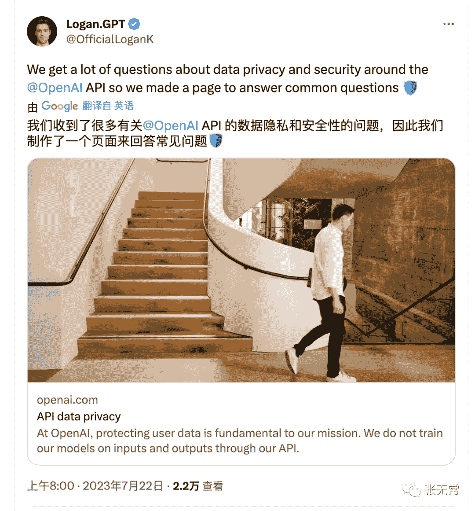
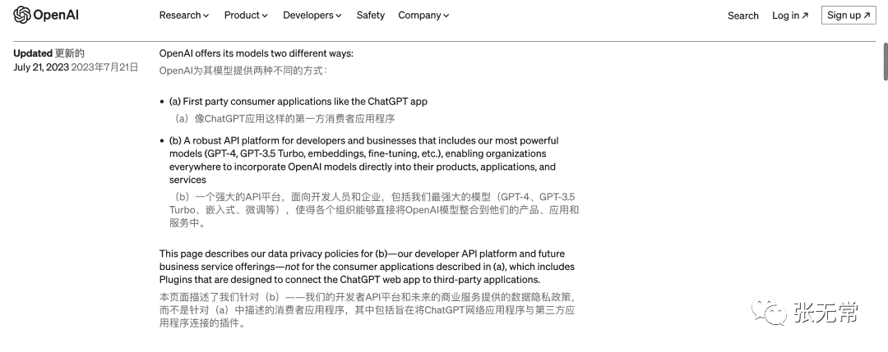
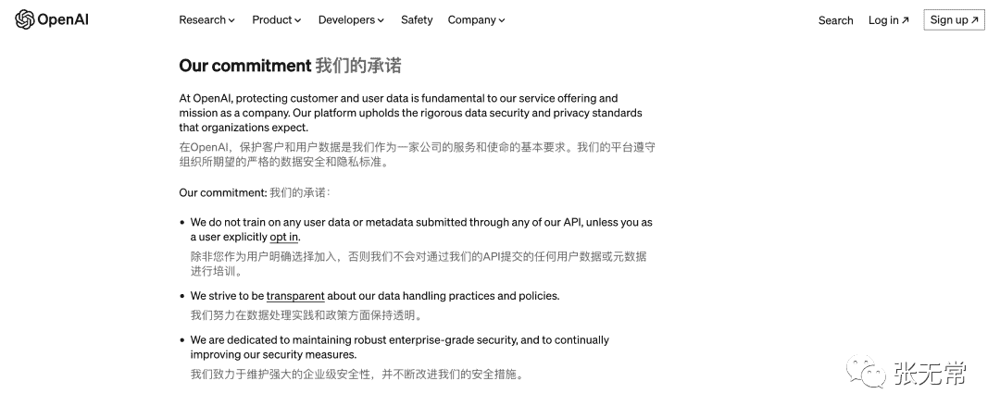
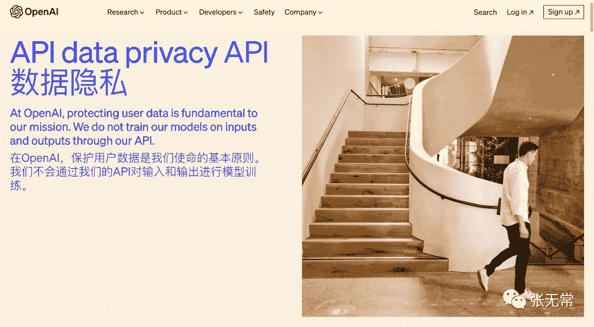
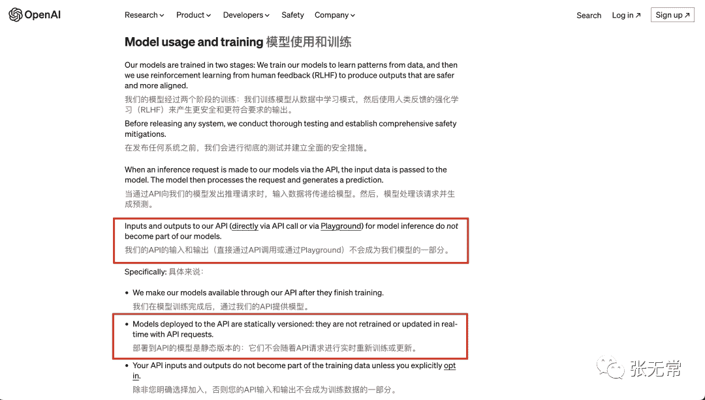
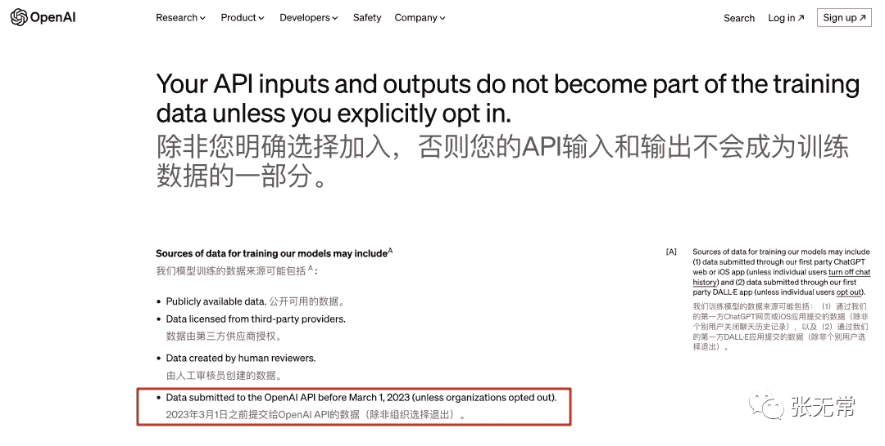
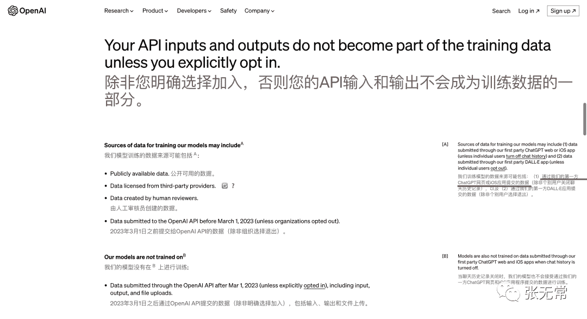
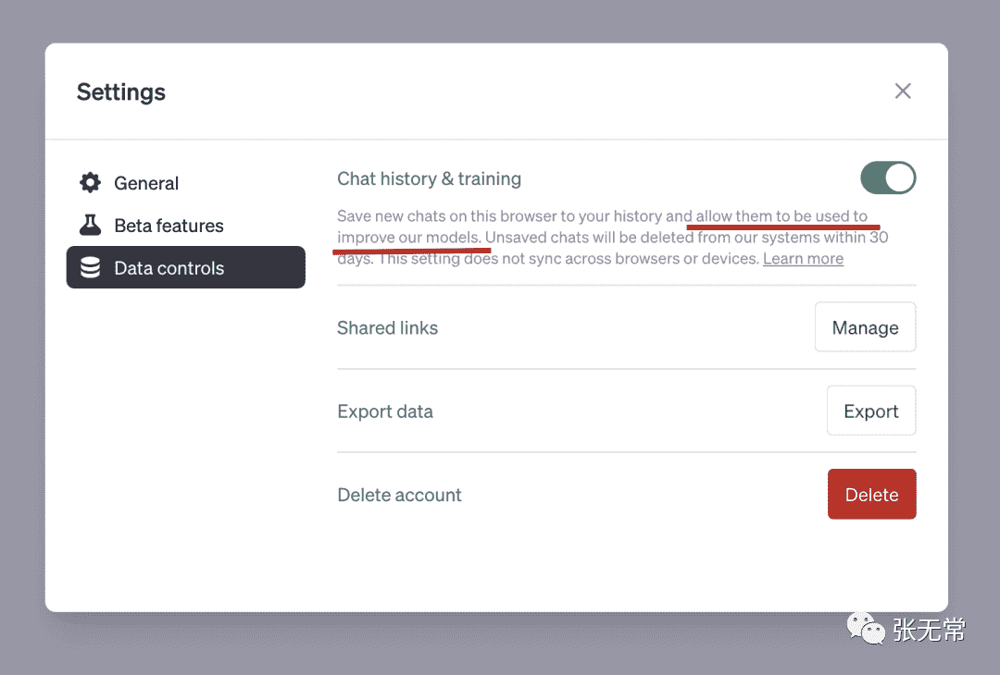
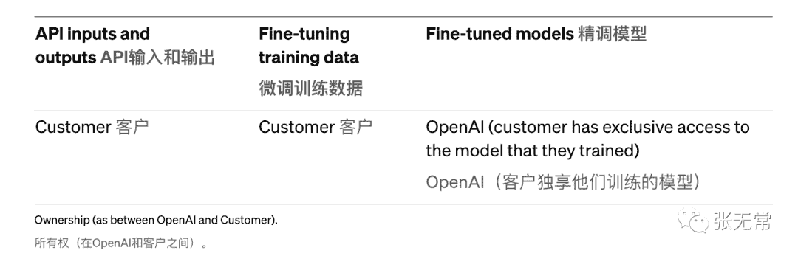
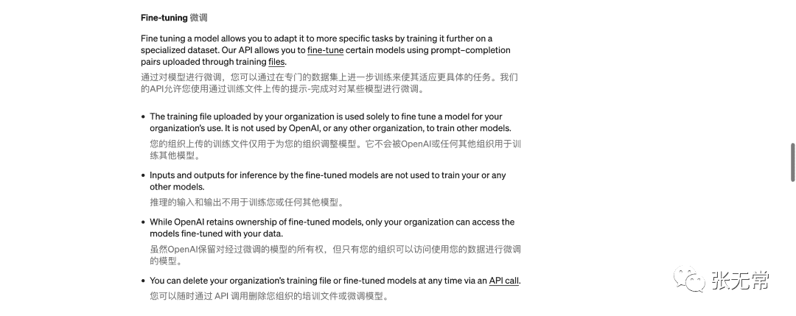

# ChatGPT 侵犯用户隐私了吗？

> 来源：[https://agijuejin.feishu.cn/docx/BufWdHdzpo3jpVxui8mcCTgvnzc](https://agijuejin.feishu.cn/docx/BufWdHdzpo3jpVxui8mcCTgvnzc)

> 张海庚｜[阅读原文](https://mp.weixin.qq.com/s?__biz=MzIwODA3MDUwOQ==&mid=2652772445&idx=1&sn=fea93f2b90edcc73dbcb687354a6197d&chksm=8ce20a5fbb958349705de6100d2eb2158e5b36ab0531103fe1628697cdaa922fa00492abe419&scene=21#wechat_redirect)

> 转载请联系原作者取得授权

用户隐私、 数据安全……数据问题是信息科技发展的重要问题，直接影响用户接受度、用户数量，以及更关键的——监管。

一直以来，关于 OpenAI 如何使用数据、是否滥用用户、侵犯用户隐私，众说纷纭。我观察主要有这么两类观点：

1、 **滥用阴谋论 **：OpenAI 肯定和其他科技公司一样，把我跟ChatGPT、API 对话的数据全部拿去训练了。

2、 **数据飞轮推演论 **：合理推测 OpenAI 的飞速进化，来自于从 2020 年开放 GPT-3 API 以后、开发者调用 API 数据带来的【用户数据积累-模型训练-更好的模型-更多用户使用-更多用户数据积累】的数据飞轮。

连我都观察到了，OpenAI 自不消说，加上有社交媒体巨头的前车之鉴，对于立志实现 AGI 理想的 OpenAI （以及其他）来说，谨慎处理数据隐私和安全问题，就是重中之重。OpenAI 最大竞争对手之一 Anthropic 就是原 OpenAI 安全团队负责人出于安全考虑另起炉灶创立的新公司。

这两天，OpenAI 在官网上发布了一篇博文，详细介绍了 OpenAI API 的数据隐私和安全问题。文章不长，信息量却不小，这里做几点简单的解读。

惯例：破折号（——）前为原文，后为我的解读。

1、OpenAI为其模型提供两种不同的方式：

（a）像ChatGPT应用这样的第一方消费者应用程序

（b）一个强大的API平台，面向开发人员和企业，包括我们最强大的模型（GPT-4、GPT-3.5 Turbo、嵌入式、微调等），使得各个组织能够直接将  OpenAI模型整合到他们的产品、应用和服务中。

**除非您作为用户明确选择加入，否则我们不会对通过我们的A**PI提交的任何用户数据或元数据进行训练。

2、OpenAI 不会通过API对输入和输出进行模型训练。

+   我们的API的输入和输出（直接通过API调用或通过Playground）不会成为我们模型的一部分。 我们在模型训练完成后，通过我们的API提供模型

+   部署到API的模型是静态版本的： 它们不会随着API请求进行实时重新训练或更新。

——这是国内很多用户甚至开发者的误区，很多人会觉得「我上周问ChatGPT答不上来的问题，这周突然可以了，感觉它每天都在变得更聪明」。

其**实，只要稍微熟悉GPT模**型【预训练-微调SFT/FT-基于人类反馈的强化学习RLHF】的基本训练模式就知道， 动态更新几乎是不可能的 ，OpenAI这次也直接官宣「部署到API的模型是静态版本的，它们不会随着API请求进行实时重新训练或更新」，应该可以打消很多人对ChatGPT每时每刻都在进化的美好愿望

**它是进化神速，但仍然需要**每次新模型训练完的部署（ 经常需要几周甚至几个月 ），而不是推荐系统一样，每时每刻优化并更新算法。

对**了，如果你**觉得「我上周问ChatGPT答不上来的问题，这周突然可以了，感觉它每天都在变得更聪明」，大概率是因为 概率问题 ：因为大模型的本质是「预测下一个词」，你可能上次落在一个不符合你预期的概率里，这次落到另一个符合你预期的概率了。

（ChatGPT：不会说可以不说，干嘛要打破我的滤镜 :）

3、我们模型训练的数据来源可能包括 :

2023年3月1日之前提交给OpenAI API的数据（除非组织选择退出）。

不包括：

2023年3月1日之后通过OpenAI API提交的数据（除非明确选择加入），包括输入、输出和文件上传。

——这里其实 **证实了数据飞轮推演论 **：在2020年GPT-3之后到2023年3月1日之前的API使用数据，是会用于训练模型的，之后的数据不会。

4、我们训练模型的数据来源可能包括： 通过我们的第一方ChatGPT网页或iOS应用提交的数据 （除非个别用户关闭聊天历史记录）

——这里明确了 OpenAI会使用你和ChatGPT的聊天记录去训练模型 ，当然，这个信息 已经在ChatGPT新用户弹窗和用户记录页面都提示过了。

5、数据归属：

API 输入数据：客户

微调训练数据：客户

微调模型：OpenAI（客户对他们训练的模型有独家使用权）

您的组织上传的训练文件仅用于为您的组织调整模型。它不会被OpenAI或任何其他组织用于训练其他模型。

——这其实可以打消企业和开发者「上传数据到OpenAI** API**会导致公司机密泄露」的顾虑了， 理论上 。

综上，我觉得这篇博客还是回应得挺到位的，既证伪了一些流言（比如API数据被调用、模型基于我的使用数据实时更新），也证实了一些合理推测（早期API数据是GPT-3之后的模型迅速进化的数据飞轮），值得解读和传播。

当然，正如上个时代我们只能将保护用户隐私的希望寄托在科技大厂们一样，这一切还要取决于你是否相信OpenAI：

**你**是否相信，以Sam Altman为代表的OpenAI这群最聪明的脑袋们，真的不为名利、只为实现对人类安全、有益的AGI？

这是个信仰问题，不讨论，只说一点现实考虑：

在用户和监管最关心的数据隐私问题上冒险、通过滥用用户数据、侵犯用户隐私的方式加快LLM发展，到底是跑步进入AGI、还是南辕北辙、最终弄巧成拙？

---

我一直关心LLM时代的数据问题，之前也写过，感兴趣可戳：

[突发！ChatGPT暂时禁用Bi](https://km3dl0ffdl.feishu.cn/wiki/AodMwApHSiZqyOkCv0WcqOfknDb)ng插件，聊聊这背后的大语言模型数据问题

近期其他 LLM 文章：

+   [别说自己不懂技术，记住你是用户](https://km3dl0ffdl.feishu.cn/wiki/D5Fbwoq5hiPQ2LkV3gMciSkfnIg)

+   [LLM时代的产品设计革命：大模型带来的](https://km3dl0ffdl.feishu.cn/wiki/ATIlwX3PvimTLIk157aco8JKnxJ)人机交互范式的转换是如何影响产品设计的？

+   除了ChatGPT，大模型杀手级应用还没有跑出来的原因是什么？

+   OpenAI 和 ChatGPT 带来的科技发展范式革命

+   [做产品、投资，与借假修真](http://mp.weixin.qq.com/s?__biz=MzIwODA3MDUwOQ==&mid=2652772397&idx=1&sn=702e5bb1d81fb3a2bac410f5335434e4&chksm=8ce20a2fbb958339ac9d4cb718f98d326e2abef39abd7841049667d830a78e95b1394d8a3afa&scene=21#wechat_redirect)

我**是Hayes海庚，一个关**注AI的大厂产品经理/战略，最近打算和更多人交流，如果你也关注这轮AI浪潮，希望和包括 字节、百度、阿里、腾讯 在内的大厂同学一起交流讨论，可在 👸号后台回复「茶水间」或添加🛰️ hayezhang13 进群讨论，麻烦备注【称呼-公司/学校-职位-来意/关注领域】。